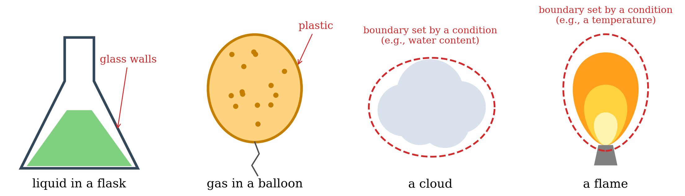

---
aliases:
  - SystemVariables.html
---

# Introduction to Thermodynamics {#sec-SystemVariables}
Why does a match burn once we strike it, while the ashes never turn back into a match? Why does salt dissolve in water but sand does not? How much heat do we get from burning a liter of gasoline, and how much of it can we actually turn into work? And when a reaction stops, why does it stop where it does, and not sooner or later? Every chemist faces questions like these, and thermodynamics is the part of physical chemistry that answers them. The remarkable thing is that thermodynamics answers them without knowing anything about molecules. It works only with quantities that we can measure in the lab, such as temperature, pressure, volume, and heat, and it builds a few simple laws on top of them. Because it does not depend on any particular model of matter, nothing that we will learn about atoms and molecules later will ever force us to change it.

Before we can use these laws, we need a few tools. In this chapter, we will introduce them: a gentle version of calculus, which is the language thermodynamics is written in; the idea of a thermodynamic system, which is the piece of the universe we decide to study; and the variables that describe it, with the important distinction between state and path variables. None of these tools is difficult on its own, but we will use all of them in every chapter that follows, so it is worth taking the time to get comfortable with them now.

## Calculus for Physical Chemistry: Slicing and Gluing

Calculus is a powerful mathematical tool that helps us understand and analyze change. At its core, calculus involves two main procedures: differentiation and integration. These concepts are fundamental to the study of thermodynamics, as they enable us to examine how physical systems change. Undergraduate students often find calculus intimidating due to its rigorous presentation in mathematical courses. However, a strong mathematical foundation, while beneficial, is not always mandatory to study thermodynamics effectively.

If you are a student who lacks confidence in mathematics, I encourage you not to be deterred by the presence of calculus in this physical chemistry textbook. If you break this initial wall of fear for calculus, you might find this textbook quite rewarding. After all, we will finally explain where all those unmemorable formulas that you've been presented in introductory general chemistry courses are coming from. To facilitate your task, we will present in this chapter a simplified view of calculus. The starting point will be a basic question: how do we measure things in science? To answer this question, we will use calculus to measure the length of an object. At a first glance, this approach might seem pedantic. Why do we need to use calculus, with all of its  mathematical complications, when we can just grab a ruler and stack it against our object to measure its length? However, we need to remind ourselves that our ultimate goal is physical chemistry, and calculus is the language of this field. By focusing on the straightforward task of measuring a simple length, we aim to make calculus more accessible and less daunting.^[I apologize in advance to the mathematicians that will read this book and cringe at the several unexplained approximations I have made. I am fully aware of the dangers of not introducing these concepts rigorously, but some compromises have to be made...] From this simple starting point, we will expand our horizon to introduce the central topic of this textbook: Thermodynamics. Our main focus will be on the relationship between chemistry and thermodynamics, but since this is an advanced undergraduate textbook, we will need to do that from a rigorous perspective. If we want to see it in simple terms, we either deal with the approach of not explaining where things are coming from that is abundantly used in freshman chemistry courses, or we make the effort of learning a bit of calculus so we can use it to understand the world.

### Differentiation: Infinite Slicing {#sec-infslici}
Differentiation can be thought of as "slicing an object into infinitely thin pieces" to understand how it changes at a specific point. Imagine you have a long stick and you want to measure how its length changes along a specific direction. To do this, you would cut the stick into infinitely thin slices. Each slice is so thin that its change in length is practically infinitesimal. By examining each of these tiny slices and how they change, you can understand the rate at which the stick’s length changes at any given point. This process of infinite slicing is called differentiation, and it is the most powerful tool to understand things that change, that is, most of the things we are interested in science.

How so? Let's look at a simple example. If we start from a stick of length $L$, we can infinitely slice it into infinitesimally small pieces of length $dL$. These incredibly tiny pieces are called **differentials** of the original quantity, in this particular case, the length of our stick. The beauty of these differentials, $dL$, is that they don't really depend on how long our object initially was: they will always be *infinitesimally small*. Imagine, for example, that you start with an object whose length is $1\, \text{m}$. After you slice it an infinite amount of times, each differential could be pictured as a length of $0.000[...]0001\, \text{m}$, where we have replaced an infinite amount of zeros with the notation $[...]$. If we start instead with a second object whose length is $1\,\text{km}$, we end up with differentials that are just as infinitesimally small. This picture with infinitely many zeros is only a way to visualize the idea: a differential is smaller than any number that we could write down, no matter how many zeros we use.

Now, through some mathematical magic, these strange numbers with an infinite amount of zeros, are essentially the closest thing you can get to $0$, without practically being $0$. For this reason, they can be used much more effectively than something that purely doesn't exist.^[Yes, we are purposely skipping a lot of stuff here, see the note above.] The key word here is *essentially*, because the differentials are as close to zero as we want, but they still contain some fundamental information related to the original objects. In the first place, they still have the dimension (and the units) of the original quantity: $dL$ is an infinitesimal *length*, measured in meters, and it cannot be compared with, say, an infinitesimal time. Additionally, the differentials will also contain information on the rate of change (the "slope") of the length in the original objects. The question that remains is: How are we going to access this apparently hidden information? In other words, how are we going to reconstruct the length of the original object from the differentials? The answer is surprisingly simple: By comparing different differentials to each other. More specifically, despite their zero-ness, we are allowed to calculate the ratio between differentials, such as $\frac{dL}{dx}$. In this specific case, we are calculating the ratio between the differential of the length of our stick, and the position, $x$, along an axis that is oriented the same way as our stick.^[The axis doesn't have to have the same orientation of the stick, but it is easier if we do so, in the first place.] This special ratio is called the *derivative*, and it is fundamental to compare one differential to another. In simple terms, the derivative tells us how one quantity (the one at the top) changes, when we purposely change another (the one at the bottom). Going back to our simple example, the derivative $\frac{dL}{dx}$ tells us how the length of our stick changes when we change the position on the axis. For this case, the derivative is a simple number $\frac{dL}{dx}=1$, but more complicated cases are possible. So, how can we use this information to measure the length of our stick? A second calculus procedure, integration, comes to our rescue.

### Integration: Gluing Together Differentials

Integration is the procedure that glues infinitely tiny slices back together to reconstruct the initial object. In simple terms, if you start with the infinitely thin slices of length that you cut earlier, you can add them all up to find the total length of the stick. Integration takes all these infinitesimally small pieces and combines them into a whole, helping you determine the accumulated total from the infinitesimal changes. Obviously this procedure is very complicated, and it involves gluing (summing over) an infinite amount of infinitesimally small things. If you can't wrap your head around this, that's OK, this concept puzzled humanity for thousands of years. The ancient Greeks were very concerned by this, but they failed to find a solution.^[Look up [Zeno's paradoxes](https://en.wikipedia.org/wiki/Zeno%27s_paradoxes) for an interesting account of the situation at Greece's times.] It took two 17^th^ century geniuses, Isaac Newton and Gottfried Wilhelm Leibniz, to figure out how to do so.

The solution came by first defining the mathematical operation that "undoes" the slicing:

$$
L = \int dL.
$$ {#eq-integraldefgen}

This operation is called an integral, and is represented by the symbol $\int$. The integral is the inverse of $d$, as it reconstructs the original object by gluing together an infinite amount of infinitesimally small differentials. This operation is, in practice, just a sanity check for the differentiation procedure introduced in the previous section. What @eq-integraldefgen is telling us, is nothing other than: if you start from an object, $L$, and apply a certain operation to it ($d$), then there has to be another operation ($\int$) that undoes what the first operation did. This inverse procedure becomes really useful when we want to measure things in the real world. How so? Because we can compare differentials of an unknown quantity to differentials of known ones, and then use the latter to reconstruct the former. In our simple example, we can use the derivative, $\frac{dL}{dx}=1$, to compare the length of the object (unknown) to the position along our axis (known, because we can manipulate it). This is the mathematical counterpart of taking an object with unknown length, and comparing it to the length of a standard stick (a meter, a kilometer, a mile, ...). The formula that describes this operation is:

$$
L=\int dL = \int_{i}^{f} 1 dx = x_f-x_i =\Delta x,
$$ {#eq-integraldef}

where the length ($L$) of the original object is reconstructed by fixing the initial piece at position $x_i$ on the $x$ axis, the final piece at position $x_f$, and then by gluing together the differentials $dx$ in between these points, using the integral procedure. Switching from $dL$ to $dx$ has the noticeable advantage of going from something that we initially don't know anything about (the length of the stick) to something that we can manipulate as much as we want, because we specifically built it for this task (the position along the axis, $x$). This concept, of course, is not limited to length. If we differentiate an area, or a volume, or a pressure, or a temperature using @eq-integraldefgen, we obtain the corresponding differentials. By comparing these differentials to specifically built ones that we are able to manipulate to our will, we can reconstruct the original quantity via integration, using @eq-integraldef. Every differential will retain the *dimension* of the original quantity ($dT$ still retains the dimension of a temperature, a.k.a. it *is* a temperature, despite the fact that it has a value of essentially zero). In addition, every differential will retain *hidden* information about the initial object, which we can reconstruct by comparing to something we know, and then by applying integration to the latter. Notice that it is the operation in @eq-integraldef that turns the infinitesimal pieces back into a finite, measurable quantity, by comparing an unknown differential to a known one. This is effectively the "measuring" procedure, written in mathematical terms.

When we wrote @eq-integraldef, we glanced over the fact that $\int_{i}^{f} 1 dx = x_f-x_i$. Where did that come from? And most importantly, how are we going to manage more complicated cases? At this point, you'll have to go fetch a mathematics textbook, as you need to know how to perform some of those integrals. For all intents and purposes, we can use those formulas as recipes that mathematicians have written in the past. Granted, we are well aware of the fact that if we want to understand where the formulas are coming from, it is possible to do so with a little effort.^[Yes, this is to a degree analogous to the plug and chug approach of general chemistry that we are trying to avoid here. However, we'll let this one pass, otherwise we risk presenting a mathematics textbook, rather than a physical chemistry one.] Mathematicians have clear rules on how to compute many of these objects, and one of such rules tells us that $\int_{i}^{f} dx = x_f-x_i$. Other common integration rules that we'll need in this course are, for example: $\int_{i}^{f} x^{n}\,dx=\left.\frac{x^{n+1}}{n+1}\right| _i^f  =\frac{1}{n+1}\left(x_f^{n+1}-x_i^{n+1}\right)$ for $n\neq -1$, and $\int_{i}^{f} x^{-1} dx=\ln \left|x_f\right|-\ln \left|x_i\right|=\ln \left|\frac{x_f}{x_i}\right|.$

This is indeed a good point to go fetch that old math textbook and refresh some of the simplest integration rules, as well as some of the simplest differentiation ones. Not that we will use all of them, but we might indeed use a few ones.

### Calculus for Thermodynamics
Now comes the interesting question: How are we going to practically perform these two important operations of differentiation and integration in thermodynamics? Well, imagine we need to study the behavior of a machine that prints out a number on a display. The first thing we need to do if we want to study this machine is to find something that makes the number change. Let's represent this something with a knob. We can then turn the knob voluntarily one way or another, and register how the number changes on the display. This is how you apply calculus in thermodynamics (and in most science, for that matter). Our machine might be the length of an object $L$, while our knob might be the position along an axis $x$. We can voluntarily change the position on the axis, and observe how the length changes on the display. Does that sound familiar? Can we use @eq-integraldef to do so? I believe so...

Now, obviously the example of length and position is the simplest we could imagine, and doesn't really pertain to physical chemistry. A more relevant example is that of a gas, whose pressure changes when we change the temperature at constant volume. In this case, the pressure, $P$, is the machine, and the temperature, $T$, is the knob. To understand the machine, we will need to know the derivative $\frac{dP}{dT}$. In many cases the derivative between our machine and our knob(s) might not be as simple as 1. In some of such cases, the derivative might be a different number, while in others it might be as complicated as a function itself. Some of the machines we will encounter might have more than just one knob, each with their own specific derivative, and each as complicated as it might be. In all cases, however, our analysis follows the same procedure: First, we identify all the knobs that affect the machine. Second, we use calculus to voluntarily change the position of the knobs and to register how the machine behaves. In mathematical terms, this procedure is to define and study the total differential:

$$
\begin{aligned}
d\mathcal{M} &= \left( \frac{\partial \mathcal{M}}{\partial a} \right) da + \left( \frac{\partial \mathcal{M}}{\partial b} \right) db + \left( \frac{\partial \mathcal{M}}{\partial c} \right) dc + \cdots ,\\
\end{aligned}
$$ {#eq-totdiff}

where $\mathcal{M}$ is our machine, $d\mathcal{M}$ is its total differential,  $\left\{a,b,c,\cdots\right\}$ are the variables that affect the machine's behavior (i.e. the knobs), and $\frac{\partial \mathcal{M}}{\partial a}$ represents a partial derivative of the machine $\mathcal{M}$ with respect to the variable $a$ obtained by keeping all other variables constant. Notice that the number of variables is left unidentified, as it is our goal to identify all of the variables that a machine depends on, and there are as many as necessary.

{#fig-machineknobs fig-alt="Illustration of a machine drawn as a rounded box with a dark display showing M = 42.0 and three colored knobs labeled a, b, and c. A curved purple arrow above each knob, labeled da, db, and dc, shows a small rotation of that knob." width="70%"}

The final piece of the puzzle we need to apply calculus to thermodynamics is to know whether or not we can apply these two procedures to any quantity that enters the picture. The answer to this question, unfortunately, is a resounding no. Differentiation and integration can be applied to many variables that are "well-behaved." Such variables are called **state variables** in thermodynamics. Unfortunately though, there are also a few variables that are not well-behaved at all. These are called **path variables** in thermodynamics. It turns out that some of the quantities that thermodynamics is mostly concerned about, such as heat and work, belong to this "ill-behaved" category. Before we delve deeper into state and path variables, however, we need to define what variables are in thermodynamics. And before we can do that, we need to take a whole step back and define what thermodynamics is concerned about, that is the thermodynamic system.

## Thermodynamic Systems
A thermodynamic system—or just simply a system—is a portion of space with defined boundaries that separate it from its surroundings (see also the title picture of this book). The surroundings may include other thermodynamic systems or physical systems that are not thermodynamic systems. A boundary may be a real physical barrier or a purely notional one.  Defining a system this way is itself a deliberate simplification that is common in science. This procedure is often jokingly referred to as the "spherical cow" analogy,^[The "spherical cow" analogy is sometimes quoted in its extended, joking form as "a spherical cow in a vacuum." See [Wikipedia's article on the spherical cow](https://en.wikipedia.org/wiki/Spherical_cow) and the article [*Higher multipoles of the cow*, American Journal of Physics 94, 264 (2026)](https://doi.org/10.1119/5.0287411).] where a complex real-world object (a cow) is treated as a simple sphere to make the math tractable. Typical examples of systems are reported in  @Fig-Fig1c1 below.

{#fig-Fig1c1 fig-alt="Drawing of four thermodynamic systems side by side. A green liquid in an Erlenmeyer flask, with the glass walls labeled as the boundary. A balloon filled with gas particles, with the plastic labeled as the boundary. A gray cloud surrounded by a dashed red line, labeled boundary set by a condition, such as water content. A flame on a burner surrounded by a dashed red line, labeled boundary set by a condition, such as a temperature." width="95%"}

In the first case, a liquid is contained in a typical Erlenmeyer flask. The boundaries of the system are the glass walls of the flask (and the surface of the liquid, which separates it from the air above). The second system is represented by the gas contained in a balloon. The boundary is a physical barrier also in this case, being the plastic of the balloon. The third case is that of a thundercloud. The boundary is not a well-defined physical barrier, but rather some condition of pressure and chemical composition at the interface between the cloud and the atmosphere. Finally, the fourth case is the case of an open flame. In this case, the boundary is again non-physical, and possibly even harder to define than for a cloud. For example, we can choose to define the flame based on some temperature threshold, color criterion, or even some chemical one. Despite the lack of physical boundaries, the cloud and the flame—as portions of space containing matter—can be defined as a thermodynamic system.

A system can exchange exclusively mass, exclusively energy, or both mass and energy with its surroundings. Depending on the boundaries' ability to transfer these quantities, a system is defined as open, closed, or isolated. An open system exchanges both mass and energy. A closed system exchanges only energy, but not mass. Finally, an isolated system exchanges neither mass nor energy.

When a system exchanges mass or energy with its surroundings, some of its parameters (variables) change. For example, if a system loses mass to the surroundings, the number of molecules (or moles) in the system will decrease. Similarly, if a system absorbs some energy, one or more of its variables (such as its temperature) increase. Mass and energy can flow into the system or out of the system. Let's consider mass exchange only. If some molecules of a substance leave the system, and then the same amount of molecules flow back into the system, the system will not be modified. We can count, for example, 100 molecules leaving a system and assign them the value of –100 in an outgoing process, and then observe the same 100 molecules going back into the system and assign them a value of +100. Regardless of the number of molecules present in the system in the first place, the overall balance will be –100 (from the outgoing process) +100 (from the ingoing process) = 0, which brings the system to its initial situation (mass has not changed). However, from a mathematical standpoint, we could have equally assigned the label +100 to the outgoing process and –100 to the ingoing one, and the overall total would have stayed the same: +100–100 = 0. Which of the two labels is best? For this case, it seems natural to define a mass going out of the system as negative (the system is losing it), and a mass going into the system as positive (the system is gaining it), but is it as straightforward for energy?

| **Type of System** | **Mass** | **Energy**   (either heat or work) |
|--------------------|:--------:|:--------------------------------:|
| **Open**           |     Y    |                 Y                |
| **Closed**         |     N    |                 Y                |
| **Isolated**       |     N    |                 N                |

> Here is another example. Let's consider a system that is composed of your body. When you exercise, you lose mass in the form of water (sweat) and CO~2~ (from respiration). This mass loss can be easily measured by stepping on a scale before and after exercise. The number you observe on the scale will go down. Hence you have lost weight. After exercise, you will reintegrate the lost mass by drinking and eating. If you have reinstated the same amount you have lost, your weight will be the same as before the exercise (no weight loss). Nevertheless, which label do you attach to the amounts that you have lost and gained? Let’s say that you are running a 5 km race without drinking or eating, and you measure your weight dropping 2 kg after the race. After the race, you drink 1.5 kg of water and eat a 500 g energy bar. Overall you did not lose any weight, and it would seem reasonable to label the 2 kg that you’ve lost as negative (–2)  and the 1.5 kg of water that you drank and the 500 g bar that you ate as positive (+1.5 +0.5 = +2). But is it the only way? After all, you didn’t gain nor lose any weight, so why not calling the 2 kg due to exercise +2 and the 2 that you’ve ingested as –2? It might seem silly, but mathematically it would not make any difference, the total would still be zero. Now, let’s consider energy instead of mass. To run the 5 km race, you have spent 500 kcal, which then you reintegrate precisely by eating the energy bar. Which sign would you put in front of the kilocalories that you “burned” during the race? In principle, you’ve lost them, so if you want to be consistent, you should use a negative sign. But if you think about it, you’ve put quite an effort to “lose” those kilocalories, so it might not feel bad to assign them a positive sign instead. After all, it’s perfectly OK to say, “I’ve done a 500 kcal run today”, while it might sound quite awkward to say, “I’ve done a –500 kcal run today.” Our previous exercise with mass demonstrates that it doesn’t really matter which sign you put in front of the quantities. As long as you are consistent throughout the process, the signs will cancel out. If you’ve done a +500 kcal run, you’ve eaten a bar for –500 kcal, resulting in a total zero loss/gain. Alternatively, if you’ve done a –500 kcal run, you would have eaten a +500 kcal bar, for a total of again zero loss/gain.

These simple examples demonstrate that the sign that we assign to quantities that flow through a boundary is arbitrary (i.e., we can define it any way we want, as long as we are always consistent with ourselves). There is no best way to assign those signs. If you ask two different people, you might obtain two different answers. But we are scientists, and we must make sure to be rigorous. For this reason, chemists have established a convention for the signs that we will follow throughout this course. If we are consistent in following the convention, we are guaranteed to never make any mistake with the signs.

::: {#def-chemistryconv}
*The chemistry convention of the sign is system-centric:*^[Notice that physicists use a different sign convention when it comes to thermodynamics. To eliminate confusion, I will not describe the physics convention here, but if you are reading thermodynamics on a physics textbook, or if you are browsing the web and stumble on thermodynamics formula (e.g., on Wikipedia), please be advised that some quantity, such as work, might have a different sign than the one that is used in this textbook. Obviously, the science will not change, but you need to be *always* consistent, so if you decide that you want to use the physics convention, make sure to *always* use the physics convention. In this course, on the other hand, we will *always* use the chemistry one, as defined here.]

- *If something (energy or mass) goes **into** the system it has a **positive** sign (the system is gaining)*
- *If something (energy or mass) goes **out of** the system it has a **negative** sign (the system is losing)*
:::

If you want a trick to remember the convention, use the weight loss/gain during the exercise example above. You are the system, if you lose weight, the kilograms will be negative (–2 kg), while if you gain weight, they will be positive (+2 kg). Similarly, if you eat an energy bar, you are the system, and you will have increased your energy by +500 kcal (positive). In contrast, if you burned energy during exercise, you are the system, and you will have lost energy, hence –500 kcal (negative). If the system is a balloon filled with gas, and the balloon is losing mass, you are the balloon, and you are losing weight; hence the mass will be negative. If the balloon is absorbing heat (likely increasing its temperature and increasing its volume), you are the system, and you are gaining heat; hence heat will be positive.

## Thermodynamic Variables
The system is defined and studied using parameters that are called variables. These variables are quantities that we can measure, such as pressure and temperature. However, don’t be surprised if, on some occasions, you encounter variables that are a little harder to measure directly, such as entropy. If we know the values of all the “relevant variables” of a system, we know the state of the system. The relationships between all possible variables and the state of the system are called "state functions". Imagine state functions as the "machines" that we described in the previous section. The relevant variables are called natural variables, and you should imagine them as the "knobs" of the machines that we want to study. When we need to study a specific aspect of the system, then we need to know the total differential of the state function that is relevant for that aspect.

What are the “relevant variables” of a system? The answer to this question depends on the system, and it is not always straightforward. The simplest case is the case of an ideal gas, for which the natural variables are those that enter the ideal gas law and the corresponding equation:

$$
PV=nRT
$$ {#eq-idealgaslaworiginal}

Therefore, the natural variables for an ideal gas are the pressure $P$, the volume $V$,  the number of moles $n$, and the temperature $T$, with $R$ being the ideal gas constant. Recalling from the general chemistry courses, $R$ is a universal dimensional constant which has the value of $R = 8.31 \,\text{J}\, \text{mol}^{-1}\, \text{K}^{-1}$ in SI units. We will use the ideal gas equation and its variables as an example to discuss variables and functions in this chapter. We will analyze more complicated cases in the next chapters. Variables can be classified according to numerous criteria, each with its advantages and disadvantages. A typical classification is:

- **Physical variables** ($P$, $V$, $T$ in the ideal gas law): independent of the chemical composition of the system.
- **Chemical variables** ($n$ in the ideal gas law): dependent on the chemical composition of the system.

Alternatively, another useful classification is:

- **Intensive variables** ($P$, $T$ in the ideal gas law): independent of the physical size (extension) of the system.
- **Extensive variables** ($V$, $n$ in the ideal gas law): dependent on the physical size (extension) of the system.

When we deal with thermodynamic systems, it is more convenient to work with intensive variables. Luckily, it is relatively easy to convert extensive variables into intensive ones by just taking the ratio between the two of them. For an ideal gas, by taking the ratio between $V$ and $n$, we obtain the intensive variable called molar volume:

$$
\overline{V}=\frac{V}{n}.
$$ {#eq-Vmdef}

We can then recast @eq-idealgaslaworiginal as:

$$
P\overline{V}=RT,
$$ {#eq-idealgaslaw}

which is the preferred equation that we will use for the remainder of this course.
The ideal gas equation connects the 3 variables pressure, molar volume, and temperature, reducing the number of independent variables to just 2. In other words, once 2 of the 3 variables are known, the other one can be easily obtained using these simple relations:

$$
P(T,\overline{V})=\frac{RT}{\overline{V}},
$$ {#eq-PTVm}

$$
\overline{V}(T,P)=\frac{RT}{P},
$$ {#eq-VmTP}

$$
T(P,\overline{V})=\frac{P\overline{V}}{R}.
$$ {#eq-TPVm}

These equations define three state functions, each one expressed in terms of two independent natural variables. For example, @eq-PTVm defines the state function called “pressure”, expressed as a function of temperature and molar volume. Similarly, @eq-VmTP defines the “molar volume” as a function of temperature and pressure, and @eq-TPVm defines the “temperature” as a function of pressure and molar volume. As we mentioned above, when we know the natural variables that define a state function, we can express the function using its total differential, for example for the pressure $P(T, \overline{V})$, using the definition of total differential in @eq-totdiff, we get:

$$
dP=\left( \frac{\partial P}{\partial T} \right)dT + \left( \frac{\partial P}{\partial \overline{V}} \right)d\overline{V}
$$ {#eq-totaldifferentialP}

Recalling Schwarz’s theorem, the mixed partial second derivatives that can be obtained from @eq-totaldifferentialP are the same:

$$
\frac{\partial^2 P}{\partial T \partial \overline{V}}=\frac{\partial}{\partial \overline{V}}\frac{\partial P}{\partial T}=\frac{\partial}{\partial T}\frac{\partial P}{\partial \overline{V}}=\frac{\partial^2 P}{\partial \overline{V} \partial T}
$$ {#eq-schwartzP}

Which can be easily verified considering that:

$$
\frac{\partial}{\partial \overline{V}} \frac{\partial P}{\partial T}  = \frac{\partial}{\partial \overline{V}} \left(\frac{R}{\overline{V}}\right) = -\frac{R}{\overline{V}^2}
$$ {#eq-secondderPA}

and

$$
\frac{\partial}{\partial T} \frac{\partial P}{\partial \overline{V}}  = \frac{\partial}{\partial T} \left(\frac{-RT}{\overline{V}^2}\right) = -\frac{R}{\overline{V}^2}
$$ {#eq-secondderPB}

While for the ideal gas law, all the variables are “well-behaved” and always satisfy Schwarz’s theorem, we will encounter some variables for which Schwarz’s theorem does not hold.

### State and Path Variables

Mathematically, if Schwarz’s theorem is violated (i.e., if the mixed second derivatives are not equal), then the corresponding function cannot be integrated. These ill-behaved variables are called **path variables** (or path functions) because they depend on the path, rather than the state of the system. In contrast to these ill-behaved variables, well-behaved variables that can be used to define the state of the system are called **state variables** (or state functions).

Since path functions violate Schwarz’s theorem, their differential cannot be defined exactly, therefore @eq-integraldef does not exist. The most typical examples of path functions that we will encounter in the next chapters are heat ($Q$) and work ($W$). For these functions, we can attempt to infinitely slice the initial variable by using the same calculus procedure introduced in @sec-infslici and defined in @eq-integraldefgen. The resulting infinitely small pieces, however, are different than regular "exact" differentials, and are called **inexact differentials**.  To differentiate between exact and inexact differentials, we use the letter $d$ for the former, and the letter $đ$ for the latter. It is important to remember that inexact differentials are defined using @eq-integraldefgen, but the procedure in @eq-integraldef does not exist for them. Summarizing for a case that we will use often in thermodynamics, we can define the following quantity for heat ($Q$):

$$
Q = \int đQ.
$$ {#eq-intdbarQ}

However, we cannot use the familiar formula given by @eq-integraldef to calculate it:

$$
\int_{i}^{f} đQ \neq Q_f - Q_i,
$$ {#eq-intdbarQfull}

as the left hand side of this equation is not defined.^[Technically, the integral itself does exist, but it takes different values when calculated along different paths, so it is not unique.] Work also behaves similarly.

> We will return to exact and inexact differentials when we discuss heat and work, but for this chapter, it is crucial to notice the difference between a state function and a path function. A typical example to understand the difference between state and path function is to consider the distance between two geographical locations. Let’s, for example, consider the distance between New York City and Los Angeles. If we fly straight from one city to the other, there are roughly 4,000 km between them. This “air distance” depends exclusively on the geographical location of the two cities. It stays constant regardless of the method of transportation that I have access to travel between them. Since the cities' positions depend uniquely on their latitudes and longitudes, the “air distance” is a state function, i.e., it is uniquely defined from a simple relationship between measurable variables. However, the “air distance” is not the distance that I will practically have to drive when I go from NYC to LA. Such “travel distance” depends on the method of transportation that I decide to take (airplane vs. car vs. train vs. boat vs. …). It will depend on a plentiful amount of other factors such as the choice of the road to be traveled (if going by car), the atmospheric conditions (if flying), and so on. A typical “travel distance” by car is, for example, about 4,500 km, which is about 12% more than the “air distance.” Indeed, we could even design a very inefficient road trip that avoids all highways and will result in a “travel distance” of 8,000 km or even more (200% of the “air distance”). The “travel distance” is a clear example of a path function because it depends on the specific path that I decide to travel to go from NYC to LA. See @Fig-Fig2c1.

{#fig-Fig2c1 fig-alt="Map of the United States with New York (A) and Los Angeles (B). A straight purple arc between them is labeled air distance, about 4,000 km, state function. A winding blue road route is labeled travel distance, about 4,500 km, path function." width="60%"}

## Chapter Review {#sec-rev1}
### Key Ideas
- **Calculus is slicing and gluing.** A differential, such as $dL$, is an infinitesimally small piece of a quantity; differentiation slices, and integration glues the pieces back together.
- **The total differential** of a function of several variables adds up the effect of each variable: $d\mathcal{M} = \left(\frac{\partial \mathcal{M}}{\partial a}\right) da + \left(\frac{\partial \mathcal{M}}{\partial b}\right) db + \cdots$.
- **A system** is the part of the universe we choose to study. Open systems exchange mass and energy, closed systems only energy, and isolated systems neither.
- **Sign convention:** in chemistry, energy that enters the system (heat absorbed, work done on it) is positive, and energy that leaves it is negative.
- **Variables are intensive or extensive.** Intensive ones (such as $T$ and $P$) do not depend on the size of the system; extensive ones (such as $V$ and $n$) do.
- **State and path variables.** State variables depend only on the current state and have exact differentials; heat and work are path variables, with inexact differentials, $đQ$ and $đW$.

### Study Questions {#sec-quest1}
**1. What is a differential, such as $dL$?**

a. The derivative of $L$ with respect to position.
b. A small but finite change in $L$, such as 1 mm.
c. An infinitesimally small piece of $L$ that keeps the dimension of a length.
d. The total length $L$ of the object.
e. A pure number with no dimension.

---

**2. What does integration do, in the language of this chapter?**

a. It glues together infinitely many infinitesimal pieces to reconstruct the whole quantity.
b. It slices a quantity into infinitesimal pieces.
c. It calculates the slope of a function at a point.
d. It converts a quantity from one unit to another.
e. It removes the dimension from a quantity.

---

**3. Which of the following does an isolated system exchange with its surroundings?**

a. Mass only.
b. Energy only.
c. Both mass and energy.
d. Neither mass nor energy.
e. Heat, but not work.

---

**4. According to the chemistry sign convention, what is the sign of the heat released by a system to its surroundings?**

a. Positive, since heat is energy.
b. Negative, since the system is losing energy.
c. Zero, since energy is conserved.
d. Positive if the process is fast, negative if it is slow.
e. It depends on the temperature of the surroundings.

---

**5. Which of the following is an intensive variable?**

a. Volume.
b. Number of moles.
c. Mass.
d. Temperature.
e. Total energy.

---

**6. What is the total differential of the pressure of an ideal gas, $P(T,\overline{V})$?**

a. $dP = \frac{dT}{d\overline{V}}$.
b. $dP = PdT + Pd\overline{V}$.
c. $dP = \frac{\partial P}{\partial T} + \frac{\partial P}{\partial \overline{V}}$.
d. $dP = \left(\frac{\partial T}{\partial P}\right)dT + \left(\frac{\partial \overline{V}}{\partial P}\right)d\overline{V}$.
e. $dP = \left(\frac{\partial P}{\partial T}\right)dT + \left(\frac{\partial P}{\partial \overline{V}}\right)d\overline{V}$.

---

**7. What does Schwarz's theorem state for a state function?**

a. The mixed second partial derivatives are equal, regardless of the order of differentiation.
b. The first derivatives are always zero.
c. The function cannot be integrated.
d. The function depends on the path.
e. The second derivatives are always positive.

---

**8. Which of the following is a path function?**

a. Pressure.
b. Temperature.
c. Work.
d. Molar volume.
e. Internal energy.

---

**9. What does the symbol $đ$ indicate, as in $đQ$?**

a. An exact differential.
b. An inexact differential, whose integral depends on the path.
c. A partial derivative.
d. A state function.
e. A very large change.

---

**10. In the example of the trip from New York to Los Angeles, why is the air distance a state function?**

a. Because it depends on the means of transportation.
b. Because it changes with the weather.
c. Because it depends only on the positions of the two cities, not on the route.
d. Because it is always longer than the travel distance.
e. Because it is measured in kilometers.

---

::: {.callout-tip collapse="true" icon="false"}
## Answers

1.c, 2.a, 3.d, 4.b, 5.d, 6.e, 7.a, 8.c, 9.b, 10.c
:::
