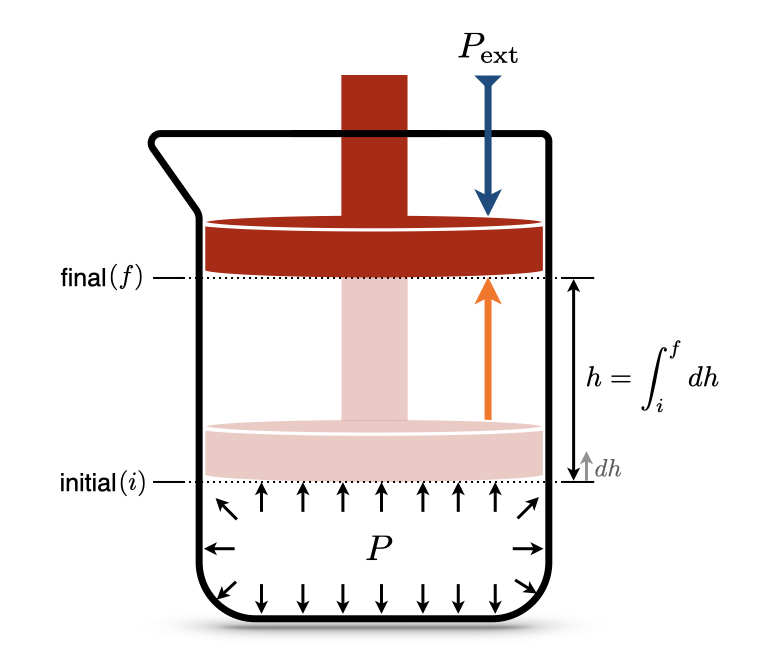
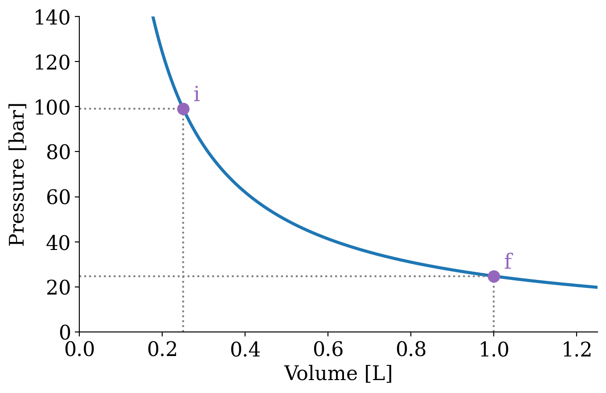
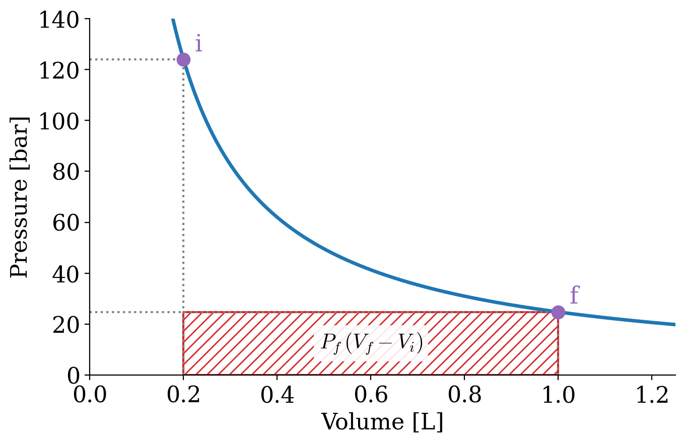
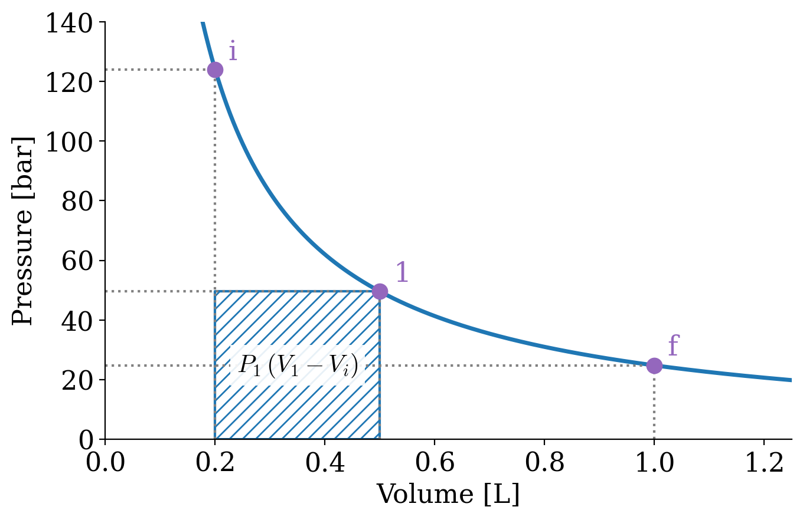
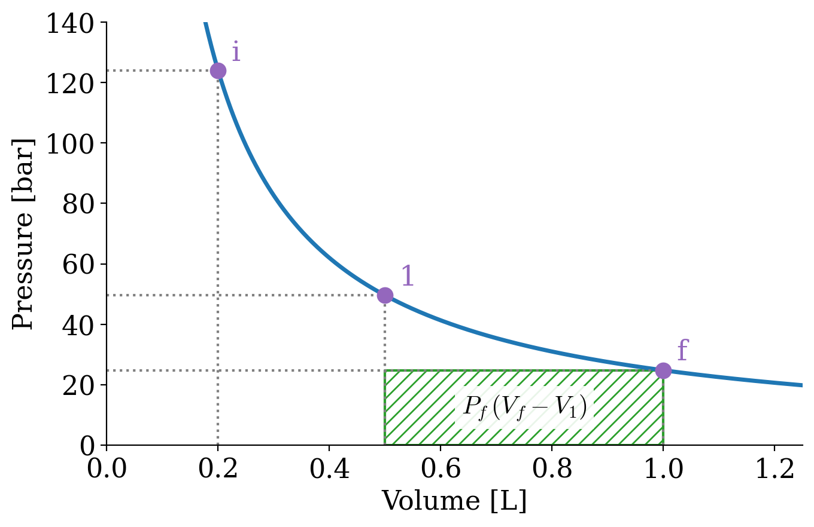
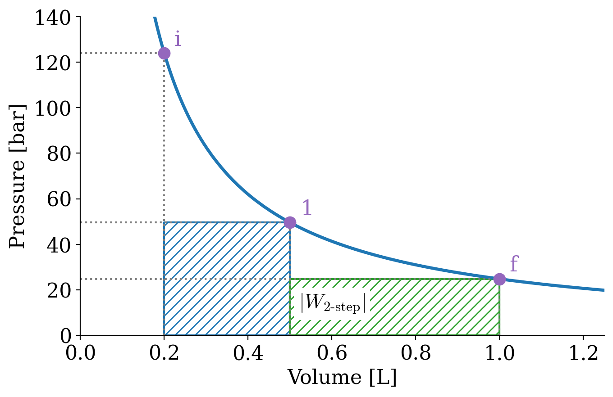
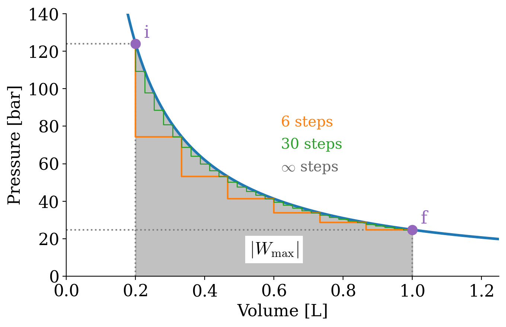

---
aliases:
  - ZerothLaw.html
---

# Zeroth Law of Thermodynamics {#sec-ZerothLaw}
In @sec-SystemVariables, we introduced the tools that we need to study thermodynamics: a bit of calculus, the definition of a system, and the distinction between state and path functions. In this chapter, we will define the two ways in which a system can exchange energy with its surroundings, heat and work, and we will learn how to calculate them. Before we do that, however, we need a solid definition of temperature, which comes from the zeroth law of thermodynamics.

## What is Thermodynamics?
Thermodynamics is the branch of science that deals with heat and work, and their relation to energy. These are the two ways in which energy can be transferred between a system and its surroundings:

- **Work** is exchanged when the system changes one of its external, macroscopic parameters against a force. The typical example in chemistry is a gas that changes its volume by pushing a piston against an external pressure.
- **Heat** is exchanged because of a temperature difference between the system and its surroundings, without any change in the external parameters. Heat flows through the random collisions between the molecules at the boundary, from the hotter side to the colder one.

As we saw in @sec-SystemVariables, heat and work are not "well-behaved" quantities because they are path functions. While it might be simple to measure the amount of heat and/or work experimentally, these measured quantities cannot be used to define the state of a system. Since heat and work are path functions, their values depend directly on the methods used to transfer them (their paths). Understanding and quantifying these energy transfers is the reason why thermodynamics was developed in the first place. The origins of thermodynamics date back to the eighteenth and nineteenth centuries, when steam engines started to be used to convert heat into work for technological applications. These early scientists needed a mathematical tool to understand how heat and work were related to each other, and how they were related to the other variables that they were able to measure, such as temperature and volume.

Before we even discuss the definition of energy and how it relates to heat and work, it is crucial to introduce the essential concept of temperature. Temperature is an intuitive concept that has a surprisingly complex definition at the microscopic level.^[In fact, we will not even give a rigorous microscopic definition of temperature within this textbook.] However, for all our purposes, it is not essential to have a microscopic definition of temperature, as long as we have the guarantee that this quantity can be measured unambiguously. In other words, we only need a mathematical definition of temperature that agrees with the physical existence of thermometers.

## The Zeroth Law of Thermodynamics
We all know from experience that if we put a hot object in contact with a cold one, after some time they reach the same temperature, and heat stops flowing between them. When this happens, we say that the two objects are in *thermal equilibrium*. The zeroth law of thermodynamics states that if two thermodynamic systems are each in thermal equilibrium with a third one, then they are in thermal equilibrium with each other. The law might appear trivial and possibly redundant, but it is exactly what makes thermometers possible: the thermometer is the third system, and if it reads the same temperature when in contact with two different objects, we can conclude that the two objects are in thermal equilibrium with each other, even if they have never touched. For this reason, the zeroth law is a fundamental requirement for the mathematical formulation of thermodynamics, and it needs to be stated. The zeroth law can be summarized by the following simple mathematical relation:

::: {#def-zerothlaw}
*Zeroth Law of Thermodynamics:* If $T_A = T_B$, and $T_B = T_C$, then $T_A = T_C$.
:::

Notice that when we state the zeroth law, it appears intuitive. However, this is not necessarily the case. Let’s, for example, consider a pot of boiling water at $P=1\;\mathrm{bar}$. Its temperature, $T_{H_2O}$, is about 373 K. Let’s now submerge in this water a coin made of wood and another coin made of metal. After some sufficient time, the wood coin will be in thermal equilibrium with the water, and its temperature $T_W = T_{H_2O}$. Similarly, the metal coin will also be in thermal equilibrium with the water, hence $T_M = T_{H_2O}$. According to the zeroth law, the temperature of the wood coin and that of the metal coin are precisely the same $T_W = T_M = 373\;\mathrm{K}$, even if they are not in direct contact with each other. Now here’s the catch: since wood and metal transmit heat in different manners, if I take the coins out of the water and put them immediately in your hands, one of them will feel just warm, but the other will burn you. If you had to guess the temperature of the two coins without a thermometer, and without knowing that they were immersed in boiling water, would you suppose that they have the same temperature? Probably not.

## Calculation of Heat {#sec-heatint}
Heat ($Q$) is a property that gets transferred between substances. Similarly to work, the amount of heat that flows through a boundary can be measured, but its mathematical treatment is complicated because *heat is a path function*.
As you probably recall from general chemistry, the ability of a substance to absorb heat is given by a coefficient called the heat capacity, which is measured in SI in $\frac{\text{J}}{\text{mol K}}$. However, since heat is a path function, these coefficients are not unique, and we have different ones depending on how the heat transfer happens.

### Processes at constant volume (isochoric)
The heat capacity at constant volume measures the ability of a substance to absorb heat at constant volume. Recalling from general chemistry, the molar heat capacity at constant volume has the following formal definition:

> The molar heat capacity at constant volume is the amount of heat required to increase the temperature of 1 mol of a substance by 1 K at constant volume.

This is a procedural definition that defines how we can measure $C_V$ in practice. While this procedure is useful in laboratory settings and in introductory chemistry courses, we need to go beyond it to understand its origin and its meaning. Have you ever wondered why you need to increase the temperature by 1 K? What if you want to increase it by 2? Or 1/2, or 1/1000? Also, the definition is highly imprecise, as there certainly has to be a difference when we increase the temperature of a substance from 1 K to 2 K, to when we increase it from 1001 K to 1002 K. Those situations certainly cannot lead to the same results. How are we going to circumvent this poor definition? We need to apply calculus to remove those arbitrary units and arbitrary increments (remember that differentials are all the same size, and unitless):

$$
C_V = \frac{đ Q_V}{n dT} \Rightarrow đ Q_V = n C_V dT.
$$ {#eq-Cvdef}

This new differential definition of $C_V$ is independent of the unit we use to measure it, and does not require a procedural definition. Given a known value of $C_V$, the amount of heat that gets transferred can be easily calculated by measuring the changes in temperature, after integration of @eq-Cvdef:

$$
đ Q_V = n C_V dT \rightarrow \int đ Q_V = n \int_{T_i}^{T_f}C_V dT \rightarrow Q_V = n C_V \int_{T_i}^{T_f}dT,
$$ {#eq-Cvint1}

which, assuming $C_V$ independent of temperature, simply becomes:

$$
Q_V \cong n C_V \Delta T.
$$ {#eq-Cvint}

### Processes at constant pressure (isobaric) {#sec-heatconstp}
Similarly to the previous case, the heat capacity at constant pressure measures the ability of a substance to absorb heat at constant pressure. Recalling again from general chemistry:

> The molar heat capacity at constant pressure is the amount of heat required to increase the temperature of 1 mol of a substance by 1 K at constant pressure.

And once again, applying calculus to obtain a differential definition of $C_P$, we get:

$$
C_P = \frac{đ Q_P}{n dT} \Rightarrow đ Q_P = n C_P dT \rightarrow \int đ Q_P = n \int_{T_i}^{T_f}C_P dT,
$$ {#eq-Cpdef}

which results in the simple formula:

$$
Q_P \cong n C_P \Delta T.
$$ {#eq-Cpint}

## Calculation of Work {#sec-workint}
In thermodynamics, work ($W$) is the ability of a system to transfer energy by exerting a force on its surroundings. Work can be measured simply by evaluating its effects, such as displacing a massive object by some amount of space. The mathematical treatment of work, however, is complicated because *work is a path function*. In the following sections, we will analyze how work is calculated in some prototypical situations commonly encountered in the thermodynamical treatment of systems.  

{#fig-Fig2c3 fig-alt="Beaker closed by a movable piston. The gas inside pushes on the piston with pressure P from below, while the external pressure pushes down from above. The piston rises from an initial position i to a final position f, a total height h obtained by summing the small displacements dh." width="50%"}

Let's consider the situation in @Fig-Fig2c3, where a special beaker with a piston that is free to move is filled with an ideal gas. The beaker sits on a desk, so the piston is not subject to any external forces other than the external pressure, $P_{\text{ext}}$, and the internal pressure of the gas, $P$.^[For this simple thought experiment, we will ignore any external force that is not significant. In other words, we will not consider the friction of the piston on the beaker walls or any other foreign influence.] The piston is initially compressed to a position that is not in equilibrium $(i)$. After the process, the piston reaches a final equilibrium position $(f)$. How do we calculate the work ($W$) performed by the system?

From basic physics, we recall that the infinitesimal amount of work associated with an object moving in space is given by the force acting on the object ($F$) multiplied by the infinitesimal amount it gets displaced ($d h$):

$$
đ W = - Fdh,
$$ {#eq-Wphysics}

where the negative sign comes from the chemistry sign convention, @Def-chemistryconv, since the work in @Fig-Fig2c3 is *performed* by the system (expansion). Which force should we use? When the gas expands, the work it performs is the energy needed to push back the surroundings, so the relevant force is the one that the surroundings exert on the piston. Relying upon another definition from physics, the pressure is the ratio between the force ($F$) and the area ($A$) that such force acts upon, so the force exerted by the surroundings is related to the external pressure, $P_{\text{ext}}$, by:

$$
P_{\text{ext}} = F/A.
$$ {#eq-Pphysics}

Obtaining $F$ from @eq-Pphysics and replacing it in @eq-Wphysics, we obtain:

$$
đ W = - P_{\text{ext}} \underbrace{Adh}_{dV},
$$ {#eq-Wphysics2}

and considering that $Adh$ (area times infinitesimal height) is the definition of an infinitesimal volume $dV$, we obtain:

$$
đ W = - P_{\text{ext}}dV.
$$ {#eq-Wdef}

The external pressure is not necessarily the same as the pressure of the gas, $P$. In a fast expansion, the gas inside the beaker can be at a much higher pressure than the surroundings. However, if the expansion happens slowly enough that the piston is always balanced, $P_{\text{ext}}=P$ at every moment, and the work can be written using the pressure of the gas:

$$
đ W = - PdV \qquad \text{(when } P_{\text{ext}}=P\text{)}.
$$ {#eq-Wdefrev}

If we want to calculate the amount of work performed by a system, $W$, from @eq-Wdef, we need to recall that $đ W$ is an inexact differential. As such, we cannot integrate it from initial to final as for the (exact) differential of a state function, because:

$$
\int_{i}^{f}đ W \neq W_f - W_i,
$$ {#eq-Wdiff}

but rather:

$$
\int_{\text{path}} đ W = W,
$$ {#eq-Wdiff2}

where the integration is performed along the *path*. Using @eq-Wdiff2, we can integrate @eq-Wdef as:

$$
\int đ W = W = - \int_{i}^{f} P_{\text{ext}}dV,
$$ {#eq-Wint}

where the integral on the left-hand side is taken along the path,^[from here on we will replace the notation $\int_{\text{path}}$ with the more convenient $\int$ and we will keep in mind that the integral of an inexact differential must be taken along the path.] while the integral on the right-hand side can be taken between the initial and final states, since $V$ is a state function.
How do we solve the integral in @eq-Wint? It turns out that there are many different ways to solve this integral (perhaps not surprisingly, since the left-hand side depends on the path), which we will explore in the next section.

### $| W_{\text{max}} |$ and  $| W_{\text{min}} |$ in processes at constant temperature (isothermal)
At constant temperature, the piston in @Fig-Fig2c3 moves along the isotherm in @fig-pvIso, obtained for 1 mol of an ideal gas at $T=298$ K.

{#fig-pvIso fig-alt="Pressure-volume plot of an ideal-gas isotherm at 298 K, a curve that falls as volume increases. The initial state i is at small volume and high pressure, and the final state f is at 1 L and low pressure, with dotted lines to their pressures and volumes." width="70%"}

An expansion of the gas will happen between $P_i$ and $P_f$. If the expansion happens in a one-step fast process, for example against external atmospheric pressure, then we can consider such final pressure constant (for example $P_f=P_{\text{ext}} =1\;\mathrm{bar}$), and solve the integral as: 

$$
W_{\text{1-step}} = - \int_{i}^{f} P_{\text{ext}}dV = -P_{\text{ext}} \int_{i}^{f} dV = -P_{\text{ext}} (V_f-V_i).
$$ {#eq-Wint3}

Notice how the work is negative, since during an expansion the work is performed by the system (recall the chemistry sign convention). The absolute value of the work^[we use the absolute value to avoid confusions due to the fact that the expansion work is negative according to @Def-chemistryconv.] represents the red area in @fig-pv1step:

{#fig-pv1step fig-alt="Same isotherm. A red hatched rectangle under the final pressure, from the initial to the final volume, represents the work of a one-step expansion, equal to the final pressure times the volume change." width="70%"}

$$
\left| W_{\text{1-step}} \right| = P_{\text{ext}} (V_f-V_i)
$$ {#eq-Warea1}

If the process happens in two steps by pausing at an intermediate position (1) until equilibrium is reached, then we should calculate the work by dividing it into two separate processes, $A$ and $B$, and solve each one as we did in the previous case. The first process is an expansion between $P_i$ and $P_1$, with $P_1$ constant. The absolute value of the work, $W_A$, is represented by the blue area in @fig-pv2stepA:

{#fig-pv2stepA fig-alt="Same isotherm with an intermediate state 1. A blue hatched rectangle under the intermediate pressure, from the initial volume to the intermediate volume, represents the work of the first step." width="70%"}

$$
\left| W_A \right| = P_1 (V_1-V_i)
$$ {#eq-Warea2}

The second process is an expansion between $P_1$ and $P_f$, with $P_f=P_{\text{ext}}$ constant. The absolute value of the work for this second process is represented by the green area in @fig-pv2stepB:

{#fig-pv2stepB fig-alt="Same isotherm with the intermediate state 1. A green hatched rectangle under the final pressure, from the intermediate volume to the final volume, represents the work of the second step." width="70%"}

$$
\left| W_B \right| = P_f (V_f-V_1)
$$ {#eq-Warea3}

The total absolute value of the work for the 2-step process is given by the sum of the two areas, as in @fig-pv2step:

{#fig-pv2step fig-alt="Same isotherm with the blue and green rectangles of the two-step expansion together. Their combined area is larger than the single rectangle of the one-step expansion." width="70%"}

$$
\left| W_{\text{2-step}} \right| = \left| W_A \right| + \left| W_B \right| = P_1 (V_1-V_i)+P_f (V_f-V_1).
$$ {#eq-Warea4}

As can be easily verified by comparing the shaded areas in the plots, $\left| W_{\text{2-step}} \right| > \left| W_{\text{1-step}} \right|$.

We can easily extend this procedure to consider processes that happen in 3, 4, 5, ..., $n$ steps. What is the limit of this procedure? In other words, what happens when $n \rightarrow \infty$? A simple answer is given by @fig-pvmax, which clearly demonstrates that the maximum value of the area underneath the curve $\left| W_{\text{max}}\right|$ is achieved in an $\infty$-step process. In this limit, each step is infinitesimally small, the external pressure is always equal to the pressure of the gas, and we can use @eq-Wdefrev to calculate the work as:

$$
\left| W_{\infty \text{-step}} \right| = \left| W_{\text{max}} \right| = \sum_{n}^{\infty} P_n(V_n-V_{n-1}) = \int_{i}^{f} PdV.
$$ {#eq-WintsolvedV2}

{#fig-pvmax fig-alt="Same isotherm with the whole area under the curve, from the initial to the final volume, shaded gray and labeled absolute value of the maximum work. An orange staircase of six steps and a finer green staircase of thirty steps under the curve show how a multi-step expansion approaches this area; the gray area corresponds to infinitely many steps." width="70%"}

The integral on the right hand side of @eq-WintsolvedV2 can be solved for an ideal gas by calculating the pressure using the ideal gas law $P=\frac{nRT}{V}$, and solving the integral since $n$, $R$, and $T$ are constant:

$$
\left| W_{\text{max}} \right| = nRT \int_{i}^{f} \frac{dV}{V} = nRT \ln \frac{V_f}{V_i}.
$$ {#eq-WmaxV}

This example demonstrates why work is a path function. If we perform a fast 1-step expansion, the system will perform an amount of work that is much smaller than the amount of work it can perform if the expansion between the same points happens slowly in an $\infty$-step process.

The same considerations that we made up to this point for expansion processes apply in reverse to compression ones. The only difference is that the work associated with compressions will have a positive sign since it must be performed onto the system. As such, the amount of work for a transformation that happens in a finite number of steps will be an upper bound to the minimum amount of work required to compress the system.^[In contrast to a lower bound for expansion processes.] $\left| W_{\text{min}} \right|$ for compressions is calculated as the area underneath the $PV$ curve, exactly as $\left| W_{\text{max}} \right|$ for expansions in @eq-WintsolvedV2.

## Chapter Review {#sec-rev2}
### Study Questions {#sec-quest2}
**1. What does the zeroth law of thermodynamics state?**

a. If two systems are each in thermal equilibrium with a third one, then they are in thermal equilibrium with each other.
b. The energy of the universe is conserved.
c. The entropy of the universe increases.
d. Heat always flows from hot to cold objects.
e. The entropy of a perfect crystal is zero at 0 K.

---

**2. A wooden coin and a metal coin are left for a long time in boiling water. What can we say about their temperatures?**

a. The metal coin is hotter, because it burns when touched.
b. The wooden coin is hotter, because wood is an insulator.
c. We cannot say anything without a thermometer.
d. They have the same temperature, even if they feel different to the touch.
e. Their temperatures depend on their masses.

---

**3. What is the differential definition of the molar heat capacity at constant volume?**

a. $C_V = \frac{Q_V}{\Delta T}$.
b. $C_V = \frac{đQ_V}{n\,dT}$.
c. $C_V = n\,đQ_V\,dT$.
d. $C_V = \frac{dT}{đQ_V}$.
e. $C_V = \frac{đQ_P}{n\,dT}$.

---

**4. How is the heat exchanged at constant pressure calculated, assuming $C_P$ independent of temperature?**

a. $Q_P = n C_V \Delta T$.
b. $Q_P = P \Delta V$.
c. $Q_P = nRT \ln \frac{V_f}{V_i}$.
d. $Q_P = 0$.
e. $Q_P = n C_P \Delta T$.

---

**5. Why is the work of an expansion negative in the chemistry sign convention?**

a. Because the volume decreases.
b. Because the pressure is negative.
c. Because the work is performed by the system, which loses energy.
d. Because the temperature decreases.
e. Because work is a path function.

---

**6. What is the work for a one-step expansion against a constant external pressure?**

a. $W = -P_{\text{ext}}(V_f-V_i)$.
b. $W = P_{\text{ext}}(V_f-V_i)$.
c. $W = -nRT \ln \frac{V_f}{V_i}$.
d. $W = 0$.
e. $W = n C_V \Delta T$.

---

**7. A gas expands isothermally between the same initial and final states in one step, in two steps, or in infinitely many steps. In which case is the absolute value of the work the largest?**

a. One step.
b. Two steps.
c. It is the same in all cases.
d. Infinitely many steps.
e. It depends on the gas.

---

**8. What is the absolute value of the maximum work for the isothermal expansion of an ideal gas?**

a. $\left|W_{\text{max}}\right| = P_{\text{ext}}\Delta V$.
b. $\left|W_{\text{max}}\right| = nRT \ln \frac{V_f}{V_i}$.
c. $\left|W_{\text{max}}\right| = nR\Delta T$.
d. $\left|W_{\text{max}}\right| = n C_V \Delta T$.
e. $\left|W_{\text{max}}\right| = nRT\frac{V_f}{V_i}$.

---

**9. What do the one-step, two-step, and infinitely-many-step expansions demonstrate?**

a. That work is a state function.
b. That the temperature changes during an isothermal process.
c. That heat and work are the same thing.
d. That the ideal gas law is not valid.
e. That work depends on how the process is carried out between the same initial and final states.

---

**10. How must a compression be performed to require the minimum amount of work?**

a. As fast as possible, in one step.
b. In two steps.
c. Infinitely slowly, in infinitely many steps.
d. At constant volume.
e. Against zero external pressure.

---

::: {.callout-tip collapse="true" icon="false"}
## Answers

1.a, 2.d, 3.b, 4.e, 5.c, 6.a, 7.d, 8.b, 9.e, 10.c
:::
