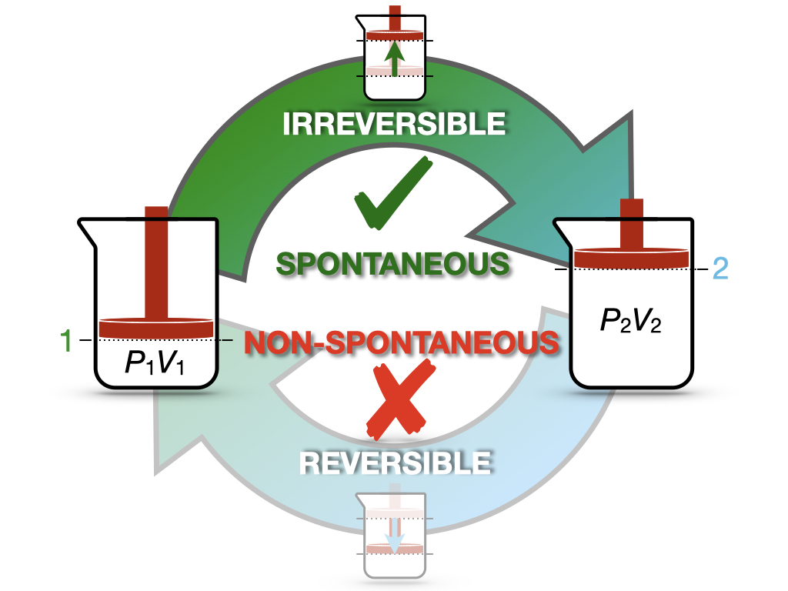
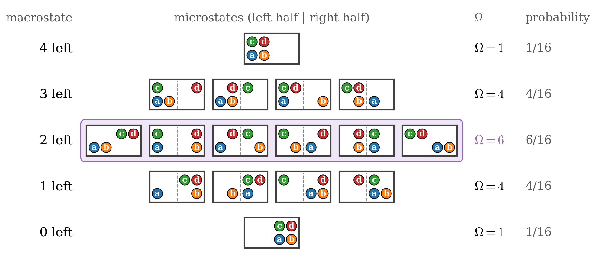

---
aliases:
  - SecondLaw.html
  - 06_SecondLaw.html
---

# Entropy and the Second Law of Thermodynamics {#sec-SecondLaw}
In @sec-ThermodynamicCycles, we used heat engines to understand why some processes are spontaneous while others are not, and we found that no engine can convert all the heat it absorbs into work. Carnot's findings did not just inspire Lord Kelvin on this subject, but they also motivated Rudolf Clausius (1822–1888) to introduce a new state function, the *entropy*. In this chapter, we will follow Clausius' reasoning to define the entropy, we will use it to write the second law of thermodynamics, and we will then look at the same quantity from the microscopic point of view of Boltzmann, to understand what entropy really measures.

## Entropy {#sec-entropyint}
Let's return to the efficiency of a Carnot cycle, and bring together the two expressions that we found in @eq-effCC2 and @eq-effCC3:

$$
\varepsilon = 1+\frac{Q_3}{Q_1} = 1-\frac{T_l}{T_h}.
$$ {#eq-effcQT}

Subtracting 1 from both sides, we obtain $\frac{Q_3}{Q_1}=-\frac{T_l}{T_h}$. We can then multiply both sides by $\frac{Q_1}{T_l}$, which separates the quantities related to the cold reservoir from the ones related to the hot reservoir:

$$
\frac{Q_3}{T_l} = -\frac{Q_1}{T_h},
$$ {#eq-effcQTrearr}

or, moving everything to the left-hand side:

$$
\frac{Q_3}{T_l} + \frac{Q_1}{T_h} = 0.
$$ {#eq-effcQTrearr2}

The left-hand side of @eq-effcQTrearr2 is a sum of two terms, one for each isothermal stage of the Carnot cycle. Each term is the heat exchanged during that stage, divided by the temperature at which it is exchanged. Since, according to @Def-carnotcycle, each transformation in a Carnot cycle is reversible, these are heats exchanged at reversible conditions, $Q_{\mathrm{REV}}$. The two adiabatic stages do not contribute, since no heat is exchanged during them.

Is this result special to the Carnot cycle? To find out, let's look at the heat exchanged by an ideal gas along *any* reversible path, not just along isotherms and adiabats. From the first law, the reversible heat is $đQ_{\mathrm{REV}} = dU - đW_{\mathrm{REV}}$. Since the internal energy of an ideal gas depends only on its temperature (@sec-isothermalE), $dU = nC_V\,dT$ for any process, and the reversible work is $đW_{\mathrm{REV}} = -P\,dV = -\frac{nRT}{V}dV$. Therefore:

$$
đQ_{\mathrm{REV}} = nC_V\,dT + \frac{nRT}{V}\,dV.
$$ {#eq-dQrevIG}

This looks like a total differential, @eq-totdiff, but it is not one. If we apply the Schwarz test of @sec-SystemVariables to the two coefficients, the derivative of $nC_V$ with respect to $V$ is zero, while the derivative of $\frac{nRT}{V}$ with respect to $T$ is $\frac{nR}{V}$. The two mixed derivatives are different, as we expect for the heat, which is a path function. Now let's divide both sides of @eq-dQrevIG by the temperature:

$$
\frac{đQ_{\mathrm{REV}}}{T} = \frac{nC_V}{T}\,dT + \frac{nR}{V}\,dV.
$$ {#eq-dQrevTIG}

This time, the derivative of $\frac{nC_V}{T}$ with respect to $V$ is zero, and the derivative of $\frac{nR}{V}$ with respect to $T$ is also zero. The test is passed: @eq-dQrevTIG is an exact differential.^[In fact, we can integrate it directly: if $C_V$ is constant, $\frac{đQ_{\mathrm{REV}}}{T} = d\left(nC_V \ln T + nR \ln V\right)$.] Dividing by $T$ removed the $T$ from the coefficient of $dV$, which was the only thing that made the heat path-dependent. And since the integral of an exact differential around a closed path is always zero, for *any* reversible cycle of an ideal gas we have:

$$
\oint \frac{đQ_{\mathrm{REV}}}{T} = 0.
$$ {#eq-ds0}

The Carnot result, @eq-effcQTrearr2, is just a special case: along the two isotherms we add $\frac{Q}{T}$, and along the two adiabats we add nothing.

We have proved @eq-ds0 only for the ideal gas, but the result is general. Carnot showed that every reversible engine working between the same two temperatures has the same efficiency, whatever substance it contains (otherwise, coupling two different engines would let us move heat from a cold body to a hot one with no other effect, which, as we will see in this chapter, never happens). Since the efficiency fixes $\frac{Q_3}{Q_1}$, @eq-effcQTrearr2 holds for the Carnot cycles of every substance, and from there one can show that @eq-ds0 holds for any reversible cycle of any substance. We will not go through this general proof, which requires more work than it is worth here; the ideal-gas calculation already shows the essential point.

@Eq-ds0 is a remarkable result. The heat, $đQ$, is a path function, and its integral around a cycle is in general *not* zero. However, if we take the heat exchanged reversibly and divide it by the temperature, we obtain a quantity whose integral around *any* reversible cycle is zero. As we saw for the energy in @eq-de0, this is precisely the property that defines a state function: when we go back to the starting point, we always find the same value. Clausius realized this in 1865, and he decided to call the new state function *entropy*, and to indicate it with the letter $S$:

::: {#def-entropy}
*Entropy:* The state function $S$ whose infinitesimal change is equal to the heat exchanged at reversible conditions, divided by the temperature at which it is exchanged:
$$
dS = \frac{đQ_{\mathrm{REV}}}{T}.
$$ {#eq-dentropy}
:::

For a transformation between an initial and a final state, the change in entropy is obtained by integration along any reversible path that connects the two states:

$$
\Delta S = S_f - S_i = \int_i^f \frac{đQ_{\mathrm{REV}}}{T}.
$$ {#eq-dentropyint}

Let's unpack @Def-entropy:

1. **Dividing by $T$ turns a path function into a state function.** In @sec-SystemVariables, we introduced inexact differentials, such as $đQ$, which cannot be integrated as differences between final and initial values. @Eq-dentropy tells us that, for reversible processes, dividing $đQ_{\mathrm{REV}}$ by the temperature turns it into the exact differential of a state function, $dS$. Mathematicians call $1/T$ an *integrating factor*.
2. **Only the reversible heat works.** The heat exchanged along an irreversible path is different, and dividing it by $T$ does *not* give $dS$. To calculate the entropy change of an irreversible process, we must find a reversible path between the same initial and final states and calculate $\Delta S$ along that path. Since the entropy is a state function, the result is valid for the irreversible process as well.
3. **The same heat matters more at low temperature.** The entropy change produced by a given amount of heat is larger when the heat is exchanged at a low temperature than at a high temperature. Intuitively, giving 1 kJ of heat to a cold object changes it more than giving the same 1 kJ to a hot one.
4. **The units of entropy are energy divided by temperature**, $\text{J/K}$ in SI. The entropy is an extensive property, and its molar version, $\overline{S}$, is measured in $\text{J}\,\text{mol}^{-1}\,\text{K}^{-1}$.
5. **Only changes in entropy are defined, for now.** @Eq-dentropyint gives us differences in entropy, but not absolute values. We will see in @sec-thirdlaw that the third law of thermodynamics fixes the zero of the entropy scale.

## Irreversible Cycles

Up to this point, we have discussed *reversible* cycles only. What happens when the cycle is irreversible? In @sec-ThermodynamicCycles, we saw that the efficiency of a Carnot cycle, @eq-effCC3, is the maximum efficiency that any cycle working between two temperatures can reach. Any real (irreversible) cycle loses some energy along the way, for example to friction, and its efficiency is always smaller than the Carnot one. Therefore, @eq-effcQT does not hold anymore for an *irreversible* cycle, and it must be replaced by an inequality:

$$
\overbrace{1+\frac{Q^{\mathrm{IRR}}_3}{Q^{\mathrm{IRR}}_1}}^{\varepsilon_{\mathrm{IRR}}} < \overbrace{1-\frac{T_l}{T_h}}^{\varepsilon_{\mathrm{REV}}}.
$$ {#eq-effcIRR}

Following exactly the same steps used in @sec-entropyint (subtracting 1 from both sides and multiplying by $\frac{Q^{\mathrm{IRR}}_1}{T_l}$, which is positive, so the direction of the inequality does not change), we obtain:

$$
\frac{Q^{\mathrm{IRR}}_3}{Q^{\mathrm{IRR}}_1} < - \frac{T_l}{T_h} \longrightarrow \frac{Q^{\mathrm{IRR}}_3}{T_l} + \frac{Q^{\mathrm{IRR}}_1}{T_h} < 0 \longrightarrow \sum_i \frac{Q_{\mathrm{IRR},i}}{T_i} < 0,
$$ {#eq-effcIRR2}

which, using the same calculus procedure as before, becomes:

$$
\oint \frac{đQ_{\mathrm{IRR}}}{T} < 0.
$$ {#eq-dqirrineq}

Putting @eq-ds0 and @eq-dqirrineq together, we obtain:

$$
\oint \frac{đQ}{T} \leq 0,
$$ {#eq-clausiusineq}

where the equal sign holds for reversible cycles exclusively, while the inequality sign holds for irreversible ones. @Eq-clausiusineq is known as the **Clausius inequality**. In words, it tells us that around an irreversible cycle, the system always gives away more "heat divided by temperature" than it absorbs. This is the mathematical version of the fact that some of the energy that goes through a real engine is always wasted.

## The Second Law of Thermodynamics {#sec-secondlaw}
We are now ready to use the Clausius inequality to understand spontaneity. Let's consider an isolated system that undergoes an irreversible transformation from state 1 to state 2, and then let's bring it back from state 2 to state 1 along a reversible path, as in @Fig-FigJexpC2.

{#fig-FigJexpC2 fig-alt="Cycle between state 1 (pressure P1, volume V1) and state 2 (pressure P2, volume V2). The top arrow, from 1 to 2, is labeled irreversible and spontaneous with a green check mark. The bottom arrow, from 2 to 1, is labeled reversible and non-spontaneous with a red cross." width="80%"}

This cycle is similar to the one in @Fig-FigJexpC for the Joule expansion experiment: the gas expands spontaneously into the vacuum (1 $\rightarrow$ 2), but it never goes back on its own (2 $\rightarrow$ 1). To bring it back, we must compress it from the outside.^[Strictly speaking, during the reversible compression the system cannot be isolated, since a reversible return to state 1 requires exchanging heat and work with the surroundings. This does not affect our argument: we use the reversible path only as a tool to calculate the entropy change between states 1 and 2, and since the entropy is a state function, the result does not depend on how we actually bring the system back. This is therefore a plausibility argument rather than a rigorous proof, but it leads to the correct result.] Since the cycle contains an irreversible step, it is irreversible overall, and the Clausius inequality, @eq-clausiusineq, gives:

$$
\int_1^2 \frac{đQ_{\mathrm{IRR}}}{T} + \int_2^1 \frac{đQ_{\mathrm{REV}}}{T} < 0.
$$ {#eq-qirrcycle1}

The second integral is taken along a reversible path, so, according to @eq-dentropyint, it is the entropy change from state 2 to state 1, which is $-\Delta S$, where $\Delta S=S_2-S_1$ is the entropy change of the forward process. Moving it to the right-hand side, we obtain:

$$
\underbrace{\int_1^2 \frac{đQ_{\mathrm{REV}}}{T}}_{\Delta S} > \underbrace{\int_1^2 \frac{đQ_{\mathrm{IRR}}}{T}}_{=0},
$$ {#eq-qirrcycle2}

where the right-hand side is zero because the system is isolated during the forward process, and therefore $đQ_{\mathrm{IRR}}=0$. @Eq-qirrcycle2 simply becomes:

$$
\Delta S > 0.
$$ {#eq-secondlaweq}

What does @eq-secondlaweq tell us?

1. **In an isolated system, spontaneous processes increase the entropy.** Every irreversible process that happens on its own in an isolated system has $\Delta S > 0$. Spontaneous processes are always irreversible, since reversible processes are idealizations that require infinitely slow, controlled changes.
2. **The entropy changes even if no heat is exchanged.** In the Joule expansion, $Q=0$, and yet $\Delta S>0$. This is not a contradiction: the entropy change must be calculated along a reversible path between the same states, and along that path heat *is* exchanged. We will calculate this value in @sec-thirdlaw.
3. **The reverse process would decrease the entropy**, and it never happens on its own in an isolated system. This is why the gas never goes back to one side of the box.

Since the only system that is truly isolated is the universe, we can write a concise statement for a new fundamental law of thermodynamics:

::: {#def-secondlawdef}
*Second Law of Thermodynamics:* For any spontaneous process, the entropy of the universe increases.
:::

Historically, the second law was first stated in terms of heat and engines, in two classical forms that we can now derive from the entropy:

- **Clausius statement:** heat cannot flow spontaneously from a colder body to a hotter one. If the heat $Q>0$ moved on its own from a reservoir at $T_l$ to one at $T_h > T_l$, the entropy of the universe would change by $-\frac{Q}{T_l}+\frac{Q}{T_h} < 0$.
- **Kelvin statement:** no cyclic process can absorb heat from a single reservoir and convert it entirely into work. After a full cycle, the entropy of the engine is unchanged, while the reservoir loses the entropy $\frac{Q}{T}$, so the entropy of the universe would decrease.

The two statements are equivalent: a device that violated one of them could be combined with an ordinary engine or refrigerator to violate the other. Both are contained in Kelvin's 1851 words that we quoted at the end of @sec-ThermodynamicCycles.

The entropy also lets us complete the distinction between quasi-static and reversible processes that we started in @sec-FirstLaw. Consider two large reservoirs, at $T_h$ and $T_l$, connected by a thin rod that conducts heat very poorly. Heat flows so slowly that both reservoirs pass only through equilibrium states, and the process is quasi-static. Yet, when the heat $Q$ moves from the hot reservoir to the cold one, the entropy of the universe changes by $\frac{Q}{T_l}-\frac{Q}{T_h}>0$, and the process is irreversible: the heat will never flow back on its own. A slow process is reversible only if, in addition, there are no finite differences of temperature (or pressure) between the system and its surroundings, and no friction.

## Boltzmann Entropy

Up to this point, we have treated entropy as a macroscopic quantity, defined through heat and temperature. This definition is powerful, but it does not tell us what entropy *is* at the level of molecules, which is where chemistry happens. The microscopic meaning of entropy was found by Ludwig Eduard Boltzmann (1844–1906), who connected it to the number of ways in which the molecules of a system can be arranged.

To understand Boltzmann's idea, we need to distinguish between two ways of describing a system:

- A **macrostate** is described by the macroscopic variables that we can measure, such as pressure, volume, and temperature.
- A **microstate** is a complete specification of where every single molecule is and how it moves.^[Positions and velocities are continuous quantities, so to count microstates we have to divide space into small cells, and only ask which cell each molecule is in. Quantum mechanics, which we will study in P-Chem 2, makes this counting exact, since the energy levels of molecules are discrete.]

Many different microstates correspond to the same macrostate, since we can swap molecules around without changing the pressure or the temperature. The number of microstates that correspond to a given macrostate is called its **multiplicity**, and is indicated with $\Omega$.

### Counting Microstates
Let's see how this works with a simple example. Consider a box divided into two halves, left and right, containing just four molecules, which we label $a$, $b$, $c$, and $d$. Each molecule can be in either half, and we consider as a macrostate the number of molecules in the left half. The microstates are all the possible ways of assigning each molecule to one of the two halves:

| Molecules on the left | Microstates (molecules on the left) | $\Omega$ |
|:---:|:---|:---:|
| 4 | $abcd$ | 1 |
| 3 | $abc$, $abd$, $acd$, $bcd$ | 4 |
| 2 | $ab$, $ac$, $ad$, $bc$, $bd$, $cd$ | 6 |
| 1 | $a$, $b$, $c$, $d$ | 4 |
| 0 | none | 1 |

: Microstates of four molecules in a box divided into two halves. {#tbl-microstates}

The same microstates are drawn in @fig-microstates, where each box is one microstate, and each row collects the microstates that belong to the same macrostate.

{#fig-microstates fig-alt="Five rows of small boxes, each split in half by a dashed line, containing four colored molecules labeled a, b, c, and d. The top row, 4 left, has one box with all molecules on the left, multiplicity 1, probability 1 in 16. The second row, 3 left, has four boxes, multiplicity 4, probability 4 in 16. The middle row, 2 left, highlighted in purple, has six boxes, multiplicity 6, probability 6 in 16. The fourth row, 1 left, has four boxes, multiplicity 4. The bottom row, 0 left, has one box with all molecules on the right, multiplicity 1." width="95%"}

There are $2^4=16$ microstates in total. If the molecules move around randomly, each microstate is equally likely, and the probability of each macrostate is proportional to its multiplicity. Notice three things in @tbl-microstates:

1. **The evenly distributed macrostate is the most probable.** Two molecules on each side has $\Omega=6$, which corresponds to a probability of $6/16$, almost 40%.
2. **The macrostate with all molecules on one side is the least probable.** It has $\Omega=1$, so its probability is only $1/16$.
3. **The effect becomes overwhelming for many molecules.** With $N$ molecules, the probability of finding all of them on the left is $1/2^N$. For $N=100$ molecules, this is about $10^{-30}$. For a mole of gas, with $N\approx 6\times 10^{23}$, it is so small that it will never be observed. This is why the gas in the Joule experiment never goes back to one side of the box: not because it is forbidden, but because it is overwhelmingly improbable.

### The Boltzmann Equation
Boltzmann connected the multiplicity to the thermodynamic entropy through the formula that became famous as the **Boltzmann equation**:

$$
S = k_B \ln \Omega,
$$ {#eq-boltzmanneq}

where $k_B$ is the Boltzmann constant, $k_B = R/N_A = 1.380649 \times 10^{-23} \, \text{J/K}$, with $R$ being the ideal gas constant and $N_A$ Avogadro's constant. The Boltzmann constant is the ideal gas constant "per molecule", and it is the conversion factor between the microscopic counting of $\Omega$ and the macroscopic entropy measured in $\text{J/K}$.

Why the logarithm? If we put together two independent systems, the number of microstates of the combined system is the *product* of the two multiplicities, $\Omega=\Omega_1\Omega_2$, since every microstate of the first can be combined with every microstate of the second. However, the entropy is extensive, so the entropy of the combined system must be the *sum* of the two entropies. The logarithm is the function that turns products into sums: $k_B\ln(\Omega_1\Omega_2)=k_B\ln\Omega_1+k_B\ln\Omega_2$.

Let's now check that Boltzmann's entropy agrees with Clausius' one, using the expansion of an ideal gas into twice its initial volume. Each molecule now has twice as many positions available, so, for each microstate of the initial state, there are $2^N$ microstates of the final state, where $N$ is the number of molecules. Using @eq-boltzmanneq:

$$
\Delta S = k_B \ln \Omega_f - k_B \ln \Omega_i = k_B \ln \frac{\Omega_f}{\Omega_i} = k_B \ln 2^N = N k_B \ln 2 = nR \ln 2,
$$ {#eq-boltzmannexp}

where in the last step we used $N k_B = n N_A \frac{R}{N_A} = nR$. In @sec-thirdlaw, we will calculate the same entropy change from Clausius' definition, obtaining $\Delta S = nR \ln \frac{V_f}{V_i}$, which for $V_f=2V_i$ is exactly the same result. The two definitions of entropy describe the same quantity.

### Why "Disorder" Can Be Misleading

Entropy is often described as a measure of "disorder." This description is not completely wrong, but it can be misleading. A more accurate description is that the entropy measures the *number of microscopic arrangements* compatible with what we observe macroscopically. For example, when ice melts, the entropy increases because the water molecules in the liquid can move around and take many more positions and orientations than in the rigid crystal. Calling the liquid "more disordered" is a shortcut for "has many more microstates," and it is the number of microstates that we should keep in mind.

The shortcut becomes a misconception when we apply it to everyday objects. A messy room does not have a higher thermodynamic entropy than a tidy one. The thermodynamic entropy counts the arrangements of about $10^{23}$ molecules, and the arrangement of a few dozen books and socks does not contribute to it in any measurable way. Moreover, a messy room and a tidy room are each just *one* specific arrangement of the objects. If we really want to count arrangements of objects, we need many identical copies of the same room.^[A better version of the analogy is that of a hotel with many identical rooms containing the same objects. The collection of all the unmade rooms in the morning has a higher entropy than the collection of the same rooms after the housekeepers have arranged all the objects in every room in exactly the same way.]

## Chapter Review {#sec-rev5}
### Key Ideas
- **Clausius entropy:** $dS = \frac{đQ_{\mathrm{REV}}}{T}$. The entropy is a state function, measured in $\text{J/K}$.
- **Why dividing by $T$ works:** for an ideal gas, $đQ_{\mathrm{REV}} = nC_V\,dT + \frac{nRT}{V}dV$ fails the Schwarz test, but $\frac{đQ_{\mathrm{REV}}}{T}$ passes it. Its integral around any reversible cycle is zero, which makes $S$ a state function ($1/T$ is an integrating factor).
- **Irreversible processes:** to calculate $\Delta S$, we use a reversible path between the same two states, since $S$ is a state function.
- **Clausius inequality:** $\oint \frac{đQ}{T} \leq 0$ around any cycle, with the equal sign only for reversible cycles.
- **The second law:** the entropy of the universe increases in every spontaneous process, and stays constant only in reversible ones.
- **Classical statements:** heat does not flow spontaneously from cold to hot (Clausius), and no cycle turns the heat of a single reservoir entirely into work (Kelvin). Both follow from the increase of the entropy of the universe.
- **Boltzmann entropy:** $S = k_B \ln \Omega$, where $\Omega$ counts the microstates compatible with the macroscopic state. Spontaneous processes move toward the macrostates with the most microstates.

### Study Questions {#sec-quest5}
**1. Which quantity has a sum (or integral) equal to zero around any reversible cycle?**

a. The heat, $Q_{\mathrm{REV}}$.
b. The heat divided by the temperature, $\frac{Q_{\mathrm{REV}}}{T}$.
c. The work, $W$.
d. The temperature, $T$.
e. The heat multiplied by the temperature, $Q_{\mathrm{REV}}T$.

---

**2. Which formula defines the entropy according to Clausius?**

a. $dS = \frac{đQ_{\mathrm{REV}}}{T}$.
b. $dS = \frac{đQ_{\mathrm{IRR}}}{T}$.
c. $dS = đQ_{\mathrm{REV}}\,T$.
d. $S = \frac{T}{Q}$.
e. $dS = \frac{đW}{T}$.

---

**3. How can we calculate the entropy change of an irreversible process?**

a. By integrating the irreversible heat divided by the temperature.
b. It cannot be calculated.
c. By using the work instead of the heat.
d. By calculating it along a reversible path between the same initial and final states.
e. By assuming it is always zero.

---

**4. What are the units of entropy in the SI?**

a. $\text{J}$.
b. $\text{K/J}$.
c. $\text{J}\cdot\text{K}$.
d. $\text{J/mol}$.
e. $\text{J/K}$.

---

**5. What is the Clausius inequality?**

a. $\oint \frac{đQ}{T} \geq 0$.
b. $\oint \frac{đQ}{T} = 0$ always.
c. $\oint \frac{đQ}{T} \leq 0$.
d. $\oint đQ \leq 0$.
e. $\oint dS > 0$.

---

**6. How does the efficiency of an irreversible cycle compare with that of a Carnot cycle between the same temperatures?**

a. It is smaller.
b. It is larger.
c. It is the same.
d. It is always zero.
e. It can be larger than 1.

---

**7. What does the second law of thermodynamics state?**

a. The energy of the universe is conserved.
b. The entropy of the universe is constant.
c. The entropy of a system always increases.
d. For any spontaneous process, the entropy of the universe increases.
e. Heat can be completely converted into work.

---

**8. A gas expands into a vacuum inside an insulated container (the Joule expansion). What are the heat exchanged and the entropy change of the gas?**

a. $Q>0$ and $\Delta S>0$.
b. $Q=0$ and $\Delta S>0$.
c. $Q=0$ and $\Delta S=0$.
d. $Q<0$ and $\Delta S<0$.
e. $Q=0$ and $\Delta S<0$.

---

**9. Which formula is the Boltzmann equation for the entropy?**

a. $S = k_B\,\Omega$.
b. $S = R \ln T$.
c. $S = \frac{\Omega}{k_B}$.
d. $S = k_B T$.
e. $S = k_B \ln \Omega$.

---

**10. Four molecules move randomly in a box divided into two halves. Which macrostate is the most probable?**

a. All four molecules on the left.
b. Three molecules on the left and one on the right.
c. Two molecules on each side.
d. All four molecules on the right.
e. All macrostates are equally probable.

---

::: {.callout-tip collapse="true" icon="false"}
## Answers

1.b, 2.a, 3.d, 4.e, 5.c, 6.a, 7.d, 8.b, 9.e, 10.c
:::
