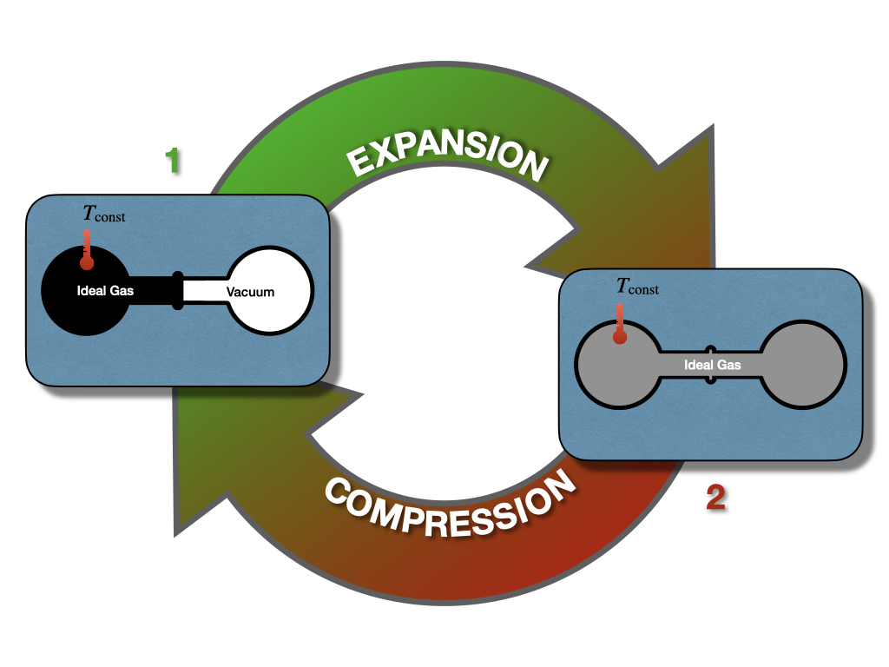
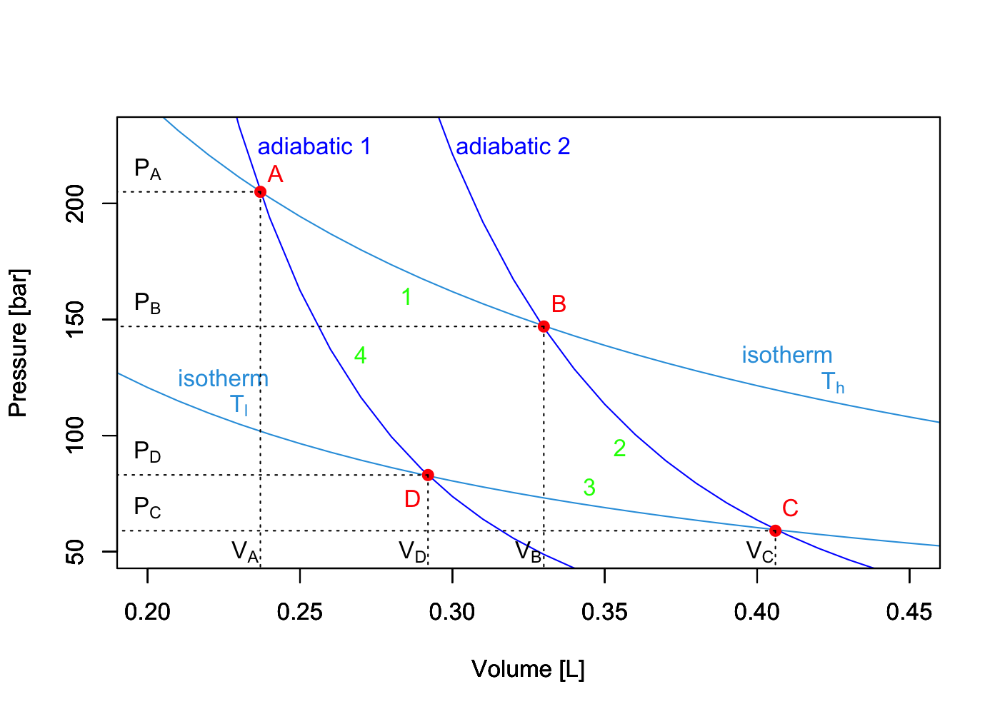
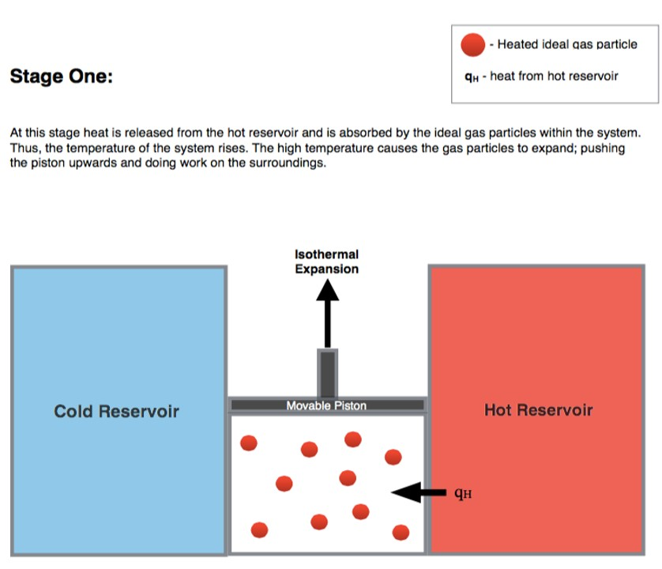
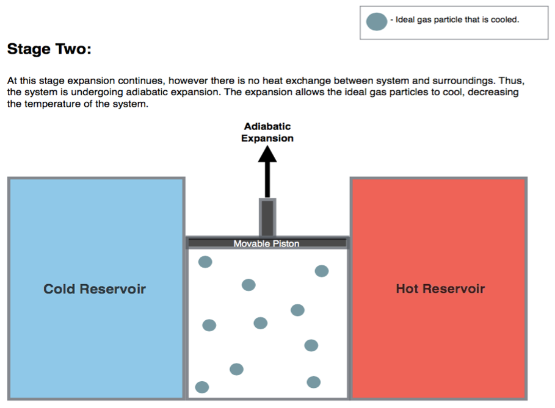
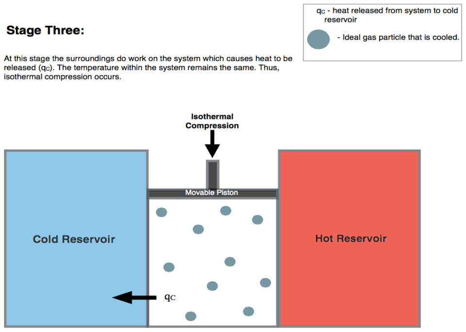
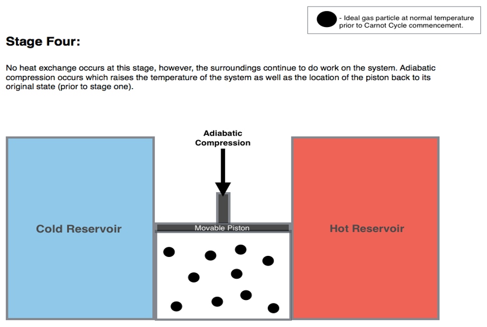
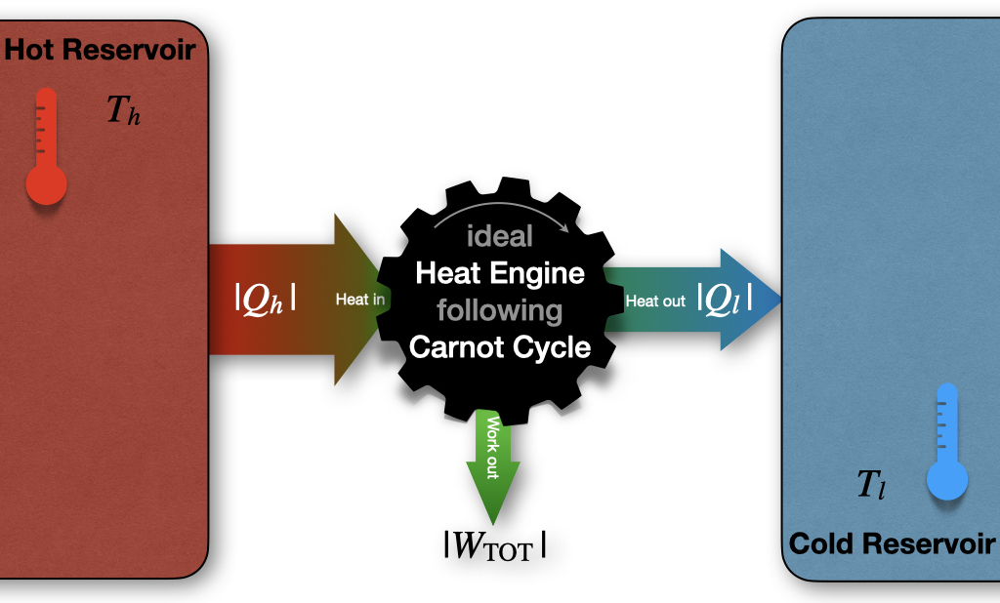
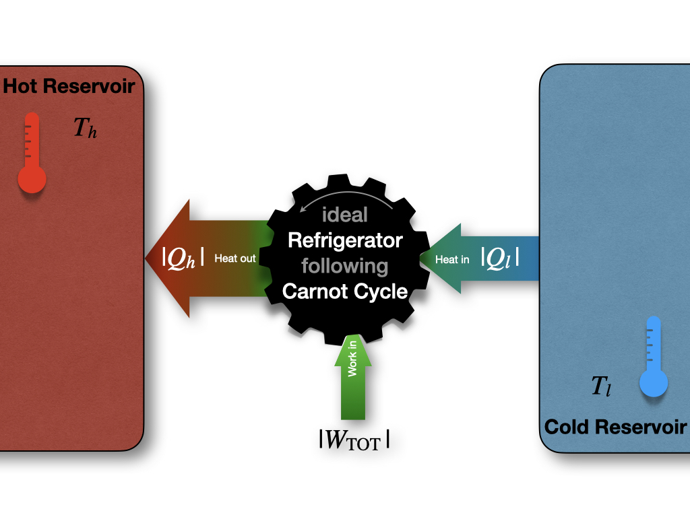

---
aliases:
  - ThermodynamicCycles.html
---

# Thermodynamic Cycles {#sec-ThermodynamicCycles}
The first law of thermodynamics places no restrictions on the conversion of energy from one form to another. For example, let's consider once again the Joule experiment (@Fig-FigJexp). If we design a cycle that goes from the gas on the left chamber only to the gas equilibrated in both chambers and backward, as in @Fig-FigJexpC, there are no restrictions imposed on this hypothetical cycle by the first law. 

{#fig-FigJexpC fig-alt="Cycle diagram for the Joule experiment at constant temperature. The arrow labeled expansion goes from state 1, gas in the left flask and vacuum in the right one, to state 2, gas in both flasks. The arrow labeled compression closes the cycle back to state 1." width="80%"}

As we saw in @sec-isothermalE, states 1 and 2 have exactly the same energy at constant temperature. Restricting the analysis to the information contained in the first law, the ideal gas could hypothetically go from state 1 (all gas in the left chamber) to state 2 (gas in both chambers), as well as spontaneously close the cycle back from state 2 to state 1, without external intervention. While the transformation from 1 $\rightarrow$ 2 is intuitively spontaneous (it's the same transformation that we considered in @sec-isothermalE), the backward transformation from 2 $\rightarrow$ 1 is clearly not as intuitive. In this case, the gas should spontaneously compress back to the left side, leaving a vacuum on the right chamber, without interventions from the outside. This transformation is clearly never observed. A gas just does not spontaneously concentrate on one side of a room, leaving a vacuum on the other side. In fact, when we need to create a vacuum, a lot of energy must be spent. Suppose we use exclusively information contained in the first law. In this case, there is nothing that might suggest a system's preference to perform the transformation 1 $\rightarrow$ 2, while preventing the 2 $\rightarrow$ 1 from happening spontaneously. Both states have the same energy, and 

$$
\oint dU=0.
$$ {#eq-de0c}

James Joule himself was indeed convinced that this must be the case and that we don't observe the backward transformation in practice only because we cannot build ideal machines.^[Either because we don't really have ideal gases, or because we are unable to construct mechanical devices without loss, or in general because of other experimental factors.] Another scientist of that era was not convinced. William Thomson, the 1^st^ Baron Kelvin (1824–1907), was unsure about this idea, and invested substantial resources to try to prove Joule wrong.^[Interestingly enough, both Joule and Lord Kelvin are now recognized as key figures in the development of thermodynamics and science in general. So much so, that the energy unit and the temperature unit in the SI system are named after them.] 

A few years later, the controversy between Joule and Kelvin was resolved in favor of the latter, thanks to the experiments of French military engineer Nicolas Léonard Sadi Carnot (1796–1832). The work of Carnot began in France several years before Joule and Kelvin's time.^[Carnot's lone book, the [*Réflexions sur la Puissance Motrice du Feu* ("Reflections on the Motive Power of Fire")](https://en.wikipedia.org/wiki/Reflections_on_the_Motive_Power_of_Fire) was published in France in 1824, the same year Kelvin was born and just 6 years after Joule's birth.] At that time, the importance of steam engines was growing for industrial applications, but a theoretical perspective was lacking. Carnot was convinced that a scientific understanding of heat engines was necessary to improve their efficiency. 

## Carnot Cycle {#sec-carnotcyclesect}
The main contribution of Carnot to thermodynamics is his abstraction of the steam engine's essential features into a more general and idealized heat engine. The definition of Carnot's idealized cycle is as follows:

::: {#def-carnotcycle}
A *Carnot cycle* is an idealized process composed of two isothermal and two adiabatic transformations. Each transformation is either an expansion or a compression of an *ideal gas*. All transformations are assumed to be *reversible*, and no energy is lost to mechanical friction.
:::

A Carnot cycle connects two "heat reservoirs" at temperatures $T_h$ (hot) and $T_l$ (low), respectively. The reservoirs have a large thermal capacity so that their temperatures are unaffected by the cycle. The system is composed exclusively of the ideal gas, which is the only substance that changes temperature throughout the cycle. If we report the four transformations of a Carnot cycle on a $PV$ diagram, we obtain the following plot:

{#fig-FigCarnotPV fig-alt="Pressure-volume diagram of a Carnot cycle. Two isotherms, at the high temperature and at the low temperature, and two adiabats, which are steeper, cross at four points A, B, C, and D. The cycle runs from A to B along the hot isotherm (stage 1), B to C along an adiabat (stage 2), C to D along the cold isotherm (stage 3), and D back to A along the other adiabat (stage 4)." width="70%"}

### Stage 1: isothermal expansion $A \rightarrow B$ {#sec-CCstage1}
{fig-alt="Carnot cycle stage one, isothermal expansion. A cylinder with a movable piston sits between a cold reservoir on the left and a hot reservoir on the right. Heat from the hot reservoir enters the gas, shown as red hot particles, and the piston moves up." width="70%"}

Starting the analysis of the cycle from point $A$ in @Fig-FigCarnotPV,^[The stages of a Carnot cycle depicted at the beginning of this section and of the following three ones are taken from [Wikipedia's article on the Carnot cycle](https://en.wikipedia.org/wiki/Carnot_cycle), and have been generated and distributed by Author BlyumJ under CC-BY-SA license.] the first transformation we encounter is an isothermal expansion at $T_h$. Since the transformation is isothermal:

$$
\Delta U_1 = \overbrace{W_1}^{<0} + \overbrace{Q_1}^{>0} = 0 \Rightarrow Q_1 = -W_1,
$$ {#eq-CCst1}

and heat and work can be calculated for this stage using @eq-WmaxV:

$$
\begin{aligned}
 Q_1 & = \left| Q_h \right|  = nRT_h \overbrace{\ln \frac{V_B}{V_A}}^{>0 \text{ since } V_B>V_A} > 0, \\
 W_1 & = -Q_1 = - nRT_h \ln \frac{V_B}{V_A} < 0,
\end{aligned}
$$ {#eq-CCst1b}

where we denoted $\left| Q_h \right|$ the absolute value of the heat that gets **into** the system from the hot reservoir. 

### Stage 2: adiabatic expansion $B \rightarrow C$ {#sec-CCstage2}
{fig-alt="Carnot cycle stage two, adiabatic expansion. No heat is exchanged with either reservoir. The piston keeps moving up and the gas cools, shown as gray-blue particles." width="70%"}

The second transformation is an adiabatic expansion between $T_h$ and $T_l$. Since we are at adiabatic conditions:

$$
Q_2 = 0 \Rightarrow \Delta U_2 = W_2,
$$ {#eq-CCst2}

and the negative energy (expansion work) can be calculated using:

$$
\Delta U_2 = W_2 = n \underbrace{\int_{T_h}^{T_l} C_V dT}_{<0 \text{ since } T_\mathrm{l}<T_\mathrm{h}} < 0.
$$ {#eq-CCst2b}

### Stage 3: isothermal compression $C \rightarrow D$ {#sec-CCstage3}
{fig-alt="Carnot cycle stage three, isothermal compression. The surroundings push the piston down, and heat leaves the cooled gas toward the cold reservoir on the left." width="70%"}

The third transformation is an isothermal compression at $T_l$. The formulas are the same as those used for stage 1, but they will result in heat and work with reversed signs (since this is a compression):

$$
\Delta U_3 = \overbrace{W_3}^{>0} + \overbrace{Q_3}^{<0} = 0 \Rightarrow Q_3 = -W_3,
$$ {#eq-CCst3}

and:

$$
\begin{aligned}
 Q_3 & = -\left| Q_l \right|  = nRT_l \overbrace{\ln \frac{V_D}{V_C}}^{<0 \text{ since } V_D<V_C} < 0 , \\
 W_3 & = -Q_3 = - nRT_l \ln \frac{V_D}{V_C} > 0,
\end{aligned}
$$ {#eq-CCst3b}

where $\left| Q_l \right|$ is the absolute value of the heat that gets **out of** the system to the cold reservoir ($Q_3 = -\left| Q_l \right|$ being the heat entering the system). 

### Stage 4: adiabatic compression $D \rightarrow A$ {#sec-CCstage4}
{fig-alt="Carnot cycle stage four, adiabatic compression. No heat is exchanged. The piston is pushed further down and the gas, shown as black particles, warms back to its starting temperature." width="70%"}

The fourth and final transformation is an adiabatic compression that restores the system to point $A$, bringing it from $T_l$ to $T_h$. Similarly to stage 2:

$$
Q_4 = 0 \Rightarrow \Delta U_4 = W_4,
$$ {#eq-CCst4}

since we are at adiabatic conditions. The energy associated with this process is now positive (compression work), and can be calculated using:

$$
\Delta U_4 = W_4 = n \underbrace{\int_{T_l}^{T_h} C_V dT}_{>0 \text{ since } T_\mathrm{h}>T_\mathrm{l}} > 0.
$$ {#eq-CCst4b}

Notice how $\Delta U_4 = - \Delta U_2$ because $\int_x^y=-\int_y^x$.

## Energy, Heat, and Work in the Carnot Cycle {#sec-UWQCarnot}
Summarizing the results of the previous sections, the total amount of energy for a Carnot cycle is:

$$
\begin{aligned}
  \Delta U_{\text{TOT}} & = \Delta U_1+\Delta U_2+\Delta U_3+\Delta U_4 \\
                 & = 0 + n \int_{T_h}^{T_l} C_V dT + 0 + n \int_{T_l}^{T_h} C_V dT  \\
                 & = n \int_{T_h}^{T_l} C_V dT - n \int_{T_h}^{T_l} C_V dT = 0 \\
\end{aligned}
$$ {#eq-UtotCC}

which is obviously zero, since $\oint dU=0$. The amounts of work and heat, however, are not zero, since $Q$ and $W$ are path functions. Therefore:

$$
\begin{aligned}
  W_{TOT} & = W_1+W_2+W_3+W_4 \\
                 & = - nRT_h \ln \frac{V_B}{V_A} + n \int_{T_h}^{T_l} C_V dT - nRT_l \ln \frac{V_D}{V_C} + n \int_{T_l}^{T_h} C_V dT \\
                 & = - nRT_h \ln \frac{V_B}{V_A} - nRT_l \ln \frac{V_D}{V_C}, \\
\end{aligned}
$$ {#eq-WtotCC}

which, considering that $V_C/V_D=V_B/V_A$, reduces to:

$$
W_{TOT} = - nR \left( T_h-T_l \right) \ln \frac{V_B}{V_A} < 0,
$$ {#eq-WtotCC2}

which is negative, because $T_h>T_l$ and $V_B>V_A$. Negative work means that the work is done by the system. In other words, the system is performing $PV$-work by transferring heat from a hot reservoir to a cold one via a Carnot cycle. On the other hand, for the heat:

$$
\begin{aligned}
  Q_{\text{TOT}} & = Q_1+Q_2+Q_3+Q_4 \\
                 & = \left| Q_h \right| + 0 - \left| Q_l \right| + 0    \\
                 & = nRT_h \ln \frac{V_B}{V_A} + nRT_l \ln \frac{V_D}{V_C} \\
                 & = nR \left( T_h-T_l \right) \ln \frac{V_B}{V_A} = -W_{TOT},
\end{aligned}
$$ {#eq-QtotCC}

which simplifies to:

$$
W_{TOT}=-(Q_1+Q_3),
$$ {#eq-WtotCC3}

and, replacing $Q_1$ and $Q_3$ with the absolute values of the heats drawn from the hot and cold reservoirs, $\left| Q_h \right|$, and $\left| Q_l \right|$ respectively:

$$
\left| W_{TOT} \right| = \left| Q_h \right| - \left| Q_l \right|,
$$ {#eq-QtotCC2}

or, in other words, more heat is extracted from the hot reservoir than it is put into the cold one. The difference between the absolute value of these amounts of heat gives the total work of the cycle. This process is depicted in @Fig-FigCarnotEff.

{#fig-FigCarnotEff fig-alt="Heat engine diagram. Heat of magnitude Q h flows from a hot reservoir at temperature T h into a gear labeled ideal heat engine following Carnot cycle. Part of it leaves as work W TOT, pointing down, and the rest, Q l, flows out into a cold reservoir at temperature T l." width="80%"}

::: {#exr-CarnotEx}
Up to this point, we have discussed Carnot cycles working in the hot $\rightarrow$ cold direction ($A$ $\rightarrow$ $B$ $\rightarrow$ $C$ $\rightarrow$ $D$ $\rightarrow$ $A$), since this is the primary mode of operation of heat engines that produce work. However, a heat engine could also—in principle—work in the reversed cold $\rightarrow$ hot direction ($A$ $\rightarrow$ $D$ $\rightarrow$ $C$ $\rightarrow$ $B$ $\rightarrow$ $A$). Write the equations for heat, work, and energy of each stage of a Carnot cycle going the opposite direction than the one discussed in @sec-carnotcyclesect and @sec-UWQCarnot.

*Solution:* When the heat engine works in reverse order, the formulas remain the same, but all the signs in front of $Q$, $W$, and $U$ will be reversed. In this case, the total work would get **into** the system, and heat would be transferred from the cold reservoir to the hot one. @Fig-FigCarnotEff would be modified as:

{fig-alt="Refrigerator diagram, the reverse of the heat engine. Work W TOT enters a gear labeled ideal refrigerator following Carnot cycle. Heat Q l is drawn from the cold reservoir at temperature T l, and heat Q h is released into the hot reservoir at temperature T h." width="60%"}

:::
This reversed mode of operation is the basic principle behind refrigerators and air conditioning.

## Efficiency of a Carnot Cycle

The efficiency ($\varepsilon$) of a cycle is defined as the ratio between the absolute value of the work extracted from the cycle ($\left| W_{TOT} \right|$) and the heat that gets into the system ($\left| Q_h \right|$):

$$
\varepsilon = \frac{\left| W_{TOT} \right|}{\left| Q_h \right|} =\frac{-W_{TOT}}{Q_1}
$$ {#eq-effCC1}

where the minus sign in front of the work is necessary because the efficiency is defined as a positive number. Replacing @eq-WtotCC3 into @eq-effCC1, we obtain:

$$
\varepsilon = \frac{Q_3+Q_1}{Q_1} = 1+\frac{Q_3}{Q_1}.
$$ {#eq-effCC2}

If we go back to @eq-effCC1 and we replace @eq-WtotCC2 for $W_{TOT}$ and @eq-CCst1b for $Q_1$, we obtain:

$$
\varepsilon = \frac{nR \left( T_h - T_l \right) \ln V_B/V_A}{nRT_h \ln V_B/V_A} = \frac{T_h-T_l}{T_h}=1-\frac{T_l}{T_h }<1,
$$ {#eq-effCC3}

which proves that the efficiency of a Carnot cycle is strictly smaller than 1.^[@Eq-effCC3 can be equal to 1 only if $T_l=0 \; \text{K}$ or $T_h=\infty$, two conditions that are both equally impossible.] In other words, no cycle can convert 100% of the heat into work it extracts from a hot reservoir. This finding had remarkable consequences on the entire thermodynamics field and set the foundation for the introduction of entropy. We will use @eq-effCC1 and @eq-effCC3 for this purpose in the next chapter, but we conclude the discussion on Carnot cycles by returning to Lord Kelvin. In 1851 he used this finding to formulate his statement "It is impossible for a self-acting machine, unaided by any external agency, to convey heat from one body to another at a higher temperature. It is impossible, by means of inanimate material agency, to derive mechanical effect from any portion of matter by cooling it below the temperature of the coldest of the surrounding objects."^[Thomson W. [Transactions of the Royal Society of Edinburgh. 1851 XX 261–268, 289–298.](https://www.biodiversitylibrary.org/item/126047#page/295/mode/1up).] This statement conclusively disproved Joule's original theories and demonstrated that there is some fundamental principle to govern the flow of heat beyond the first law of thermodynamics.

## Chapter Review {#sec-rev5}
### Study Questions {#sec-quest5}
**1. What does the first law of thermodynamics say about a gas that spontaneously compresses back into one side of the Joule apparatus?**

a. It forbids it, since energy would not be conserved.
b. It requires work to be done on the gas.
c. It requires heat to flow out of the gas.
d. Nothing: the process would conserve energy, so the first law does not forbid it.
e. It shows that the process is spontaneous.

---

**2. What transformations make up a Carnot cycle?**

a. Two isochoric and two isobaric transformations.
b. Two isothermal and two adiabatic reversible transformations.
c. Four isothermal transformations.
d. Four adiabatic transformations.
e. One isothermal, one adiabatic, one isochoric, and one isobaric transformation.

---

**3. What happens during the isothermal expansion at $T_h$ in a Carnot cycle?**

a. $\Delta U = 0$, heat is absorbed from the hot reservoir, and the same amount of energy leaves as work.
b. No heat is exchanged.
c. The temperature drops from $T_h$ to $T_l$.
d. Heat is released to the cold reservoir.
e. Work is done on the gas.

---

**4. What happens during the adiabatic expansion in a Carnot cycle?**

a. Heat is absorbed from the hot reservoir.
b. The internal energy stays constant.
c. Heat is released to the cold reservoir.
d. The volume decreases.
e. No heat is exchanged, the gas performs work, and its temperature drops from $T_h$ to $T_l$.

---

**5. What is the total change in internal energy for a complete Carnot cycle?**

a. $nR(T_h-T_l)\ln\frac{V_B}{V_A}$.
b. $nC_V(T_h-T_l)$.
c. Zero, since the internal energy is a state function.
d. Equal to the total work.
e. Equal to the heat absorbed from the hot reservoir.

---

**6. What is the total work of a Carnot cycle?**

a. $W_{TOT} = nR(T_h-T_l)\ln\frac{V_B}{V_A}$.
b. $W_{TOT} = -nR(T_h-T_l)\ln\frac{V_B}{V_A}$.
c. $W_{TOT} = 0$.
d. $W_{TOT} = nRT_h\ln\frac{V_B}{V_A}$.
e. $W_{TOT} = nC_V(T_h-T_l)$.

---

**7. How is the efficiency of a heat engine defined?**

a. $\varepsilon = \frac{|Q_h|}{|W_{TOT}|}$.
b. $\varepsilon = \frac{|Q_l|}{|Q_h|}$.
c. $\varepsilon = \frac{|W_{TOT}|}{|Q_l|}$.
d. $\varepsilon = \frac{|W_{TOT}|}{|Q_h|}$.
e. $\varepsilon = \frac{T_h}{T_l}$.

---

**8. What is the efficiency of a Carnot cycle in terms of the reservoir temperatures?**

a. $\varepsilon = 1-\frac{T_l}{T_h}$.
b. $\varepsilon = 1-\frac{T_h}{T_l}$.
c. $\varepsilon = \frac{T_h}{T_l}$.
d. $\varepsilon = \frac{T_h-T_l}{T_l}$.
e. $\varepsilon = 1$.

---

**9. Why is the efficiency of a Carnot cycle always smaller than 1?**

a. Because of friction in the engine.
b. Because the gas is not ideal.
c. Because heat is a state function.
d. Because the cycle is irreversible.
e. Because it would be 1 only if $T_l=0\;\text{K}$ or $T_h=\infty$, which are impossible.

---

**10. What happens when a Carnot cycle is run in reverse?**

a. It produces more work than the forward cycle.
b. It reaches 100% efficiency.
c. Work is put into the system, and heat is moved from the cold reservoir to the hot one, as in a refrigerator.
d. Heat flows from the hot reservoir to the cold one without work.
e. It violates the first law.

---

::: {.callout-tip collapse="true" icon="false"}
## Answers

1.d, 2.b, 3.a, 4.e, 5.c, 6.b, 7.d, 8.a, 9.e, 10.c
:::
