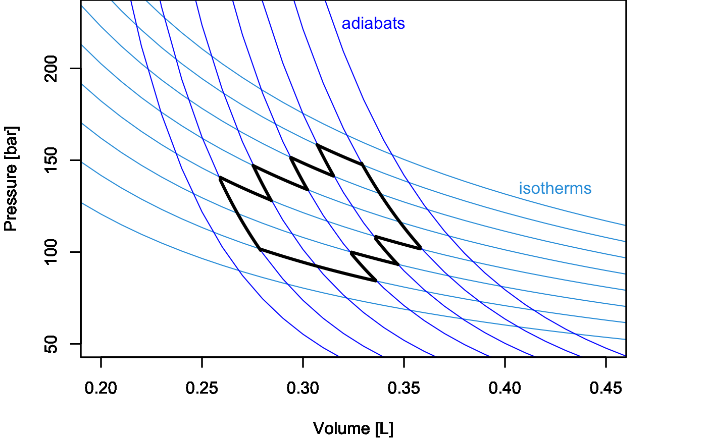
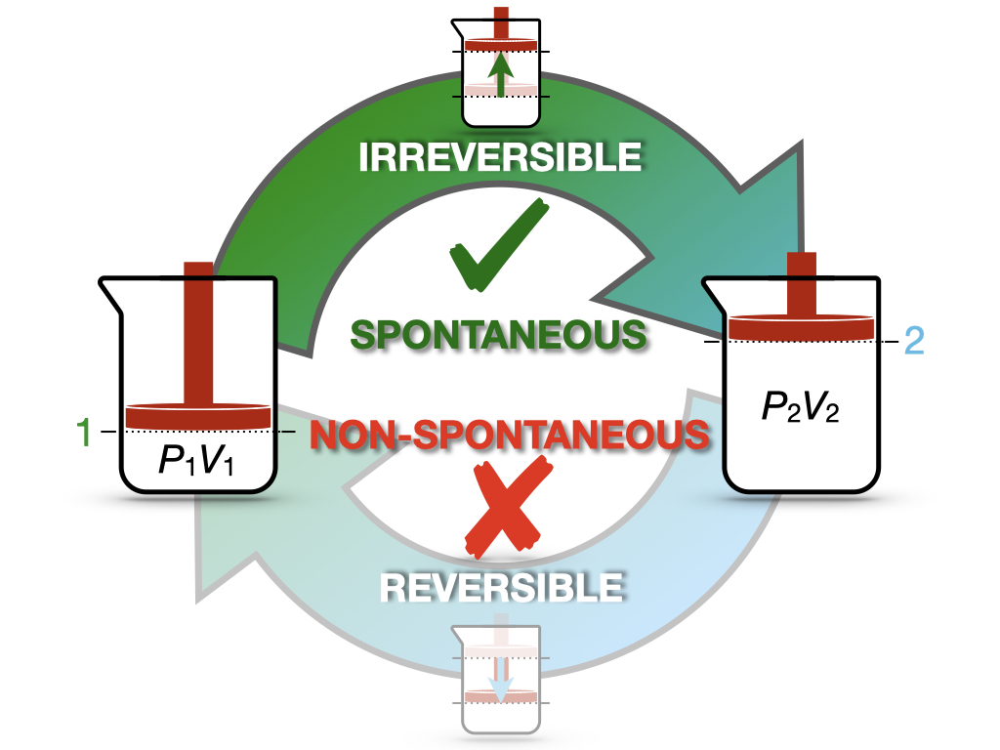

---
aliases:
  - SecondLaw.html
---

# Entropy and the Second Law of Thermodynamics {#sec-SecondLaw}
In @sec-ThermodynamicCycles, we have discussed heat engines as a means of understanding how some processes are spontaneous while others are not. Carnot's findings did not just simply inspire Lord Kelvin on this subject, but they also motivated Rudolf Clausius (1822–1888) to introduce the concept of entropy. 

## Entropy {#sec-entropyint}
Let's return to the definition of efficiency of a Carnot cycle and bring together @eq-effCC2 and @eq-effCC3:

$$
\varepsilon = 1+\frac{Q_3}{Q_1} = 1-\frac{T_l}{T_h}.
$$ {#eq-effcQT}

Simplifying this equality, we obtain:

$$
\frac{Q_3}{T_l} = -\frac{Q_1}{T_h},
$$ {#eq-effcQTrearr}

or alternatively:

$$
\frac{Q_3}{T_l} + \frac{Q_1}{T_h} = 0.
$$ {#eq-effcQTrearr2}

The left hand side of @eq-effcQTrearr2 contains the sum of two quantities around the Carnot cycle, each calculated as $\frac{Q_{\mathrm{REV}}}{T}$, with $Q_{\mathrm{REV}}$ being the heat exchanged at reversible conditions (recall that according to @Def-carnotcycle each transformation in a Carnot cycle is reversible). @Eq-effcQTrearr can be generalized to a sequence of connected Carnot cycles joining more than two isotherms by taking the summation across different temperatures:

{fig-alt="Pressure-volume diagram filled with a grid of isotherms and steeper adiabats. A closed, zig-zag black path made only of isotherm and adiabat segments shows that a general cycle can be built from many small Carnot cycles." width="70%"}

$$
\sum_i \frac{Q_{\mathrm{REV}}}{T_i} = 0,
$$ {#eq-effQrevT}

where the summation happens across a sequence of Carnot cycles that connects different temperatures. @Eq-effcQTrearr2 and @eq-effQrevT show that for a Carnot cycle—or a series of connected Carnot cycles—there exists a conserved quantity obtained by dividing the heat associated with each reversible stage by the temperature at which such heat is exchanged. If a quantity is conserved around a cycle, it must be independent of the path, and therefore it is a state function. Looking at similar equations, Clausius introduced in 1865 a new state function in thermodynamics, which he decided to call entropy and indicate with the letter $S$:

::: {#def-entropy}
*Entropy:* $$
S = \frac{Q_{\mathrm{REV}}}{T}.
$$
:::

We can use the new state function to generalize @eq-effQrevT to any reversible cycle in a $PV$-diagram by using the rules of calculus. First, we will slice $S$ into an infinitesimal quantity:

$$
dS = \frac{đQ_{\mathrm{REV}}}{T},
$$ {#eq-dentropy}

then we can extend the summation across temperatures of @eq-effQrevT to a sum over infinitesimal quantities—that is the integral—around the cycle:

$$
\oint dS = \oint \frac{đQ_{\mathrm{REV}}}{T} = 0.
$$ {#eq-ds0}

## Irreversible Cycles

Up to this point, we have discussed *reversible* cycles only. Notice that the heat that enters the definition of entropy (@Def-entropy) is the heat exchanged at reversible conditions since it is only at those conditions that the right-hand side of @eq-dentropy becomes a state function. What happens when we face an irreversible cycle? The efficiency of a Carnot cycle in @eq-effCC3 is the maximum efficiency that an idealized thermodynamic cycle can reach. As such, any irreversible cycle will incontrovertibly have an efficiency smaller than the maximum efficiency of the idealized Carnot cycle. Therefore, @eq-effcQT for an *irreversible* cycle will not hold anymore and must be rewritten as:

$$
\overbrace{1+\frac{Q_3}{Q_1}}^{\varepsilon_{\mathrm{IRR}}} < \overbrace{1-\frac{T_l}{T_h}}^{\varepsilon_{\mathrm{REV}}},
$$ {#eq-effcIRR}

and, following the same procedure used in @sec-entropyint, we can rewrite @eq-effcIRR as:

$$
\frac{Q^{\mathrm{IRR}}_3}{Q^{\mathrm{IRR}}_1} < - \frac{T_l}{T_h} \longrightarrow \frac{Q^{\mathrm{IRR}}_3}{T_l} + \frac{Q^{\mathrm{IRR}}_1}{T_h} < 0 \longrightarrow \sum_i \frac{Q_{\mathrm{IRR}}}{T_i} < 0,
$$ {#eq-effcIRR2}

which can be generalized using calculus to:

$$
\oint \frac{đQ_{\mathrm{IRR}}}{T} < 0.
$$ {#eq-dqirrineq}

Putting @eq-ds0 and @eq-dqirrineq together, we obtain:

$$
\oint \frac{đQ}{T} \leq 0,
$$ {#eq-clausiusineq}

where the equal sign holds for reversible transformations exclusively, while the inequality sign holds for irreversible ones. @Eq-clausiusineq is known as **Clausius inequality**. 

## The Second Law of Thermodynamics {#sec-secondlaw}
Now we can consider an isolated system undergoing a cycle composed of an irreversible forward transformation (1 $\rightarrow$ 2) and a reversible backward transformation (2 $\rightarrow$ 1), as in @Fig-FigJexpC2. 

{#fig-FigJexpC2 fig-alt="Cycle between state 1 (pressure P1, volume V1) and state 2 (pressure P2, volume V2). The top arrow, from 1 to 2, is labeled irreversible and spontaneous with a green check mark. The bottom arrow, from 2 to 1, is labeled reversible and non-spontaneous with a red cross." width="80%"}

This cycle is similar to the cycle depicted in @Fig-FigJexpC for the Joule's expansion experiment. In this case, we have an intuitive understanding of the spontaneity of the irreversible expansion process, as well as of the non-spontaneity of the backward compression. Since the cycle has at least one irreversible step, it is overall irreversible, and we can calculate: 

$$
\oint \frac{đQ_{\mathrm{IRR}}}{T} = \int_1^2 \frac{đQ_{\mathrm{IRR}}}{T} + \int_2^1 \frac{đQ_{\mathrm{REV}}}{T}.
$$ {#eq-qirrcycle}

We can then use Clausius inequality (@eq-clausiusineq) to write:

$$
\begin{aligned}
\int_1^2 \frac{đQ_{\mathrm{IRR}}}{T} + \int_2^1 \frac{đQ_{\mathrm{REV}}}{T} < 0,
\end{aligned}
$$ {#eq-qirrcycle1}

which can be rearranged as:

$$
\underbrace{\int_1^2 \frac{đQ_{\mathrm{REV}}}{T}}_{\int_1^2 dS = \Delta S} > \underbrace{\int_1^2 \frac{đQ_{\mathrm{IRR}}}{T}}_{=0},
$$ {#eq-qirrcycle2}

where we have used the fact that, for an isolated system (the universe), $đQ_{\mathrm{IRR}}=0$. @Eq-qirrcycle2 can be rewritten as:

$$
\Delta S > 0,
$$ {#eq-secondlaweq}

which proves that for any irreversible process in an isolated system, the entropy is increasing. Using @eq-secondlaweq and considering that the only system that is truly isolated is the universe, we can write a concise statement for a new fundamental law of thermodynamics:

::: {#def-secondlawdef}
*Second Law of Thermodynamics:* for any spontaneous process, the entropy of the universe is increasing.
:::

## Boltzmann Entropy

Earlier in this chapter, we introduced Clausius's entropy to describe how heat and work interact in macroscopic systems, and we saw how entropy increases in isolated systems, with this increase being linked to irreversibility and the second law of thermodynamics. From this perspective, entropy is a tool that explains how energy transformations behave, and what limits the efficiency of those processes. However, in order to connect the molecular behaviors that chemistry describes with the macroscopic laws of thermodynamics, we need to explore what entropy really *is*. To do this, we need to dive into the microscopic world, where entropy is interpreted in terms of the underlying microstates that define the system. 

This exploration of entropy from a microscopic perspective was pioneered by Ludwig Eduard Boltzmann (1844–1906), who introduced a formula to describe a statistical concept, which he then linked to Clausius's thermodynamic entropy. The microscopic definition of Boltzmann's entropy is summarized in the formula that became famous as the Boltzmann equation:

$$
S = k_B \ln \Omega,
$$ {#eq-boltzmanneq}

where $S$ is the entropy, $k_B$ is the Boltzmann constant, $k_B = R/N_A = 1.380649 \times 10^{-23} \, \text{J/K}$, where $R$ is the ideal gas constant, and $N_A$ Avogadro's constant, and finally $\Omega$ is the multiplicity of the system (that is, the number of possible microstates that correspond to a given macrostate). Boltzmann equation tells us that this statistical form of entropy is directly related to the number of microscopic configurations (microstates) available to a system. More microstates mean more entropy. The logarithmic relationship ensures that entropy scales appropriately with the size of the system and that small changes in the number of microstates lead to measurable changes in entropy. It is important to notice that the microscopic statistical entropy of Boltzmann is, in principle, a different concept than the macroscopic thermodynamic entropy of Clausius. The beauty of Boltzmann equation is that it shows how these two concepts are connected with each other. In particular, the key role in the equation is played by the Boltzmann constant, which is the proportionality factor between the two concepts of entropy. This constant is a fundamental constant of nature at the microscopic level, relating the thermal energy of a gas with its temperature. At the macroscopic level, however, it can be obtained simply from the ideal gas law as:

$$
k_B = \frac{PV}{TN},
$$ {#eq-stat2}

with $N=nN_A$ being the number of molecules in a system. 

The second key concept in the Boltzmann equation is that the state of a system at the microscopic level is described by a **microstate**. A microstate specifies the exact arrangement of each particle in the system, including their positions and momenta. For example, in an ideal gas, a microstate would tell us the precise position and velocity of every individual gas molecule at a given moment. In contrast, a **macrostate** describes the system using macroscopic variables like pressure, temperature, and volume. A single macrostate can correspond to a large number of different microstates, since there are many ways the particles can be arranged that result in the same overall macroscopic properties. 

The **multiplicity** of a system, denoted by $\Omega$, is the number of distinct microstates that correspond to a given macrostate. Systems naturally evolve toward macrostates with higher multiplicities because these are more probable. In other words, a system is more likely to be found in a macrostate that is associated with a high number of possible microstates, simply because there are more ways to arrange the particles. Consider an example where a gas expands into a larger volume. Initially, the particles are confined to a smaller volume, which corresponds to a relatively small number of microstates. When the gas expands, the particles have more space to occupy, leading to a greater number of possible microstates. As a result, the multiplicity $\Omega$ increases, and so does the entropy.

Boltzmann equation gives us a powerful tool to link the macroscopic behavior of a system (entropy) to the microscopic behavior of its individual particles (microstates). The more microstates available to the system, the higher the entropy. Systems naturally evolve toward macrostates with the highest multiplicity (i.e., the largest number of microstates), which explains why entropy tends to increase in isolated systems, as stated by the second law of thermodynamics.

### Why "Disorder" Can Be Misleading

As first shown by Boltzmann himself, although thermodynamic entropy and statistical entropy arise from different perspectives, they describe the same underlying reality. One common misconception about entropy is that it is simply a measure of "disorder." While there is some truth to this idea, it can be misleading. A more accurate description of entropy is that it measures the number of possible ways a system can be arranged, which corresponds to the amount of "information" needed to describe the system at the microscopic level. For example, when ice melts into water, the entropy of the system increases, but the resulting liquid is not necessarily more "disordered" than the solid ice. Instead, the liquid has more possible microstates, as the water molecules can move more freely compared to the fixed structure of ice. While we would be able to describe the solid macrostate using a small number of microstates (in principle the number of microstates for a solid could be even as small as one), we would always need many more microstates to describe the liquid one. The common misconception of a messy room having more entropy than a tidier one is indeed a mistake, as entropy (at least the thermodynamic entropy that we are discussing here) doesn't play a role in either of these situations. If we want to stretch the analogy and treat objects in a room the same way we treat particles in a system, the analogy also doesn't work, as both the messy room and the tidy one represent only one way of arranging the objects in the room (a microstate), so the entropy is zero for both, since $S=k_B \ln(1)=0$.^[If we really want to use this analogy, then a better version would be that of a hotel with identical rooms containing the same objects. The configuration of all unmade rooms in the morning has a higher entropy than the configuration of the same rooms after the housekeepers have arranged all the objects in every room exactly the same way.]

## Chapter Review {#sec-rev6}
### Practice Problems {#sec-exer6}
**Problem 1: Efficiency of an Irreversible Cycle**

An irreversible heat engine operates between reservoirs at $600\,\text{K}$ and $300\,\text{K}$. If its efficiency is 80% of the maximum possible efficiency, calculate its actual efficiency.

**Solution:** The maximum possible efficiency is that of a Carnot cycle:

$$\varepsilon_{\text{max}} = 1 - \frac{T_l}{T_h} = 1 - \frac{300\,\text{K}}{600\,\text{K}} = 0.5$$

The actual efficiency for this cycle is 80% of the maximum one:

$$\varepsilon_{\text{actual}} = 0.8 \cdot \varepsilon_{\text{max}} = 0.8 \cdot 0.5 = 0.4$$

**Answer:** The actual efficiency of the irreversible heat engine is 0.4 or 40%.

---

**Problem 2: Calculating Heat Rejected in a Carnot Cycle**

A Carnot engine operates between a hot reservoir at $400\,\text{K}$ and a cold reservoir at $300\,\text{K}$. The engine absorbs $1000\,\text{J}$ of heat from the hot reservoir. Calculate the heat rejected to the cold reservoir.

**Solution:** For a Carnot cycle, we can use the equation:

$$\frac{Q_h}{T_h} + \frac{Q_l}{T_l} = 0$$

Given:

$Q_h$ = $1000\,\text{J}$

$T_h$ = $400\,\text{K}$ 

$T_l$ = $300\,\text{K}$ 

Then:

$$\frac{1000\,\text{J}}{400\,\text{K}} + \frac{Q_l}{300\,\text{K}} = 0$$

$$2.5\,\frac{\text{J}}{\text{K}} + \frac{Q_l}{300\,\text{K}} = 0$$

$$\frac{Q_l}{300\,\text{K}} = -2.5\,\frac{\text{J}}{\text{K}}$$

$$Q_l = -2.5\,\frac{\text{J}}{\text{K}} \cdot 300\,\text{K} = -750\,\text{J}$$

**Answer:** The heat rejected to the cold reservoir is $-750\,\text{J}$. The negative sign indicates that heat is leaving the system.

### Study Questions {#sec-quest6}
**1. What concept did Rudolf Clausius introduce inspired by Carnot's findings?**

a. Efficiency.
b. Entropy.
c. Heat engines.
d. Reversibility.
e. Adiabatic processes.

---

**2. In the definition of entropy, what does $Q_{\mathrm{REV}}$ represent?**

a. Heat lost to the surroundings.
b. Heat exchanged at irreversible conditions.
c. Total heat of the system.
d. Heat capacity of the system.
e. Heat exchanged at reversible conditions.

---

**3. Which of the following correctly defines entropy according to Clausius?**

a. $S = \frac{Q_{\mathrm{REV}}}{T}$.
b. $S = \frac{Q_{\mathrm{IRR}}}{T}$.
c. $S = Q_{\mathrm{REV}} \cdot T$.
d. $S = Q_{\mathrm{IRR}} \cdot T$.
e. $S = \frac{T}{Q_{\mathrm{REV}}}$.

---

**4. Which of the following is the correct expression for the Clausius inequality?**

a. $\oint \frac{đQ}{T} > 0$.
b. $\oint \frac{đQ}{T} \geq 0$.
c. $\oint \frac{đQ}{T} = 0$.
d. $\oint \frac{đQ}{T} \leq 0$.
e. $\oint \frac{đQ}{T} < 0$.

---

**5. For an irreversible cycle, which of the following is true?**

a. $\sum_i \frac{Q_{\mathrm{IRR}}}{T_i} < 0$.
b. $\sum_i \frac{Q_{\mathrm{IRR}}}{T_i} > 0$.
c. $\sum_i \frac{Q_{\mathrm{IRR}}}{T_i} = 0$.
d. $\sum_i \frac{Q_{\mathrm{IRR}}}{T_i} \geq 0$.
e. $\sum_i \frac{Q_{\mathrm{IRR}}}{T_i} \leq 0$.

---

**6. What is the Second Law of Thermodynamics as stated in the text?**

a. For any spontaneous process, the energy of the universe is increasing.
b. For any spontaneous process, the energy of the universe is conserved.
c. For any spontaneous process, the entropy of the universe is increasing.
d. For any spontaneous process, the entropy of the universe is decreasing.
e. For any spontaneous process, the entropy of the universe remains constant.

---

**7. What is the significance of the quantity $\frac{Q_{\mathrm{REV}}}{T}$ in a Carnot cycle?**

a. It represents the total work done by the system.
b. It is a conserved quantity.
c. It is always increasing.
d. It represents the heat capacity of the system.
e. It is always decreasing.

---

**8. Which system is the only one that can be considered truly isolated?**

a. The universe.
b. A perfect heat engine.
c. A closed thermodynamic system.
d. An adiabatic process.
e. A reversible cycle.

---

**9. What is the relationship between the efficiency of an irreversible cycle ($\varepsilon_{\text{IRR}}$) and the efficiency of a Carnot cycle ($\varepsilon_{\text{REV}}$)?**

a. $\varepsilon_{\text{IRR}} < \varepsilon_{\text{REV}}$.
b. $\varepsilon_{\text{IRR}} > \varepsilon_{\text{REV}}$.
c. $\varepsilon_{\text{IRR}} = \varepsilon_{\text{REV}}$.
d. $\varepsilon_{\text{IRR}} \geq \varepsilon_{\text{REV}}$.
e. $\varepsilon_{\text{IRR}} \leq \varepsilon_{\text{REV}}$.

---

**10. For a reversible cycle, what is true about the integral of $\frac{đQ_{\mathrm{REV}}}{T}$ around the cycle?**

a. It is greater than zero.
b. It is less than zero.
c. It equals zero.
d. It approaches infinity.
e. It approaches negative infinity.

---

::: {.callout-tip collapse="true" icon="false"}
## Answers

1.b, 2.e, 3.a, 4.d, 5.a, 6.c, 7.b, 8.a, 9.a, 10.c
:::

