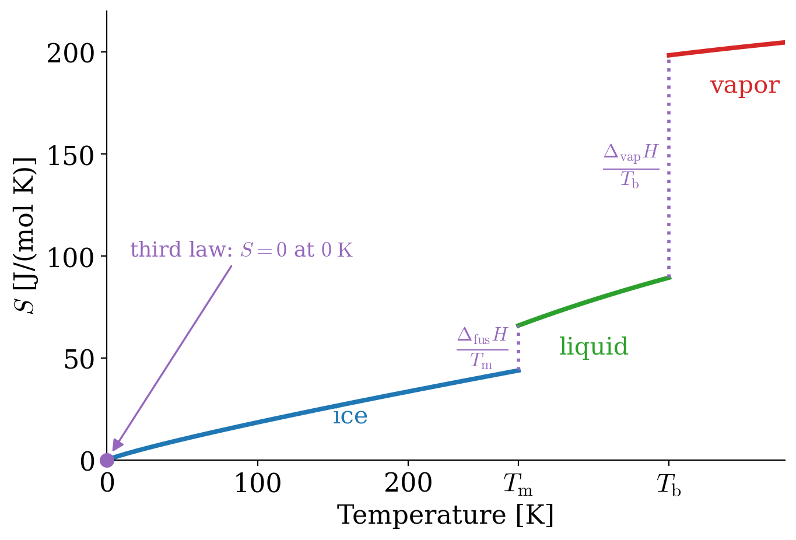

---
aliases:
  - thirdlaw.html
  - 07_ThirdLaw.html
---

# Calculation of Entropy and the Third Law of Thermodynamics {#sec-thirdlaw}
In @sec-SecondLaw, we defined the entropy as a state function, and we found that the entropy of the universe increases in every spontaneous process. A definition, however, is not very useful until we know how to calculate it. In this chapter, we will learn how to calculate the entropy changes of the most common transformations: heating and cooling, expansions and compressions, and phase changes. We will then see how to account for the surroundings, and we will introduce the third law of thermodynamics, which fixes the zero of the entropy scale and allows us to tabulate absolute entropies. Finally, we will define the standard state, the common reference for all thermodynamic tables, and we will use it to look at our first chemical reaction.

The Second Law can be used to infer the spontaneity of a process, as long as the entropy of the universe is considered. To do so, we need to remind ourselves that the universe can be divided into a system and its surroundings (environment). When we calculate the entropy of the universe as an indicator of the spontaneity of a process, we need to *always* consider changes in entropy in *both* the system (sys) and its surroundings (surr):

$$
\Delta S^{\mathrm{universe}} = \Delta S^{\mathrm{sys}} + \Delta S^{\mathrm{surr}},
$$ {#eq-dsuniv}

or, in differential form:

$$
d S^{\mathrm{universe}} = d S^{\mathrm{sys}} + d S^{\mathrm{surr}}.
$$ {#eq-dsunivd}

## Calculation of $\Delta S^{\mathrm{sys}}$ {#sec-dssys}
In general $\Delta S^{\mathrm{sys}}$ can be calculated from its definition, @def-entropy, integrated along a reversible path, @eq-dentropyint. In practice, it is always convenient to keep in mind that entropy is a state function, and as such it does not depend on the path. For this reason, we can break every transformation into elementary steps, and calculate the entropy on any path that goes from the initial state to the final state, such as, for example:

$$
\begin{aligned}
P_i, T_i & \quad \xrightarrow{ \Delta_{\text{TOT}} S^{\text{sys}} } \quad P_f, T_f \\
  \scriptstyle{\Delta_1 S^{\text{sys}}} & \searrow \qquad  \qquad \nearrow \; \scriptstyle{\Delta_2 S^{\text{sys}}} \\
& \qquad P_i, T_f \\
\\
\Delta_{\text{TOT}} S^{\text{sys}} & = \Delta_1 S^{\text{sys}} + \Delta_2 S^{\text{sys}},
\end{aligned}
$$ {#eq-entropycycle}

with $\Delta_1 S^{\text{sys}}$ calculated at constant $P$, and $\Delta_2 S^{\text{sys}}$ at constant $T$. The most important elementary steps from which we can calculate the entropy resemble the prototypical processes for which we calculated the energy in @sec-energyint.

### Entropy in Isothermal Processes

- For an ideal gas at constant temperature $\Delta U =0$, and $Q_{\mathrm{REV}} = -W_{\mathrm{REV}}$. Using the formula for $W_{\mathrm{REV}}$ in @eq-WintsolvedV2 (or its analogue for $P$), we obtain:
$$
\Delta S^{\mathrm{sys}} = \int_i^f \frac{đQ_{\mathrm{REV}}}{T} = \frac{-W_{\mathrm{REV}}}{T} = \frac{nRT \ln \frac{V_f}{V_i}}{T} = nR \ln \frac{V_f}{V_i},
$$ {#eq-sigconsttV}
or, similarly:
$$
\Delta S^{\mathrm{sys}} = nR \ln \frac{P_i}{P_f}.
$$ {#eq-sigconsttP}

- A phase change is a particular case of an isothermal process that does not follow the formulas introduced above since an ideal gas never liquefies. The entropy associated with a phase change at constant pressure can be calculated from its definition, remembering that $Q_{\mathrm{REV}}= \Delta H$. For example for vaporizations:

$$
\Delta_{\mathrm{vap}} S = \frac{\Delta_{\mathrm{vap}}H}{T_B},
$$ {#eq-spc}

with $\Delta_{\mathrm{vap}}H$ being the enthalpy of vaporization of a substance, and $T_B$ its boiling temperature.

It is experimentally observed that the entropies of vaporization of many liquids have almost the same value of:

$$
\Delta_{\mathrm{vap}} S \approx 10.5 R,
$$ {#eq-trouton}

which corresponds in SI to the range of about 85–88 J/(mol K). This simple rule is named **Trouton's rule**, after the Irish physicist who discovered it, Frederick Thomas Trouton (1863–1922).

::: {#exm-troutonex}
## Entropy of vaporization of water

Calculate the standard entropy of vaporization of water knowing $\Delta_{\mathrm{vap}} H_{\mathrm{H}_2\mathrm{O}}^\standardstate = 44 \  \text{kJ/mol}$.^[The symbol $^\standardstate$ indicates a quantity at the standard pressure of $1\;\text{bar}$. We will define standard states precisely in @sec-firstreaction.]

*Solution:* Using @eq-spc—and knowing that at standard conditions of $P^\standardstate = 1 \  \text{bar}$ the boiling temperature of water is 373 K—we calculate:

$$
\Delta_{\mathrm{vap}} S_{\mathrm{H}_2\mathrm{O}}^\standardstate = \frac{44 \times 10^3 \text{J/mol}}{373 \ \text{K}} = 118 \  \text{J} \, \text{mol}^{-1} \, \text{K}^{-1}.
$$ {#eq-trouton1}

The entropy of vaporization of water is far from Trouton's rule range of 85–88 J/(mol K) because of the hydrogen bond interactions between its molecules. Other similar exceptions are ethanol, formic acid, and hydrogen fluoride.
:::

### Entropy in Adiabatic Processes
Since adiabatic processes happen without the exchange of heat, $đQ=0$, it would be tempting to think that $\Delta S^{\mathrm{sys}} = 0$ for every one of them. A transformation at constant entropy (isentropic) is always, in fact, a reversible adiabatic process. However, the opposite case is not always true, and an irreversible adiabatic transformation is usually associated with a change in entropy. To explain this fact, we need to recall that the definition of entropy includes the heat exchanged at reversible conditions only. Therefore, for irreversible adiabatic processes  $\Delta S^{\mathrm{sys}} \neq 0$. The calculation of the entropy change for an irreversible adiabatic transformation requires a substantial effort, and we will not cover it at this stage. The situation for adiabatic processes can be summarized as follows:

$$
\begin{aligned}
\text{reversible:} \qquad & \frac{đQ_{\mathrm{REV}}}{T} = 0 \longrightarrow \Delta S^{\mathrm{sys}} = 0 \quad \text{(isentropic),}\\
\text{irreversible:} \qquad & \frac{đQ_{\mathrm{IRR}}}{T}  = 0 \longrightarrow \Delta S^{\mathrm{sys}} \neq 0. \\
\end{aligned}
$$ {#eq-adiabaticent}

### Entropy in Isochoric Processes
We can calculate the heat exchanged in a process that happens at constant volume, $Q_V$, using @eq-Cvint1. Since the heat exchanged at those conditions equals the energy (@eq-dUqv), and the energy is a state function, we can use $Q_V$ regardless of the path (reversible or irreversible). The entropy associated with the process will then be:

$$
\Delta S^{\mathrm{sys}} = \int_i^f \frac{đQ_{\mathrm{REV}}}{T} = \int_i^f nC_V \frac{dT}{T},
$$ {#eq-sconstV1}

which, assuming $C_V$ independent of temperature and solving the integral on the right-hand side, becomes:

$$
\Delta S^{\mathrm{sys}} \approx n C_V \ln \frac{T_f}{T_i}.
$$ {#eq-sconstV}

### Entropy in Isobaric Processes
Similarly to the constant volume case, we can calculate the heat exchanged in a process that happens at constant pressure, $Q_P$, using @eq-Cpdef. Again, similarly to the previous case, $Q_P$ equals a state function (the enthalpy), and we can use it regardless of the path to calculate the entropy as:

$$
\Delta S^{\mathrm{sys}} = \int_i^f \frac{đQ_{\mathrm{REV}}}{T} = \int_i^f nC_P \frac{dT}{T},
$$ {#eq-sconstP1}

which, assuming $C_P$ independent of temperature and solving the integral on the right-hand side, becomes:

$$
\Delta S^{\mathrm{sys}} \approx n C_P \ln \frac{T_f}{T_i}.
$$ {#eq-sconstP}

## Calculation of $\Delta S^{\mathrm{surr}}$ {#sec-dssurr}
While the entropy of the system can be broken down into simple cases and calculated using the formulas introduced above, the entropy of the surroundings does not require such a complicated treatment, and it can always be calculated as:

$$
\Delta S^{\mathrm{surr}} = \frac{Q_{\text{surr}}}{T_{\text{surr}}}=\frac{-Q_{\text{sys}}}{T_{\text{surr}}},
$$ {#eq-dssurr}

or, in differential form:

$$
d S^{\mathrm{surr}} = \frac{đQ_{\text{surr}}}{T_{\text{surr}}}=\frac{-đQ_{\text{sys}}}{T_{\text{surr}}},
$$ {#eq-dssurrd}

where the substitution $Q_{\text{surr}}=-Q_{\text{sys}}$ can be performed regardless of whether the transformation is reversible or not. In other words, the surroundings always absorb heat reversibly. To justify this statement, we need to restrict the analysis of the interaction between the system and the surroundings to just the vicinity of the system itself. Outside of a generally restricted region, the rest of the universe is so vast that it remains untouched by anything happening inside the system.^[Even if we think of the most energetic event that we could imagine happening here on earth—such as the explosion of an atomic bomb or the hit of a meteorite from outer space—such an event will not modify the average temperature of the universe by the slightest degree.] To facilitate our comprehension, we might consider a system composed of a beaker on a workbench. We can then consider the room that the beaker is in as the immediate surroundings. To all effects, the beaker+room combination behaves as a system isolated from the rest of the universe. The room is obviously much larger than the beaker itself, and therefore every energy production that happens in the system will have minimal effect on the parameters of the room. For example, an exothermic chemical reaction occurring in the beaker will not affect the overall temperature of the room substantially. When we study our reaction, $T_{\text{surr}}$ will be constant, and the transfer of heat from the reaction to the surroundings will happen at reversible conditions.

::: {#exm-supercooledEx}
## Freezing of supercooled water

Calculate the changes in entropy of the universe for the process of 1 mol of supercooled water, freezing at –10°C, knowing the following data: $\Delta_{\mathrm{fus}}H = 6 \; \text{kJ/mol}$, $C_P^{\mathrm{H}_2 \mathrm{O}_{(l)}}=76 \; \text{J} \, \text{mol}^{-1} \, \text{K}^{-1}$, $C_P^{\mathrm{H}_2 \mathrm{O}_{(s)}}=38 \; \text{J} \, \text{mol}^{-1} \, \text{K}^{-1}$, and assuming both $C_P$ to be independent of temperature.

*Solution:* $\Delta S^{\mathrm{sys}}$ for the process under consideration can be calculated using the following cycle:

$$
\begin{aligned}
\mathrm{H}_2 \mathrm{O}_{(l)} & \quad \xrightarrow{\quad \Delta S_{\text{sys}} \quad} \quad \mathrm{H}_2 \mathrm{O}_{(s)} \qquad \quad T=263\;\text{K}\\
\scriptstyle{\Delta S_1} \; \bigg\downarrow \quad & \qquad \qquad \qquad \qquad \scriptstyle{\bigg\uparrow  \; \Delta S_3} \\
\mathrm{H}_2 \mathrm{O}_{(l)} & \quad \xrightarrow{\quad \Delta S_2 \qquad} \quad \mathrm{H}_2\mathrm{O}_{(s)} \qquad \; T=273\;\text{K}\\
\\
\Delta S^{\text{sys}} & = \Delta S_1 + \Delta S_2 + \Delta S_3
\end{aligned}
$$ {#eq-supercooledsyst}

$\Delta S_1$ and $\Delta S_3$ are the isobaric heating and cooling processes of liquid and solid water, respectively, and can be calculated by filling the given data into @eq-sconstP1. $\Delta S_2$ is a phase change (isothermal process) and can be calculated translating @eq-spc to the freezing transformation. Overall:

$$
\begin{aligned}
\Delta S^{\text{sys}} & = \int_{263}^{273} \frac{C_P^{\mathrm{H}_2 \mathrm{O}_{(l)}}}{T}dT+\frac{-\Delta_{\mathrm{fus}}H}{273}+\int_{273}^{263} \frac{C_P^{\mathrm{H}_2 \mathrm{O}_{(s)}}}{T}dT \\
& = 76 \ln \frac{273}{263} - \frac{6 \times 10^3}{273} + 38 \ln \frac{263}{273}= -20.6 \; \text{J/K}.
\end{aligned}
$$ {#eq-supercooledsyst2}

Don't be confused by the fact that $\Delta S^{\text{sys}}$ is negative. This is ***not*** the entropy of the universe! Hence it tells ***nothing*** about spontaneity! We can now calculate $\Delta S^{\text{surr}}$ from $Q_{\text{sys}}$, noting that we can calculate the enthalpy around the same cycle in @eq-supercooledsyst. To do that, we already have $\Delta_{\mathrm{fus}}H$ from the given data, and we can calculate $\Delta H_1$ and $\Delta H_3$ using @eq-Cpdef.

$$
\begin{aligned}
Q^{\text{sys}} & = \Delta H = \int_{263}^{273} C_P^{\mathrm{H}_2 \mathrm{O}_{(l)}} dT + (-\Delta_{\mathrm{fus}}H) + \int_{273}^{263} C_P^{\mathrm{H}_2 \mathrm{O}_{(s)}}dT \\
& = 76 \times 10^{-3} (273-263) - 6 + 38  \times 10^{-3} (263-273) \\ &= -5.6 \; \text{kJ}. \\
\\
\Delta S^{\text{surr}} & = \frac{-Q_{\text{sys}}}{T}=\frac{5.6 \times 10^3}{263} = + 21.3 \; \text{J/K}. \\
\end{aligned}
$$ {#eq-supercooledsurr}

Bringing @eq-supercooledsyst and @eq-supercooledsurr results together, we obtain:

$$
\Delta S^{\text{universe}}=\Delta S^{\text{sys}} + \Delta S^{\text{surr}} =  -20.6+21.3=+0.7 \; \text{J/K}.
$$ {#eq-supercooledfinal}

Since the entropy changes in the universe are positive, the process is spontaneous, as expected.
:::

## Clausius Theorem {#sec-spontS}
By replacing @eq-dssurrd into @eq-dsunivd we can write the differential change in the entropy of the system as:

$$
d S^{\mathrm{sys}} = d S^{\mathrm{universe}} - d S^{\mathrm{surr}} = d S^{\mathrm{universe}} + \frac{đQ_{\text{sys}}}{T}.
$$ {#eq-dssysd}

According to the second law, for any spontaneous process $d S^{\mathrm{universe}}\geq0$, and therefore, replacing it into @eq-dssysd:

$$
d S^{\mathrm{sys}} \geq \frac{đQ_{\text{sys}}}{T},
$$ {#eq-dssyscrit7}

which is the mathematical expression of the so-called **Clausius theorem**. @Eq-dssyscrit7 distinguishes between three conditions:

$$
\begin{aligned}
d S^{\mathrm{sys}} > \frac{đQ_{\text{sys}}}{T} \qquad &\text{spontaneous, irreversible transformation} \\
d S^{\mathrm{sys}} = \frac{đQ_{\text{sys}}}{T} \qquad &\text{reversible transformation} \\
d S^{\mathrm{sys}} < \frac{đQ_{\text{sys}}}{T} \qquad &\text{non-spontaneous, irreversible transformation}.
\end{aligned}
$$ {#eq-dssyscond}

Clausius theorem provides a useful criterion to infer the spontaneity of a process, especially in cases where it's hard to calculate $\Delta S^{\mathrm{universe}}$. @Eq-dssyscrit7 requires knowledge of quantities that are dependent on the system exclusively, such as the difference in entropy, the amount of heat that crosses the boundaries, and the temperature at which the process happens.^[In cases where the temperature of the system changes throughout the process, $T$ is just the (constant) temperature of its immediate surroundings, $T_{\text{surr}}$, as explained in @sec-dssurr.] If a process produces more entropy than the amount of heat that crosses the boundaries divided by the absolute temperature, it will be spontaneous. Vice versa, if the entropy produced is smaller than the amount of heat crossing the boundaries divided by the absolute temperature, the process will be non-spontaneous. The equality holds for systems in equilibrium with their surroundings, or for reversible processes since they happen through a series of equilibrium states. Measuring or calculating these quantities might not always be the simplest of calculations. We will return to the Clausius theorem in @sec-Potentials, when we seek more convenient indicators of spontaneity.

## The Third Law of Thermodynamics {#sec-thirdlawsect}
So far, we have calculated only *changes* of the entropy, $\Delta S$, in the same way that we calculated only changes of the internal energy and of the enthalpy in @sec-FirstLaw. Thermodynamics, in general, gives us only differences, and we never need, nor know, the absolute value of the energy of a system. For the entropy, however, nature gives us a zero that is not arbitrary at all, thanks to the third law of thermodynamics.

The third law has an interesting history. At the beginning of the twentieth century, Walther Hermann Nernst (1864–1941) was measuring $\Delta G$ and $\Delta H$ of reactions between solids at lower and lower temperatures.^[Walther Nernst was awarded the 1920 Nobel Prize in Chemistry for his work in thermochemistry.] He noticed that the two quantities became closer and closer as the temperature decreased, and that their curves approached each other with the same slope. Since $\Delta G = \Delta H - T\Delta S$, this meant that $\Delta_{\text{rxn}}S \rightarrow 0$ as $T \rightarrow 0$. In 1906, he proposed that this is always true, and the statement became known as **Nernst's heat theorem**: the entropy change of any reaction between pure crystalline solids goes to zero at absolute zero. If all reactions have $\Delta S = 0$ at $T=0$, then all substances must have the same entropy at $T=0$, and we can choose this common value as the zero of the scale. A few years later, Max Planck (1858–1947) made this choice explicit, and the statement took the form that we use today:

::: {#def-thirdlawdef}
*Third Law of Thermodynamics:* The entropy of a perfectly ordered, pure, crystalline substance is zero at $T=0 \; \text{K}$.
:::

Why zero, and why only for a *perfect* crystal? The Boltzmann equation, @eq-boltzmanneq, gives us the answer. In a perfect crystal at absolute zero, every atom is at its place in the lattice, and the crystal is in its lowest energy state. There is only one way to arrange it, so $\Omega=1$ and $S = k_B \ln 1 = 0$.

If a crystal can freeze in more than one arrangement with the same energy, it keeps some entropy even at $0\;\text{K}$, which is called **residual entropy**. A classic example is carbon monoxide. The $\mathrm{CO}$ molecule is almost symmetric, so in the crystal each molecule can point either way, $\mathrm{CO}$ or $\mathrm{OC}$, with almost the same energy. If each of the $N_A$ molecules in one mole has 2 orientations, $\Omega = 2^{N_A}$, and:

$$
S_{\text{residual}} = k_B \ln 2^{N_A} = N_A k_B \ln 2 = R\ln 2 = 5.76\;\frac{\text{J}}{\text{mol K}},
$$ {#eq-residualCO}

which is close to the residual entropy measured for solid carbon monoxide. Ice has a residual entropy too, because the hydrogen atoms in the crystal can be arranged in many equivalent ways. This is why the definition specifies a *perfectly ordered* crystal: the residual entropy could be removed, at least in principle, by forcing the substance into a single perfect arrangement, a procedure that in practice can be extremely difficult.

The third law sets an unambiguous zero of the entropy scale, similar to what happens with absolute zero in the temperature scale (@sec-ZerothLaw and @sec-ThermodynamicCycles). The absolute value of the entropy of every substance can then be calculated in reference to this zero, and absolute entropies are always positive. This is in stark contrast to the internal energy and the enthalpy, for which we cannot measure absolute values, and we must always resort to differences.

How are absolute entropies measured? Putting together the third law with the entropy changes that we calculated in @sec-dssys, we can follow the absolute entropy of a substance from $0\;\text{K}$ up to any temperature, as in @fig-SvsTwater for water. The entropy starts from zero, increases smoothly while the substance is heated, as $\int \frac{C_P}{T}dT$, and jumps up at each phase transition, by $\frac{\Delta H}{T}$. The jump at boiling is by far the largest, since the gas has much more room for its molecules than the liquid. In the lab, the absolute entropy is obtained exactly this way, by measuring the heat capacity from temperatures as low as possible, together with the enthalpies of the phase transitions.

{#fig-SvsTwater fig-alt="Plot of the molar entropy of water against temperature from 0 to 450 kelvin. A blue curve for ice starts at zero entropy at 0 kelvin, marked in purple as the third law, and rises to about 44 joules per mole per kelvin at the melting temperature. A purple dotted vertical jump, labeled enthalpy of fusion over melting temperature, brings it to about 66. A green curve for liquid water rises to about 89 at the boiling temperature, where a much larger purple dotted jump, labeled enthalpy of vaporization over boiling temperature, brings it to about 198. A short red curve continues for the vapor." width="75%"}

The third law has two important consequences at low temperatures:

1. **Heat capacities vanish at absolute zero.** The entropy at temperature $T$ is $S(T) = \int_0^T \frac{C_P}{T}\,dT$ (plus the jumps at the phase transitions). For this integral to give a finite value, $C_P$ must go to zero as $T \rightarrow 0$; otherwise, the $\frac{1}{T}$ in the integrand would make it infinite. Experiments confirm this: the heat capacity of crystals drops to zero at low temperatures, typically as $T^3$, as you can see from the way the curve of ice starts in @fig-SvsTwater.^[The $T^3$ behavior was explained by Peter Debye in 1912, using quantum mechanics.] This is very different from the ideal gas, whose $C_V = \frac{3}{2}R$ does not depend on temperature. The ideal gas, however, is not a good model near absolute zero, where every substance is a solid.
2. **Absolute zero cannot be reached.** This consequence, also due to Nernst, is often called the *unattainability principle*. Let's see why it follows from the third law.

How do we cool something to very low temperatures? Many cooling methods work by alternating two steps, as in @fig-unattainability. First, at constant temperature, we change a parameter $X$ that affects the entropy of the substance, such as the pressure of a gas or the magnetic field applied to a magnetic salt, and we let the heat flow out into a cold reservoir. This lowers the entropy of the substance from the blue curve to the red curve. Then, we isolate the substance and change the parameter back adiabatically, so that the entropy stays constant. To keep the same entropy on the blue curve, the substance must move to a lower temperature. Repeating the two steps, we go down a staircase toward absolute zero.

{#fig-unattainability fig-alt="Plot of entropy against temperature with two curves that both start from the origin. The upper blue curve is labeled parameter X1 and the lower red curve parameter X2. A purple staircase starts at high temperature: a solid vertical segment labeled isothermal goes down from the blue curve to the red curve, then a dashed horizontal segment labeled adiabatic goes left at constant entropy back to the blue curve, at a lower temperature. The steps become smaller and smaller as they approach the origin, labeled both curves reach S equal to 0 at T equal to 0, third law." width="75%"}

Here is where the third law comes in. Since both curves must reach $S=0$ at $T=0$, they get closer and closer to each other as the temperature decreases. Each isothermal step lowers the entropy by less, and each adiabatic step lowers the temperature by less. The staircase gets finer and finer, and it would take an infinite number of steps to reach $T=0$. If the two curves ended at different entropies at $T=0$, a single adiabatic step from the lower curve could bring the substance all the way to absolute zero. The third law forbids this.

This is a true limit of nature, not of our technology. Physicists have cooled small samples to below a billionth of a kelvin, but never to absolute zero, and the third law tells us that they never will. Notice the parallel with the second law: the second law says that no engine can convert all its heat into work, and the third law says that no refrigerator can extract all the heat from a system.

## Standard States and a First Chemical Reaction {#sec-firstreaction}
Since we can measure the absolute entropy of every substance, we can collect the values in tables and use them for any process that we like. To make such tables useful, however, everybody must agree on the conditions at which the values are reported. The entropy of a substance depends on its temperature, as in @fig-SvsTwater, and, for a gas, it also depends strongly on the pressure, as we saw in @eq-sigconsttP. For this reason, thermodynamic tables report the properties of each substance in a common reference state, called the *standard state*:

::: {#def-standardstate}
*Standard State:* The standard state of a substance is its pure form at the standard pressure, $P^{\standardstate} = 1\;\text{bar}$. For a gas, it is the pure gas, behaving ideally, at $P^{\standardstate}$. For a liquid or a solid, it is the pure liquid or the pure solid at $P^{\standardstate}$.
:::

Quantities that refer to the standard state are marked with the symbol $^\standardstate$, as in $S^\standardstate$. The standard pressure is $P^{\standardstate} = 100\;\text{kPa} = 1\;\text{bar}$.^[Prior to 1982, the value $P^{\standardstate} = 1\;\text{atm}$ was used. The two values are within 1% of each other, since $1\;\text{atm} = 101.325\;\text{kPa}$.] Notice that the definition does not include a temperature. A standard state can be defined at any temperature, but most tables report their values at room temperature, $T = 298.15\;\text{K}$, which we will often round to $298\;\text{K}$. Do not confuse the standard state with the "standard temperature and pressure" (STP, $0\;°\text{C}$ and $1\;\text{atm}$) that you might have used for gases in general chemistry. For example, the standard molar entropy of liquid water at $298\;\text{K}$ is $S^\standardstate_{\mathrm{H_2O}_{(l)}} = 70.0\;\frac{\text{J}}{\text{mol K}}$, close to the value that we can read on the curve in @fig-SvsTwater at that temperature. A comprehensive list of standard entropies of inorganic and organic compounds is reported in @sec-appendix.

We now have everything that we need to look at our first chemical reaction. A chemical reaction transforms some substances, the *reactants*, into other substances, the *products*. We can write a general reaction as:

$$ a\mathrm{A} + b\mathrm{B} \rightarrow c\mathrm{C} + d\mathrm{D}, $$ {#eq-genreaction}

where $a,b,c,d$ are the stoichiometric coefficients of species $\mathrm{A,B,C,D}$. The change of a state function during a reaction is the value for the products minus the value for the reactants, each multiplied by its stoichiometric coefficient. To write this in a compact form, we give a sign to each coefficient, and we call the result the *stoichiometric number*, $\nu_i$:

::: {#def-nui}
*Signs of the stoichiometric numbers:*

- $\nu_i$  is **positive** if $i$ is a **product**.
- $\nu_i$  is **negative** if $i$ is a **reactant**.
:::

For the general reaction in @eq-genreaction, $\nu_{\mathrm{A}}=-a$, $\nu_{\mathrm{B}}=-b$, $\nu_{\mathrm{C}}=+c$, and $\nu_{\mathrm{D}}=+d$. With this convention, the standard entropy of a reaction is calculated from the tabulated standard entropies as:

$$
\Delta_{\text{rxn}} S^\standardstate = \sum_i \nu_i S_i^\standardstate = \underbrace{\left( cS^\standardstate_{\mathrm{C}}+dS^\standardstate_{\mathrm{D}} \right) }_{\text{products}} - \underbrace{\left( aS^\standardstate_{\mathrm{A}}+bS^\standardstate_{\mathrm{B}}\right)}_{\text{reactants}},
$$ {#eq-thirdlaweq}

where the sum runs over all reactants and products.

::: {#exm-NH3entropy}
## Entropy of the synthesis of ammonia

Calculate the standard entropy of reaction at $298\;\text{K}$ for the synthesis of ammonia:

$$
\mathrm{N}_{2(g)} + 3\mathrm{H}_{2(g)} \rightarrow 2\mathrm{NH}_{3(g)},
$$

knowing the following standard entropies: $S^\standardstate_{\mathrm{N}_{2(g)}} = 191.6\;\frac{\text{J}}{\text{mol K}}$, $S^\standardstate_{\mathrm{H}_{2(g)}} = 130.7\;\frac{\text{J}}{\text{mol K}}$, and $S^\standardstate_{\mathrm{NH}_{3(g)}} = 192.8\;\frac{\text{J}}{\text{mol K}}$.

*Solution:* The stoichiometric numbers are $\nu_{\mathrm{N}_2}=-1$, $\nu_{\mathrm{H}_2}=-3$, and $\nu_{\mathrm{NH}_3}=+2$. Using @eq-thirdlaweq:

$$
\begin{aligned}
\Delta_{\text{rxn}} S^\standardstate &= 2\,S^\standardstate_{\mathrm{NH}_{3(g)}} - S^\standardstate_{\mathrm{N}_{2(g)}} - 3\,S^\standardstate_{\mathrm{H}_{2(g)}} \\
&= 2(192.8) - 191.6 - 3(130.7) = -198.1\;\frac{\text{J}}{\text{mol K}}.
\end{aligned}
$$

The entropy of the system decreases. This makes sense, since four molecules of gas become two, and fewer molecules have fewer ways to arrange themselves in the same volume.
:::

Does this negative result mean that nitrogen and hydrogen cannot form ammonia? Not at all. As we learned in @sec-dssurr, and as we saw for supercooled water in @exm-supercooledEx, the entropy of the system alone tells us *nothing* about spontaneity: we must also account for the surroundings. When the reaction happens at constant temperature and pressure, it exchanges heat with its surroundings, and their entropy changes by $\Delta S^{\text{surr}} = -Q_{\text{sys}}/T$. To decide whether ammonia forms, we need to know how much heat the reaction releases or absorbs. Calculating the heat of chemical reactions is the job of *thermochemistry*, the topic of the next chapter, where we will finally apply the laws of thermodynamics to chemistry. And even then, thermodynamics will tell us only *which way* the reaction goes, not *how fast*. These are two separate questions, and we will need both to understand chemistry.

## Chapter Review {#sec-rev6}
### Key Ideas
- **Spontaneity** requires the entropy of the whole universe: $\Delta S^{\mathrm{universe}} = \Delta S^{\mathrm{sys}} + \Delta S^{\mathrm{surr}}$.
- **System:** $\Delta S^{\mathrm{sys}} = nR\ln\frac{V_f}{V_i}$ (isothermal ideal gas), $0$ (reversible adiabatic), $nC_P\ln\frac{T_f}{T_i}$ (isobaric heating), and $\frac{\Delta H}{T}$ (phase change at the transition temperature).
- **Surroundings:** $\Delta S^{\mathrm{surr}} = -\frac{Q_{\text{sys}}}{T_{\text{surr}}}$, since the surroundings behave as a large reservoir.
- **Trouton's rule:** many liquids have $\Delta_{\text{vap}}S \approx 85\text{–}88\;\text{J/(mol K)}$; liquids with hydrogen bonds, such as water, have more.
- **A process can be spontaneous** even if the entropy of the system decreases, as long as the surroundings gain more entropy (as when supercooled water freezes).
- **The third law:** the entropy of a perfect crystal is zero at $0\;\text{K}$ (Nernst and Planck), since a perfect crystal has a single microstate. It allows us to tabulate absolute entropies, $S^\standardstate$; crystals that freeze in many arrangements keep a residual entropy.
- **Consequences:** heat capacities vanish as $T \rightarrow 0$, and absolute zero cannot be reached in a finite number of steps.
- **Standard state:** the pure substance at $P^\standardstate = 1\;\text{bar}$ (an ideal gas, for gases), at any temperature, usually $298.15\;\text{K}$. Thermodynamic tables report standard values, marked with $^\standardstate$.
- **Reaction entropies:** $\Delta_{\text{rxn}}S^\standardstate = \sum_i \nu_i S_i^\standardstate$, with stoichiometric numbers $\nu_i$ positive for products and negative for reactants. A negative $\Delta_{\text{rxn}}S^\standardstate$, as for the synthesis of ammonia, does not mean that a reaction cannot happen: we also need the entropy of the surroundings.

### Study Questions {#sec-quest6}
**1. How is the entropy change of the universe calculated?**

a. $\Delta S^{\text{universe}} = \Delta S^{\text{sys}} + \Delta S^{\text{surr}}$.
b. $\Delta S^{\text{universe}} = \Delta S^{\text{sys}} - \Delta S^{\text{surr}}$.
c. $\Delta S^{\text{universe}} = \Delta S^{\text{sys}}$.
d. $\Delta S^{\text{universe}} = \Delta S^{\text{sys}} \cdot \Delta S^{\text{surr}}$.
e. $\Delta S^{\text{universe}} = 0$ always.

---

**2. What is the entropy change of an ideal gas in an isothermal expansion?**

a. $\Delta S = 0$.
b. $\Delta S = nC_V \ln\frac{T_f}{T_i}$.
c. $\Delta S = nR \ln\frac{V_f}{V_i}$.
d. $\Delta S = nR(V_f-V_i)$.
e. $\Delta S = \frac{W}{T}$.

---

**3. How is the entropy of vaporization of a liquid calculated at its boiling point?**

a. $\Delta_{\text{vap}}S = \Delta_{\text{vap}}H \cdot T_B$.
b. $\Delta_{\text{vap}}S = nR\ln T_B$.
c. $\Delta_{\text{vap}}S = 0$.
d. $\Delta_{\text{vap}}S = \Delta_{\text{vap}}H - T_B$.
e. $\Delta_{\text{vap}}S = \frac{\Delta_{\text{vap}}H}{T_B}$.

---

**4. Why does water deviate from Trouton's rule?**

a. Because it boils at 100 °C.
b. Because of the hydrogen bonds between its molecules.
c. Because its molar mass is small.
d. Because it is an ideal liquid.
e. Because its enthalpy of vaporization is negative.

---

**5. What is the entropy change of the system in a reversible adiabatic process?**

a. Always positive.
b. Always negative.
c. Equal to $\frac{Q}{T}$ with $Q>0$.
d. Zero, since the process is isentropic.
e. Infinite.

---

**6. What is the standard state of a gas?**

a. The pure gas, behaving ideally, at $P^\standardstate = 1\;\text{bar}$, at any temperature.
b. The gas at $0\;°\text{C}$ and $1\;\text{atm}$.
c. The gas at $0\;\text{K}$, where its entropy is zero.
d. The gas mixed with air at $1\;\text{bar}$ and $298.15\;\text{K}$.
e. The gas at the pressure where it liquefies.

---

**7. How is the entropy change of the surroundings calculated?**

a. $\Delta S^{\text{surr}} = \frac{Q_{\text{sys}}}{T_{\text{sys}}}$.
b. $\Delta S^{\text{surr}} = -\Delta S^{\text{sys}}$.
c. $\Delta S^{\text{surr}} = \frac{-Q_{\text{sys}}}{T_{\text{surr}}}$.
d. $\Delta S^{\text{surr}} = 0$.
e. $\Delta S^{\text{surr}} = nR\ln\frac{V_f}{V_i}$.

---

**8. Supercooled water freezes spontaneously at –10 °C, even though the entropy of the water decreases. How is this possible?**

a. The entropy of the universe decreases, which is allowed for freezing.
b. The second law does not apply to phase changes.
c. The process is reversible.
d. The entropy of the water actually increases.
e. The heat released to the surroundings increases their entropy by more than the water loses.

---

**9. What does the Clausius theorem state?**

a. $dS^{\text{sys}} = \frac{đQ}{T}$ always.
b. $dS^{\text{sys}} \geq \frac{đQ}{T}$, with the equality for reversible processes.
c. $dS^{\text{sys}} \leq \frac{đQ}{T}$ for spontaneous processes.
d. $dS^{\text{sys}} = 0$ for all processes.
e. $dS^{\text{universe}} < 0$ for spontaneous processes.

---

**10. What does the third law of thermodynamics make possible for the entropy that is not possible for the enthalpy?**

a. Calculating changes at constant pressure.
b. Measuring it with a calorimeter.
c. Using it for chemical reactions.
d. Tabulating absolute values, since it fixes the zero of the entropy scale.
e. Making it independent of temperature.

---

::: {.callout-tip collapse="true" icon="false"}
## Answers

1.a, 2.c, 3.e, 4.b, 5.d, 6.a, 7.c, 8.e, 9.b, 10.d
:::
