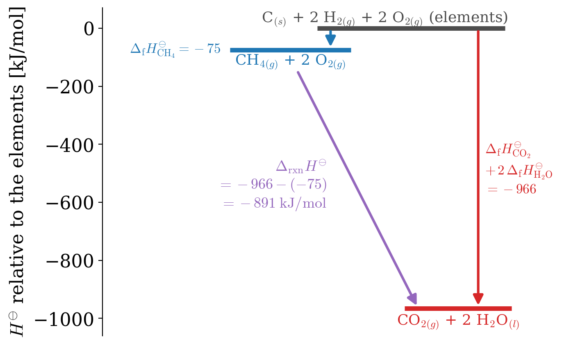

---
aliases:
  - Thermochemistry.html
  - 04_Thermochemistry.html
---

# Thermochemistry {#sec-Thermochemistry}
With this chapter, we begin the second part of the book, where we apply the laws of thermodynamics to chemistry. So far, we have studied changes in energy and entropy in the absence of chemical reactions, with one exception: at the end of @sec-thirdlaw, we found that the synthesis of ammonia decreases the entropy of the system (@exm-NH3entropy), and we left open the question of whether the reaction happens at all. To answer it, we need to know the heat that the reaction exchanges with its surroundings. When a chemical reaction takes place, some bonds break and some new ones form. Breaking a bond always requires energy, while forming a bond always releases energy. The balance between the energy spent to break the bonds of the reactants and the energy released when the bonds of the products form determines whether the reaction, overall, absorbs or releases energy.^[A common misconception is that energy is "stored" in chemical bonds and released when they break. It is the opposite: a bond is a more stable (lower-energy) arrangement than the separated atoms, so breaking it always costs energy. Fuels release energy when they burn because the bonds that form in the products (for example, in $\mathrm{CO}_2$ and $\mathrm{H}_2\mathrm{O}$) are, overall, stronger than the ones broken in the reactants.] For a proper thermodynamic treatment of the system, this extra energy must be included in the net balance. In this chapter, we will learn how to calculate it from tabulated data, and we will then use it to answer our question about ammonia.

## Reaction Enthalpies {#sec-rxnenthalpy}
Since most chemical reactions happen at constant atmospheric pressure (isobaric conditions) in the lab, we can use @eq-dh2 to replace the inexact differential of the heat with the exact differential of the state function called enthalpy. The advantage of this transformation is that it allows us to study the heat associated with chemical reactions at constant pressure independently of their path. Using the same notation that we introduced for reaction entropies in @sec-firstreaction, the heat associated with the reaction (rxn) is defined as:

$$
\Delta_{\text{rxn}} H = H_{\text{products}}-H_{\text{reactants}} \; .
$$ {#eq-DHrxn1}

For example, if we take a simple reaction of the form:

$$ \mathrm{A} + \mathrm{B} \rightarrow \mathrm{C} + \mathrm{D}, $$

the heat at constant pressure is equal to the enthalpy of reaction, which is calculated as:

$$
Q_P = \Delta_{\text{rxn}} H = \underbrace{ \left (H_{\mathrm{C}}+H_{\mathrm{D}} \right) }_{\text{products}} - \underbrace{\left( H_{\mathrm{A}}+H_{\mathrm{B}}\right)}_{\text{reactants}}.
$$ {#eq-DHrxn2}

Using the chemistry sign convention, @Def-chemistryconv, reactions are classified in terms of the sign of their reaction enthalpies as follows:

::: {#def-exoendo}
$\;$

- $\Delta_{\text{rxn}} H > 0 \Rightarrow$ *Endothermic reaction* (heat is gained by the system).
- $\Delta_{\text{rxn}} H < 0 \Rightarrow$ *Exothermic reaction* (heat is lost by the system).
:::

If we expand the sample reaction to account for its stoichiometry, as in the general reaction of @eq-genreaction, @eq-DHrxn2 can be rewritten as:

$$
Q_P = \Delta_{\text{rxn}} H = \underbrace{\left( cH_{\mathrm{C}}+dH_{\mathrm{D}} \right) }_{\text{products}} - \underbrace{ \left( aH_{\mathrm{A}}+bH_{\mathrm{B}} \right)}_{\text{reactants}},
$$ {#eq-DHrxn3}

while for the most general case we can write it:

$$
\Delta_{\text{rxn}} H = \sum_i \nu_i H_i,
$$ {#eq-DHrxn4}

where $\nu_i$ is the stoichiometric number of species $i$, positive for products and negative for reactants, as in @def-nui. @Eq-DHrxn4 has exactly the same form as the one that we used for reaction entropies, @eq-thirdlaweq.

## Calorimetry {#sec-calorimetry}
Reaction enthalpies are measured with a *calorimeter*, an insulated container in which the reaction takes place. Since the calorimeter does not exchange heat with the rest of the lab, the heat released or absorbed by the reaction stays inside it and changes its temperature. If the calorimeter (including everything inside it) has a total heat capacity $C_{\text{cal}}$, a temperature change $\Delta T$ corresponds to the heat of reaction:

$$
Q_{\text{rxn}} = -C_{\text{cal}}\,\Delta T,
$$ {#eq-calorimetry}

where the negative sign follows the chemistry sign convention: an exothermic reaction ($Q_{\text{rxn}}<0$) warms the calorimeter ($\Delta T>0$). The heat capacity of the calorimeter is determined beforehand by calibration, either with an electrical heater that supplies a known amount of energy, or with a reaction whose heat is accurately known, such as the combustion of benzoic acid.

There are two main kinds of calorimeters, and they measure two different state functions:

- **Constant-pressure calorimeters** are open to the atmosphere. The simplest example is the "coffee-cup" calorimeter of general chemistry labs, used for reactions in solution. At constant pressure, @eq-dh2 tells us that the heat equals the enthalpy change, $Q_P = \Delta_{\text{rxn}}H$.
- **Constant-volume (bomb) calorimeters** are sealed steel containers, called *bombs*, immersed in a water bath. They are used for combustions, where the sample burns in an excess of oxygen under pressure. At constant volume, no work is done, and the heat equals the energy change, $Q_V = \Delta_{\text{rxn}}U$, as in @eq-dUqv.

Since tables report enthalpies, the energies measured in bomb calorimeters must be converted. Using the definition of enthalpy, @eq-enthalpydef:

$$
\Delta_{\text{rxn}} H = \Delta_{\text{rxn}} U + \Delta(PV).
$$

The volumes of liquids and solids are so small that their contribution to $\Delta(PV)$ is negligible. For the gases, we can use the ideal gas law, $PV = nRT$, and at constant temperature $\Delta(PV) = \Delta n_{\text{gas}}RT$, which gives:

$$
\Delta_{\text{rxn}} H = \Delta_{\text{rxn}} U + \Delta n_{\text{gas}} RT,
$$ {#eq-DHDU}

where $\Delta n_{\text{gas}}$ is the number of moles of gaseous products minus the number of moles of gaseous reactants, per mole of reaction. If the number of moles of gas does not change, or if no gases are involved, $\Delta_{\text{rxn}} H \approx \Delta_{\text{rxn}} U$.

::: {#exm-bombmethane}
## Combustion of methane in a bomb calorimeter

A sample of $0.0200\;\text{mol}$ of methane is burned in a bomb calorimeter with $C_{\text{cal}} = 10.00\;\text{kJ/K}$, and the temperature of the calorimeter increases by $1.772\;\text{K}$. Calculate $\Delta_{\text{rxn}}U$ and $\Delta_{\text{rxn}}H$ at $298\;\text{K}$ for the reaction:

$$
\mathrm{CH}_{4(g)} + 2 \mathrm{O}_{2(g)} \rightarrow \mathrm{CO}_{2(g)} + 2 \mathrm{H}_2 \mathrm{O}_{(l)}.
$$

*Solution:* Using @eq-calorimetry, the heat released by the sample is:

$$
Q_V = -C_{\text{cal}}\,\Delta T = -10.00 \times 1.772 = -17.72\;\text{kJ}.
$$

Since the bomb has a constant volume, this heat is the energy change of the reaction, and per mole of methane:

$$
\Delta_{\text{rxn}} U = \frac{Q_V}{n} = \frac{-17.72\;\text{kJ}}{0.0200\;\text{mol}} = -886\;\text{kJ/mol}.
$$

In the reaction, 3 moles of gas (1 of methane and 2 of oxygen) become 1 mole of gas (carbon dioxide), while water is liquid, so $\Delta n_{\text{gas}} = 1 - 3 = -2$. Using @eq-DHDU:

$$
\Delta_{\text{rxn}} H = -886 + (-2)(8.314 \times 10^{-3})(298) = -886 - 5 = -891\;\text{kJ/mol}.
$$

The difference between $\Delta_{\text{rxn}}H$ and $\Delta_{\text{rxn}}U$ is only about 0.5%. The reaction enthalpy is more negative than the energy because the gas contracts, and at constant pressure the atmosphere does work on the system as it shrinks. We will obtain the same value of $\Delta_{\text{rxn}}H$ from tabulated data in @exm-HessLawEx.
:::

Experiments like this one, repeated for many substances, are the source of the tabulated enthalpies of formation that we introduce next.

## Standard Enthalpies of Formation {#sec-formenthalpy}
In principle, we could use @eq-DHrxn3 to calculate the reaction enthalpy associated with any reaction. However, to do so, the absolute enthalpies $H_i$ of reactants and products would be required. Unfortunately, absolute enthalpies are not known—and theoretically unknowable, since this would require an absolute zero for the enthalpy scale, which does not exist. This is the key difference with the entropy, for which the third law provides a natural zero (@sec-thirdlawsect), so that we could use the absolute values $S_i^\standardstate$ directly in @eq-thirdlaweq. For the enthalpy, we must instead choose a zero, and use enthalpies relative to this reference. The reference is defined as the constituent elements in their standard state, and the enthalpies of 1 mol of substance relative to this reference are called **standard enthalpies of formation**.

::: {#def-stdenthapies}
The *standard enthalpy of formation* of compound $i$, $\Delta_{\mathrm{f}} H_i^\standardstate$, is the change of enthalpy during the formation of 1 mol of $i$ from its constituent elements, with all substances in their standard states.
:::

The standard states are the ones that we defined in @def-standardstate, at the standard pressure $P^{\standardstate} = 1 \; \mathrm{bar}$. As for the entropies, there is no standard temperature, but standard enthalpies of formation are usually reported at room temperature, $T = 298.15 \; \mathrm{K}$. For the elements, the reference is the form in which each element is most stable at standard pressure (for example, for hydrogen, carbon, and oxygen the reference forms are $\mathrm{H}_{2(g)}, \mathrm{C}_{(s,\text{graphite})}, \text{and }\mathrm{O}_{2(g)}$,  respectively). Since forming an element from itself requires no change at all, the standard enthalpy of formation of an element in its reference form is zero.^[There are some exceptions, such as phosphorus, for which the most stable form at 1 bar is black phosphorus, but white phosphorus is chosen as the standard reference state for zero enthalpy of formation. For the purposes of this course, however, we can safely ignore them.]

For example, the standard enthalpies of formation of some common compounds at $T = 298.15 \; \mathrm{K}$ are calculated from the following reactions:

$$
\begin{aligned}
  \mathrm{C}_{(s,\text{graphite})}+\mathrm{O}_{2(g)} \rightarrow \mathrm{CO}_{2(g)} \qquad & \Delta_{\mathrm{f}} H_{\mathrm{CO}_{2(g)}}^\standardstate = -394 \; \text{kJ/mol} \\
   \mathrm{C}_{(s,\text{graphite})}+2 \mathrm{H}_{2(g)} \rightarrow \mathrm{CH}_{4(g)} \qquad & \Delta_{\mathrm{f}} H_{\mathrm{CH}_{4(g)}}^\standardstate = -75 \; \text{kJ/mol} \\
   \mathrm{H}_{2(g)}+\frac{1}{2} \mathrm{O}_{2(g)} \rightarrow \mathrm{H}_2 \mathrm{O}_{(l)} \qquad & \Delta_{\mathrm{f}} H_{\mathrm{H}_2 \mathrm{O}_{(l)}}^\standardstate = -286 \; \text{kJ/mol}
\end{aligned}
$$ {#eq-someDfH}

A comprehensive list of standard enthalpies of formation of inorganic and organic compounds is also reported in @sec-appendix.

## Hess's Law {#sec-hessslaw}
The calculation of a standard reaction enthalpy can be performed using the following cycle:

$$
\begin{aligned}
 \text{reactants} & \quad \xrightarrow{\Delta_{\text{rxn}} H^\standardstate} \quad \text{products} \\
\scriptstyle{-\Delta_{\text{f}} H_{\text{reactants}}^\standardstate} \quad \bigg\downarrow \quad & \qquad \qquad \qquad \qquad \scriptstyle{\bigg\uparrow  \; \Delta_{\text{f}} H_{\text{products}}^\standardstate} \\
 \text{"elements in } & \text{their standard reference state"}
\end{aligned}
$$ {#eq-Hesscycle}

This process is summarized by the simple formula:

$$
\Delta_{\text{rxn}} H^\standardstate = \Delta_{\mathrm{f}} H_{\text{products}}^\standardstate - \Delta_{\mathrm{f}} H_{\text{reactants}}^\standardstate.
$$ {#eq-Hess1}

Notice how there is a negative sign in front of the enthalpy of formation of the reactants because they are normally defined for the reactions that go from the elements to the reactants and not vice-versa. To close the cycle in @eq-Hesscycle, however, we should go from the reactants to the elements, and therefore we must invert the sign in front of the formation enthalpies of the reactants. @Eq-Hess1 can be generalized using the same technique used to derive @eq-DHrxn4, resulting in:

$$
\Delta_{\text{rxn}} H^\standardstate = \sum_i \nu_i \Delta_{\mathrm{f}} H_i^\standardstate,
$$ {#eq-Hess}

which is a mathematical expression of the law that is known as **Hess's Law**. Hess's law is valid at constant pressure because, at those conditions, the heat of reaction—a path function—is equal to the enthalpy of reaction—a state function. Therefore, the enthalpy of a reaction depends exclusively on the initial and final state, and it can be obtained via the pathway that passes through the elements in their standard state (the formation pathway).

::: {#exm-HessLawEx}
## Combustion enthalpy of methane from Hess's law

Calculate the standard enthalpy of combustion at 298 K of 1 mol of methane, using the data in @eq-someDfH.

*Solution:* The reaction that is under consideration is:
$$
\mathrm{CH}_{4(g)} + 2 \mathrm{O}_{2(g)} \rightarrow \mathrm{CO}_{2(g)} + 2 \mathrm{H}_2 \mathrm{O}_{(l)} \qquad \Delta_{\text{rxn}} H^\standardstate = ?
$$

Using Hess's Law, @eq-Hess, the enthalpy of combustion of methane is:

$$
\Delta_{\text{rxn}} H^\standardstate =  \Delta_{\text{f}} H^\standardstate_{\mathrm{CO}_{2(g)}} + 2 \Delta_{\text{f}} H^\standardstate_{\mathrm{H_2O}_{(l)}} - \Delta_{\text{f}} H^\standardstate_{\mathrm{CH}_{4(g)}} - 2 \underbrace{\Delta_{\text{f}} H^\standardstate_{\mathrm{O}_{2(g)}}}_{=0}
$$

whose values are reported in @eq-someDfH. Notice that the formation enthalpy of $\mathrm{O}_{2(g)}$ is zero, since it is an element in its standard state. The final result is:

$$
\Delta_{\text{rxn}} H^\standardstate =  \overbrace{-394}^{\Delta_{\text{f}} H^\standardstate_{\mathrm{CO}_{2(g)}}} +2 \overbrace{(-286)}^{\Delta_{\text{f}} H^\standardstate_{\mathrm{H_2O}_{(l)}}} - \overbrace{(-75)}^{\Delta_{\text{f}} H^\standardstate_{\mathrm{CH}_{4(g)}}}  = -891 \; \mathrm{kJ/mol}.
$$

where the negative sign indicates that the reaction is exothermic (see @def-exoendo), as we should expect. This is the same value that we obtained from the bomb calorimeter in @exm-bombmethane. The cycle that we used to solve this exercise can be summarized as:

$$
\begin{aligned}
\mathrm{CH}_{4(g)} + & 2 \mathrm{O}_{2(g)} \quad \xrightarrow{\Delta_{\text{rxn}} H^\standardstate} \quad \mathrm{CO}_{2(g)} + 2 \mathrm{H}_2 \mathrm{O}_{(l)} \\
  \scriptstyle{-\Delta_{\text{f}} H_{\mathrm{CH}_{4(g)},\mathrm{O}_{2(g)}}^\standardstate} & \searrow \qquad \qquad \qquad \qquad \qquad \nearrow \; \scriptstyle{\Delta_{\text{f}} H_{\text{CO}_{2(g)},\mathrm{H}_{2}\mathrm{O}_{(l)}}^\standardstate}\\
  & \qquad \mathrm{H}_{2(g)}, \mathrm{C}_{(s,\text{graphite})}, \mathrm{O}_{2(g)}
\end{aligned}
$$

Notice that at standard pressure and $T = 298 \; \mathrm{K}$ water is in liquid form. However, when we burn methane, the heat associated with the exothermic reaction immediately vaporizes the water. Substances in different states of matter have different formation enthalpies, and $\Delta_{\text{f}} H^\standardstate_{\mathrm{H_2O}_{(g)}} =  -242 \  \mathrm{kJ/mol}$. The difference between the formation enthalpies of the same substance in different states represents the latent heat that separates them. For example, for water:

$$
\begin{aligned}
\Delta_{\text{vap}} H^\standardstate_{\mathrm{H_2O}} & = \Delta_{\text{f}} H^\standardstate_{\mathrm{H_2O}_{(g)}} - \Delta_{\text{f}} H^\standardstate_{\mathrm{H_2O}_{(l)}} \\
& = (-242) - (-286) = + 44 \; \text{kJ/mol}
\end{aligned}
$$

which is the latent heat of vaporization for water, $\Delta_{\text{vap}} H^\standardstate_{\mathrm{H_2O}}$, the same value that we used in @exm-troutonex. The latent heat is positive to indicate that the system absorbs energy in going from the liquid to the gaseous state (and it will release energy when going the opposite direction from gas to liquid).
:::

The same cycle can be drawn as an enthalpy diagram, @fig-hessmethane, where each species sits at its enthalpy relative to the elements. Since the enthalpy is a state function, the two paths from the reactants to the products, directly or through the elements, must give the same enthalpy change.

{#fig-hessmethane fig-alt="Enthalpy level diagram. A gray level at 0 kilojoules per mole for the elements, carbon, hydrogen, and oxygen. A blue level slightly below, at minus 75, for methane plus two oxygen molecules, reached by a short blue arrow labeled formation enthalpy of methane. A red level far below, at minus 966, for carbon dioxide plus two liquid water molecules, reached from the elements by a long red arrow. A purple arrow from the methane level to the products level is labeled reaction enthalpy equals minus 966 minus minus 75, equals minus 891 kilojoules per mole." width="80%"}

## Bond Enthalpies {#sec-bondenthalpy}
When the formation enthalpies of a compound are not available, we can still estimate a reaction enthalpy from the bonds that break and form, as we described at the beginning of this chapter. The *bond enthalpy* is the enthalpy needed to break 1 mol of a given bond in the gas phase. Since the same bond has slightly different strengths in different molecules, tables report average values, such as those in @tbl-bondenthalpies.

| Bond | Bond enthalpy [kJ/mol] | Bond | Bond enthalpy [kJ/mol] |
|:----:|:----:|:----:|:----:|
| H–H  | 436 | N–H  | 391 |
| C–H  | 413 | N≡N  | 945 |
| O–H  | 463 | O=O  | 498 |
| C–C  | 348 | C=O (in CO~2~) | 799 |

: Average Bond Enthalpies. {#tbl-bondenthalpies}

Breaking a bond always requires energy, and forming a bond always releases it, so:

$$
\Delta_{\text{rxn}} H \approx \sum_{\text{broken}} \text{(bond enthalpies)} - \sum_{\text{formed}} \text{(bond enthalpies)}.
$$ {#eq-bondenthalpy}

Notice that the order is the opposite of Hess's law: the bonds of the *reactants* come first, with a positive sign. For example, in the synthesis of ammonia we break one N≡N bond and three H–H bonds, and we form six N–H bonds:

$$
\Delta_{\text{rxn}} H \approx \left[945 + 3(436)\right] - 6(391) = 2253 - 2346 = -93\;\text{kJ/mol},
$$

very close to the value of $-91.8\;\text{kJ/mol}$ obtained from the formation enthalpies. The agreement is not always this good, since bond enthalpies are averages, and @eq-bondenthalpy is valid only when all reactants and products are gases. Formation enthalpies, when available, should always be preferred.

## Calculations of Enthalpies of Reaction at $T \neq 298 \; \text{K}$

Standard enthalpies of formation are usually reported at room temperature ($T$ = 298 K), but enthalpies of formation at any temperature $T'$ can be calculated from the values at 298 K using @eq-Cpdef and @eq-dh2:

$$
\begin{aligned}
dH = C_P dT \rightarrow & \int_{H_{298}^\standardstate}^{H_{T'}^\standardstate} dH =  \int_{298}^{T'} C_P dT \\
            & H_{T'}^\standardstate - H_{298}^\standardstate = \int_{298}^{T'} C_P dT \\
            & H_{T'}^\standardstate = H_{298}^\standardstate + \int_{298}^{T'} C_P dT,
\end{aligned}
$$ {#eq-DrxnHneq298}

which, in conjunction with Hess's Law, @eq-Hess, results in:

$$
\Delta_{\text{rxn}} H_{T'}^\standardstate = \Delta_{\text{rxn}} H_{298}^\standardstate + \int_{298}^{T'} \Delta C_P dT,
$$ {#eq-DrxnHneq298f}

with $\Delta C_P = \sum_i \nu_i C_{P,i}$. @Eq-DrxnHneq298f is known as **Kirchhoff's law**, after the German physicist Gustav Robert Kirchhoff (1824–1887).

::: {#exm-DHtdiff298}
## Reaction enthalpy at 398 K

Calculate $\Delta_{\text{rxn}}H^\standardstate_{398}$ of the following reaction at 398 K, knowing that $\Delta_{\text{rxn}}H^\standardstate_{298}$ is -283.0 kJ/mol, and the following $C_P$ values: $\mathrm{CO}_{(g)}$ = 29 J/(mol K), $\mathrm{O}_{2(g)}$ = 30 J/(mol K), $\mathrm{CO}_{2(g)}$ = 38 J/(mol K):

$$
\mathrm{CO}_{(g)}+\frac{1}{2}\mathrm{O}_{2(g)} \rightarrow \mathrm{CO}_{2(g)},
$$

*Solution:* Using @eq-DrxnHneq298f we obtain:

$$
 \Delta_{\text{rxn}} H^\standardstate_{398} = \overbrace{-283.0}^{\Delta_{\text{rxn}}H^\standardstate_{298}} + \int_{298}^{398} ( \overbrace{38}^{C_P^{\mathrm{CO}_2}} -\overbrace{29}^{C_P^{\mathrm{CO}}} -\frac{1}{2}\overbrace{30}^{C_P^{\mathrm{O}_2}} ) \times 10^{-3} dT,
$$

which, assuming that the heat capacities do not depend on the temperature, becomes:

$$
\begin{aligned}
 \Delta_{\text{rxn}} H^\standardstate_{398} &= -283.0 + \left(38-29-\frac{1}{2}30 \right) \times 10^{-3} (398-298) \\ &= -283.6 \; \text{kJ/mol}.
\end{aligned}
$$

As we notice from this result, a difference in temperature of 100 K translates into a change in $\Delta_{\text{rxn}}H^\standardstate$ of this reaction of only 0.6 kJ/mol. This is a trend that is often observed, and values of $\Delta_{\text{rxn}}H$ are very weakly dependent on changes in temperature for most chemical reactions. This numerical result can also be compared with the amount that is experimentally measured for $\Delta_{\text{rxn}}H^\standardstate_{398}$ of this reaction, which is –283.67 kJ/mol. This comparison strongly supports the assumption that we used to solve the integral in @eq-DrxnHneq298f, confirming that the heat capacities are mostly independent of temperature.
:::

## Spontaneity of Chemical Reactions {#sec-rxnspont}
We can now go back to the question that we left open at the end of @sec-thirdlaw: does the synthesis of ammonia happen? To decide whether a process is spontaneous, we need the entropy of the universe, @eq-dsuniv. For a reaction at constant temperature and pressure, both of its pieces come from tabulated data:

- The entropy of the system is the reaction entropy, which we calculate from the standard entropies with @eq-thirdlaweq.
- The entropy of the surroundings comes from the heat that the reaction exchanges with them, @eq-dssurr. At constant pressure, this heat is the reaction enthalpy, $Q_{\text{sys}} = \Delta_{\text{rxn}}H$, and therefore:

$$
\Delta S^{\text{surr}} = -\frac{\Delta_{\text{rxn}} H}{T}.
$$ {#eq-dssurrrxn}

An exothermic reaction releases heat and increases the entropy of the surroundings, while an endothermic reaction absorbs heat and decreases it.

::: {#exm-NH3universe}
## Is the synthesis of ammonia spontaneous?

Using the result of @exm-NH3entropy, $\Delta_{\text{rxn}} S^\standardstate = -198.1\;\frac{\text{J}}{\text{mol K}}$, and knowing that $\Delta_{\mathrm{f}} H^\standardstate_{\mathrm{NH}_{3(g)}} = -45.9\;\text{kJ/mol}$, decide whether the synthesis of ammonia at standard conditions and $298\;\text{K}$ is spontaneous:

$$
\mathrm{N}_{2(g)} + 3\mathrm{H}_{2(g)} \rightarrow 2\mathrm{NH}_{3(g)}.
$$

*Solution:* Using Hess's law, @eq-Hess, and remembering that the formation enthalpies of $\mathrm{N}_{2(g)}$ and $\mathrm{H}_{2(g)}$ are zero, since they are elements in their reference form:

$$
\Delta_{\text{rxn}} H^\standardstate = 2 \Delta_{\mathrm{f}} H^\standardstate_{\mathrm{NH}_{3(g)}} - \underbrace{\Delta_{\mathrm{f}} H^\standardstate_{\mathrm{N}_{2(g)}}}_{=0} - 3\underbrace{\Delta_{\mathrm{f}} H^\standardstate_{\mathrm{H}_{2(g)}}}_{=0} = 2(-45.9) = -91.8\;\text{kJ/mol}.
$$

The reaction is exothermic, and the heat that it releases increases the entropy of the surroundings, @eq-dssurrrxn:

$$
\Delta S^{\text{surr}} = -\frac{\Delta_{\text{rxn}} H^\standardstate}{T} = -\frac{-91.8 \times 10^3}{298} = +308.1\;\frac{\text{J}}{\text{mol K}}.
$$

The entropy of the universe is therefore:

$$
\Delta S^{\text{universe}} = \Delta_{\text{rxn}} S^\standardstate + \Delta S^{\text{surr}} = -198.1 + 308.1 = +110.0\;\frac{\text{J}}{\text{mol K}},
$$

and the reaction is spontaneous. Just as for the freezing of supercooled water in @exm-supercooledEx, the system loses entropy, but the heat that it releases increases the entropy of the surroundings by more.
:::

This result should not make us think that a bottle of nitrogen and hydrogen turns into ammonia on its own. At room temperature, the reaction is so slow that nothing measurable happens, even over years. In industry, ammonia is produced with the Haber–Bosch process, which uses a catalyst and high temperatures to make the reaction fast enough. Thermodynamics tells us which way a reaction goes; how fast it goes is the subject of chemical kinetics, which we will study in @sec-Kinetics.

The calculation in @exm-NH3universe works, but it requires two separate pieces, one for the system and one for the surroundings. We can combine them in a single expression by multiplying the entropy of the universe by $-T$:

$$
-T\Delta S^{\text{universe}} = -T\Delta_{\text{rxn}} S + \Delta_{\text{rxn}} H = \Delta_{\text{rxn}} H - T\Delta_{\text{rxn}} S.
$$ {#eq-TdSuniv}

Since $T$ is positive, a reaction is spontaneous ($\Delta S^{\text{universe}}>0$) when the right-hand side of @eq-TdSuniv is negative. For the synthesis of ammonia, it is $-91.8 - 298 \times (-0.1981) = -32.8\;\text{kJ/mol}$. Notice that the right-hand side contains only properties of the system, and no reference to the surroundings. This combination of enthalpy and entropy is so useful that it deserves its own name. In the next chapter, we will see that it is the change of a new state function, the Gibbs energy, and we will discover the general family of functions to which it belongs, called the thermodynamic potentials.

## Chapter Review {#sec-rev7}
### Key Ideas
- **Reaction enthalpy** is the heat exchanged by a reaction at constant pressure: negative for exothermic reactions, positive for endothermic ones.
- **Reaction enthalpies** are calculated with the same stoichiometric numbers, $\nu_i$, that we used for reaction entropies: negative for reactants and positive for products.
- **Calorimetry:** $Q_{\text{rxn}} = -C_{\text{cal}}\Delta T$. A constant-pressure calorimeter measures $\Delta_{\text{rxn}}H$, a bomb calorimeter measures $\Delta_{\text{rxn}}U$, and the two are related by $\Delta_{\text{rxn}}H = \Delta_{\text{rxn}}U + \Delta n_{\text{gas}}RT$.
- **Standard enthalpies of formation,** $\Delta_{\text{f}}H^\standardstate$, refer to the standard state at $P^\standardstate = 1\;\text{bar}$, and they are zero for elements in their most stable form. Unlike entropies, enthalpies have no natural zero, so only these relative values can be tabulated.
- **Hess's law:** since $H$ is a state function, $\Delta_{\text{rxn}}H^\standardstate = \sum_i \nu_i \Delta_{\text{f}}H_i^\standardstate$, whatever the path of the reaction.
- **Bond enthalpies** give quick estimates for gas-phase reactions: bonds broken minus bonds formed.
- **Other temperatures (Kirchhoff's law):** $\Delta_{\text{rxn}}H^\standardstate_{T'} = \Delta_{\text{rxn}}H^\standardstate_{298} + \int_{298}^{T'} \Delta C_P\,dT$, and the correction is usually small.
- **Spontaneity of a reaction:** $\Delta S^{\text{universe}} = \Delta_{\text{rxn}}S - \frac{\Delta_{\text{rxn}}H}{T}$. A reaction that lowers the entropy of the system, such as the synthesis of ammonia, can still be spontaneous if it releases enough heat. The combination $\Delta_{\text{rxn}}H - T\Delta_{\text{rxn}}S = -T\Delta S^{\text{universe}}$ depends only on the system, and it is negative for spontaneous reactions.
- **Which way, not how fast:** thermodynamics tells us whether a reaction is spontaneous, but not how fast it goes.

### Study Questions {#sec-quest7}
**1. What characterizes an endothermic reaction?**

a. $\Delta_{\text{rxn}}H < 0$, and heat is released by the system.
b. $\Delta_{\text{rxn}}H = 0$.
c. $\Delta_{\text{rxn}}H > 0$, and heat is gained by the system.
d. The reaction is always spontaneous.
e. The reaction happens at constant volume.

---

**2. What is the sign convention for the stoichiometric coefficients $\nu_i$?**

a. Positive for products and negative for reactants.
b. Positive for reactants and negative for products.
c. Always positive.
d. Positive for gases and negative for liquids.
e. Positive for elements and negative for compounds.

---

**3. What is the standard enthalpy of formation of a compound?**

a. The enthalpy of the compound at 0 K.
b. The enthalpy change when 1 mol of the compound is decomposed into atoms.
c. The heat released when the compound burns in oxygen.
d. The absolute enthalpy of the compound at 298 K.
e. The enthalpy change when 1 mol of the compound is formed from its elements, with all substances in their standard states.

---

**4. What is the standard pressure used in thermodynamic tables?**

a. 0 bar.
b. 1 bar.
c. 1 atm exactly.
d. 10 bar.
e. It depends on the substance.

---

**5. What is the standard enthalpy of formation of $\mathrm{O}_{2(g)}$?**

a. $-286\;\text{kJ/mol}$.
b. $-394\;\text{kJ/mol}$.
c. $+498\;\text{kJ/mol}$.
d. $0\;\text{kJ/mol}$, since it is an element in its standard state.
e. It cannot be measured.

---

**6. Which formula expresses Hess's law?**

a. $\Delta_{\text{rxn}}H^{\standardstate} = \sum_i \nu_i \Delta_{\text{f}}H_i^{\standardstate}$.
b. $\Delta_{\text{rxn}}H^{\standardstate} = \sum_i \Delta_{\text{f}}H_i^{\standardstate}$.
c. $\Delta_{\text{rxn}}H^{\standardstate} = \prod_i \nu_i \Delta_{\text{f}}H_i^{\standardstate}$.
d. $\Delta_{\text{rxn}}H^{\standardstate} = Q_V$.
e. $\Delta_{\text{rxn}}H^{\standardstate} = \sum_i \nu_i S_i^{\standardstate}$.

---

**7. Why can Hess's law be used to calculate reaction enthalpies?**

a. Because all reactions are exothermic.
b. Because heat is a state function.
c. Because the enthalpy is a state function, so its change does not depend on the path.
d. Because all reactions happen at standard conditions.
e. Because enthalpies of formation are always negative.

---

**8. What does the difference between the enthalpies of formation of $\mathrm{H}_2\mathrm{O}_{(g)}$ and $\mathrm{H}_2\mathrm{O}_{(l)}$ represent?**

a. The enthalpy of formation of water.
b. The heat capacity of water.
c. The enthalpy of combustion of hydrogen.
d. Zero, since they are the same substance.
e. The enthalpy (latent heat) of vaporization of water.

---

**9. How can a reaction enthalpy at a temperature $T'$ be calculated from its value at 298 K?**

a. $\Delta_{\text{rxn}}H_{T'} = \Delta_{\text{rxn}}H_{298} \cdot \frac{T'}{298}$.
b. $\Delta_{\text{rxn}}H_{T'} = \Delta_{\text{rxn}}H_{298} + \int_{298}^{T'} \Delta C_P\,dT$.
c. $\Delta_{\text{rxn}}H_{T'} = \Delta_{\text{rxn}}H_{298}$ always.
d. $\Delta_{\text{rxn}}H_{T'} = \Delta_{\text{rxn}}H_{298} - T'\Delta S$.
e. $\Delta_{\text{rxn}}H_{T'} = \int_{298}^{T'} C_P\,dT$.

---

**10. The synthesis of ammonia has $\Delta_{\text{rxn}}S^\standardstate < 0$. Why is it spontaneous at 298 K?**

a. Because the entropy of the system does not matter for spontaneity.
b. Because the reaction is endothermic.
c. Because every reaction between gases is spontaneous.
d. Because the heat that it releases increases the entropy of the surroundings by more than the system loses.
e. Because the reaction is fast at room temperature.

---

**11. A bomb calorimeter measures the heat of a reaction at constant volume. Which quantity does it give?**

a. $\Delta_{\text{rxn}}H$.
b. $\Delta_{\text{rxn}}U$, which can be converted to $\Delta_{\text{rxn}}H$ with $\Delta_{\text{rxn}}H = \Delta_{\text{rxn}}U + \Delta n_{\text{gas}}RT$.
c. $\Delta_{\text{rxn}}S$.
d. The work done by the reaction.
e. The heat capacity of the products.

---

**12. How is a reaction enthalpy estimated from bond enthalpies?**

a. Bonds formed minus bonds broken.
b. Bonds broken plus bonds formed.
c. Bonds broken minus bonds formed.
d. The sum of the bond enthalpies of the products.
e. It cannot be estimated from bond enthalpies.

---

::: {.callout-tip collapse="true" icon="false"}
## Answers

1.c, 2.a, 3.e, 4.b, 5.d, 6.a, 7.c, 8.e, 9.b, 10.d, 11.b, 12.c
:::
