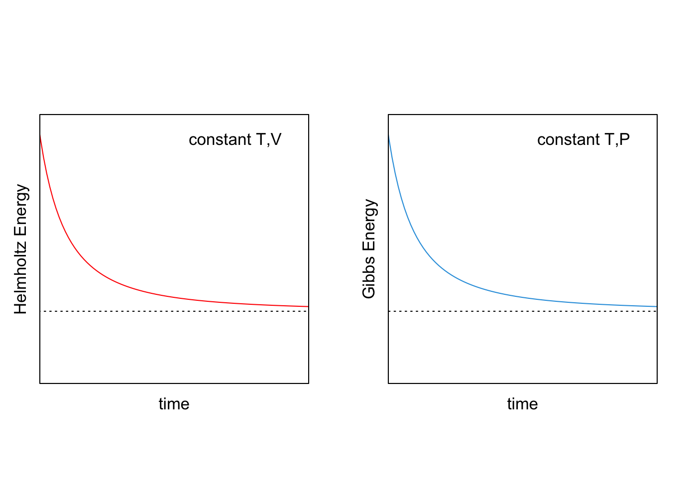

---
aliases:
  - Potentials.html
---

# Thermodynamic Potentials {#sec-Potentials}
## Fundamental Equation of Thermodynamics {#sec-fundeq}
Let's summarize some of the results from the first and second law of thermodynamics that we have seen so far. For reversible processes in closed systems:

$$
\begin{aligned}
\text{From 1}^{\text{st}} \text{ Law:} \qquad \quad & dU = đQ_{\mathrm{REV}}-PdV \\
\text{From The Definition of Entropy:} \qquad \quad & dS = \frac{đQ_{\mathrm{REV}}}{T} \rightarrow đQ_{\mathrm{REV}} = TdS \\
\\
\Rightarrow \quad & dU = TdS - PdV.
\end{aligned}
$$ {#eq-dunv}

@Eq-dunv is called the **fundamental equation of thermodynamics** since it combines the first and the second laws. Even though we started the derivation above by restricting to reversible transformations only, if we look carefully at @eq-dunv, we notice that it exclusively involves state functions. As such, it applies to both reversible and irreversible processes. The fundamental equation, however, remains constrained to closed systems. This fact restricts its utility for chemistry, since when a chemical reaction happens, the composition of the system will change, and the system is no longer closed. 

At the end of the 19^th^ century, Josiah Willard Gibbs (1839–1903) proposed an important addition to the fundamental equation to account for chemical reactions. Gibbs was able to do so by introducing a new quantity that he called the chemical potential:

::: {#def-chemicalpot}
The *chemical potential* is the amount of energy absorbed or released due to a change of the particle number of a given chemical species.
:::

The chemical potential of species $i$ is usually abbreviated as $\mu_i$, and it enters the fundamental equation of thermodynamics as:

$$
dU = TdS-PdV+\sum_i\mu_i dn_i,
$$ {#eq-dunv2}

where $dn_i$ is the differential change in the number of moles of substance $i$, and the summation extends over all chemical species in the system. 

According to the fundamental equation, the internal energy of a system is a function of the three variables entropy, $S$, volume, $V$, and the numbers of moles $\{n_i\}$.^[In the case of the numbers of moles we include them in curly brackets to indicate that there might be more than one, depending on how many species undergo chemical reactions.] Because of their importance in determining the internal energy, these three variables are crucial in thermodynamics. Under several circumstances, however, they might not be the most convenient variables to use.^[For example, we don't always have a simple way to calculate or to measure the entropy.] To emphasize the important connections given by the fundamental equation, we can use the notation $U(S,V,\{n_i\})$ and we can term $S$, $V$, and $\{n_i\}$ **natural variables** of the energy.

## Thermodynamic Potentials {#sec-thermpot}
Starting from the fundamental equation, we can define new thermodynamic state functions that are more convenient to use under certain specific conditions. The new functions are determined by using a mathematical procedure called the Legendre transformation. A Legendre transformation is a linear change in variables that brings from an initial mathematical function to a new function obtained by subtracting one or more products of conjugate variables.^[The mathematical condition that is fulfilled when performing a Legendre transformation is that the first derivatives of the original function and its transformation are inverse functions of each other.]

Taking the internal energy as defined in @eq-dunv, we can perform such procedure by subtracting products of the following conjugate variables pairs: $T \text{ and } S$ or $-P \text{ and } V$. This procedure aims to define new state functions that depend on more convenient natural variables.^[The rigorous mathematical definition of conjugate variables is unimportant at this stage. However, we can relate the variables in a pair with basic physics by noticing how the first variable in a pair is always intensive ($T$ and $-P$), while the second one is always extensive ($S$ and $V$). The intensive variables represent thermodynamic driving forces (as compared with mechanical forces in classical mechanics), while the extensive ones are the thermodynamic displacements (as compared with spatial displacements in classical mechanics). Similarly to classical mechanics, the product of two conjugate variables in a pair yields an energy. The minus sign in front of $P$ is explained by the fact that an increase in the force should always correspond to an increase in the displacement (while $P$ and $V$ are inversely related).] The new functions are called "thermodynamic potential energies," or simply **thermodynamic potentials**.^[Even if we introduced both concepts in the same chapter, it is important to never confuse the *thermodynamic potentials*—which are potential energy functions—with the *chemical potential*—which has been introduced by Gibbs to study heat in chemical reactions.] An example of this procedure is given by the definition of enthalpy that we have already seen in @sec-enthalpy. If we take the internal energy and subtract the product of two conjugate variables ($-P$ and $V$), we obtain a new state function called enthalpy, as we did in @eq-enthalpydef. Taking the differential of this definition, we obtain:

$$
dH = dU +VdP +PdV,
$$ {#eq-dhdef1}

and using the fundamental equation, @eq-dunv2, to replace $dU$, we obtain:

$$
\begin{aligned}
dH & = TdS -PdV +\sum_i\mu_i dn_i +VdP +PdV  \\
   & = TdS +VdP +\sum_i\mu_i dn_i.
\end{aligned}
$$ {#eq-dhdef2}

which is the fundamental equation for enthalpy. The natural variables of the enthalpy are $S$, $P$, and $\{n_i\}$. The Legendre transformation has allowed us to go from $U(S,V,\{n_i\})$ to $H(S,P,\{n_i\})$ by replacing the dependence on the extensive variable, $V$, with an intensive one, $P$.

Following the same procedure, we can perform another Legendre transformation to replace the entropy with a more convenient intensive variable such as the temperature. This can be done by defining a new function called the Helmholtz energy, $A$, as:

$$
A = U -TS
$$ {#eq-dadef1}

which, taking the differential and using the fundamental equation (@eq-dunv2) becomes:

$$
\begin{aligned}
dA &= dU -SdT -TdS = TdS - PdV +\sum_i \mu_i dn_i -SdT -TdS  \\
   &= -SdT -PdV +\sum_i \mu_i dn_i.
\end{aligned}
$$ {#eq-dadef2}

The Helmholtz energy is named after Hermann Ludwig Ferdinand von Helmholtz (1821–1894), and its natural variables are temperature, volume, and the number of moles.

Finally, suppose we perform a Legendre transformation on the internal energy to replace both the entropy and the volume with intensive variables. In that case, we can define a new function called the Gibbs energy, $G$, as:

$$
G = U -TS +PV = H-TS
$$ {#eq-dgdef1}

which, taking again the differential and using @eq-dunv2 becomes:

$$
\begin{aligned}
dG &= dU -SdT -TdS +VdP +PdV = dH -SdT -TdS\\
   &= TdS - PdV +\sum_i\mu_i dn_i -SdT -TdS +VdP +PdV \\
   &= VdP -SdT +\sum_i\mu_i dn_i.
\end{aligned}
$$ {#eq-dgdef2} 

The Gibbs energy is named after Willard Gibbs himself, and its natural variables are temperature, pressure, and number of moles.

A summary of the four thermodynamic potentials is given in the following table.

\tiny
|          **Name**         | **Symbol** |    **Fundamental Equation**    | **Natural Variables** |
|:-------------------------:|:----------:|:------------------------------:|:---------------------:|
| **Energy**                |     $U$    |  $dU=TdS-PdV+\sum_i\mu_i dn_i$ |      $S,V,\{n_i\}$      |
| **Enthalpy**              |     $H$    |  $dH=TdS+VdP+\sum_i\mu_i dn_i$ |      $S,P,\{n_i\}$      |
| **Helmholtz Energy** |     $A$    | $dA=-SdT-PdV+\sum_i\mu_i dn_i$ |      $T,V,\{n_i\}$      |
| **Gibbs Energy**     |     $G$    |  $dG=VdP-SdT+\sum_i\mu_i dn_i$ |      $T,P,\{n_i\}$      |
\normalsize

The thermodynamic potentials are the analog of the potential energy in classical mechanics.^[For the mathematically inclined, an entertaining method to summarize the same thermodynamic potentials is the [thermodynamic square](https://en.wikipedia.org/wiki/Thermodynamic_square).]

## Gibbs and Helmholtz Energies {#sec-freeenergies}
The Legendre transformation procedure translates all information contained in the original function to the new one. Therefore, $H(S,P,\{n_i\})$, $A(T,V,\{n_i\})$, and $G(T,P,\{n_i\})$ all contain the same information that is in $U(S,V,\{n_i\})$. However, the new functions depend on different natural variables, and they are useful at different conditions. For example, when we want to study chemical changes, we are interested in studying the term $\sum_i\mu_i dn_i$ that appears in each thermodynamic potential. To do so, we need to isolate the chemical term by keeping all other natural variables constant. For example, changes in the chemical term will correspond to changes in the internal energy at constant $S$ and constant $V$:

$$
dU(S,V,\{n_i\}) = \sum_i\mu_i dn_i \quad \text{if} \quad dS=dV=0.
$$ {#eq-duchem}

Similarly:

$$
\begin{aligned}
dH(S,P,\{n_i\}) = \sum_i\mu_i dn_i \quad \text{if} \quad dS=dP=0, \\
dA(T,V,\{n_i\}) = \sum_i\mu_i dn_i \quad \text{if} \quad dT=dV=0, \\
dG(T,P,\{n_i\}) = \sum_i\mu_i dn_i \quad \text{if} \quad dT=dP=0.
\end{aligned}
$$ {#eq-dhagchem}

The latter two cases are particularly interesting since most of chemistry happens at either constant volume,^[for example, several industrial processes in chemical plants.] or constant pressure.^[for example, most processes in a chemistry lab.] Since $dS=0$ is not a requirement for both energies to describe chemical changes, we can apply either of them to study non-isentropic processes. If a process is not isentropic, it either increases the entropy of the universe, or it decreases it. Therefore—according to the second law—it is either spontaneous or not. Using this concept in conjunction with Clausius theorem, we can devise new criteria for inferring the spontaneity of a process that depend exclusively on the potentials. 

Recalling Clausius theorem:

$$
d S^{\mathrm{sys}} \geq \frac{đQ}{T_{\text{surr}}} \quad \longrightarrow \quad TdS \geq đQ,
$$ {#eq-dssyscrit}

we can consider the two cases: constant $V$ ($đQ_V=dU$, left), and constant $P$ ($đQ_P=dH$, right):

$$
\begin{aligned}
\text{constant} & \; V:           & \qquad \qquad & \qquad \qquad &     \text{constant} & \; P: \\
\\
TdS & \geq dU           & &   &     TdS & \geq dH \\
\\
TdS -dU & \geq 0         & &   &      TdS -dH & \geq 0 \\
\end{aligned}
$$ {#eq-dadgder1}

we can then simplify the definition of each energy, @eq-dadef2 and @eq-dgdef2, assuming constant temperature as:

$$
\begin{aligned}
\text{constant} & \; T,V:           & \qquad & \qquad &     \text{constant} & \; T,P: \\
\\
(dA)_{T,V} &= dU -TdS     & &   &       (dG)_{T,P} &= dH - TdS \\ 
\\
dU = (dA)_{T,V} &+TdS       & &   &       dH = (dG)_{T,P} &+TdS
\end{aligned}
$$ {#eq-dadgder3}

and by merging $dU$ and $dH$ from @eq-dadgder3 into Clausius theorem expressed using @eq-dadgder1, we obtain:

$$
\begin{aligned}
TdS -(dA)_{T,V} &- TdS \geq 0 & \qquad & \qquad & TdS -(dG)_{T,P} &- TdS \geq 0 \\
\\
(dA)_{T,V} & \leq 0 & \qquad & \qquad & (dG)_{T,P} & \leq 0. \\
\end{aligned}
$$ {#eq-dadgcond}

These equations represent the conditions on $dA$ and $dG$ for inferring the spontaneity of a process, and can be summarized as follows:

::: {#def-helmgibbsminimum}
$\;$

- During a spontaneous process at constant *temperature* and *volume*, the *Helmholtz energy* will decrease $(dA<0)$, until it reaches a stationary point at which the system will be at equilibrium $(dA=0)$.
- During a spontaneous process at constant *temperature* and *pressure*, the *Gibbs energy* will decrease $(dG<0)$, until it reaches a stationary point at which the system will be at equilibrium $(dG=0)$.
:::

{#fig-agfig fig-alt="Two plots against time. Left, at constant temperature and volume: the Helmholtz energy, in red, decreases and levels off at a minimum. Right, at constant temperature and pressure: the Gibbs energy, in blue, decreases and levels off at a minimum."}

## Maxwell Relations {#sec-maxwell}
Let's consider the fundamental equations for the thermodynamic potentials that we have derived in @sec-thermpot: 

$$
\begin{aligned}
dU(S,V,\{n_i\}) &= \enspace T dS -P dV + \sum_i \mu_i dn_i \\
dH(S,P,\{n_i\}) &= \enspace T dS + V dP + \sum_i \mu_i dn_i \\
dA(T,V,\{n_i\}) &= -S dT -P dV + \sum_i \mu_i dn_i \\
dG(T,P,\{n_i\}) &= -S dT + V dP + \sum_i \mu_i dn_i\;.
\end{aligned}
$$ {#eq-dhagchem1}

From the knowledge of the natural variables of each potential, we could reconstruct these formulas by using the total differential formula:

$$
\begin{aligned}
dU &= \underbrace{\left(\frac{\partial U}{\partial S} \right)_{V,\{n_i\}}}_{T} dS + \underbrace{\left(\frac{\partial U}{\partial V} \right)_{S,\{n_i\}}}_{-P} dV + \sum_i \underbrace{\left(\frac{\partial U}{\partial n_i} \right)_{S,V,\{n_{j \neq i}\}}}_{\mu_i} dn_i \\
dH &= \underbrace{\left(\frac{\partial H}{\partial S} \right)_{P,\{n_i\}}}_{T} dS + \underbrace{\left(\frac{\partial H}{\partial P} \right)_{S,\{n_i\}}}_{V} dP + \sum_i \underbrace{\left(\frac{\partial H}{\partial n_i} \right)_{S,P,\{n_{j \neq i}\}}}_{\mu_i} dn_i \\
dA &= \underbrace{\left(\frac{\partial A}{\partial T} \right)_{V,\{n_i\}}}_{-S} dT + \underbrace{\left(\frac{\partial A}{\partial V} \right)_{T,\{n_i\}}}_{-P} dV + \sum_i \underbrace{\left(\frac{\partial A}{\partial n_i} \right)_{T,V,\{n_{j \neq i}\}}}_{\mu_i} dn_i \\
dG &= \underbrace{\left(\frac{\partial G}{\partial T} \right)_{P,\{n_i\}}}_{-S} dT + \underbrace{\left(\frac{\partial G}{\partial P} \right)_{T,\{n_i\}}}_{V} dP + \sum_i \underbrace{\left(\frac{\partial G}{\partial n_i} \right)_{T,P,\{n_{j \neq i}\}}}_{\mu_i} dn_i\;,
\end{aligned}
$$ {#eq-dhagchem2}

we can derive the following new definitions:

$$
\begin{aligned}
 T &= \left(\frac{\partial U}{\partial S} \right)_{V,\{n_i\}} = \left(\frac{\partial H}{\partial S} \right)_{P,\{n_i\}}  \\
-P &= \left(\frac{\partial U}{\partial V} \right)_{S,\{n_i\}} = \left(\frac{\partial A}{\partial V} \right)_{T,\{n_i\}}  \\
 V &= \left(\frac{\partial H}{\partial P} \right)_{S,\{n_i\}} = \left(\frac{\partial G}{\partial P} \right)_{T,\{n_i\}}  \\
-S &= \left(\frac{\partial A}{\partial T} \right)_{V,\{n_i\}} = \left(\frac{\partial G}{\partial T} \right)_{P,\{n_i\}}  \\
\text{and:}
\\
 \mu_i &=  \left(\frac{\partial U}{\partial n_i} \right)_{S,V,\{n_{j \neq i}\}} =  \left(\frac{\partial H}{\partial n_i} \right)_{S,P,\{n_{j \neq i}\}} \\
       &= \left(\frac{\partial A}{\partial n_i} \right)_{T,V,\{n_{j \neq i}\}} = \left(\frac{\partial G}{\partial n_i} \right)_{T,P,\{n_{j \neq i}\}}\;.
\end{aligned}
$$ {#eq-dhagchem3}

Since $T$, $P$, $V$, and $S$ are now defined as partial first derivatives of a thermodynamic potential, we can now take a second partial derivative with respect to a separate variable, and rely on Schwarz's theorem to derive the following relations:

$$
\begin{aligned}
\frac{\partial^2 U }{\partial S \partial V} &=& +\left(\frac{\partial T}{\partial V}\right)_{S,n_{i}} &=& -\left(\frac{\partial P}{\partial S}\right)_{V,n_{i}}   \\
\frac{\partial^2 H }{\partial S \partial P} &=& +\left(\frac{\partial T}{\partial P}\right)_{S,n_{i}} &=& +\left(\frac{\partial V}{\partial S}\right)_{P,n_{i}}  \\
-\frac{\partial^2 A }{\partial T \partial V} &=& +\left(\frac{\partial S}{\partial V}\right)_{T,n_{i}} &=& +\left(\frac{\partial P}{\partial T}\right)_{V,n_{i}}  \\
\frac{\partial^2 G }{\partial T \partial P} &=& -\left(\frac{\partial S}{\partial P}\right)_{T,n_{i}} &=& +\left(\frac{\partial V}{\partial T}\right)_{P,n_{i}}
\end{aligned}
$$ {#eq-maxrelf}

The relations in @eq-maxrelf are called **Maxwell relations**,^[Maxwell relations should not be confused with the Maxwell equations of electromagnetism.] and are useful in experimental settings to relate quantities that are hard to measure with others that are more intuitive.

::: {#exr-maxwellEx}
Derive the last Maxwell relation in @eq-maxrelf.

*Solution:* We can start our derivation from the definitions of $V$ and $S$ as partial derivatives of $G$:

$$
V = \left(\frac{\partial G}{\partial P} \right)_{T,\{n_i\}} \qquad \text{and:} \qquad -S = \left(\frac{\partial G}{\partial T} \right)_{P,\{n_i\}},
$$

and then take a second partial derivative of each quantity with respect to the second variable:

$$
\begin{aligned}
 \left(\frac{\partial V}{\partial T} \right)_{P,\{n_i\}} &=\frac{\partial}{\partial T}\left[ \left(\frac{\partial G}{\partial P} \right)_{T,\{n_i\}} \right]_{P,\{n_i\}} \\
\\
-\left(\frac{\partial S}{\partial P} \right)_{T,\{n_i\}} &=\frac{\partial}{\partial P}\left[ \left(\frac{\partial G}{\partial T} \right)_{P,\{n_i\}} \right]_{T,\{n_i\}} \;.
\end{aligned}
$$

These two derivatives are mixed partial second derivatives of $G$ with respect to $T$ and $P$, and therefore, according to Schwarz's theorem, they are equal to each other:

$$
\begin{aligned}
\frac{\partial}{\partial T}\left[ \left(\frac{\partial G}{\partial P} \right)_{T,\{n_i\}} \right]_{P,\{n_i\}} &=
\frac{\partial}{\partial P}\left[ \left(\frac{\partial G}{\partial T} \right)_{P,\{n_i\}} \right]_{T,\{n_i\}}, \\
\\
\text{hence:} \\
\\
 \left(\frac{\partial V}{\partial T} \right)_{P,\{n_i\}} &= -\left(\frac{\partial S}{\partial P} \right)_{T,\{n_i\}},
\end{aligned}
$$

which is the last of Maxwell relations, as defined in @eq-maxrelf. This relation is particularly useful because it connects the quantity $\left(\frac{\partial S}{\partial P} \right)_{T,\{n_i\}}$—which is impossible to measure in a lab—with the quantity $\left(\frac{\partial V}{\partial T} \right)_{P,\{n_i\}}$—which is easier to measure from an experiment that determines isobaric volumetric thermal expansion coefficients.
:::

## Chapter Review {#sec-rev8}
### Study Questions {#sec-quest8}
**1. Which of the following formulas is the fundamental equation of thermodynamics for closed systems?**

a. $dU = đQ_{\mathrm{REV}} - PdV$.
b. $dU = TdS - PdV$.
c. $dU = TdS + PdV$.
d. $dU = đQ_{\mathrm{REV}} + PdV$.
e. $dU = TdS - VdP$.

---

**2. Which of the following formulas is the fundamental equation for the Helmholtz energy?**

a. $dA = TdS - PdV + \sum_i \mu_i dn_i$.
b. $dA = -SdT + VdP + \sum_i \mu_i dn_i$.
c. $dA = -SdT - PdV + \sum_i \mu_i dn_i$.
d. $dA = TdS + VdP + \sum_i \mu_i dn_i$.
e. $dA = -SdT - VdP + \sum_i \mu_i dn_i$.

---

**3. Which statement about thermodynamic potentials is NOT correct?**

a. The natural variables of the enthalpy are $S$, $P$, and $\{n_i\}$.
b. The Helmholtz energy is obtained from the internal energy with a Legendre transformation that replaces $S$ with $T$.
c. The natural variables of the Gibbs energy are $S$, $V$, and $\{n_i\}$.
d. All thermodynamic potentials contain the same information as the internal energy.
e. The Gibbs energy can be written as $G = H - TS$.

---

**4. Which of the following is NOT a thermodynamic potential?**

a. Internal energy.
b. Enthalpy.
c. Gibbs energy.
d. Helmholtz energy.
e. Chemical potential.

---

**5. What are the natural variables of the Gibbs energy?**

a. $T$, $V$, $\{n_i\}$.
b. $S$, $P$, $\{n_i\}$.
c. $T$, $P$, $\{n_i\}$.
d. $S$, $V$, $\{n_i\}$.
e. $U$, $P$, $\{n_i\}$.

---

**6. Which thermodynamic potential has temperature and volume among its natural variables?**

a. Internal energy.
b. Enthalpy.
c. Gibbs energy.
d. Helmholtz energy.
e. Chemical potential.

---

**7. What is the condition for a spontaneous process at constant temperature and pressure?**

a. $dA > 0$.
b. $dG = 0$.
c. $dG < 0$.
d. $dS > 0$.
e. $dU < 0$.

---

**8. Which of the following is a Maxwell relation?**

a. $\left(\frac{\partial T}{\partial S}\right)_{S,\{n_i\}} = -\left(\frac{\partial P}{\partial S}\right)_{V,\{n_i\}}$.
b. $\left(\frac{\partial T}{\partial P}\right)_{S,\{n_i\}} = -\left(\frac{\partial V}{\partial S}\right)_{P,\{n_i\}}$.
c. $\left(\frac{\partial S}{\partial V}\right)_{T,\{n_i\}} = -\left(\frac{\partial P}{\partial T}\right)_{V,\{n_i\}}$.
d. $\left(\frac{\partial S}{\partial P}\right)_{T,\{n_i\}} = -\left(\frac{\partial V}{\partial T}\right)_{P,\{n_i\}}$.
e. $\left(\frac{\partial U}{\partial V}\right)_{S,\{n_i\}} = -\left(\frac{\partial P}{\partial S}\right)_{V,\{n_i\}}$.

---

**9. What is the definition of the chemical potential?**

a. The amount of heat absorbed or released due to a change in particle number.
b. The amount of work done due to a change in particle number.
c. The amount of energy absorbed or released due to a change in particle number.
d. The amount of entropy change due to a change in particle number.
e. The amount of volume change due to a change in particle number.

---

**10. Which of the following is true about the Legendre transformation?**

a. It changes the natural variables of a thermodynamic potential.
b. It adds products of conjugate variables to define new functions.
c. It only applies to the internal energy function.
d. It removes all information from the original function.
e. It can only be performed once on a given function.

---

::: {.callout-tip collapse="true" icon="false"}
## Answers

1.b, 2.c, 3.c, 4.e, 5.c, 6.d, 7.c, 8.d, 9.c, 10.a
:::

