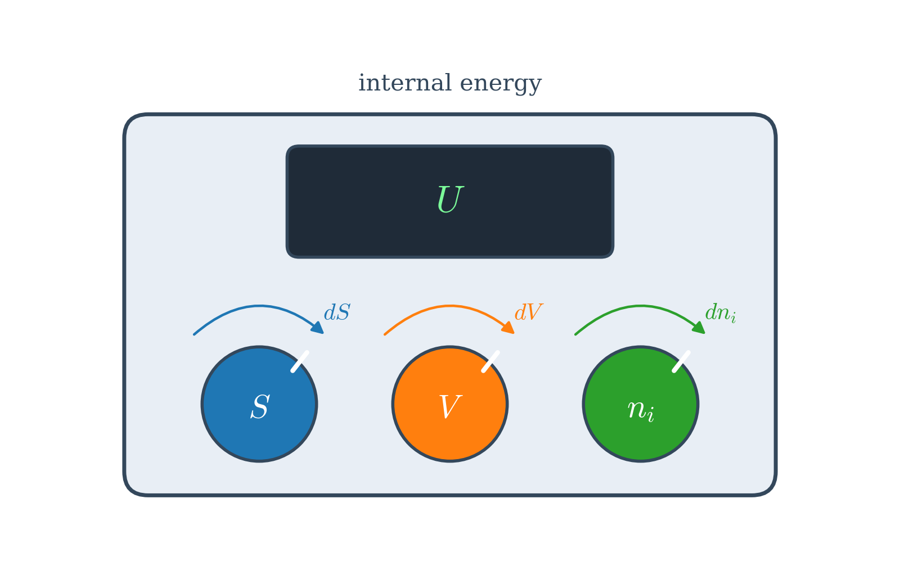
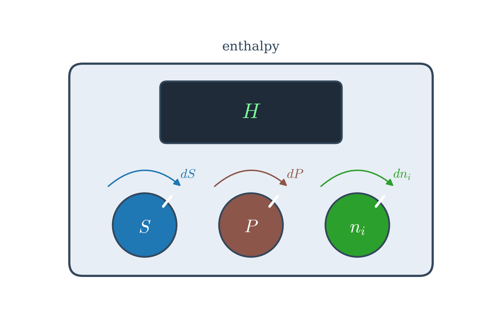
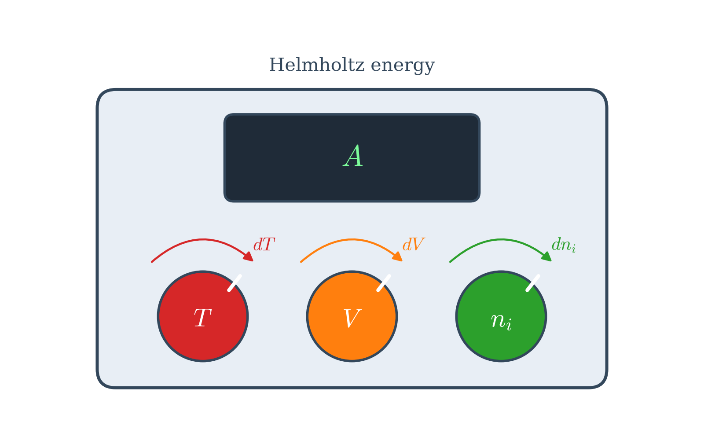
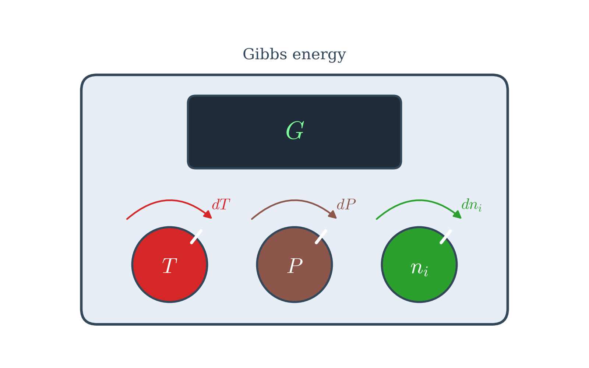
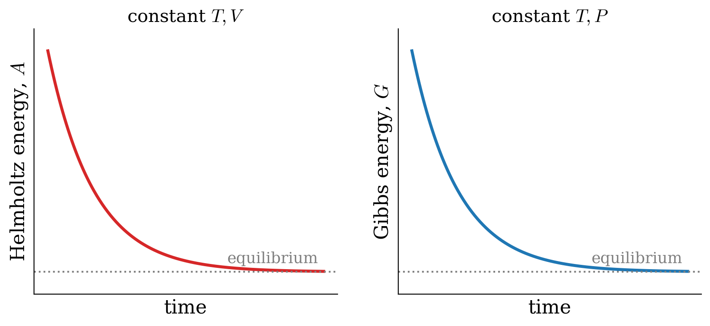

---
aliases:
  - Potentials.html
---

# Thermodynamic Potentials {#sec-Potentials}
In @sec-SecondLaw and @sec-thirdlaw, we learned that the entropy of the universe tells us whether a process is spontaneous. This criterion is general, but it is not very practical: to use it, we always need to calculate what happens to the surroundings, in addition to what happens to the system. Chemists would much rather have a criterion that depends only on the system, and that works at the conditions that we can easily control in a lab, such as constant temperature and constant pressure. In this chapter, we will build such criteria. We will start by combining the first and second laws into a single equation, and we will then use a simple mathematical trick to define new state functions, called *thermodynamic potentials*, each tailored to a specific set of experimental conditions. One of them, the Gibbs energy, will be the protagonist of the rest of this book.

## Fundamental Equation of Thermodynamics {#sec-fundeq}
Let's summarize some of the results from the first and second law of thermodynamics that we have seen so far. For reversible processes in closed systems, the first law gives us the change in internal energy, and the definition of entropy gives us the reversible heat:

$$
\begin{aligned}
\text{From 1}^{\text{st}} \text{ Law:} \qquad \quad & dU = đQ_{\mathrm{REV}}-PdV \\
\text{From The Definition of Entropy:} \qquad \quad & dS = \frac{đQ_{\mathrm{REV}}}{T} \rightarrow đQ_{\mathrm{REV}} = TdS \\
\\
\Rightarrow \quad & dU = TdS - PdV.
\end{aligned}
$$ {#eq-dunv}

@Eq-dunv is called the **fundamental equation of thermodynamics** since it combines the first and the second laws. Even though we started the derivation above by restricting to reversible transformations only, if we look carefully at @eq-dunv, we notice that it exclusively involves state functions ($U$, $T$, $S$, $P$, and $V$). Since state functions do not care about the path, the relation between their changes must be the same for any path, and it applies to both reversible and irreversible processes. The fundamental equation, however, remains constrained to closed systems. This fact restricts its utility for chemistry, since when a chemical reaction happens, the amounts of the chemical species change.

At the end of the 19^th^ century, Josiah Willard Gibbs (1839–1903) proposed an important addition to the fundamental equation to account for changes in composition. Gibbs was able to do so by introducing a new quantity that he called the chemical potential:

::: {#def-chemicalpot}
The *chemical potential* is the amount of energy absorbed or released due to a change of the particle number of a given chemical species.
:::

The chemical potential of species $i$ is usually abbreviated as $\mu_i$, and it enters the fundamental equation of thermodynamics as:

$$
dU = TdS-PdV+\sum_i\mu_i dn_i,
$$ {#eq-dunv2}

where $dn_i$ is the differential change in the number of moles of substance $i$, and the summation extends over all chemical species in the system. In words, $\mu_i$ tells us by how much the energy of the system changes when we add a tiny amount of species $i$, while keeping everything else fixed. As we will see in the next chapters, it measures the "escaping tendency" of a species: matter spontaneously moves from where its chemical potential is high to where it is low, just like heat moves from high to low temperature.

According to the fundamental equation, the internal energy of a system is a function of the three variables entropy, $S$, volume, $V$, and the numbers of moles $\{n_i\}$.^[In the case of the numbers of moles we include them in curly brackets to indicate that there might be more than one, depending on how many species are present.] To emphasize this connection, we can use the notation $U(S,V,\{n_i\})$, and we call $S$, $V$, and $\{n_i\}$ the **natural variables** of the energy. Using the language of @sec-SystemVariables, the natural variables are the "knobs" that control the "machine" $U$: if we know how to turn them, we know everything about how $U$ changes.

{#fig-machineU fig-alt="Machine drawn as a rounded box labeled internal energy, with a display showing U and three knobs labeled S, V, and n i, each with a curved arrow labeled dS, dV, and dn i." width="60%"}

## Thermodynamic Potentials {#sec-thermpot}
The natural variables of the internal energy have a practical problem. While the volume and the number of moles are easy to control, nobody has ever built an "entropy-meter," and we have no knob to set the entropy of a system in the lab. The knobs that we *can* easily turn are the temperature (with a thermostat or a water bath) and the pressure (by leaving the beaker open to the atmosphere). We would like, therefore, to define new state functions whose natural variables include $T$ and $P$ instead of $S$ and $V$.

There is a simple trick to do this, called a **Legendre transformation**. Look at @eq-dunv2: the variables appear in pairs, multiplied together, as $T$ and $S$ in $TdS$, and $-P$ and $V$ in $-PdV$. These pairs are called *conjugate variables*. In each pair, one variable is intensive ($T$ and $-P$), the other one is extensive ($S$ and $V$), and their product has the units of an energy.^[The intensive variable can be thought of as a thermodynamic "force," and the extensive one as the corresponding "displacement," similarly to how a force times a displacement gives a work in classical mechanics.] Now, let's subtract the product $TS$ from $U$ and take the differential. Using the product rule, $d(TS)=TdS+SdT$, and therefore:

$$
d(U-TS) = \underbrace{TdS-PdV+\sum_i\mu_i dn_i}_{dU} - TdS - SdT = -SdT-PdV+\sum_i\mu_i dn_i.
$$ {#eq-legendretrick}

The term $TdS$ has disappeared, and it has been replaced by $-SdT$. The new function, $U-TS$, has $T$ as a natural variable instead of $S$: we have swapped a knob that we cannot turn for one that we can. This is all there is to a Legendre transformation: to replace a natural variable with its conjugate partner, we subtract the product of the two from the original function. In the language of our machines, a Legendre transformation swaps one knob for its partner, as summarized in @fig-legendremachines. The new functions obtained this way are called **thermodynamic potentials**.^[Even if we introduced both concepts in the same chapter, it is important to never confuse the *thermodynamic potentials*—which are energy functions such as $H$, $A$, and $G$—with the *chemical potential*—which describes how the energy changes with the composition.]

{#fig-legendremachines fig-alt="Diagram with the internal energy machine on the left, with knobs S, V, and n i, and three purple arrows going to three machines on the right. The top arrow, labeled H equals U plus P V, swap V for P, goes to the enthalpy machine with knobs S, P, and n i. The middle arrow, labeled A equals U minus T S, swap S for T, goes to the Helmholtz energy machine with knobs T, V, and n i. The bottom arrow, labeled G equals U minus T S plus P V, swap both, goes to the Gibbs energy machine with knobs T, P, and n i. Each variable has its own knob color." width="85%"}

{#fig-machineH fig-alt="Machine drawn as a rounded box labeled enthalpy, with a display showing H and three knobs labeled S, P, and n i, each with a curved arrow labeled dS, dP, and dn i." width="60%"}

We have already used this trick, without saying it, when we defined the enthalpy in @sec-enthalpy. If we take the internal energy and subtract the product of the conjugate variables $-P$ and $V$, we obtain $U-(-P)V=U+PV=H$, as in @eq-enthalpydef. Taking the differential of this definition, we obtain:

$$
dH = dU +VdP +PdV,
$$ {#eq-dhdef1}

and using the fundamental equation, @eq-dunv2, to replace $dU$, we obtain:

$$
\begin{aligned}
dH & = TdS -PdV +\sum_i\mu_i dn_i +VdP +PdV  \\
   & = TdS +VdP +\sum_i\mu_i dn_i,
\end{aligned}
$$ {#eq-dhdef2}

which is the fundamental equation for enthalpy. The natural variables of the enthalpy are $S$, $P$, and $\{n_i\}$. The Legendre transformation has allowed us to go from $U(S,V,\{n_i\})$ to $H(S,P,\{n_i\})$ by replacing the dependence on the extensive variable, $V$, with an intensive one, $P$.

{#fig-machineA fig-alt="Machine drawn as a rounded box labeled Helmholtz energy, with a display showing A and three knobs labeled T, V, and n i, each with a curved arrow labeled dT, dV, and dn i." width="60%"}

The function that we have obtained in @eq-legendretrick, where we replaced the entropy with the temperature, is called the Helmholtz energy, $A$:

$$
A = U -TS,
$$ {#eq-dadef1}

and its fundamental equation is:

$$
\begin{aligned}
dA &= dU -SdT -TdS = TdS - PdV +\sum_i \mu_i dn_i -SdT -TdS  \\
   &= -SdT -PdV +\sum_i \mu_i dn_i.
\end{aligned}
$$ {#eq-dadef2}

The Helmholtz energy is named after Hermann Ludwig Ferdinand von Helmholtz (1821–1894), and its natural variables are temperature, volume, and the number of moles.

{#fig-machineG fig-alt="Machine drawn as a rounded box labeled Gibbs energy, with a display showing G and three knobs labeled T, P, and n i, each with a curved arrow labeled dT, dP, and dn i." width="60%"}

Finally, we can perform both Legendre transformations at once, to replace both the entropy and the volume with their intensive partners. In that case, we define a new function called the Gibbs energy, $G$, as:

$$
G = U -TS +PV = H-TS,
$$ {#eq-dgdef1}

which, taking again the differential and using @eq-dunv2 becomes:

$$
\begin{aligned}
dG &= dU -SdT -TdS +VdP +PdV = dH -SdT -TdS\\
   &= TdS - PdV +\sum_i\mu_i dn_i -SdT -TdS +VdP +PdV \\
   &= VdP -SdT +\sum_i\mu_i dn_i.
\end{aligned}
$$ {#eq-dgdef2}

The Gibbs energy is named after Willard Gibbs himself, and its natural variables are temperature, pressure, and number of moles: exactly the knobs that we control when we run a reaction in an open beaker.

A summary of the four thermodynamic potentials is given in the following table.

\tiny
|          **Name**         | **Symbol** |    **Fundamental Equation**    | **Natural Variables** |
|:-------------------------:|:----------:|:------------------------------:|:---------------------:|
| **Energy**                |     $U$    |  $dU=TdS-PdV+\sum_i\mu_i dn_i$ |      $S,V,\{n_i\}$      |
| **Enthalpy**              |     $H$    |  $dH=TdS+VdP+\sum_i\mu_i dn_i$ |      $S,P,\{n_i\}$      |
| **Helmholtz Energy** |     $A$    | $dA=-SdT-PdV+\sum_i\mu_i dn_i$ |      $T,V,\{n_i\}$      |
| **Gibbs Energy**     |     $G$    |  $dG=VdP-SdT+\sum_i\mu_i dn_i$ |      $T,P,\{n_i\}$      |
\normalsize

Let's look at what this table tells us:

1. **Each potential is suited to different conditions.** We should use the potential whose natural variables are the ones that we keep constant in our experiment. The internal energy is natural for an isolated, rigid container. The enthalpy is natural for heat exchanged at constant pressure, as we saw in @sec-Thermochemistry. The Helmholtz energy is natural for processes at constant temperature and volume, such as reactions in a sealed rigid vessel. The Gibbs energy is natural for processes at constant temperature and pressure, which is the case for most chemical reactions in the lab and for all the processes in living organisms.
2. **No information is lost.** A Legendre transformation does not throw away anything: the four potentials contain exactly the same information, written in terms of different variables.
3. **The thermodynamic potentials are the analog of the potential energy in classical mechanics.** A ball rolls downhill, and it stops at the bottom, where its potential energy is at a minimum. As we will show in the next section, a system at constant $T$ and $V$ evolves spontaneously towards the minimum of $A$, and a system at constant $T$ and $P$ evolves towards the minimum of $G$.^[For the mathematically inclined, an entertaining method to summarize the same thermodynamic potentials is the [thermodynamic square](https://en.wikipedia.org/wiki/Thermodynamic_square).]

## Gibbs and Helmholtz Energies {#sec-freeenergies}
The Legendre transformation procedure translates all information contained in the original function to the new one. Therefore, $H(S,P,\{n_i\})$, $A(T,V,\{n_i\})$, and $G(T,P,\{n_i\})$ all contain the same information that is in $U(S,V,\{n_i\})$. However, the new functions depend on different natural variables, and they are useful at different conditions. For example, when we want to study chemical changes, we are interested in studying the term $\sum_i\mu_i dn_i$ that appears in each thermodynamic potential. To do so, we need to isolate the chemical term by keeping all other natural variables constant. For example, changes in the chemical term will correspond to changes in the internal energy at constant $S$ and constant $V$:

$$
dU(S,V,\{n_i\}) = \sum_i\mu_i dn_i \quad \text{if} \quad dS=dV=0.
$$ {#eq-duchem}

Similarly:

$$
\begin{aligned}
dH(S,P,\{n_i\}) = \sum_i\mu_i dn_i \quad \text{if} \quad dS=dP=0, \\
dA(T,V,\{n_i\}) = \sum_i\mu_i dn_i \quad \text{if} \quad dT=dV=0, \\
dG(T,P,\{n_i\}) = \sum_i\mu_i dn_i \quad \text{if} \quad dT=dP=0.
\end{aligned}
$$ {#eq-dhagchem}

The latter two cases are particularly interesting, since most of chemistry happens at constant temperature and either constant volume,^[For example, several industrial processes in sealed reactors.] or constant pressure.^[For example, most processes in a chemistry lab.] Neither of them requires the entropy to be constant, which we could not control anyway. We will now show that $A$ and $G$ also give us what we were looking for at the beginning of this chapter: criteria for spontaneity that depend only on the system. The starting point is the Clausius theorem, @eq-dssyscrit7, which contains the second law written in terms of the system only:

$$
d S^{\mathrm{sys}} \geq \frac{đQ}{T_{\text{surr}}} \quad \longrightarrow \quad TdS \geq đQ,
$$ {#eq-dssyscrit}

where in the second step we multiplied both sides by $T$, the temperature of the system and of its surroundings, which we keep constant. We can now consider two cases, side by side: constant $V$ (left), where no work is done and the heat is $đQ_V=dU$, and constant $P$ (right), where the heat is $đQ_P=dH$:

$$
\begin{aligned}
\text{constant} & \; V:           & \qquad \qquad & \qquad \qquad &     \text{constant} & \; P: \\
\\
TdS & \geq dU           & &   &     TdS & \geq dH \\
\\
TdS -dU & \geq 0         & &   &      TdS -dH & \geq 0 \\
\end{aligned}
$$ {#eq-dadgder1}

On the other hand, at constant temperature, $SdT=0$, and the differentials of the definitions of $A$ and $G$, @eq-dadef1 and @eq-dgdef1, simplify to:

$$
\begin{aligned}
\text{constant} & \; T,V:           & \qquad & \qquad &     \text{constant} & \; T,P: \\
\\
(dA)_{T,V} &= dU -TdS     & &   &       (dG)_{T,P} &= dH - TdS \\
\\
dU = (dA)_{T,V} &+TdS       & &   &       dH = (dG)_{T,P} &+TdS
\end{aligned}
$$ {#eq-dadgder3}

Replacing $dU$ and $dH$ from the last line of @eq-dadgder3 into @eq-dadgder1, the terms $TdS$ cancel out, and we obtain:

$$
\begin{aligned}
TdS -(dA)_{T,V} &- TdS \geq 0 & \qquad & \qquad & TdS -(dG)_{T,P} &- TdS \geq 0 \\
\\
(dA)_{T,V} & \leq 0 & \qquad & \qquad & (dG)_{T,P} & \leq 0. \\
\end{aligned}
$$ {#eq-dadgcond}

These are the conditions on $dA$ and $dG$ for inferring the spontaneity of a process. Notice how they contain only properties of the system: the entropy change of the surroundings is hidden inside them, through the heat that the system exchanges. They can be summarized as follows:

::: {#def-helmgibbsminimum}
$\;$

- During a spontaneous process at constant *temperature* and *volume*, the *Helmholtz energy* will decrease $(dA<0)$, until it reaches a stationary point at which the system will be at equilibrium $(dA=0)$.
- During a spontaneous process at constant *temperature* and *pressure*, the *Gibbs energy* will decrease $(dG<0)$, until it reaches a stationary point at which the system will be at equilibrium $(dG=0)$.
:::

{#fig-agfig fig-alt="Two plots against time. Left, at constant temperature and volume: the Helmholtz energy, in red, decreases and levels off at a minimum, marked as equilibrium. Right, at constant temperature and pressure: the Gibbs energy, in blue, does the same." width="85%"}

## Maxwell Relations {#sec-maxwell}
Let's consider the fundamental equations for the thermodynamic potentials that we have derived in @sec-thermpot:

$$
\begin{aligned}
dU(S,V,\{n_i\}) &= \enspace T dS -P dV + \sum_i \mu_i dn_i \\
dH(S,P,\{n_i\}) &= \enspace T dS + V dP + \sum_i \mu_i dn_i \\
dA(T,V,\{n_i\}) &= -S dT -P dV + \sum_i \mu_i dn_i \\
dG(T,P,\{n_i\}) &= -S dT + V dP + \sum_i \mu_i dn_i\;.
\end{aligned}
$$ {#eq-dhagchem1}

Since we know the natural variables of each potential, we can also write the same differentials using the general formula for the total differential, @eq-totdiff. Each coefficient in front of $dS$, $dV$, $dT$, $dP$, or $dn_i$ is a partial derivative of the potential:

$$
\begin{aligned}
dU &= \underbrace{\left(\frac{\partial U}{\partial S} \right)_{V,\{n_i\}}}_{T} dS + \underbrace{\left(\frac{\partial U}{\partial V} \right)_{S,\{n_i\}}}_{-P} dV + \sum_i \underbrace{\left(\frac{\partial U}{\partial n_i} \right)_{S,V,\{n_{j \neq i}\}}}_{\mu_i} dn_i \\
dH &= \underbrace{\left(\frac{\partial H}{\partial S} \right)_{P,\{n_i\}}}_{T} dS + \underbrace{\left(\frac{\partial H}{\partial P} \right)_{S,\{n_i\}}}_{V} dP + \sum_i \underbrace{\left(\frac{\partial H}{\partial n_i} \right)_{S,P,\{n_{j \neq i}\}}}_{\mu_i} dn_i \\
dA &= \underbrace{\left(\frac{\partial A}{\partial T} \right)_{V,\{n_i\}}}_{-S} dT + \underbrace{\left(\frac{\partial A}{\partial V} \right)_{T,\{n_i\}}}_{-P} dV + \sum_i \underbrace{\left(\frac{\partial A}{\partial n_i} \right)_{T,V,\{n_{j \neq i}\}}}_{\mu_i} dn_i \\
dG &= \underbrace{\left(\frac{\partial G}{\partial T} \right)_{P,\{n_i\}}}_{-S} dT + \underbrace{\left(\frac{\partial G}{\partial P} \right)_{T,\{n_i\}}}_{V} dP + \sum_i \underbrace{\left(\frac{\partial G}{\partial n_i} \right)_{T,P,\{n_{j \neq i}\}}}_{\mu_i} dn_i\;,
\end{aligned}
$$ {#eq-dhagchem2}

Comparing @eq-dhagchem1 and @eq-dhagchem2 term by term, we can read off what each partial derivative is equal to. For example, the coefficient of $dS$ in $dU$ is $T$ in the first equation and $\left(\frac{\partial U}{\partial S}\right)_{V,\{n_i\}}$ in the second one, so these two quantities must be equal. In this way, we obtain the following new definitions:

$$
\begin{aligned}
 T &= \left(\frac{\partial U}{\partial S} \right)_{V,\{n_i\}} = \left(\frac{\partial H}{\partial S} \right)_{P,\{n_i\}}  \\
-P &= \left(\frac{\partial U}{\partial V} \right)_{S,\{n_i\}} = \left(\frac{\partial A}{\partial V} \right)_{T,\{n_i\}}  \\
 V &= \left(\frac{\partial H}{\partial P} \right)_{S,\{n_i\}} = \left(\frac{\partial G}{\partial P} \right)_{T,\{n_i\}}  \\
-S &= \left(\frac{\partial A}{\partial T} \right)_{V,\{n_i\}} = \left(\frac{\partial G}{\partial T} \right)_{P,\{n_i\}}  \\
\text{and:}
\\
 \mu_i &=  \left(\frac{\partial U}{\partial n_i} \right)_{S,V,\{n_{j \neq i}\}} =  \left(\frac{\partial H}{\partial n_i} \right)_{S,P,\{n_{j \neq i}\}} \\
       &= \left(\frac{\partial A}{\partial n_i} \right)_{T,V,\{n_{j \neq i}\}} = \left(\frac{\partial G}{\partial n_i} \right)_{T,P,\{n_{j \neq i}\}}\;.
\end{aligned}
$$ {#eq-dhagchem3}

Since $T$, $P$, $V$, and $S$ are now defined as first partial derivatives of a thermodynamic potential, we can take a second partial derivative with respect to the other natural variable. As we saw in @sec-SystemVariables, Schwarz's theorem guarantees that, for a state function, the order in which we take the two derivatives does not matter. Therefore, the two mixed second derivatives of each potential must be equal, which gives the following relations:

$$
\begin{aligned}
\frac{\partial^2 U }{\partial S \partial V} &=& +\left(\frac{\partial T}{\partial V}\right)_{S,n_{i}} &=& -\left(\frac{\partial P}{\partial S}\right)_{V,n_{i}}   \\
\frac{\partial^2 H }{\partial S \partial P} &=& +\left(\frac{\partial T}{\partial P}\right)_{S,n_{i}} &=& +\left(\frac{\partial V}{\partial S}\right)_{P,n_{i}}  \\
-\frac{\partial^2 A }{\partial T \partial V} &=& +\left(\frac{\partial S}{\partial V}\right)_{T,n_{i}} &=& +\left(\frac{\partial P}{\partial T}\right)_{V,n_{i}}  \\
\frac{\partial^2 G }{\partial T \partial P} &=& -\left(\frac{\partial S}{\partial P}\right)_{T,n_{i}} &=& +\left(\frac{\partial V}{\partial T}\right)_{P,n_{i}}
\end{aligned}
$$ {#eq-maxrelf}

The relations in @eq-maxrelf are called **Maxwell relations**,^[Maxwell relations should not be confused with the Maxwell equations of electromagnetism.] and are useful in experimental settings to relate quantities that are hard to measure with others that are more intuitive. Their real power is that they let us calculate how the entropy changes with pressure or volume, which we cannot measure directly, from how $P$, $V$, and $T$ are related, which we can measure easily.

Let's see an example. The third Maxwell relation tells us that $\left(\frac{\partial S}{\partial V}\right)_{T} = \left(\frac{\partial P}{\partial T}\right)_{V}$. For an ideal gas, $P=\frac{nRT}{V}$, and the right-hand side is easy to calculate: $\left(\frac{\partial P}{\partial T}\right)_{V}=\frac{nR}{V}$. Therefore, $dS=\frac{nR}{V}dV$ at constant temperature, and integrating between $V_i$ and $V_f$:

$$
\Delta S = nR \ln \frac{V_f}{V_i} \qquad \text{(constant } T\text{)},
$$ {#eq-maxwellidealgas}

which is exactly the result that we obtained in @eq-sigconsttV, using the heat exchanged along a reversible path. With the Maxwell relation, we obtained it without ever thinking about heat, starting only from the ideal gas law.

::: {#exm-maxwellEx}
## Deriving a Maxwell relation

Derive the last Maxwell relation in @eq-maxrelf.

*Solution:* We can start our derivation from the definitions of $V$ and $S$ as partial derivatives of $G$:

$$
V = \left(\frac{\partial G}{\partial P} \right)_{T,\{n_i\}} \qquad \text{and:} \qquad -S = \left(\frac{\partial G}{\partial T} \right)_{P,\{n_i\}},
$$

and then take a second partial derivative of each quantity with respect to the second variable:

$$
\begin{aligned}
 \left(\frac{\partial V}{\partial T} \right)_{P,\{n_i\}} &=\frac{\partial}{\partial T}\left[ \left(\frac{\partial G}{\partial P} \right)_{T,\{n_i\}} \right]_{P,\{n_i\}} \\
\\
-\left(\frac{\partial S}{\partial P} \right)_{T,\{n_i\}} &=\frac{\partial}{\partial P}\left[ \left(\frac{\partial G}{\partial T} \right)_{P,\{n_i\}} \right]_{T,\{n_i\}} \;.
\end{aligned}
$$

These two derivatives are mixed partial second derivatives of $G$ with respect to $T$ and $P$, and therefore, according to Schwarz's theorem, they are equal to each other:

$$
\begin{aligned}
\frac{\partial}{\partial T}\left[ \left(\frac{\partial G}{\partial P} \right)_{T,\{n_i\}} \right]_{P,\{n_i\}} &=
\frac{\partial}{\partial P}\left[ \left(\frac{\partial G}{\partial T} \right)_{P,\{n_i\}} \right]_{T,\{n_i\}}, \\
\\
\text{hence:} \\
\\
 \left(\frac{\partial V}{\partial T} \right)_{P,\{n_i\}} &= -\left(\frac{\partial S}{\partial P} \right)_{T,\{n_i\}},
\end{aligned}
$$

which is the last of Maxwell relations, as defined in @eq-maxrelf. This relation is particularly useful because it connects the quantity $\left(\frac{\partial S}{\partial P} \right)_{T,\{n_i\}}$—which is impossible to measure in a lab—with the quantity $\left(\frac{\partial V}{\partial T} \right)_{P,\{n_i\}}$—which is easier to measure from an experiment that determines isobaric volumetric thermal expansion coefficients.
:::

## Chapter Review {#sec-rev8}
### Key Ideas
- **Fundamental equation:** $dU = T\,dS - P\,dV + \sum_i \mu_i\,dn_i$. It contains only state functions, so it applies to reversible and irreversible processes alike.
- **Chemical potential:** $\mu_i$ measures how the energy changes when moles of species $i$ are added.
- **Legendre transformations** swap a variable with its conjugate, giving $H = U + PV$, $A = U - TS$, and $G = U - TS + PV$, each with its own natural variables.
- **Spontaneity criteria:** at constant $T$ and $V$, the Helmholtz energy decreases ($dA < 0$); at constant $T$ and $P$, the Gibbs energy decreases ($dG < 0$).
- **Maxwell relations** follow from the equality of mixed second derivatives, and they turn hard-to-measure derivatives of $S$ into easy-to-measure ones of $P$, $V$, and $T$.

### Study Questions {#sec-quest8}
**1. What is the fundamental equation of thermodynamics for a closed system?**

a. $dU = TdS + PdV$.
b. $dU = đQ - PdV$ only for reversible processes.
c. $dU = TdS - PdV$.
d. $dU = SdT - VdP$.
e. $dU = TdS - VdP$.

---

**2. Why does the fundamental equation apply to irreversible processes too, even if it was derived for reversible ones?**

a. Because it contains only state functions.
b. Because irreversible processes do not exist.
c. Because heat is a state function.
d. Because it contains the entropy.
e. Because it is an approximation.

---

**3. What is the chemical potential?**

a. The energy stored in chemical bonds.
b. The potential energy of a molecule.
c. The pressure of a chemical species.
d. The energy needed to break a molecule into atoms.
e. The amount of energy absorbed or released due to a change in the number of particles of a chemical species.

---

**4. What are the natural variables of the internal energy?**

a. $T$, $P$, $\{n_i\}$.
b. $S$, $V$, $\{n_i\}$.
c. $T$, $V$, $\{n_i\}$.
d. $S$, $P$, $\{n_i\}$.
e. $U$, $V$, $T$.

---

**5. What does a Legendre transformation do?**

a. It adds heat to the system.
b. It removes all information from the original function.
c. It converts a path function into a state function.
d. It defines a new function by subtracting a product of conjugate variables, replacing one natural variable with its conjugate.
e. It changes the units of the energy.

---

**6. What are the natural variables of the Gibbs energy?**

a. $T$, $P$, $\{n_i\}$.
b. $S$, $V$, $\{n_i\}$.
c. $T$, $V$, $\{n_i\}$.
d. $S$, $P$, $\{n_i\}$.
e. $G$, $H$, $S$.

---

**7. What is the fundamental equation for the Helmholtz energy?**

a. $dA = TdS - PdV + \sum_i \mu_i dn_i$.
b. $dA = -SdT + VdP + \sum_i \mu_i dn_i$.
c. $dA = -SdT - PdV + \sum_i \mu_i dn_i$.
d. $dA = TdS + VdP + \sum_i \mu_i dn_i$.
e. $dA = SdT + PdV$.

---

**8. What is the condition for a spontaneous process at constant temperature and pressure?**

a. $dA < 0$.
b. $dS = 0$.
c. $dH > 0$.
d. $dG > 0$.
e. $dG < 0$, until $dG = 0$ at equilibrium.

---

**9. From which mathematical property do the Maxwell relations follow?**

a. The first law of thermodynamics.
b. The equality of the mixed second derivatives of a state function (Schwarz's theorem).
c. The ideal gas law.
d. The definition of the chemical potential.
e. The Clausius inequality.

---

**10. Why is the Maxwell relation $\left(\frac{\partial V}{\partial T}\right)_P = -\left(\frac{\partial S}{\partial P}\right)_T$ useful?**

a. Because it shows that the entropy is constant.
b. Because it defines the temperature.
c. Because it is valid only for ideal gases.
d. Because it relates a quantity that is hard to measure (how $S$ changes with $P$) to one that is easy to measure (thermal expansion).
e. Because it gives the value of the Gibbs energy.

---

::: {.callout-tip collapse="true" icon="false"}
## Answers

1.c, 2.a, 3.e, 4.b, 5.d, 6.a, 7.c, 8.e, 9.b, 10.d
:::
