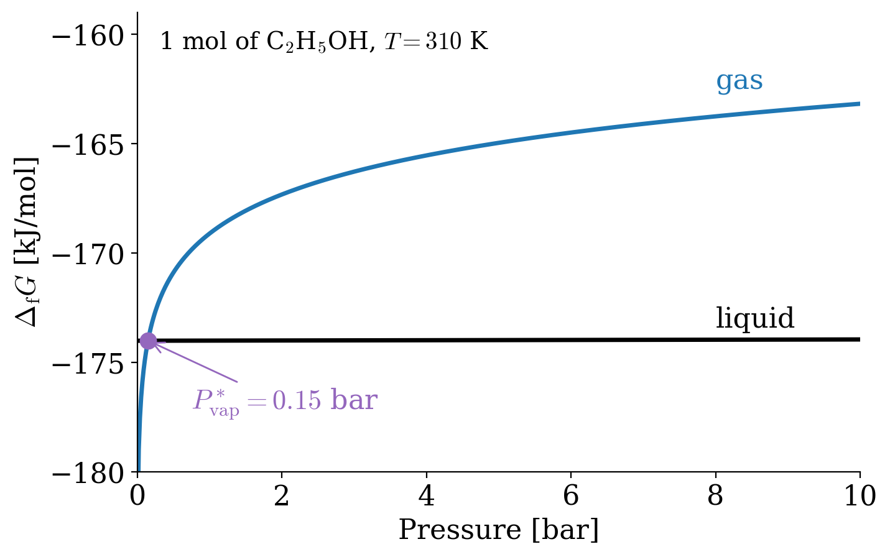

---
aliases:
  - GibbsFree.html
---

# Gibbs Energy {#sec-GibbsFree}
In @sec-Potentials, we found that, at constant temperature and pressure, a process is spontaneous if it decreases the Gibbs energy of the system. In this chapter, we will concentrate on chemical processes that happen at these conditions.^[The majority of chemical reactions in a lab happen at those conditions, and all biological functions happen at those conditions as well.] We will learn how to calculate the Gibbs energy of a reaction from tabulated data, and how the Gibbs energy changes with temperature, pressure, and composition. These three dependencies will be the foundations of the next chapters on chemical equilibrium, phase equilibrium, and solutions.

## Gibbs Equation {#sec-gibbseqsec}
Recalling from @sec-Potentials, the definition of $G$ is:

$$
G = U -TS +PV = H-TS,
$$ {#eq-dgdeftot}

which, taking the differential at constant $T$ and $P$, becomes:

$$
dG = dH \; \overbrace{-SdT}^{=0} -TdS = dH -TdS.
$$ {#eq-dgdeftot2}

Integrating @eq-dgdeftot2 between the initial and final states of a process results in:

$$
\begin{aligned}
\int_i^f dG &= \int_i^f dH -T \int_i^f dS \\
\\
\Delta G &= \Delta H -T \Delta S
\end{aligned}
$$ {#eq-gibbseq}

which is the famous **Gibbs equation** for $\Delta G$. Using @Def-helmgibbsminimum, we can use $\Delta G$ to infer the spontaneity of a chemical process that happens at constant $T$ and $P$ using $\Delta G \leq 0$. If we set ourselves at standard conditions, we can calculate the standard Gibbs energy of reaction, $\Delta_{\text{rxn}} G^\standardstate$, for any reaction as:

$$
\begin{aligned}
\Delta_{\text{rxn}} G^\standardstate &= \Delta_{\text{rxn}} H^\standardstate -T \Delta_{\text{rxn}} S^\standardstate \\
\\
&= \sum_i \nu_i \Delta_{\mathrm{f}} H_i^\standardstate - T \sum_i \nu_i S_i^\standardstate,
\end{aligned}
$$ {#eq-gibbseq2}

where $\Delta_{\mathrm{f}} H_i^\standardstate$ are the standard enthalpies of formation, $S_i^\standardstate$ are the standard entropies, and $\nu_i$ are the stoichiometric coefficients for every species $i$ involved in the reaction. All these quantities are commonly available, and we have already discussed their usage in @sec-Thermochemistry and @sec-thirdlaw, respectively.^[It is not uncommon to see values of $\Delta_{\text{f}} G^\standardstate$ tabulated alongside $\Delta_{\mathrm{f}} H^\standardstate$ and $S_i^\standardstate$, which simplifies even further the calculation. In fact, a comprehensive list of standard Gibbs energy of formation of inorganic and organic compounds is reported in the appendix of this book (@sec-appendix). For cases where $\Delta_{\text{f}} G^\standardstate$ are not reported, they can always be calculated from their constituents.]

The following four options are possible for $\Delta G^\standardstate$ of a chemical reaction:

| $\Delta G^\standardstate$ |      | $\Delta H^\standardstate$ | $\Delta S^\standardstate$ |                             Spontaneous?                             |
|:-------------------------:|------|:-------------------------:|:-------------------------:|:--------------------------------------------------------------------:|
|             –             | *if* |             –             |             +             |                               *Always*                               |
|             +             | *if* |             +             |             –             |                                *Never*                               |
|            –/+            | *if* |             –             |             –             | *Depends on $T$:*    $\scriptstyle{\text{spontaneous at low } T}$ |
|            +/–            | *if* |             +             |             +             | *Depends on $T$:*   $\scriptstyle{\text{spontaneous at high } T}$ |

Or, in other words:

- Exothermic reactions that increase the entropy are always spontaneous.
- Endothermic reactions that reduce the entropy are always non-spontaneous.
- For the other two cases, the spontaneity of the reaction depends on the temperature:
    - Exothermic reactions that reduce the entropy are spontaneous at low $T$.
    - Endothermic reactions that increase the entropy are spontaneous at high $T$.

A simple criterion to estimate the sign of the entropy change of a reaction is to count the moles of *gas* among the reactants and the products. Gases have much larger entropies than liquids and solids, since their molecules can occupy a much larger volume. Therefore, if the reaction produces more moles of gas than it consumes, it will most likely increase the entropy. Vice versa, if the number of moles of gas decreases, the entropy will most likely decrease. For example, the combustion of methane, $\mathrm{CH}_{4(g)} + 2\mathrm{O}_{2(g)} \rightarrow \mathrm{CO}_{2(g)} + 2\mathrm{H}_2\mathrm{O}_{(l)}$, goes from 3 moles of gas to 1, and its entropy change is indeed negative. This criterion is only a rule of thumb: when the number of moles of gas does not change, we need the tabulated entropies to decide.

As we saw in @sec-thermpot, the natural variables of the Gibbs energy are the temperature, $T$, the pressure, $P$, and chemical composition, as the number of moles $\{n_i\}$. The Gibbs energy can therefore be expressed using the total differential as (see also the last formula in @eq-dhagchem2):

$$
dG(T,P,\{n_i\}) = \mkern-18mu \underbrace{\left(\frac{\partial G}{\partial T} \right)_{P,\{n_i\}}}_{\text{temperature dependence}} \mkern-36mu dT + \underbrace{\left(\frac{\partial G}{\partial P} \right)_{T,\{n_i\}}}_{\text{pressure dependence}} \mkern-36mu dP + \sum_i \underbrace{\left(\frac{\partial G}{\partial n_i} \right)_{T,P,\{n_{j \neq i}\}}}_{\text{composition dependence}} \mkern-36mu dn_i.
$$ {#eq-dgtotdiff}

If we know the behavior of $G$ as we vary each of the three natural variables independently of the other two, we can reconstruct the total differential $dG$. Each of these terms represents a coefficient in @eq-dgtotdiff, which are given in @eq-dhagchem3.

## Temperature Dependence of $\Delta G$
$$
\left(\frac{\partial G}{\partial T} \right)_{P,\{n_i\}}=-S
$$

Let's analyze the first coefficient that gives the dependence of the Gibbs energy on temperature.  Since this coefficient is equal to $-S$ and the entropy is always positive, $G$ must decrease when $T$ increases at constant $P$ and $\{n_i\}$, and vice versa.

If we replace this coefficient for $-S$ in the Gibbs equation, @eq-gibbseq, we obtain:

$$
\Delta G = \Delta H + T \left(\frac{\partial \Delta G}{\partial T} \right)_{P,\{n_i\}},
$$ {#eq-dgconsttt}

and since @eq-dgconsttt includes both $\Delta G$ and its partial derivative with respect to temperature $\left(\frac{\partial \Delta G}{\partial T} \right)_{P,\{n_i\}}$ we need to rearrange it to include the temperature derivative only. To do so, we can start by evaluating the partial derivative of $\left( \frac{\Delta G}{T} \right)$ using the product rule:

$$
\left[ \frac{\partial\left( \frac{\Delta G}{T} \right)}{\partial T} \right]_{P,\{n_i\}} = \frac{1}{T} \left(\frac{\partial \Delta G}{\partial T}  \right)_{P,\{n_i\}} - \frac{1}{T^2}\Delta G,
$$ {#eq-dgconsttt1}

which, replacing $\Delta G$ from @eq-dgconsttt into @eq-dgconsttt1, becomes:

$$
\begin{aligned}
\left[ \frac{\partial\left( \frac{\Delta G}{T} \right)}{\partial T} \right]_{P,\{n_i\}} &= \frac{1}{T} \left(\frac{\partial \Delta G}{\partial T}  \right)_{P,\{n_i\}} - \frac{1}{T^2} \left[ \Delta H + T \left(\frac{\partial \Delta G}{\partial T} \right)_{P,\{n_i\}} \right] \\
&= \frac{1}{T} \left(\frac{\partial \Delta G}{\partial T}  \right)_{P,\{n_i\}}- \frac{\Delta H}{T^2}-\frac{1}{T} \left(\frac{\partial \Delta G}{\partial T}  \right)_{P,\{n_i\}},
\end{aligned}
$$ {#eq-dgconsttt2}

which simplifies to:

$$
\begin{aligned}
\left[ \frac{\partial\left( \frac{\Delta G}{T} \right)}{\partial T} \right]_{P,\{n_i\}} &= - \frac{\Delta H}{T^2}.
\end{aligned}
$$ {#eq-gibbshelm}

@Eq-gibbshelm is known as the **Gibbs–Helmholtz equation**, and is useful in its integrated form to calculate the Gibbs energy for a chemical reaction at any temperature $T$ by knowing just the standard Gibbs energy of formation and the standard enthalpy of formation for the individual species, which are usually reported at $T=298\;\text{K}$. The integration is performed as follows:

$$
\begin{aligned}
\int_{T_i=298 \;\text{K}}^{T_f=T}  \frac{\partial\left( \frac{\Delta_{\text{rxn}} G}{T} \right)}{\partial T} &=  - \int_{T_i=298 \;\text{K}}^{T_f=T}  \frac{\Delta_{\text{rxn}} H}{T^2} \\ \\ \frac{\Delta_{\text{rxn}} G^\standardstate(T)}{T} &=  \frac{\Delta_{\text{rxn}} G^\standardstate}{298 \;\text{K}} + \Delta_{\text{rxn}} H^\standardstate \left( \frac{1}{T} -\frac{1}{298 \;\text{K}} \right),
\end{aligned}
$$ {#eq-gibbshelmIbase}

giving the integrated Gibbs–Helmholtz equation:

$$
\frac{\Delta_{\text{rxn}} G^\standardstate(T)}{T} =  \frac{\sum_i \nu_i \Delta_{\text{f}} G_i^\standardstate}{298 \;\text{K}} + \sum_i \nu_i \Delta_{\text{f}} H_i^\standardstate \left( \frac{1}{T} -\frac{1}{298 \;\text{K}} \right)
$$ {#eq-gibbshelmI}

## Pressure Dependence of $\Delta G$
$$
\left(\frac{\partial G}{\partial P} \right)_{T,\{n_i\}}=V
$$

We can now turn our attention to the second coefficient that gives how the Gibbs energy changes when the pressure changes. To do this, we put the system at constant $T$ and $\{n_i\}$, and then we consider infinitesimal variations of $G$. From @eq-dgdef2:

$$
dG = VdP -SdT +\sum_i\mu_i dn_i \quad \xrightarrow{\text{constant}\; T,\{n_i\}} \quad dG = VdP,
$$ {#eq-dgconsttp}

which is the differential equation that we were looking for. To study changes of $G$ for macroscopic changes in $P$, we can integrate @eq-dgconsttp between initial and final pressures, and considering an ideal gas, we obtain:

$$
\begin{aligned}
\int_i^f dG &= \int_i^f VdP \\
\Delta G &= nRT \int_i^f \frac{dP}{P} = nRT \ln \frac{P_f}{P_i}.
\end{aligned}
$$ {#eq-dgconsttpintegral1}

If we take $P_i = P^\standardstate = 1 \, \text{bar}$, we can rewrite @eq-dgconsttpintegral1 as:

$$
G = G^\standardstate + nRT \ln \frac{P_f}{P^\standardstate},
$$ {#eq-dgconsttpintegral2}

which is useful to convert standard Gibbs energies of formation to pressures different from standard pressure, using:

$$
\Delta_{\text{f}} G = \Delta_{\text{f}} G^\standardstate + nRT \ln \frac{P_f}{\underbrace{P^\standardstate}_{=1 \; \text{bar}}} = \Delta_{\text{f}} G^\standardstate + nRT \ln P_f
$$ {#eq-dgconsttpintegral2b}

For liquids and solids, $V$ is essentially independent of $P$ (liquids and solids are incompressible), and @eq-dgconsttp can be integrated as:

$$
\Delta G = \int_i^f VdP = V \int_i^f dP = V \Delta P.
$$ {#eq-dgconsttpintegral3}

The plots in @Fig-gdeppfig show the remarkable difference in the behaviors of $\Delta_{\text{f}} G$ for a gas and for a liquid, as obtained from @eq-dgconsttpintegral1 and @eq-dgconsttpintegral3.

{#fig-gdeppfig fig-alt="Gibbs energy of formation of 1 mol of ethanol at 310 K versus pressure from 0 to 10 bar. The liquid line is almost flat at about minus 174 kJ per mol. The gas curve rises steeply at low pressure and then more slowly, crossing the liquid line at the vapor pressure, 0.15 bar. Below that pressure the gas has the lower Gibbs energy, and above it the liquid does." width="75%"}

## Composition Dependence of $\Delta G$
$$
\left(\frac{\partial G}{\partial n_i} \right)_{T,P}=\mu_i
$$

The third and final coefficient gives the chemical potential as the dependence of $G$ on the chemical composition at constant $T$ and $P$. To understand what the chemical potential means, let's consider a pure substance, and let's imagine building a sample of it by adding small amounts, $dn$, one after the other, at constant $T$ and $P$. Each small amount that we add is identical to what is already in the sample. Therefore, each of them changes the Gibbs energy by the same amount, $dG=\mu^* dn$, where $\mu^*$ indicates the chemical potential of the pure substance. In other words, $\mu^*$ is an intensive property: it depends on $T$ and $P$, but not on how much substance we have. Since the Gibbs energy is extensive, when there is no substance there is also no Gibbs energy. We can then integrate from an empty sample ($n=0$, $G=0$) to a sample with $n$ moles and Gibbs energy $G$:

$$
\int_0^G d G = \int_0^n \mu^* dn,
$$ {#eq-dgconstn}

and since $\mu^*$ does not depend on the number of moles, we can take it out of the integral:

$$
\int_0^G d G = \mu^* \int_0^n dn \quad \rightarrow \quad G = \mu^* n \quad \rightarrow \quad \mu^* = \frac{G}{n},
$$ {#eq-dgconstn1}

which gives a straightforward interpretation of the chemical potential of a pure substance as the molar Gibbs energy.

We can start from @eq-dgconsttpintegral2 and write for a pure substance that is brought from $P_i=P^\standardstate$ to $P_f=P$ at constant $T$:

$$
G - G^\standardstate = nRT \ln \frac{P}{P^\standardstate},
$$ {#eq-dgconstn2}

dividing both sides by $n$, we obtain:

$$
\frac{G}{n} - \frac{G^\standardstate}{n} = RT \ln \frac{P}{P^\standardstate},
$$ {#eq-dgconstn3}

which, for a pure substance at $P^\standardstate = 1 \;\text{bar}$, becomes:

$$
\mu^* - \mu^\standardstate =      RT \ln P.
$$ {#eq-dgconstn4}

Notice that, while we use the pressure of the gas inside the logarithm in @eq-dgconstn4, the quantity is formally divided by the standard pressure $P^\standardstate = 1 \;\text{bar}$, and therefore it is a dimensionless quantity, as it should be. For simplicity of notation, however, we will omit the division by $P^\standardstate$ in the remainder of this textbook, especially wherever it does not create confusion.
Let's now consider a mixture of ideal gases, and let's try to find out whether the chemical potential of a pure gas inside the mixture, $\mu_i^{\text{mixture}}$, is the same as its chemical potential outside the mixture, $\mu^*$.
To do so, we can use @eq-dgconstn4 and replace the pressure $P$ with the partial pressure  $P_i$:

$$
\mu_i^{\text{mixture}} = \mu_i^\standardstate + RT \ln P_i,
$$ {#eq-dgconstn5}

where the partial pressure $P_i$ can be obtained from the simple relation that is known as **Dalton's Law**:

$$
P_i = y_i P,
$$ {#eq-daltonlaw}

with $y_i$ being the concentration of gas $i$ measured as a mole fraction in the gas phase $y_i=\frac{n_i}{n_{\text{TOT}}} < 1$. Replacing @eq-daltonlaw into @eq-dgconstn5, we obtain:

$$
\begin{aligned}
\mu_i^{\text{mixture}} &= \mu_i^\standardstate + RT \ln (y_i P) \\
 &= \underbrace{\mu_i^\standardstate + RT \ln P}_{\mu_i^*} + RT \ln y_i,
\end{aligned}
$$ {#eq-dgconstn6}

which then reduces to the following equation:

$$
\mu_i^{\text{mixture}} = \mu_i^* + RT \ln y_i.
$$ {#eq-dgconstn7}

Analyzing @eq-dgconstn7, we can immediately see that, since $y_i < 1$:

$$
\mu_i^{\text{mixture}} < \mu_i^*,
$$ {#eq-dgconstn8}

or, in other words, the chemical potential of a substance in the mixture is always lower than the chemical potential of the pure substance. If we consider a process where we start from two separate pure ideal gases and finish with a mixture of the two, we can calculate the change in Gibbs energy due to the mixing process with:

$$
\Delta_{\text{mixing}} G = \sum n_i \left( \mu_i^{\text{mixture}} - \mu_i^* \right)  < 0,
$$ {#eq-dgconstn9}

or, in other words, the process is spontaneous under all circumstances, and pure ideal gases will always mix.

## Chapter Review {#sec-rev9}
### Key Ideas
- **Gibbs equation:** at constant $T$ and $P$, $\Delta G = \Delta H - T\Delta S$, which balances enthalpy and entropy.
- **Temperature dependence:** $\left(\frac{\partial G}{\partial T}\right)_{P} = -S$, and the Gibbs–Helmholtz equation gives $\Delta G$ at other temperatures from $\Delta H$.
- **Pressure dependence:** $\left(\frac{\partial G}{\partial P}\right)_{T} = V$. For an ideal gas, $G = G^\standardstate + nRT\ln\frac{P}{P^\standardstate}$; for liquids and solids, $G$ barely changes with $P$.
- **Chemical potential:** for a pure substance, $\mu^* = G/n$; for an ideal gas in a mixture, $\mu_i = \mu_i^\standardstate + RT\ln P_i$.
- **Mixing:** ideal gases always mix spontaneously, since $\Delta_{\text{mixing}}G < 0$.

### Study Questions {#sec-quest9}
**1. Which equation gives the Gibbs energy change of a process at constant $T$ and $P$?**

a. $\Delta G = \Delta H + T\Delta S$.
b. $\Delta G = \Delta H - T\Delta S$.
c. $\Delta G = \Delta U - T\Delta S$.
d. $\Delta G = T\Delta S - \Delta H$.
e. $\Delta G = \Delta H \cdot \Delta S$.

---

**2. An exothermic reaction decreases the entropy of the system. When is it spontaneous?**

a. Always.
b. Never.
c. Only at high temperature.
d. Only at low temperature.
e. Only at high pressure.

---

**3. An endothermic reaction increases the entropy of the system. When is it spontaneous?**

a. Only at high temperature.
b. Only at low temperature.
c. Always.
d. Never.
e. Only at low pressure.

---

**4. Since $\left(\frac{\partial G}{\partial T}\right)_{P,\{n_i\}} = -S$, how does the Gibbs energy of a substance change when the temperature increases?**

a. It increases, since the entropy is positive.
b. It stays constant.
c. It increases linearly with the volume.
d. It oscillates.
e. It decreases, since the entropy is positive.

---

**5. What is the Gibbs–Helmholtz equation?**

a. $\left(\frac{\partial G}{\partial P}\right)_T = V$.
b. $\Delta G = \Delta H - T\Delta S$.
c. $\left[\frac{\partial (\Delta G/T)}{\partial T}\right]_P = -\frac{\Delta H}{T^2}$.
d. $\left[\frac{\partial (\Delta G/T)}{\partial T}\right]_P = \frac{\Delta S}{T^2}$.
e. $\Delta G = -RT\ln K$.

---

**6. What is the pressure dependence coefficient of the Gibbs energy?**

a. $\left(\frac{\partial G}{\partial P}\right)_{T,\{n_i\}} = -V$.
b. $\left(\frac{\partial G}{\partial P}\right)_{T,\{n_i\}} = V$.
c. $\left(\frac{\partial G}{\partial P}\right)_{T,\{n_i\}} = -S$.
d. $\left(\frac{\partial G}{\partial P}\right)_{T,\{n_i\}} = H$.
e. $\left(\frac{\partial G}{\partial P}\right)_{T,\{n_i\}} = 0$.

---

**7. How does the Gibbs energy of an ideal gas depend on the pressure at constant temperature?**

a. $G = G^{\standardstate} - nRT\ln\frac{P}{P^{\standardstate}}$.
b. $G = G^{\standardstate} + nRT\frac{P}{P^{\standardstate}}$.
c. $G = G^{\standardstate} + V\Delta P$.
d. $G = G^{\standardstate} + nRT\ln\frac{P}{P^{\standardstate}}$.
e. $G$ does not depend on $P$.

---

**8. Why does the Gibbs energy of a liquid change much less with pressure than that of a gas?**

a. Because the molar volume of a liquid is small and almost independent of pressure.
b. Because liquids have zero entropy.
c. Because liquids are always at standard pressure.
d. Because the Gibbs energy of a liquid is zero.
e. Because liquids do not have a chemical potential.

---

**9. What is the chemical potential of a pure substance?**

a. Its enthalpy.
b. Its entropy per mole.
c. Its pressure divided by $RT$.
d. Zero at standard conditions.
e. Its molar Gibbs energy, $\mu^* = G/n$.

---

**10. Two pure ideal gases are allowed to mix at constant $T$ and $P$. What is the sign of $\Delta_{\text{mixing}}G$?**

a. Positive, so the gases do not mix.
b. Zero, since ideal gases do not interact.
c. Negative, so the gases always mix spontaneously.
d. It depends on the gases.
e. It depends on the temperature.

---

::: {.callout-tip collapse="true" icon="false"}
## Answers

1.b, 2.d, 3.a, 4.e, 5.c, 6.b, 7.d, 8.a, 9.e, 10.c
:::
