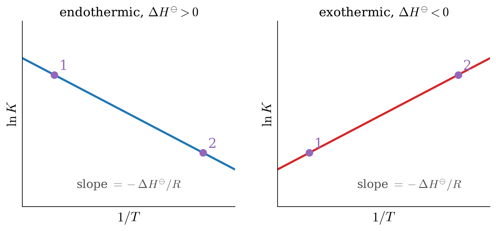

---
aliases:
  - ChemicalEquilibrium.html
---

# Chemical Equilibrium {#sec-ChemicalEquilibrium}
In @sec-GibbsFree, we learned that the Gibbs energy decreases during a spontaneous process at constant temperature and pressure, and we found how it depends on the composition of a mixture. In this chapter, we will apply these results to chemical reactions. Most reactions do not go all the way to products: they stop at a mixture of reactants and products, the chemical equilibrium. We will see that the composition of this mixture is set by the minimum of the Gibbs energy, which leads us to the equilibrium constant that you know from general chemistry. We will then study how the equilibrium constant changes with temperature and pressure, which gives a mathematical form to Le Chatelier's principle.

## Reaction Quotient and Equilibrium Constant
Let's consider a prototypical reaction at constant $T,P$:

$$
a\mathrm{A} + b\mathrm{B} \rightarrow c\mathrm{C} + d\mathrm{D}
$$ {#eq-reaction4}

The Gibbs energy of the reaction is defined as:

$$
\Delta_{\text{rxn}} G = G_{\text{products}} - G_{\text{reactants}} = G^{\text{C}} + G^{\text{D}} - G^{\text{A}}-G^{\text{B}},
$$ {#eq-chemeq1}

and replacing the absolute Gibbs energies with the chemical potentials $\mu_i$, we obtain:

$$
\Delta_{\text{rxn}} G = c \mu_{\text{C}} + d \mu_{\text{D}} - a \mu_{\text{A}}- b\mu_{\text{B}}.
$$ {#eq-chemeq2}

Assuming the reaction is happening in the gas phase, we can then use @eq-dgconstn5 to replace the chemical potentials with their value in the reaction mixture, as:

$$
\begin{aligned}
\mkern-60mu \Delta_{\text{rxn}} G =& \; c (\mu_{\text{C}}^\standardstate +RT \ln P_{\text{C}}) + d (\mu_{\text{D}}^\standardstate +RT \ln P_{\text{D}}) +\\ & - a (\mu_{\text{A}}^\standardstate +RT \ln P_{\text{A}}) - b (\mu_{\text{B}}^\standardstate +RT \ln P_{\text{B}}) \\
  =& \; \underbrace{c \mu_{\text{C}}^\standardstate + d \mu_{\text{D}}^\standardstate - a \mu_{\text{A}}^\standardstate - b\mu_{\text{B}}^\standardstate}_{\Delta_{\text{rxn}} G^\standardstate}  +RT \ln \frac{P_{\text{C}}^c \cdot P_{\text{D}}^d}{P_{\text{A}}^a \cdot P_{\text{B}}^b}.
\end{aligned}
$$ {#eq-chemeq3}

We can define a new quantity called the *reaction quotient* as a function of the partial pressures of each substance:^[Notice that since we used @eq-dgconstn4 to derive the reaction quotient, the partial pressures inside it are always dimensionless since they are divided by $P^\standardstate$.]

$$
Q_P = \frac{P_{\text{C}}^c \cdot P_{\text{D}}^d}{P_{\text{A}}^a \cdot P_{\text{B}}^b},
$$ {#eq-chemeq4}

and we can then simply rewrite @eq-chemeq3 using @eq-chemeq4 as:

$$
\Delta_{\text{rxn}} G = \Delta_{\text{rxn}} G^\standardstate + RT \ln Q_P.
$$ {#eq-chemeq5}

This equation tells us that the sign of $\Delta_{\text{rxn}} G$ is influenced by the reaction quotient $Q_P$. For a spontaneous reaction at the beginning, the partial pressures of the reactants are much higher than the partial pressures of the products, therefore $Q_P \ll 1$ and $\Delta_{\text{rxn}} G < 0$, as we expect. As the reaction proceeds, the partial pressures of the products will increase, while the partial pressures of the reactants will decrease. Consequently, both $Q_P$ and $\Delta_{\text{rxn}} G$ will increase. The reaction will completely stop when $\Delta_{\text{rxn}} G = 0$, which is the chemical equilibrium point. At the reaction equilibrium:

$$
\Delta_{\text{rxn}} G = 0 = \Delta_{\text{rxn}} G^\standardstate + RT \ln K_P,
$$ {#eq-chemeq6}

where we have defined a new quantity called **equilibrium constant**, as the value the reaction quotient assumes when the reaction reaches equilibrium, and we have denoted it with the symbol $K_P$.^[The subscript $P$ refers to the fact that the equilibrium constant is measured in terms of partial pressures.] From @eq-chemeq6 we can derive the following fundamental equation on the standard Gibbs energy of reaction:

$$
\Delta_{\text{rxn}} G^\standardstate = - RT \ln K_P.
$$ {#eq-chemeqdg0}

To extend the concept of $K_P$ beyond the four species in the prototypical reaction @eq-reaction4, we can use the product of a series symbol $\left( \prod_i \right)$, and write:

$$
K_P=\prod_i P_{i,\text{eq}}^{\nu_i},
$$ {#eq-kpdef}

where $P_{i,\text{eq}}$ are the partial pressures of each species at equilibrium. @Eq-kpdef is in principle valid for ideal gases only. However, reactions involving ideal gases are pretty rare. As such, we can further extend the concept of equilibrium constant and write:

$$
K_{\text{eq}} =\prod_i a_{i,\text{eq}}^{\nu_i},
$$ {#eq-kdef}

where we have replaced the partial pressure at equilibrium, $P_{i,\text{eq}}$, with a new concept introduced initially by Gilbert Newton Lewis (1875–1946),^[Gilbert Lewis is the same scientist who invented the concept of Lewis Structures.] that he termed **activity**, and represented by the letter $a$. The activity is a dimensionless "effective concentration" that tells us how much each species contributes to the equilibrium. Its expression depends on the state of the species:

- **Ideal gases:** the activity is the partial pressure divided by the standard pressure, $a_i=P_i/P^\standardstate$, as in @eq-kpdef.
- **Non-ideal gases:** the pressure is replaced by an "effective pressure," the fugacity, $a_i=f_i/P^\standardstate$, which we will introduce in @sec-RealGases.
- **Pure liquids and solids:** the activity is simply $a_i=1$. This is why pure solids and liquids do not appear in the equilibrium constants that you wrote in general chemistry.
- **Solutions:** for dilute solutions, the activity is approximately equal to a measured concentration, such as the mole fraction, or the molar concentration divided by the standard one, $[i]/[i]^\standardstate$ with $[i]^\standardstate = 1\;\text{mol/L}$. For concentrated solutions, a correction factor is needed. We will derive the activity of solutions in @sec-MCPhaseDiagrams.

For now, it is interesting to use the activity to write the definition of the following two constants:

$$
K_y =\prod_i \left( y_{i,\text{eq}} \right)^{\nu_i} \qquad \qquad \qquad \qquad K_C =\prod_i \left( [i]_{\text{eq}}/[i]^\standardstate \right)^{\nu_i},
$$ {#eq-kxkcdef}

which can then be related with $K_P$ for a mixture of ideal gases using:

$$
P_i = y_i P \qquad \qquad \qquad P_i=\frac{n_i}{V}RT=[i]RT,
$$ {#eq-kxkcdef2}

which then results in:

$$
K_P = K_y\cdot \left(\frac{P}{P^\standardstate}\right)^{\Delta \nu} \qquad \qquad K_P = K_C \left( \frac{[i]^\standardstate RT}{P^\standardstate} \right)^{\Delta \nu},
$$ {#eq-kxkcdef3}

with $\Delta \nu =\sum_i \nu_i$. 

Using the general equilibrium constant, $K_{\text{eq}}$, we can also rewrite the fundamental equation on $\Delta_{\text{rxn}} G^\standardstate$ that we derived in @eq-chemeqdg0 to be applicable at most conditions, as:

$$
\Delta_{\text{rxn}} G^\standardstate = - RT \ln K_{\text{eq}},
$$ {#eq-chemeqdgG}

and since $\Delta_{\text{rxn}} G^\standardstate$ depends on $T,P$ and $\{n_i\}$, it is useful to explore how $K_{\text{eq}}$ depends on those variables as well.

## Temperature Dependence of $K_{\text{eq}}$

To study the temperature dependence of $K_{\text{eq}}$ we can use @eq-chemeqdgG for the general equilibrium constant and write:

$$
\ln K_{\text{eq}} = -\frac{\Delta G^\standardstate}{RT},
$$ {#eq-kptemp1}

which we can then differentiate with respect to temperature at constant $P,\{n_i\}$ on both sides:

$$
\left( \frac{\partial \ln K_{\text{eq}}}{\partial T} \right)_{P,\{n_i\}} = -\frac{1}{R}  \left[ \frac{\partial \left( \frac{\Delta G^\standardstate}{T} \right)}{\partial T} \right]_{P,\{n_i\}},
$$ {#eq-kptemp2}

and, using the Gibbs–Helmholtz equation (@eq-gibbshelm) to simplify the right-hand side, becomes:

$$
\left( \frac{\partial \ln K_{\text{eq}}}{\partial T} \right)_{P,\{n_i\}} = -\frac{1}{R} \left( -\frac{\Delta H^\standardstate}{T^2} \right) = \frac{\Delta H^\standardstate}{RT^2},
$$ {#eq-kptemp3}

which gives the dependence of $\ln K_{\text{eq}}$ on $T$ that we were looking for. @Eq-kptemp3 is also called **van 't Hoff equation**,^[named after Jacobus Henricus "Henry" van 't Hoff Jr. (1852–1911).] and it is the mathematical expression of Le Chatelier's principle. The simplest interpretation is as follows:

- For an exothermic reaction ($\Delta H^\standardstate < 0$): $K_{\text{eq}}$ will decrease as the temperature increases. 
- For an endothermic reaction ($\Delta H^\standardstate > 0$): $K_{\text{eq}}$ will increase as the temperature increases. 

If we integrate the van 't Hoff equation between two arbitrary points at constant $P$, and assuming constant $\Delta H^\standardstate$, we obtain the following:

$$
\int_1^2 d \ln K_{\text{eq}} = \frac{\Delta H^\standardstate}{R} \int_1^2 \frac{dT}{T^2},
$$ {#eq-kptemp4}

which leads to the linear equation:

$$
\ln K_{\text{eq}}(2) = \ln K_{\text{eq}}(1) - \frac{\Delta H^\standardstate}{R} \left( \frac{1}{T_2}-\frac{1}{T_1} \right),
$$ {#eq-vthoffeqI}

which is the equation that produces the so-called **van 't Hoff plots**, from which $\Delta H^\standardstate$ can be experimentally determined:

{#fig-vthoffplt fig-alt="Two van 't Hoff plots of ln K versus 1 over T, each with two points labeled 1 and 2. Left, endothermic reaction: a blue line with negative slope, equal to minus the standard reaction enthalpy over R. Right, exothermic reaction: a red line with positive slope." width="85%"}

## Pressure and Composition Dependence of $K_{\text{eq}}$

While $K_P$ is independent of both total pressure and number of moles for an ideal gas, the same is not necessarily true for the other equilibrium constants. 

$$
\left( \frac{\partial K_P}{\partial P} \right)_{T,\{n_i\}} = 0 \qquad \qquad \left( \frac{\partial K_P}{\partial n_i} \right)_{T,P} =0.
$$ {#eq-kppni}

For example, it is easy to look at @eq-kxkcdef3 and determine that $K_y$ usually depends on $P$.^[$K_y$  becomes independent of $P$ in the particular case where $\Delta \nu=0$, i.e., for reactions where the total number of moles of reactants is the same as the total number of moles of the products.] Using Dalton's Law, @eq-daltonlaw, we can also notice that the equilibrium partial pressures of the reactants and products in a gas-phase reaction can be expressed in terms of their equilibrium mole fractions $y_i$ and the total pressure $P$. As such, we can use $K_y$ to demonstrate that the equilibrium mole fractions will change when $P$ changes,^[Keep in mind that $K_P$ will *not* change.] as it is demonstrated by the following exercise.

::: {#exr-kpkx}
Calculate the mole fraction change for the dissociation of $\mathrm{Cl}_{2(g)}$ when the pressure is increased from $P^\standardstate$ to $P_f=2.5 \;\text{bar}$ at constant $T=2\,298\;\mathrm{K}$, knowing that $\Delta_{\mathrm{f}} G^\standardstate_{\mathrm{Cl}_{(g)}} = 105.3 \;\text{kJ/mol}$ and $\Delta_{\mathrm{f}} H^\standardstate_{\mathrm{Cl}_{(g)}} = 121.3 \;\text{kJ/mol}$, and remembering that both of these values are tabulated at $T=298\;\text{K}$.

*Solution:* Let's consider the reaction:
$$
\mathrm{Cl}_{2(g)} \rightleftarrows 2 \mathrm{Cl}_{(g)}
$$

We can divide the exercise into two parts. In the first one, we will deal with calculating the equilibrium constant at $T=2\,298\;\mathrm{K}$ from the data at $T=298\;\mathrm{K}$. In the second one, we will calculate the change in mole fraction when the pressure is increased from $P^\standardstate=1\;\text{bar}$ to $P_f=2.5 \;\text{bar}$. 

- Let's begin the first part by calculating $\Delta_{\text{rxn}} G^\standardstate$ and $\Delta_{\text{rxn}} H^\standardstate$ from:
$$
\begin{aligned}
\Delta_{\text{rxn}} G^\standardstate &= 2 \Delta_{\text{f}} G^\standardstate_{\text{Cl}_{(g)}} - \Delta_{\text{f}} G^\standardstate_{\text{Cl}_{2(g)}} \\
\Delta_{\text{rxn}} H^\standardstate &= 2 \Delta_{\text{f}} H^\standardstate_{\text{Cl}_{(g)}} - \Delta_{\text{f}} H^\standardstate_{\text{Cl}_{2(g)}},
\end{aligned}
$$
and since $\text{Cl}_{2(g)}$ is an element in its most stable form at $T=298\;\mathrm{K}$, its standard enthalpy and Gibbs energy of formation are $\Delta_{\text{f}} H^\standardstate_{\text{Cl}_{2(g)}} = \Delta_{\text{f}} G^\standardstate_{\text{Cl}_{2(g)}} = 0$. Therefore:^[Notice how a positive $\Delta_{\text{rxn}} G^\standardstate$ indicates that the dissociation of $\mathrm{Cl}_{2(g)}$ is non-spontaneous at $T=298\;\text{K}$ and $P=1\;\text{bar}$. As such, we should expect a very small value for $K_P$.]
$$
\begin{aligned}
\Delta_{\text{rxn}} G^\standardstate &= 2 \cdot 105.3 - 0 = 210.6 \;\text{kJ/mol} \\
\Delta_{\text{rxn}} H^\standardstate &= 2 \cdot 121.3 - 0 = 242.6\;\text{kJ/mol}.
\end{aligned}
$$
Using @eq-chemeqdg0 to calculate $K_P (P^\standardstate,298\;\text{K})$, we obtain:^[The result corresponds to $K_P=1.2\times 10^{-37}$, an incredibly minuscule number, as we should expect given the data of $\Delta_{\text{rxn}} G^\standardstate$.]
$$
\ln [ K_P (P^\standardstate,298\;\text{K}) ] =  \frac{ - \Delta_{\text{rxn}} G^\standardstate}{RT}  =  \frac{-210.6\times10^3}{8.31 \cdot 298} = - 85.0.
$$
We can now use the integrated van 't Hoff equation, @eq-vthoffeqI, to calculate $K_P$ at $T=2\,298\;\text{K}$:
$$
\begin{aligned}
\ln [K_P (P^\standardstate,&2\,298\;\text{K})] = \ln [K_P (P^\standardstate,298\;\text{K})] \;+ \\ &-\frac{\Delta_{\text{rxn}} H^\standardstate}{R} \left(\frac{1}{2\,298}-\frac{1}{298} \right),
\end{aligned}
$$
which becomes:
$$
\begin{aligned}
\ln [K_P (P^\standardstate,&2\,298\;\text{K})] = - 85.0 \;+\\&-\frac{242.6\times 10^{3}}{8.31} \left(\frac{1}{2\,298}-\frac{1}{298} \right) = 0.262\;,
\end{aligned}
$$
which corresponds to:
$$
K_P (P^\standardstate,2\,298\;\text{K}) = \exp (0.262)=1.30.
$$

- Let's now move to the second part of the exercise, where we increase the pressure from $1\;\text{bar}$ to $2.5\;\text{bar}$ at constant $T=2\,298\;\text{K}$. We start by writing the definition of $K_P$ and $K_y$:
$$
K_P=\frac{P_\mathrm{Cl_{(g)}}^2}{P_{\mathrm{Cl}_{2(g)}}} \qquad \qquad  K_y=\frac{y_\mathrm{Cl_{(g)}}^2}{y_{\mathrm{Cl}_{2(g)}}},
$$
and using @eq-kxkcdef3:
$$
\begin{aligned}
\Delta \nu &= 2 - 1 = 1 \\
K_P &= K_y \cdot \frac{P}{P^\standardstate} \quad \xrightarrow \qquad K_y=K_P \left( \frac{P}{P^\standardstate} \right)^{-1},
\end{aligned}
$$
we can calculate the initial $K_y$ at $P_i=P^\standardstate$, using:
$$
K_y (P^\standardstate,2\,298\;\text{K}) = 1.30 =\frac{1.30}{1}.
$$
and calculate the initial concentration of $\mathrm{Cl}_{2(g)}$ and $\mathrm{Cl}_{(g)}$ at $P^\standardstate$, recalling that $y_{\mathrm{Cl}_{2(g)}}=1-y_{\mathrm{Cl}_{(g)}}:$
$$
K_y (P_i,2\,298\;\text{K})=\frac{\left(y^i_{\mathrm{Cl}_{(g)}}\right)^2}{1-y^i_{\mathrm{Cl}_{(g)}}} = 1.30.
$$
Solving the quadratic equation, we obtain one negative answer—which is unphysical—,^[Concentration cannot be negative.] and:
$$
y_{\mathrm{Cl}_{(g)}}^i= 0.662 \quad \xrightarrow \qquad y_{\mathrm{Cl}_{2(g)}}^i=1-0.662 = 0.338.
$$
At the end of the process, $P_f=2.5\;\text{bar}$, and we obtain:
$$
K_y (P_f,2\,298\;\text{K}) = 0.520 = K_P \frac{P^\standardstate}{P_f} = \frac{1.30}{2.5},
$$
and, using the same technique used before to solve the quadratic equation:
$$
K_y (P_f,2\,298\;\text{K})=\frac{\left(y^f_{\mathrm{Cl}_{(g)}}\right)^2}{1-y^f_{\mathrm{Cl}_{(g)}}} = 0.520,
$$
gives:
$$
y_{\mathrm{Cl}_{(g)}}^f=0.507 \quad \xrightarrow \qquad y_{\mathrm{Cl}_{2(g)}}^f=1-0.507 = 0.493.
$$
To summarize, when we increase the pressure from $1\;\text{bar}$ to $2.5\;\text{bar}$ at $T=2\,298\;\text{K}$, the equilibrium constant in terms of the mole fraction decreases from $K_y(P^\standardstate,2\,298\;\text{K})=1.30$ to $K_y(P_f=2.5\;\text{bar},2\,298\;\text{K})=0.520$. This reduction is causing a shift of the equilibrium towards the reactants, with the concentration of  $\text{Cl}_{2(g)}$ increasing from $y_{\text{Cl}_{2(g)}}^i = 0.338$ to $y_{\text{Cl}_{2(g)}}^f = 0.493$ and the concentration of $\text{Cl}_{(g)}$ decreasing from $y_{\text{Cl}_{(g)}}^i = 0.662$ to $y_{\text{Cl}_{(g)}}^f = 0.507$.
:::

The dependence of $K_{\text{eq}}$ on $P$ highlighted above is another mathematical expression of Le Chatelier's principle, on this occasion, for changes in pressure. The interpretation for a reaction happening in the gas phase is as follows:

- If the total pressure increases, the equilibrium will shift towards the side of the chemical equation that contains the smallest total number of moles of gas (the equilibrium in @exr-kpkx shifts toward the reactant).

## Chapter Review {#sec-rev10}
### Study Questions {#sec-quest10}
**1. How is the Gibbs energy of a reaction related to the reaction quotient?**

a. $\Delta_{\text{rxn}}G = \Delta_{\text{rxn}}G^{\standardstate} + RT\ln Q$.
b. $\Delta_{\text{rxn}}G = \Delta_{\text{rxn}}G^{\standardstate} - RT\ln Q$.
c. $\Delta_{\text{rxn}}G = RTQ$.
d. $\Delta_{\text{rxn}}G = \Delta_{\text{rxn}}G^{\standardstate}\,Q$.
e. $\Delta_{\text{rxn}}G = -RT\ln K$.

---

**2. What is true at chemical equilibrium?**

a. $\Delta_{\text{rxn}}G^{\standardstate} = 0$.
b. $Q = 1$.
c. $\Delta_{\text{rxn}}G = 0$, and the reaction quotient equals the equilibrium constant.
d. The reaction stops because the reactants are used up.
e. $K = 0$.

---

**3. How is the standard Gibbs energy of reaction related to the equilibrium constant?**

a. $\Delta_{\text{rxn}}G^{\standardstate} = RT\ln K_{\text{eq}}$.
b. $\Delta_{\text{rxn}}G^{\standardstate} = K_{\text{eq}}/RT$.
c. $\Delta_{\text{rxn}}G^{\standardstate} = RTK_{\text{eq}}$.
d. $\Delta_{\text{rxn}}G^{\standardstate} = 0$ at equilibrium.
e. $\Delta_{\text{rxn}}G^{\standardstate} = -RT\ln K_{\text{eq}}$.

---

**4. The dissociation of $\mathrm{Cl}_{2(g)}$ has a large positive $\Delta_{\text{rxn}}G^{\standardstate}$ at 298 K. What does this tell us about its equilibrium constant?**

a. It is very large.
b. It is very small.
c. It is equal to 1.
d. It is negative.
e. It cannot be defined.

---

**5. What is the activity of a pure liquid or solid?**

a. Its mole fraction.
b. Its molar concentration.
c. Its vapor pressure.
d. 1.
e. 0.

---

**6. How are $K_P$ and $K_y$ related for a reaction between ideal gases?**

a. $K_P = K_y \left(\frac{P}{P^{\standardstate}}\right)^{\Delta\nu}$.
b. $K_P = K_y$ always.
c. $K_P = K_y \left(\frac{P^{\standardstate}}{P}\right)^{\Delta\nu}$.
d. $K_P = K_y\,RT$.
e. $K_P = K_y^{\Delta\nu}$.

---

**7. What is the van 't Hoff equation?**

a. $\left(\frac{\partial \ln K_{\text{eq}}}{\partial T}\right)_P = -\frac{\Delta H^{\standardstate}}{RT^2}$.
b. $\left(\frac{\partial \ln K_{\text{eq}}}{\partial T}\right)_P = \frac{\Delta S^{\standardstate}}{R}$.
c. $\left(\frac{\partial \ln K_{\text{eq}}}{\partial T}\right)_P = \frac{\Delta H^{\standardstate}}{RT^2}$.
d. $\left(\frac{\partial K_{\text{eq}}}{\partial P}\right)_T = 0$.
e. $\ln K_{\text{eq}} = -\frac{\Delta G^{\standardstate}}{R}$.

---

**8. How does the equilibrium constant of an exothermic reaction change when the temperature increases?**

a. It increases.
b. It stays constant.
c. It becomes negative.
d. It first increases, then decreases.
e. It decreases.

---

**9. In a van 't Hoff plot of $\ln K$ versus $1/T$, what is the slope of the line?**

a. $\frac{\Delta H^{\standardstate}}{R}$.
b. $-\frac{\Delta H^{\standardstate}}{R}$.
c. $\frac{\Delta S^{\standardstate}}{R}$.
d. $-\Delta G^{\standardstate}$.
e. $RT$.

---

**10. What happens when the total pressure of a gas-phase reaction at equilibrium is increased, if the number of moles of gas changes in the reaction?**

a. $K_P$ increases, and the equilibrium shifts towards the products.
b. $K_P$ decreases, and the equilibrium shifts towards the reactants.
c. Nothing changes.
d. $K_P$ does not change, but the equilibrium shifts towards the side with fewer moles of gas.
e. The equilibrium shifts towards the side with more moles of gas.

---

::: {.callout-tip collapse="true" icon="false"}
## Answers

1.a, 2.c, 3.e, 4.b, 5.d, 6.a, 7.c, 8.e, 9.b, 10.d
:::
