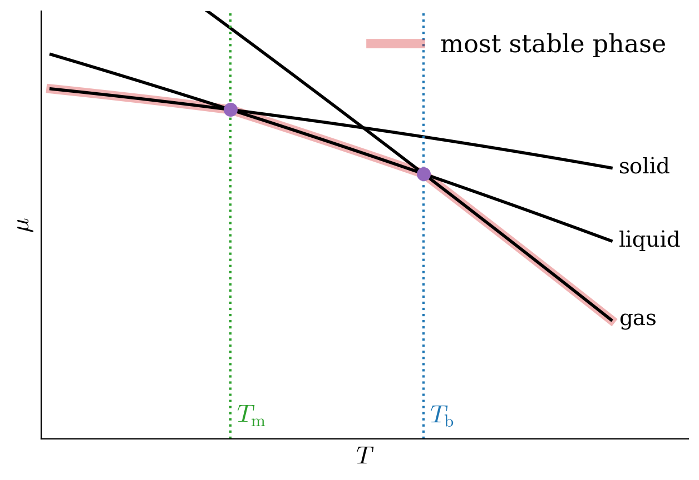
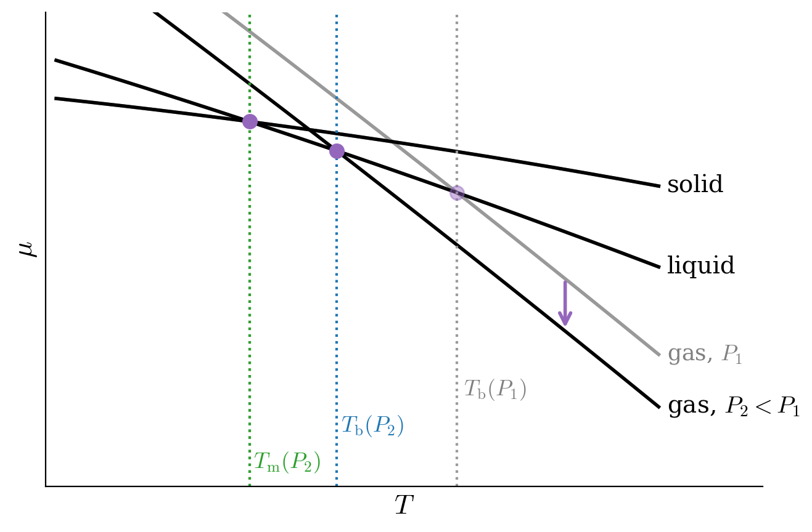
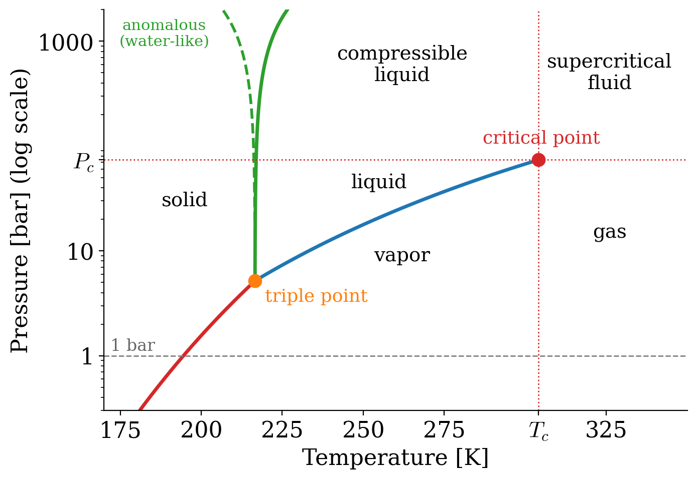

---
aliases:
  - PhaseEquilibrium.html
---

# Phase Equilibrium {#sec-PhaseEquilibrium}
In @sec-RealGases, we saw that a non-ideal gas can be liquefied, and that the liquid and the gas can coexist under certain conditions. In @sec-GibbsFree, we introduced the chemical potential, the molar Gibbs energy of a substance, and we learned how it changes with temperature and pressure. In this chapter, we will put these two ideas together to understand when a pure substance is solid, liquid, or gas, and what happens at the boundaries between these phases. We will build the phase diagrams that chemists use every day, and we will derive the equations that tell us how melting and boiling points change with pressure.

## Phase Stability

We have already encountered the gas, liquid, and solid phases and already discussed some of their properties. These terms are intuitive since these are the three most common states of matter.^[Other states of matter—such as plasma—are possible, but they are not usually observed at the values of temperature and pressure that classical thermodynamics is usually applied to. Discussion of these extreme cases is beyond the scope of this textbook.] For this reason, we have previously used the terms without the necessity of formally defining their meaning. However, a formal definition of "phase" is necessary to discuss several concepts in this chapter and the following ones: 

::: {#def-phasedef}
*Phase:* A region of the system with homogeneous chemical composition and physical state.
:::

Let's now use the total differential of the chemical potential and the definition of molar Gibbs energy for one component:

$$
\begin{aligned}
d\mu &= \left( \frac{\partial \mu}{\partial T} \right)_P dT + \left( \frac{\partial \mu}{\partial P} \right)_T dP \\
d\mu &= -SdT+\overline{V}dP,
\end{aligned}
$$ {#eq-muequal1}

to write:

$$
\left( \frac{\partial \mu}{\partial T} \right)_P=-S \qquad \left( \frac{\partial \mu}{\partial P} \right)_T =\overline{V}.
$$ {#eq-muequal2}

We can use these definitions to study the dependence of the chemical potential with respect to changes in pressure and temperature. If we plot $\mu$ as a function of $T$ using the first coefficient in @eq-muequal2, we obtain the diagram in @Fig-FigPhase1. The diagram presents three curves, each corresponding to one of the three most common states of matter – solid, liquid, and gas. As we saw in several previous chapters, the entropy of a phase is almost constant with respect to temperature,^[Think, for example, of the integral $\int SdT$, for which we can assume $S$ independent of temperature to obtain $S\Delta T$. In practice, the entropy increases slightly with the temperature. Therefore the curves in @Fig-FigPhase1 are slightly concave downwards (remember that they are obtained from values of $-S$, so if $S$ increases with $T$, the curves bend downwards.)] and therefore the three curves are essentially straight, with negative slopes equal to $-S$. Since the solid has the smallest entropy of the three phases, its line is the least steep.^[The solid line would become perfectly flat only as $T\rightarrow 0$, where, according to the third law, the entropy of a perfect crystal goes to zero. At any temperature at which a substance melts, the entropy of the solid is positive, and its line slopes downward.] The difference between the slopes of the three lines is explained by the fact that each of these states has a different value of entropy:

$$
\left( \frac{\partial \mu_{\text{solid}}}{\partial T} \right)_P =-S_{\text{s}} \qquad \left( \frac{\partial \mu_{\text{liquid}}}{\partial T} \right)_P =-S_{\text{l}} \qquad \left( \frac{\partial \mu_{\text{gas}}}{\partial T} \right)_P =-S_{\text{g}},
$$ {#eq-muequal3}

and since the entropy of a gas is always bigger than the entropy of a liquid, which in turn, is yet bigger than the entropy of a solid ($S_{\text{g}} \gg S_{\text{l}}>S_{\text{s}}$), we obtain three lines with different slopes that intersect each other, as in @Fig-FigPhase1. A few important considerations can be made by analyzing this diagram:

1. **The most stable phase has the lowest chemical potential.** At each temperature, the phase whose line is the lowest is the stable one (red segments in @Fig-FigPhase1). Just as a ball rolls downhill, matter moves spontaneously towards the phase with the lowest chemical potential, since this lowers the Gibbs energy at constant $T$ and $P$.
2. **Phase changes happen where two lines cross.** At each intersection, the two phases have the same chemical potential, and they coexist. At the crossing between the solid and the liquid lines, the fusion (fus) process occurs, at the melting point $T_{\text{m}}$. At the crossing between the liquid and the gas lines, the vaporization (vap) process occurs, at the boiling point $T_{\text{b}}$.
3. **Heating favors the phases with higher entropy.** Since the gas line is the steepest, the gas always wins at high enough temperature, while the solid always wins at low enough temperature.
4. **The liquid can be skipped.** Depending on the substance and on the pressure, the solid line might intersect the gas line before the liquid line. When that occurs, the liquid phase is never observed, and the solid turns directly into gas, at the sublimation (subl) point $T_{\text{subl}}$.

{#fig-FigPhase1 fig-alt="Chemical potential versus temperature at constant pressure for the solid, liquid, and gas phases: three downward-sloping lines, least steep for the solid and steepest for the gas. The lowest line at each temperature, highlighted in red, is the most stable phase. The solid and liquid lines cross at the melting point, and the liquid and gas lines cross at the boiling point." width="60%"}

The effects of pressure on this diagram can be studied using the second coefficient in @eq-muequal2. For the majority of substances, $\overline{V}_{\text{g}} \gg \overline{V}_{\text{l}} > \overline{V}_{\text{s}}$, hence the curves will shift to lower values when the pressure is reduced, as in @Fig-FigPhase2. Notice also that since $\overline{V}_{\text{l}} \cong \overline{V}_{\text{s}}$, the shifts for both the solid and liquid lines are much smaller than the shift for the gas line. These shifts also translate to different values of the junctions, which means the phase changes will occur at different temperatures. Therefore both the melting point and the boiling point in general increase when pressure is increased (and vice versa). Notice how the change for the melting point is always much smaller than the change for the boiling point. 
Water is a noticeable exception to this trend because $\overline{V}_{\mathrm{H}_2\mathrm{O,l}} < \overline{V}_{\text{ice}}$. This explains the experimental observation that increasing the pressure on ice lowers its melting point.^[You might have heard that this is why we can skate on ice. The effect is real, but far too small to explain skating: the pressure under the blade of a skate lowers the melting point of ice by less than one degree, while we can skate on ice at –20 °C. Ice is slippery mostly because of a very thin, liquid-like layer that is always present on its surface, and because of the heat produced by friction.]

{#fig-FigPhase2 fig-alt="Chemical potential versus temperature at two pressures. Lowering the pressure from P1 to P2 shifts the gas line down, shown by a purple arrow, while the solid and liquid lines barely move. As a result, the boiling point moves to a much lower temperature, while the melting point is almost unchanged." width="60%"}

Considering the intersections between two lines, two phases are in equilibrium with each other at each of these points. For two or more phases to be in equilibrium, their chemical potentials must be equal:

$$
\mu_{\alpha} = \mu_{\beta}.
$$ {#eq-muequal}

If we now change either the temperature or the pressure, the location of the intersection will be shifted (see again @Fig-FigPhase2 and the discussion above). For infinitesimal changes in variables, the new location will be:

$$
\mu_{\alpha} + d\mu_{\alpha}= \mu_{\beta}+d\mu_{\beta},
$$ {#eq-muequalA}

which using @eq-muequal, simply becomes:

$$
d\mu_{\alpha}= d\mu_{\beta}.
$$ {#eq-muequalB}

Replacing the differential with the definition of chemical potential in @eq-muequal1, we obtain:

$$
\begin{aligned}
-S_{\alpha}dT+\overline{V}_{\alpha}dP &= -S_{\beta}dT+\overline{V}_{\beta}dP \\
\underbrace{\left(S_{\beta}-S_{\alpha}\right)}_{\Delta S} dT &= \underbrace{\left( \overline{V}_{\beta}-\overline{V}_{\alpha}\right)}_{\Delta \overline{V}}dP,
\end{aligned}
$$ {#eq-muequalC}

which can be rearranged into:

$$
\frac{dP}{dT}=\frac{\Delta S}{\Delta \overline{V}}.
$$ {#eq-ClapeyronEq}

This equation is known as the **Clapeyron equation**, and it is the mathematical relation at the basis of the pressure-temperature phase diagrams. Plotting the results of @eq-ClapeyronEq on a $PT$ phase diagram for common substances results in three lines representing the equilibrium between two different phases. A few important considerations can be made by analyzing @eq-ClapeyronEq:

1. **The slope of a phase boundary is the ratio between two differences.** It depends only on how much the entropy and the molar volume change when we go from one phase to the other.
2. **The sign of the slope is decided by the volume change.** Going from a lower-temperature phase to a higher-temperature one, the entropy always increases ($\Delta S>0$). Therefore, the line slopes up if the volume increases ($\Delta\overline{V}>0$), and down if it decreases.
3. **Small volume changes give steep lines.** When the two phases have almost the same molar volume, as for a solid and a liquid, $\Delta\overline{V}$ is small, and the line is almost vertical. When one of the phases is a gas, $\Delta\overline{V}$ is large, and the line is much flatter.

## Gibbs Phase Rule
In @sec-SystemVariables, we have already seen that the number of independent variables required to describe an ideal gas is two. This number was derived by counting the total number of variables $(3: P,\overline{V},T)$, and reducing it by one because the ideal gas law constrains the value of one of them, once the other two are fixed. For a generic system potentially containing more than one chemical substance in several different phases, however, the number of independent variables can be different than two. For a system composed of $c$ components (chemical substances) and $p$ phases, the number of independent variables, $f$, is given by the Gibbs phase rule:

$$
f=c-p+2.
$$ {#eq-Gibbsrule}

The Gibbs phase rule derives from the fact that different phases are in equilibrium with each other at some conditions, resulting in the reduction of the number of independent variables at those conditions. More rigorously, when two phases are in thermodynamic equilibrium, their chemical potentials are equal (see @eq-muequal). For each equality, the number of independent variables—also called the number of *degrees of freedom*—is reduced by one. For example, the chemical potentials of the liquid and its vapor depend on both $T$ and $P$. But when these phases are in equilibrium with each other, their chemical potentials must be equal. If either the pressure or the temperature is fixed, the other variable will be uniquely determined by the equality relation. In other terms, when a liquid is in equilibrium with its vapor at a given pressure, the temperature is determined by the fact that the chemical potentials of the two phases are the same, and is denoted as the boiling temperature $T_{\text{b}}$. Similarly, at a given temperature, the pressure of the vapor is uniquely determined by the same equality relation and is denoted as the vapor pressure, $P^*$.

The Gibbs phase rule is obtained considering that the number of independent variables is given by the total number of variables minus the constraints. The total number of variables is given by temperature, pressure, plus all the variables required to describe each of the phases. The composition of each phase is determined by $(c-1)$ variables.^[For a 1-component system $c-1=1-1=0$, and no additional variable is required to determine the composition of each phase. For a 2-component system, however, each phase will contain both components, hence $c-1=2-1=1$ additional variable will be required to describe it–the mole fraction.] The number of constraints is determined by the number of possible equilibrium relations, which is $c(p-1)$ since the chemical potential of each component must be equal in all phases. The number of degrees of freedom $f$ is then given by $f=(c-1)p+2-c(p-1)$ $=c-p+2$, which is the Gibbs phase rule, as in @eq-Gibbsrule.

A few important considerations can be made by analyzing @eq-Gibbsrule for a pure substance ($c=1$, so $f=3-p$):

1. **One phase, $f=2$.** We can change both $T$ and $P$ independently, and the substance stays in the same phase. In a $PT$ diagram, single phases are *areas*.
2. **Two phases, $f=1$.** If we choose the temperature, the pressure at which the two phases coexist is fixed, and vice versa. Two-phase equilibria are *lines*.
3. **Three phases, $f=0$.** Nothing can be chosen: three phases can coexist only at a single temperature and pressure. Three-phase equilibria are *points*.

## $PT$ Phase Diagrams

{#fig-FigPhase3 fig-alt="Pressure-temperature phase diagram of carbon dioxide with a logarithmic pressure axis. The red solid-vapor line rises to the triple point at about 217 K and 5 bar. From there, the blue liquid-vapor line rises to the critical point at 304 K and 74 bar, and the green solid-liquid line goes almost straight up. A dashed green line tilting to the left shows an anomalous, water-like solid-liquid line. Labeled regions are solid, liquid, compressible liquid, vapor, gas, and supercritical fluid, and a dashed horizontal line marks 1 bar, where carbon dioxide sublimes." width="75%"}

Let's now discuss the pressure–temperature diagram of a typical substance, as reported in @Fig-FigPhase3. Each of the lines reported in the diagram represents an equilibrium between two phases, and therefore it represents a condition that reduces the number of degrees of freedom to one. The lines can be determined using the Clapeyron equation, @eq-ClapeyronEq. The interpretation of each line is as follows:

### Liquid $\rightleftarrows$ Gas equilibrium

For this equilibrium we can use Trouton's rule, @eq-trouton, and write:
$$
\Delta_{\text{vap}} S = S_{\text{g}}-S_{\text{l}} \cong 88 \; \frac{\text{J}}{\text{mol K}} > 0\quad \text{always},
$$ {#eq-PTdia1}

where the entropy of vaporization is always positive, even for cases where the Trouton's rule is violated. The difference in molar volumes is easily obtained, since the volume of the gas is always much greater than the volume of the liquid:

$$
\overline{V}_{\text{g}} - \overline{V}_{\text{l}} \cong \overline{V}_{\text{g}} = 22.4\; \frac{\text{L}}{\text{mol}} >0\quad \text{always}.
$$ {#eq-PTdia2}

Replacing these values in the Clapeyron equation, we obtain:

$$
\frac{dP}{dT}=\frac{88}{22.4}\left( \frac{0.0831}{8.31} \right) = 0.04\;\text{bar/K} > 0 \quad \text{always},
$$ {#eq-PTdia3}

which is always positive, regardless of violations to Trouton's rule. Notice how small this value is: the liquid–gas line in @Fig-FigPhase3 is much flatter than the solid–liquid one.

### Solid $\rightleftarrows$ Gas equilibrium

If we look at the signs of each quantity, this case is similar to the previous one: 
$$
\begin{aligned}
\Delta_{\text{subl}} S &> 0 \quad \text{always} \\
\Delta_{\text{subl}} \overline{V }&> 0 \quad \text{always} \\
\\
\frac{dP}{dT} &> 0 \quad \text{always}.
\end{aligned}
$$ {#eq-PTdi1}

However, the entropy of sublimation is larger than the entropy of vaporization, since going from solid to gas is equivalent to melting and then vaporizing ($\Delta_{\text{subl}}S=\Delta_{\text{fus}}S+\Delta_{\text{vap}}S$). Near the triple point, where the two lines meet, the solid–gas line is therefore steeper than the liquid–gas one.

### Solid $\rightleftarrows$ Liquid equilibrium

The final curve is for the solid-liquid equilibrium, for which we have:

$$
\Delta_{\text{fus}} S = \frac{\Delta_{\text{fus}} H}{T_{\text{m}}} > 0 \quad \text{always},
$$ {#eq-PTd1}

since fusion is always an endothermic process, $(\Delta_{\text{fus}} H>0)$. On the other side:

$$
\Delta_{\text{fus}} \overline{V} = \overline{V}_{\text{l}} - \overline{V}_{\text{s}} > 0 \quad \text{generally}.
$$

In other words, the difference of the molar volume of the liquid and that of the solid is positive for most substances, but it might be negative (for example for $\mathrm{H}_2\mathrm{O}$). As such:

$$
\frac{dP}{dT} > 0 \quad \text{generally}.
$$ {#eq-PTd2}

For $\mathrm{H}_2\mathrm{O}$ and a few other substances, $\frac{dP}{dT}<0$, an anomalous behavior that has crucial consequences for the existence of life on earth.^[As is well explained by [Wikipedia's article on the properties of water](https://en.wikipedia.org/wiki/Properties_of_water#Density_of_water_and_ice): "The unusual density curve and lower density of ice than of water is vital to life—if water were most dense at the freezing point, then in winter the very cold water at the surface of lakes and other water bodies would sink, lakes could freeze from the bottom up, and all life in them would be killed. Furthermore, given that water is a good thermal insulator (due to its heat capacity), some frozen lakes might not completely thaw in summer. The layer of ice that floats on top insulates the water below. Water at about 4 °C (39 °F) also sinks to the bottom, thus keeping the temperature of the water at the bottom constant."] Because of its importance, this behavior is also depicted in @Fig-FigPhase3 using a dashed green line. 

Since the differences in molar volumes between the solid and the liquid phases are usually small (changes are generally of the order of $10^{-3}\;\mathrm{L}$), $\frac{dP}{dT}$ is always much larger than for the previous two cases. The resulting lines for the solid–liquid equilibria are therefore almost vertical, regardless of the signs of their slopes. 

### The triple point and the critical point
The only point in the $PT$ diagram where all the three phases coexist is called the triple point. The number of degrees of freedom at the triple point for every 1-component diagram is $f=1-3+2=0$. The fact that the triple point has zero degrees of freedom means that its coordinates, $\{T_{\text{tp}},P_{\text{tp}},\overline{V}_{\text{tp}}\}$, are uniquely determined for each chemical substance. For this reason, the value of the triple point of water was fixed by definition—rather than measured—until 2019. This definition was necessary to establish the base unit of the thermodynamic temperature scale in the SI (the kelvin).^[For more information on the 2019 redefinition of the SI units, see [Wikipedia's article on the 2019 redefinition of the SI base units](https://en.wikipedia.org/wiki/2019_redefinition_of_the_SI_base_units).]

In addition to the triple point where the solid, liquid, and gas phases meet, a triple point may involve more than one condensed phase. Triple points are common for substances with multiple solid phases (polymorphs), involving either two solid phases and a liquid one or three solid phases. Helium is a special case that presents a triple point involving two different fluid phases, called the lambda point. Since the number of degrees of freedom cannot be negative, the Gibbs phase rule for a 1-component diagram sets the limit to how many phases can coexist to just three. Therefore, quadruple points (or higher coexistence points) are not possible for pure substances, even for polymorphs.^[Notice that quadruple points are possible for 2-component diagrams.]

Another point with a fixed position in the $PT$ diagram is the critical point, $\{T_{\text{c}},P_{\text{c}},\overline{V}_{\text{c}}\}$. We have already given the definition of the critical temperature in @def-criticalT. This point represents the end of the liquid–gas equilibrium curve. This point is also semantically important to define different regions of the phase diagram, as in @Fig-FigPhase3. A gas whose temperature is below the critical temperature is called a *vapor*, since it can be liquefied by compression. A gas whose temperature and pressure are above the critical ones is called a *supercritical fluid*. Finally, a liquid whose pressure is above the critical point is called a *compressible liquid*.^[Notice that the temperature of a liquid must be below the critical point, otherwise it is no longer a liquid but rather a supercritical fluid.]

## The Clausius–Clapeyron Equation
Let's now take a closer look at the equilibrium between a condensed phase and the gas phase. For both the vaporization and sublimation processes, Clausius showed that the Clapeyron equation can be simplified by using:

$$
\Delta_{\text{vap}} S = \frac{\Delta_{\text{vap}} H}{T} \qquad \Delta \overline{V}= \overline{V}_{\mathrm{g}} -\overline{V}_{\mathrm{l}} \cong \overline{V}_{\mathrm{g}},
$$ {#eq-clacla1}

resulting in:

$$
\frac{dP}{dT} = \frac{ \Delta_{\text{vap}} S}{\Delta \overline{V}} \cong \frac{ \Delta_{\text{vap}} H}{T \overline{V}_{\mathrm{g}}}.
$$ {#eq-clacla2}

Using the ideal gas law to replace the molar volume of the gas, we obtain:

$$
\frac{dP}{dT} = \frac{P \Delta_{\text{vap}} H}{RT^2},
$$ {#eq-clacla3}

which can be rearranged as:

$$
\frac{dP}{P} = \frac{\Delta_{\text{vap}} H}{R} \frac{dT}{T^2}.
$$ {#eq-clacla}

@Eq-clacla is known as the **Clausius–Clapeyron equation**, and it measures the dependence of the vapor pressure of a substance as a function of the temperature. The Clausius–Clapeyron equation can be integrated to obtain:

$$
\begin{aligned}
\int_{P_i}^{P_f} \frac{dP}{P} &= \frac{\Delta_{\text{vap}} H}{R} \int_{T_i}^{T_f} \frac{dT}{T^2} \\
\ln \frac{P_f}{P_i} &=-\frac{\Delta_{\text{vap}} H}{R} \left( \frac{1}{T_f}-\frac{1}{T_i} \right).
\end{aligned}
$$ {#eq-clacla4}

The integrated Clausius–Clapeyron equation shows that the vapor pressure depends exponentially on the temperature. Thus, even a small change in the temperature will result in a significant change in the vapor pressure. In fact, we daily use the fact that the vapor pressure of water changes drastically when we increase its temperature for cooking most of our food. For example, at an external pressure of 1 bar, it rapidly grows from $P^*=0.02\;\text{bar}$ to $P^*=1\;\text{bar}$ when the temperature is increased from $T=293\;\mathrm{K}$ (around room temperature) to $T=373\;\mathrm{K}$ (boiling point). The integrated Clausius–Clapeyron equation is also often used to determine the enthalpy of vaporization from measurements of vapor pressure at different temperatures.

## Chapter Review {#sec-rev12}
### Study Questions {#sec-quest12}
**1. What is a phase?**

a. A region of the system at constant temperature.
b. A region of the system with homogeneous chemical composition and physical state.
c. Any pure substance.
d. A region of the system with constant volume.
e. A mixture of solid and liquid.

---

**2. In a plot of the chemical potential versus temperature, which phase has the steepest (most negative) slope, and why?**

a. The solid, because it is the densest.
b. The liquid, because it can flow.
c. All phases have the same slope.
d. The gas, because it has the highest entropy.
e. The solid, because it has the highest entropy.

---

**3. At a given temperature and pressure, which phase of a substance is the most stable?**

a. The one with the lowest chemical potential.
b. The one with the highest chemical potential.
c. The one with the lowest entropy.
d. The one with the largest volume.
e. Always the liquid.

---

**4. What condition must be satisfied for two phases to be in equilibrium?**

a. Their entropies must be equal.
b. Their volumes must be equal.
c. Their enthalpies must be equal.
d. Their densities must be equal.
e. Their chemical potentials must be equal.

---

**5. What is the Clapeyron equation?**

a. $\frac{dP}{dT} = \frac{\Delta V}{\Delta S}$.
b. $\frac{dP}{dT} = \Delta S\,\Delta \overline{V}$.
c. $\frac{dP}{dT} = \frac{\Delta S}{\Delta \overline{V}}$.
d. $\frac{dP}{dT} = \frac{\Delta G}{\Delta \overline{V}}$.
e. $\frac{dP}{dT} = \frac{R}{\Delta \overline{V}}$.

---

**6. Why does the solid–liquid line of water have a negative slope in the $PT$ phase diagram?**

a. Because ice has a higher entropy than liquid water.
b. Because the molar volume of ice is larger than that of liquid water.
c. Because water has hydrogen bonds.
d. Because the enthalpy of fusion of water is negative.
e. Because water boils at 100 °C.

---

**7. What is the Gibbs phase rule?**

a. $f = c + p + 2$.
b. $f = c - p$.
c. $f = p - c + 2$.
d. $f = c - p + 2$.
e. $f = 2 - p$.

---

**8. How many degrees of freedom are there at the triple point of a pure substance?**

a. 0.
b. 1.
c. 2.
d. 3.
e. It depends on the substance.

---

**9. What does the critical point represent in a $PT$ phase diagram?**

a. The point where solid, liquid, and gas coexist.
b. The end of the solid–liquid line.
c. The normal boiling point.
d. The point where the solid sublimates.
e. The end of the liquid–gas equilibrium line.

---

**10. According to the integrated Clausius–Clapeyron equation, how does the vapor pressure of a liquid depend on the temperature?**

a. It decreases linearly.
b. It is independent of temperature.
c. It increases exponentially.
d. It increases linearly.
e. It is proportional to $1/T$.

---

::: {.callout-tip collapse="true" icon="false"}
## Answers

1.b, 2.d, 3.a, 4.e, 5.c, 6.b, 7.d, 8.a, 9.e, 10.c
:::
