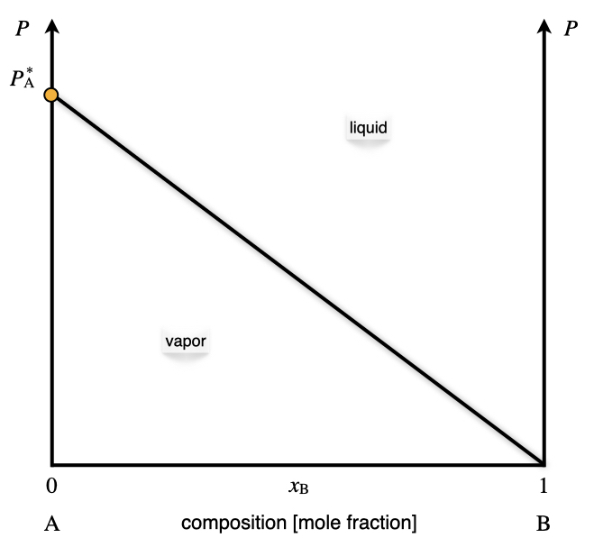
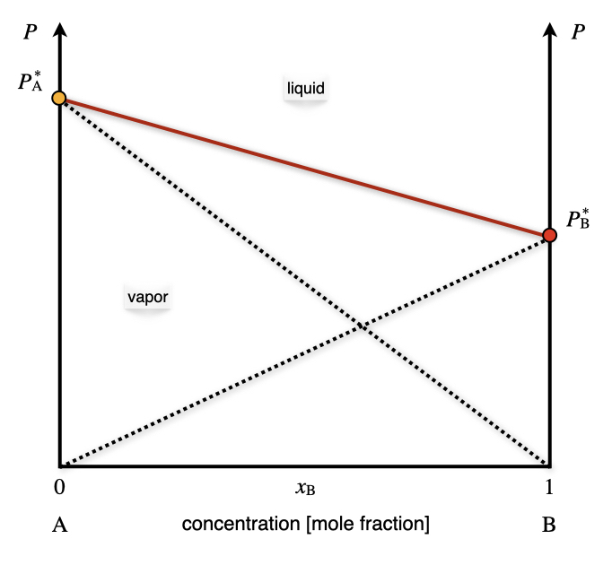
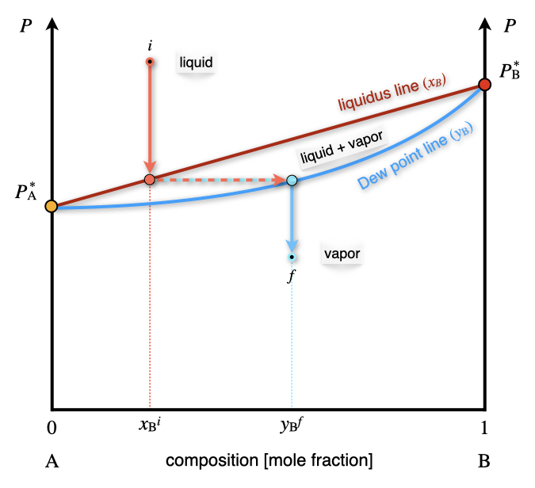
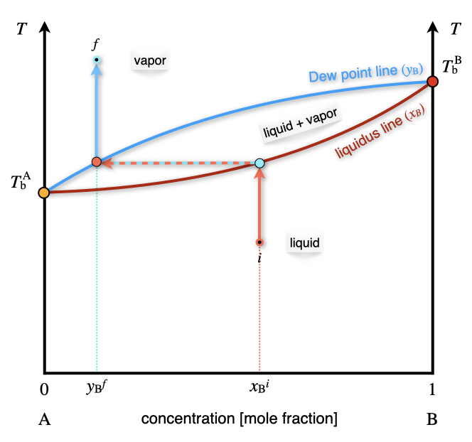
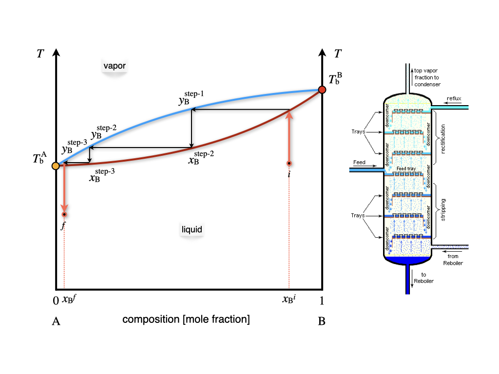
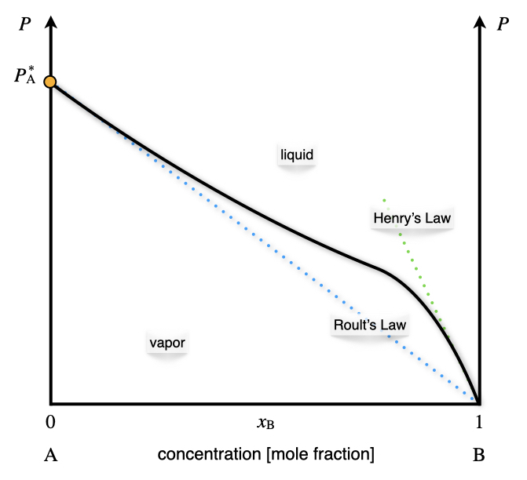
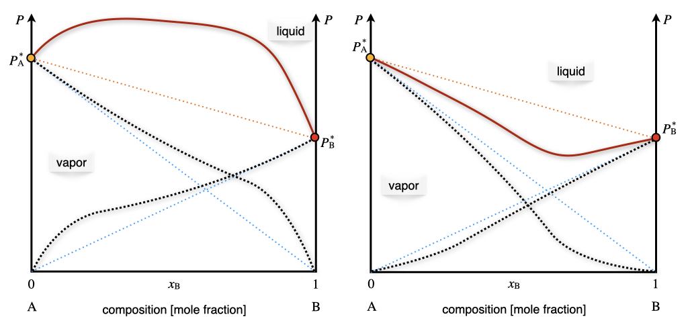
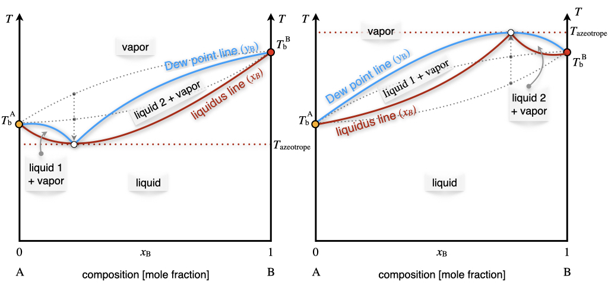
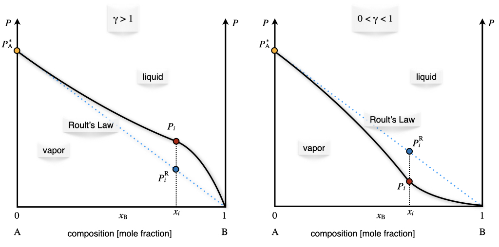
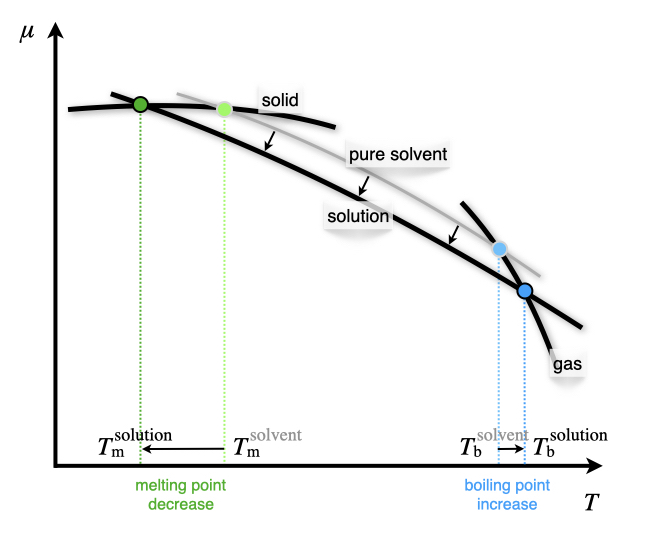

---
aliases:
  - MCPhaseDiagrams.html
---

# Multi-Component Phase Diagrams and Solutions {#sec-MCPhaseDiagrams}
In @sec-PhaseEquilibrium, we studied what happens when a single substance is split between two or more phases, and we used the chemical potential to understand when, for example, a liquid boils or a solid melts. Most of the chemistry we do in the lab, however, does not involve pure substances, but mixtures: we dissolve salts in water, we mix solvents, we bubble gases through liquids. In this chapter, we will extend the ideas of the previous chapter to systems that contain two or more chemical species. As we will see, the presence of a second component opens up a whole new set of phenomena that are extremely useful in practice, from the separation of liquids by distillation to the reason why we spread salt on icy roads in winter.

Systems that include two or more chemical species in the same phase are usually called *solutions*. The species present in the largest amount is usually called the *solvent*, and the others are called *solutes*. Solutions are possible for all three states of matter:

\scriptsize
| Type:             | Solvent | Solute | Examples:                    |
|-------------------|:-------:|:------:|------------------------------|
| Solid solutions   | Solid   | Solid  | Alloys: brass, bronze        |
|                   | Solid   | Liquid | Dental amalgam               |
|                   | Solid   | Gas    | Hydrogen stored in palladium |
| Liquid solutions  | Liquid  | Solid  | Saltwater, bleach           |
|                   | Liquid  | Liquid | Alcoholic beverages, vinegar |
|                   | Liquid  | Gas    | Carbonated drinks            |
| Gaseous solutions | Gas     | Solid  | Smoke, smog                  |
|                   | Gas     | Liquid | Aerosols and perfumes        |
|                   | Gas     | Gas    | Air                          |
\normalsize

## Describing a Two-Component System
Let's start by counting how many variables we need to describe a solution of two components (a *binary* solution). Recalling the Gibbs phase rule from @sec-PhaseEquilibrium, the number of degrees of freedom for $c=2$ components is:

$$
f=2-p+2=4-p.
$$ {#eq-mcgibbs}

A few important considerations can be made by analyzing @eq-mcgibbs:

1. **One phase needs three variables.** When the solution is in a single phase (e.g., a liquid), we need $4-1=3$ variables to describe it. These are usually the temperature, $T$, the pressure, $P$, and the composition. For two components, the composition is given by a single mole fraction, since the other one is obtained from $x_{\text{A}}+x_{\text{B}}=1$. We will use $x_i$ for the mole fractions in the liquid phase and $y_i$ for those in the gas phase.
2. **Three variables would require a 3D plot.** To represent all states of a single-phase binary system, we would need a three-dimensional $T,P,x$ diagram. Since 3D plots are hard to draw and to read, we will always keep one of the variables constant: either the temperature (obtaining a $Px$ diagram) or the pressure (obtaining a $Tx$ diagram).
3. **Two phases leave two variables.** When a liquid and its vapor coexist, $f=4-2=2$. If we also fix the temperature, only one variable remains free. In other words, at a given temperature, once we choose the composition of the liquid, the pressure and the composition of the vapor are fixed by nature. This is what makes the diagrams in this chapter so useful: they tell us exactly what vapor will form above a given liquid.

## Ideal Solutions and Raoult's Law
In @sec-RealGases, we simplified the treatment of gases by introducing the ideal gas, a model where molecules do not interact with each other. For liquids, this assumption is simply impossible, since the interactions between molecules are what keeps a liquid together in the first place. We need, therefore, a different kind of simplification:

::: {#def-idealsolution}
*Ideal solution:* A solution where the interactions between molecules of different species ($\mathrm{A}$–$\mathrm{B}$) are, on average, the same as the interactions between molecules of the same species ($\mathrm{A}$–$\mathrm{A}$ and $\mathrm{B}$–$\mathrm{B}$).
:::

In an ideal solution, a molecule of $\mathrm{A}$ does not "notice" whether its neighbors are molecules of $\mathrm{A}$ or $\mathrm{B}$. This has two immediate consequences: mixing the two liquids releases or absorbs no heat ($\Delta_{\text{mix}}H=0$), and the volume of the mixture is the sum of the volumes of the two liquids ($\Delta_{\text{mix}}V=0$). The only thing that changes upon mixing is the number of ways in which we can arrange the molecules, which increases. As we saw in @sec-SecondLaw, this means that the entropy increases, and that mixing in an ideal solution is a spontaneous process driven entirely by entropy. Mixtures of chemically similar molecules, such as benzene and toluene, or hexane and heptane, behave as ideal solutions to a very good approximation. We will also assume that the vapor above the solution behaves as a mixture of ideal gases, which is reasonable at the low pressures that we usually deal with.

What is the vapor pressure of an ideal solution? Let's think about a molecule of $\mathrm{A}$ at the surface of the liquid. Its tendency to escape into the gas phase depends on how strongly it is held by its neighbors. In an ideal solution, the neighbors hold it exactly as strongly as in the pure liquid, so each molecule of $\mathrm{A}$ at the surface escapes as easily as it would from pure $\mathrm{A}$. However, only a fraction $x_{\text{A}}$ of the molecules at the surface are molecules of $\mathrm{A}$. It is then reasonable to expect that the partial pressure of $\mathrm{A}$ above the solution is the vapor pressure of pure $\mathrm{A}$, reduced by this fraction. This plausibility argument is confirmed experimentally, and it was formulated by François-Marie Raoult (1830–1901) in what is known as **Raoult's law**:

$$
P_i=x_i P_i^*,
$$ {#eq-mc1}

where $P_i$ is the partial pressure of component $i$ above the solution, $x_i$ is its mole fraction in the liquid, and $P_i^*$ is the vapor pressure of pure $i$ at the same temperature. Raoult's law can also be used as an alternative definition of an ideal solution: a solution is ideal if all of its components follow @eq-mc1 at all compositions.

### One volatile component
Let's first consider a solution where only one of the two components, $\mathrm{A}$, is volatile. This is the case, for example, of a solution of sugar in water, since sugar has no measurable vapor pressure. In this case, the pressure above the solution is entirely due to $\mathrm{A}$, and Raoult's law describes a straight line in the $Px_{\text{B}}$ diagram, going from $P_{\text{A}}^*$ for pure $\mathrm{A}$ ($x_{\text{B}}=0$) to zero for pure $\mathrm{B}$ ($x_{\text{B}}=1$), as in @Fig-FigMC1.

{#fig-FigMC1 fig-alt="Pressure versus mole fraction of B, from 0 (pure A) to 1 (pure B). Only A is volatile. A straight line goes from the vapor pressure of pure A at the left axis down to zero at pure B. The liquid region is above the line and the vapor region is below it." width="60%"}

A few important considerations can be made by analyzing @Fig-FigMC1:

1. **The line separates two regions.** Above the line, the pressure is higher than the vapor pressure of the solution, and only the liquid is stable. Below the line, the pressure is lower, the liquid evaporates, and only the vapor is stable. Each region has $f=3$ degrees of freedom, but only two of them are visible in the diagram, since the temperature is kept constant.
2. **Along the line, liquid and vapor coexist.** Raoult's law acts as an additional constraint for the points on the line, which have only two degrees of freedom. Since the temperature is fixed, choosing the composition of the liquid determines the pressure, and vice versa.
3. **Adding a nonvolatile solute lowers the vapor pressure.** Moving from left to right along the line, the vapor pressure decreases. This is the first example of a *colligative property*, which we will discuss in detail at the end of this chapter.

### Two volatile components
When both components are volatile, each of them follows Raoult's law, and both contribute to the vapor. Since we are treating the vapor as a mixture of ideal gases, the total pressure is simply the sum of the two partial pressures, according to Dalton's law, @eq-daltonlaw:

$$
P_{\text{TOT}}=P_{\text{A}}+P_{\text{B}}=x_{\text{A}}P_{\text{A}}^*+x_{\text{B}}P_{\text{B}}^*=P_{\text{A}}^*+x_{\text{B}}\left(P_{\text{B}}^*-P_{\text{A}}^*\right),
$$ {#eq-mcdalton}

where in the last step we used $x_{\text{A}}=1-x_{\text{B}}$. @Eq-mcdalton is the equation of a straight line that goes from $P_{\text{A}}^*$ to $P_{\text{B}}^*$, as reported in red in @Fig-FigMC2. The partial pressures of each of the two components are also reported, using black dotted lines.

{#fig-FigMC2 fig-alt="Pressure versus mole fraction of B for an ideal solution of two volatile components. Two dotted straight lines show the partial pressures of A and of B, each following Raoult's law. Their sum, the total pressure, is a red straight line from the vapor pressure of pure A to that of pure B, with liquid above it and vapor below it." width="60%"}

::: {#exr-xaya}
Calculate the mole fraction in the vapor phase of a liquid solution composed of 67% of toluene ($\mathrm{A}$) and 33% of benzene ($\mathrm{B}$) (in moles), given the vapor pressures of the pure substances: $P_{\text{A}}^*=0.03\;\text{bar}$, and $P_{\text{B}}^*=0.10\;\text{bar}$.

*Solution:* The data available for the system are summarized as follows:
$$
\begin{aligned}
x_{\text{A}}=0.67  \qquad & \qquad x_{\text{B}}=0.33 \\
P_{\text{A}}^* = 0.03\;\text{bar} \qquad & \qquad P_{\text{B}}^* = 0.10\;\text{bar} \\
& P_{\text{TOT}} = ? \\
y_{\text{A}}=? \qquad & \qquad y_{\text{B}}=?
\end{aligned}
$$ {#eq-mc2}
The partial pressures and the total pressure of the vapors can be calculated combining Raoult's and Dalton's laws:
$$
\begin{aligned}
P_{\text{A}} &= x_{\text{A}} P_{\text{A}}^* = 0.67\cdot 0.03 = 0.020\;\text{bar} \\
P_{\text{B}} &= x_{\text{B}} P_{\text{B}}^* = 0.33\cdot 0.10 = 0.033\;\text{bar} \\
P_{\text{TOT}} &= P_{\text{A}}+P_{\text{B}} = 0.053 \;\text{bar}.
\end{aligned}
$$ {#eq-mc3}
Since each partial pressure is proportional to the number of moles of that component in the vapor, we can calculate the mole fractions in the vapor phase as:
$$
\begin{aligned}
y_{\text{A}}=\frac{P_{\text{A}}}{P_{\text{TOT}}} & \qquad y_{\text{B}}=\frac{P_{\text{B}}}{P_{\text{TOT}}} \\
y_{\text{A}}=\frac{0.020}{0.053}=0.38 & \qquad y_{\text{B}}=\frac{0.033}{0.053}=0.62.
\end{aligned}
$$ {#eq-mc4}
Notice how the vapor is much richer in benzene ($y_{\text{B}}=0.62$) than the liquid ($x_{\text{B}}=0.33$). Benzene has the higher vapor pressure (it is more *volatile*), so its molecules escape more easily into the gas phase.
:::

The result of @Exr-xaya is completely general: *the vapor above an ideal solution is always richer in the more volatile component than the liquid it comes from.* Since the compositions of the liquid and of the vapor are different, we can report both of them in the same diagram, as in @Fig-FigMC3. The line that gives the composition of the liquid, $x_{\text{B}}$, is called the *liquidus line* (or bubble point line), while the line that gives the composition of the vapor, $y_{\text{B}}$, is called the *dew point line*.

{#fig-FigMC3 fig-alt="Pressure versus mole fraction of B for an ideal solution. The upper red straight line is the liquidus line, liquid composition x B. The lower blue curve is the dew point line, vapor composition y B. Between them is a liquid plus vapor region. An arrow shows a liquid of composition x B i whose pressure is lowered until it reaches the liquidus line, where it forms vapor of composition y B f." width="60%"}

The liquidus and dew point lines enclose a new region of the diagram, where the liquid and the vapor coexist. Let's follow the arrow in @Fig-FigMC3 to understand how to read this diagram:

1. **We start from a liquid** with composition $x^i_{\text{B}}$ at high pressure (point $i$). Here only the liquid is stable.
2. **We lower the pressure** at constant temperature and composition, moving straight down, until we hit the liquidus line. At this pressure, the liquid starts to boil.
3. **The first bubble of vapor** that forms does not have the same composition as the liquid. Its composition is found by moving horizontally (at the same pressure) until we hit the dew point line, which gives $y^f_{\text{B}}$. As expected, the vapor is richer in the more volatile component, $\mathrm{B}$.
4. **Inside the coexistence region**, any horizontal line (called a *tie line*) connects a liquid and a vapor in equilibrium with each other. Since there are only two degrees of freedom inside this region, and the temperature is fixed, once we fix the pressure, the compositions of both phases are determined.

### $Tx_{\text{B}}$ phase diagrams and fractional distillation

In the lab, we usually boil liquids at constant (atmospheric) pressure by increasing the temperature, rather than by reducing the pressure. It is therefore more useful to look at the phase diagram of a 2-component ideal solution as a function of temperature at constant pressure. The $Tx_{\text{B}}$ diagram for two volatile components is reported in @Fig-FigMC4. Notice that, in this diagram, the more volatile component is $\mathrm{A}$, which has the lower boiling point, $T_{\text{b}}^{\text{A}}$.

{#fig-FigMC4 fig-alt="Temperature versus mole fraction of B for an ideal solution at constant pressure. A lens-shaped region of liquid plus vapor lies between the lower red liquidus line and the upper blue dew point line, which join at the boiling points of pure A and of pure B. Liquid is below, vapor above. An arrow shows a liquid of composition x B i heated until it boils, giving vapor of composition y B f that is richer in A." width="60%"}

A few important considerations can be made by analyzing @Fig-FigMC4:

1. **The phases are in reversed order.** Compared to the $Px_{\text{B}}$ diagram of @Fig-FigMC3, the liquid is now at the bottom (low temperature), and the vapor is on top (high temperature).
2. **The two lines form a lens.** The liquidus and dew point lines are curved, and they enclose a lens-shaped region where liquid and vapor coexist. Inside the lens there are only two degrees of freedom, and since the pressure is kept constant, only one of them is visible in the plot: if we choose the temperature, the compositions of both phases are fixed, and vice versa.
3. **A mixture boils over a range of temperatures.** If we heat a liquid of composition $x_{\text{B}}^i$, it starts boiling when it hits the liquidus line. The first vapor that forms has composition $y_{\text{B}}^f$, which is richer in the more volatile component $\mathrm{A}$. As the vapor leaves, the remaining liquid becomes richer in $\mathrm{B}$, and its boiling temperature increases. Unlike a pure substance, a mixture does not have a single boiling point.

The difference in composition between the liquid and the vapor can be exploited to separate the two components. If we collect the vapor and condense it, we obtain a liquid that is richer in $\mathrm{A}$ than the one we started from. If we boil this new liquid again, its vapor will be even richer in $\mathrm{A}$. Each evaporation and condensation step corresponds to a horizontal line (from the liquidus line to the dew point line) followed by a vertical line (from the dew point line down to the liquidus line), as in the staircase of @Fig-FigMC5. Each of these steps is called a *theoretical plate*, and by repeating it enough times we can obtain almost pure $\mathrm{A}$. This is the principle of *fractional distillation*.

{#fig-FigMC5 fig-alt="Left: the same temperature-composition lens with a staircase of horizontal and vertical steps, each step being one theoretical plate, moving the composition from x B i toward pure A. Right: schematic of a fractional distillation column with trays, a feed inlet, a reboiler at the bottom, and a condenser at the top." width="60%"}

In practice, the evaporations and condensations do not happen in separate flasks, but along a tall column filled with trays, as schematically depicted on the right of @Fig-FigMC5. The mixture is heated at the bottom, and the temperature decreases with the height of the column. On each tray, the rising vapor partially condenses and the liquid partially evaporates, so that each tray works as one theoretical plate. The vapor collected at the top is rich in the most volatile component, while the liquid collected at the bottom is rich in the least volatile one. Counting the theoretical plates on the $Tx_{\text{B}}$ diagram tells chemical engineers how many trays a column needs to reach the desired purity, which is how industrial distillation columns are sized.

## Phase Diagrams of Non-Ideal Solutions
In most real solutions, the $\mathrm{A}$–$\mathrm{B}$ interactions are not the same as the $\mathrm{A}$–$\mathrm{A}$ and $\mathrm{B}$–$\mathrm{B}$ ones, and Raoult's law is followed only over a small range of compositions. Let's start again from a solution with a single volatile component, $\mathrm{A}$, whose typical behavior is reported in the $Px_{\text{B}}$ plot of @Fig-FigMC6.

{#fig-FigMC6 fig-alt="Pressure versus mole fraction of B for a non-ideal solution where only A is volatile. The black curve starts at the vapor pressure of pure A and follows the dotted blue Raoult's law line when A is abundant, near x B equal to 0. Near pure B it follows a steeper dotted green line labeled Henry's law." width="60%"}

A few important considerations can be made by analyzing @Fig-FigMC6:

1. **When $\mathrm{A}$ is abundant ($x_{\text{B}} \rightarrow 0$), Raoult's law holds.** In this region, $\mathrm{A}$ is the solvent, and almost every molecule of $\mathrm{A}$ is surrounded by other molecules of $\mathrm{A}$, as in the pure liquid. Its escaping tendency is therefore the same as in pure $\mathrm{A}$, as Raoult's law assumes.
2. **When $\mathrm{A}$ is dilute ($x_{\text{B}} \rightarrow 1$), Henry's law holds.** In this region, $\mathrm{A}$ is the solute, and each molecule of $\mathrm{A}$ is surrounded almost exclusively by molecules of $\mathrm{B}$. Its escaping tendency is now determined by the $\mathrm{A}$–$\mathrm{B}$ interactions, which are different from the $\mathrm{A}$–$\mathrm{A}$ ones. The partial pressure is still proportional to the mole fraction, but with a different proportionality constant, as shown by the green dotted line.
3. **In between, neither law holds**, and the curve must be measured experimentally.

The law that describes the dilute region was found by William Henry (1774–1836), who extensively studied the behavior of gases dissolved in liquids. **Henry's law** states that the partial pressure of a dilute solute $i$ is proportional to its mole fraction in the solution:

$$
P_i=k_{\text{H},i}\, x_i \qquad \text{(for } x_i \rightarrow 0\text{)},
$$ {#eq-mc1b}

where the *Henry's law constant*, $k_{\text{H},i}$, depends on the chemical nature of both the solute and the solvent, and on the temperature. Henry's law is commonly used for gases dissolved in liquids. For example, the amount of $\mathrm{CO}_2$ dissolved in a carbonated drink is proportional to the pressure of $\mathrm{CO}_2$ above it, which is why the drink goes flat when we open the bottle and the pressure drops. In a dilute solution, the solvent follows Raoult's law, while the solute follows Henry's law.

When both components are volatile, the total pressure is once again the sum of the two partial pressures. Two different behaviors are possible, depending on the strength of the $\mathrm{A}$–$\mathrm{B}$ interactions, as reported in @Fig-FigMC7:

- **Positive deviation** (left panel): the $\mathrm{A}$–$\mathrm{B}$ interactions are weaker than the $\mathrm{A}$–$\mathrm{A}$ and $\mathrm{B}$–$\mathrm{B}$ ones. The molecules are held less strongly in the mixture than in the pure liquids, they escape more easily, and the vapor pressure is higher than the one predicted by Raoult's law. Mixing these liquids typically absorbs heat ($\Delta_{\text{mix}}H>0$). An example is the acetone/carbon disulfide mixture.
- **Negative deviation** (right panel): the $\mathrm{A}$–$\mathrm{B}$ interactions are stronger than the $\mathrm{A}$–$\mathrm{A}$ and $\mathrm{B}$–$\mathrm{B}$ ones (for example, because $\mathrm{A}$ and $\mathrm{B}$ form hydrogen bonds with each other). The molecules are held more strongly, and the vapor pressure is lower than the one predicted by Raoult's law. Mixing these liquids typically releases heat ($\Delta_{\text{mix}}H<0$). Examples are the acetone/chloroform and the hydrochloric acid/water mixtures. Negative deviations are slightly less common than positive ones.

{#fig-FigMC7 fig-alt="Two pressure-composition diagrams of non-ideal solutions of two volatile components. Left, positive deviation: the total pressure curve bulges above the straight line of Raoult's law. Right, negative deviation: it sags below that line. Dotted curves show the partial pressures of A and B." width="80%"}

If we move from the $Px_{\text{B}}$ diagram to the $Tx_{\text{B}}$ diagram, the behaviors observed in @Fig-FigMC7 correspond to the diagrams in @Fig-FigMC8. Since a higher vapor pressure means that the mixture boils at a lower temperature, a maximum in the $Px_{\text{B}}$ diagram becomes a minimum in the $Tx_{\text{B}}$ diagram, and vice versa.

{#fig-FigMC8 fig-alt="Two temperature-composition diagrams of non-ideal solutions. Left: the liquidus and dew point lines dip to a common minimum, a minimum-boiling azeotrope, which splits the diagram into two liquid plus vapor regions. Right: they rise to a common maximum, a maximum-boiling azeotrope." width="80%"}

The minimum (left plot) and maximum (right plot) points in @Fig-FigMC8 are called *azeotropes*. At an azeotrope, the liquidus and dew point lines touch, so the liquid and the vapor have the same composition. If we boil a mixture with the azeotropic composition, the vapor has the same composition as the liquid, and distillation cannot change it. The mixture boils at a single temperature, as if it was a pure substance. In practice, distillation can bring us *to* the azeotrope, but not past it. Two types of azeotropes exist, corresponding to the two types of deviation:

- **Positive (minimum-boiling) azeotrope** (left plot in @Fig-FigMC8). A well-known example is the ethanol/water mixture at atmospheric pressure, with composition 95.6% ethanol by mass. This azeotrope boils at $T=78.2\;^\circ \text{C}$, a temperature that is lower than the boiling points of both pure constituents (ethanol boils at $T=78.4\;^\circ \text{C}$ and water at $T=100\;^\circ \text{C}$). This is why we cannot obtain pure ethanol from fermented mixtures by simple distillation.
- **Negative (maximum-boiling) azeotrope** (right plot in @Fig-FigMC8). An example is the hydrochloric acid/water mixture at atmospheric pressure, with composition 20.2% hydrochloric acid by mass. This azeotrope boils at about $T=110\;^\circ \text{C}$, a temperature that is higher than the boiling points of both pure constituents (hydrochloric acid boils at $T=-84\;^\circ \text{C}$ and water at $T=100\;^\circ \text{C}$).

## Activity
To treat non-ideal solutions quantitatively, we need a quantity that plays the same role that the mole fraction plays in Raoult's law. We did something very similar for non-ideal gases in @sec-RealGases, where we replaced the pressure with the fugacity, an *effective pressure*. For solutions, we will replace the mole fraction with an *effective mole fraction*, called the **activity**. Let's derive it step by step, using the vapor above the solution as a "probe" of what happens in the liquid.

1. **The vapor.** Assuming that the vapor behaves as an ideal gas, the chemical potential of component $i$ in the vapor is given by @eq-dcpig:
$$
\mu_i^{\text{vapor}} = \mu_i^{\standardstate} + RT \ln \frac{P_i}{P^{\standardstate}}.
$$ {#eq-act2}
2. **Equilibrium with the solution.** If the vapor is in equilibrium with the solution, the chemical potential of $i$ must be the same in both phases (@eq-muequal):
$$
\mu_i^{\text{solution}} = \mu_i^{\text{vapor}} = \mu_i^{\standardstate} + RT \ln \frac{P_i}{P^{\standardstate}}.
$$ {#eq-act3}
3. **The pure liquid as a reference.** The same reasoning applies to the pure liquid $i$, which is in equilibrium with its vapor at the pressure $P_i^*$. Its chemical potential, $\mu_i^*$, is therefore:
$$
\mu_i^* = \mu_i^{\standardstate} + RT \ln \frac{P_i^*}{P^{\standardstate}}.
$$ {#eq-act3b}
4. **Subtracting** @eq-act3b from @eq-act3, the standard chemical potential of the gas and the standard pressure cancel out, and we obtain:
$$
\mu_i^{\text{solution}} = \mu_i^* + RT \ln \frac{P_i}{P^*_i}.
$$ {#eq-act4}

@Eq-act4 tells us that the ratio $P_i/P_i^*$ measures how much the chemical potential of $i$ in the solution differs from that of the pure liquid. We call this ratio the **activity** of component $i$:

$$
a_i = \frac{P_i}{P_i^*} \qquad \Rightarrow \qquad \mu_i^{\text{solution}} = \mu_i^* + RT \ln a_i.
$$ {#eq-act1}

A few important considerations can be made by analyzing @eq-act1:

1. **For an ideal solution, the activity is the mole fraction.** Using Raoult's law, @eq-mc1, $a_i=x_i$, and @eq-act1 becomes:
$$
\mu_i^{\text{solution}} = \mu_i^* + RT \ln x_i.
$$ {#eq-act5}
Since $x_i<1$, the logarithm is negative, and the chemical potential of a component in an ideal solution is always lower than that of the pure liquid. This is the same result we found for mixtures of ideal gases in @sec-GibbsFree, and it is the reason why ideal solutions form spontaneously.
2. **For a non-ideal solution, the activity is an effective mole fraction.** We can write it as the mole fraction multiplied by a correction factor, called the *activity coefficient*, $\gamma_i$:
$$
a_i = \gamma_i x_i \qquad \Rightarrow \qquad \mu_i^{\text{solution}} = \mu_i^* + RT \ln \left(\gamma_i x_i\right).
$$ {#eq-act6}
3. **The activity coefficient is measured from the vapor pressure.** Combining @eq-act1 and @eq-act6:
$$
\gamma_i = \frac{P_i}{x_i P_i^*} = \frac{P_i}{P_i^{\text{R}}},
$$ {#eq-act9}
where $P_i^{\text{R}}=x_i P_i^*$ is the partial pressure predicted by Raoult's law. For a positive deviation, the measured pressure is higher than the Raoult one, and $\gamma_i>1$. For a negative deviation, it is lower, and $0<\gamma_i<1$. For an ideal solution, $\gamma_i=1$. This procedure is illustrated in @Fig-FigSol1.
4. **The activity is a relative quantity.** It measures the "escaping tendency" of a component *relative* to a reference state, which in this case is the pure liquid at the same temperature and pressure, for which $a_i=1$. This choice of reference (*standard state*) is a convention. We could choose a different one, and the values of the activities would change accordingly, but the physics would not. For gases, the standard state is the ideal gas at $P^{\standardstate}=1\;\text{bar}$, and the activity is $f/P^{\standardstate}$.

{#fig-FigSol1 fig-alt="Two pressure-composition diagrams showing how to read the activity coefficient. Left, gamma greater than 1: at composition x i the measured partial pressure P i lies above the Raoult's law value. Right, gamma between 0 and 1: the measured value lies below it." width="80%"}

As we already discussed in @sec-ChemicalEquilibrium, the activity is the most general quantity that we can use to define the equilibrium constant of a reaction (or the reaction quotient). The advantage of using the activity is that it's defined for ideal and non-ideal gases and mixtures of gases, as well as for ideal and non-ideal solutions in both the liquid and the solid phase.^[Notice that, since the activity is a relative measure, the equilibrium constant expressed in terms of the activities is also a relative concept. In other words, it measures equilibrium relative to a standard state. This fact, however, should not surprise us, since the equilibrium constant is also related to $\Delta_{\text{rxn}} G^{\standardstate}$ using Gibbs' relation. This is why the definition of a universally agreed-upon [standard state](https://en.wikipedia.org/wiki/Standard_state) is such an essential concept in chemistry, and why it is defined by the [International Union of Pure and Applied Chemistry (IUPAC)](https://en.wikipedia.org/wiki/International_Union_of_Pure_and_Applied_Chemistry) and followed systematically by chemists around the globe.]

## Colligative Properties
Colligative properties are properties of solutions that depend on the *number* of solute particles in the solution, and not on their chemical nature. They usually appear when we dissolve a nonvolatile solute (such as sugar or salt) in a volatile liquid solvent (such as water), and they are properties of the solvent, modified by the presence of the solute. We will discuss four of them: the lowering of the vapor pressure, the elevation of the boiling point, the depression of the melting point, and the osmotic pressure.

All four of them have the same origin, which we have already found in @eq-act5. In an ideal solution, the chemical potential of the solvent is:

$$
\mu_{\text{solvent}}^{\text{solution}} = \mu_{\text{solvent}}^* + RT \ln x_{\text{solvent}} < \mu_{\text{solvent}}^*.
$$ {#eq-collA}

In other words, *dissolving a solute always lowers the chemical potential of the solvent.* This lowering is not due to any special interaction between solute and solvent. In an ideal solution there is none: it is a purely entropic effect, due to the increased number of ways in which the molecules can be arranged in the mixture. This is also why the result depends only on the mole fraction, and not on what the solute is. At the same time, the phases that contain only pure solvent (the vapor above the solution, since the solute is nonvolatile, and the solid, since the solute usually does not dissolve in the solid solvent) are not affected at all. The liquid is therefore stabilized with respect to both the vapor and the solid, as shown in @Fig-FigSol2. For non-ideal solutions, the formulas that we will derive below are only valid approximately, but they work well for dilute solutions.

{#fig-FigSol2 fig-alt="Chemical potential versus temperature for the solid, liquid, and gas phases. Adding a solute lowers the liquid line from the pure solvent position to the solution position. The liquid now crosses the solid line at a lower temperature, a melting point decrease, and crosses the gas line at a higher temperature, a boiling point increase." width="60%"}

For dilute solutions, the most useful measure of concentration is the molality, $m$, defined as the number of moles of solute divided by the mass of the solvent in kilograms:^[Molality is preferred over molarity because it does not depend on the temperature, since masses, unlike volumes, do not change when the solution is heated or cooled.]

$$
m = \frac{n_{\text{solute}}}{m_{\text{solvent}}}.
$$ {#eq-coll1}

For a dilute solution, the mole fraction of the solute is related to the molality by a simple approximation. Since $n_{\text{solute}} \ll n_{\text{solvent}}$:

$$
x_{\text{solute}}=\frac{n_{\text{solute}}}{n_{\text{solute}}+n_{\text{solvent}}} \approx \frac{n_{\text{solute}}}{n_{\text{solvent}}} = \frac{n_{\text{solute}}}{m_{\text{solvent}}/M} = mM,
$$ {#eq-collxm}

where $M$ is the molar mass of the solvent, in $\text{kg/mol}$.

### Vapor pressure lowering
As we have already seen in @Fig-FigMC1, the vapor pressure above a solution of a nonvolatile solute follows Raoult's law. Its difference with respect to the vapor pressure of the pure solvent is:

$$
\begin{aligned}
P_{\text{solvent}}^* &- P_{\text{solution}} = P_{\text{solvent}}^* - x_{\text{solvent}} P_{\text{solvent}}^* \\ 
& = \left( 1-x_{\text{solvent}}\right)P_{\text{solvent}}^* =x_{\text{solute}} P_{\text{solvent}}^*,
\end{aligned}
$$ {#eq-coll2}

which shows that the vapor pressure lowering depends only on the mole fraction of the solute, and not on its nature. As such, it is a colligative property.

### Boiling point elevation and melting point depression
Let's now look at @Fig-FigSol2 again. Since the chemical potential of the liquid is lowered, its line crosses the line of the gas at a higher temperature, and the line of the solid at a lower temperature. Therefore, the boiling point increases, and the melting point decreases. To find out by how much, let's follow the boiling point step by step.^[This is a plausibility argument rather than a rigorous proof, since we will use two approximations that are valid only for dilute solutions.]

1. **The equilibrium condition.** At the boiling point of the solution, $T_{\text{b}}$, the chemical potential of the pure vapor equals that of the solvent in the solution, @eq-collA:
$$
\mu_{\text{gas}}^*(T_{\text{b}}) = \mu_{\text{liquid}}^*(T_{\text{b}}) + RT_{\text{b}}\ln x_{\text{solvent}} \quad \Rightarrow \quad \ln x_{\text{solvent}} = \frac{\mu_{\text{gas}}^*-\mu_{\text{liquid}}^*}{RT_{\text{b}}}=\frac{\Delta_{\text{vap}}G(T_{\text{b}})}{RT_{\text{b}}},
$$ {#eq-coll4}
where $\Delta_{\text{vap}}G$ is the molar Gibbs energy of vaporization of the *pure* solvent.
2. **The Gibbs–Helmholtz equation.** We know that $\Delta_{\text{vap}}G=0$ at the boiling point of the pure solvent, $T_{\text{b}}^*$. We can find its value at $T_{\text{b}}$ by integrating the Gibbs–Helmholtz equation, @eq-gibbshelm, between $T_{\text{b}}^*$ and $T_{\text{b}}$, assuming that $\Delta_{\text{vap}}H$ is constant:
$$
\frac{\Delta_{\text{vap}}G(T_{\text{b}})}{T_{\text{b}}} = \Delta_{\text{vap}}H \left(\frac{1}{T_{\text{b}}}-\frac{1}{T_{\text{b}}^*}\right) \quad \Rightarrow \quad \ln x_{\text{solvent}} = \frac{\Delta_{\text{vap}}H}{R}\left(\frac{1}{T_{\text{b}}}-\frac{1}{T_{\text{b}}^*}\right).
$$ {#eq-coll4b}
3. **The dilute-solution approximations.** For a dilute solution, $\ln x_{\text{solvent}}=\ln (1-x_{\text{solute}}) \approx -x_{\text{solute}}$, and since $T_{\text{b}}$ and $T_{\text{b}}^*$ are very close to each other, $\frac{1}{T_{\text{b}}}-\frac{1}{T_{\text{b}}^*}=\frac{T_{\text{b}}^*-T_{\text{b}}}{T_{\text{b}}T_{\text{b}}^*} \approx -\frac{\Delta T_{\text{b}}}{\left(T_{\text{b}}^*\right)^2}$. Replacing both into @eq-coll4b, and using @eq-collxm for the mole fraction of the solute:
$$
\Delta T_{\text{b}} = \frac{R\left(T_{\text{b}}^*\right)^2}{\Delta_{\text{vap}}H}\, x_{\text{solute}} = \underbrace{\frac{RM\left(T_{\text{b}}^*\right)^2}{\Delta_{\text{vap}}H}}_{K_{\text{b}}}\, m.
$$ {#eq-coll5}

The constant $K_{\text{b}}$ is called the *ebullioscopic constant* of the solvent, and it depends only on the properties of the pure solvent. For example, for water, using $M=0.018\;\text{kg/mol}$, $T_{\text{b}}^*=373\;\text{K}$, and $\Delta_{\text{vap}}H=40.7\;\text{kJ/mol}$, we obtain $K_{\text{b}}=0.51\;\frac{\text{K kg}}{\text{mol}}$, in excellent agreement with the experimental value of $0.512\;\frac{\text{K kg}}{\text{mol}}$.

So far, we have assumed that each unit of solute produces one particle in solution. Since colligative properties depend on the *number* of particles, if a solute dissociates into ions, its effect is multiplied. We account for this with the *van 't Hoff factor*, $i$, which counts the number of particles produced by each formula unit of solute. The final formula for the boiling point elevation is:

$$
\Delta T_{\text{b}}=T_{\text{b}}^{\text{solution}}-T_{\text{b}}^{\text{solvent}}=iK_{\text{b}}m.
$$ {#eq-coll3}

For a solute that does not dissociate in solution, such as sugar, $i=1$. For example, the strong electrolyte $\mathrm{Ca}\mathrm{Cl}_2$ completely dissociates into three particles in solution, one $\mathrm{Ca}^{2+}$ and two $\mathrm{Cl}^-$, and $i=3$. For cases of partial dissociation, such as weak acids, weak bases, and their salts, $i$ can assume non-integer values.

The depression of the melting point is obtained with exactly the same procedure, using the equilibrium between the pure solid and the solution instead of the one between the pure vapor and the solution. The result is:

$$
\Delta T_{\text{m}}=T_{\text{m}}^{\text{solution}}-T_{\text{m}}^{\text{solvent}}=-iK_{\text{m}}m, \qquad \text{with} \qquad K_{\text{m}}=\frac{RM\left(T_{\text{m}}^*\right)^{2}}{\Delta_{\mathrm{fus}}H},
$$ {#eq-coll6}

where $K_{\text{m}}$ is the *cryoscopic constant* of the solvent, and the minus sign accounts for the fact that the melting temperature decreases ($\Delta T_{\text{m}}$ is negative, while $i$, $K_{\text{m}}$, and $m$ are all positive). For water, $K_{\text{m}} = 1.86\; \frac{\text{K kg}}{\text{mol}}$. This is why we spread salt on icy roads: a salt solution freezes at a lower temperature than pure water.

Notice from @Fig-FigSol2 how the depression of the melting point is much larger than the elevation of the boiling point. To understand why, we can recall that the slope of each line in @Fig-FigSol2 is $-S$ (@eq-muequal2). When we lower the liquid line, the new crossing point moves more if the two crossing lines have similar slopes, and less if their slopes are very different. The slopes of the liquid and the solid lines differ by the entropy of fusion, which is small, while the slopes of the liquid and gas lines differ by the entropy of vaporization, which is large. Mathematically, since $\Delta H = T\Delta S$ at the transition, we can rewrite the two constants as $K=RMT^*/\Delta S$, where $\Delta S$ is the entropy of the corresponding transition. For water, $\Delta_{\text{fus}}S=22\;\text{J}\,\text{mol}^{-1}\,\text{K}^{-1}$ and $\Delta_{\text{vap}}S=109\;\text{J}\,\text{mol}^{-1}\,\text{K}^{-1}$, which explains why $K_{\text{m}}$ is almost four times larger than $K_{\text{b}}$.

### Osmotic pressure

The osmotic pressure is probably the most important colligative property for biology and medicine. Consider the apparatus in @Fig-FigSol3, where a solution and the pure solvent are separated by a *semi-permeable* (osmotic) membrane. This membrane is made of a material that lets the solvent molecules through, but blocks the solute ones.

{#fig-FigSol3 fig-alt="U-shaped tube with a semi-permeable membrane at the bottom, before and after. Before: the left arm contains solution with solute particles, the right arm contains pure solvent, and the levels are equal under the same external pressure. After: solvent has moved into the left arm, whose level is higher by a height delta h, matching the osmotic pressure pi." width="80%"}

Since the chemical potential of the solvent in the solution is lower than that of the pure solvent, @eq-collA, the solvent spontaneously flows from the pure side into the solution, across the membrane. As a consequence, the level of the solution rises, and its pressure increases. The flow stops when the extra pressure on the solution side raises the chemical potential of its solvent back to that of the pure solvent. This extra pressure, $\pi$, is called the **osmotic pressure**. We can calculate it step by step:

1. **The equilibrium condition.** At equilibrium, the chemical potential of the pure solvent at pressure $P$ equals that of the solvent in the solution at pressure $P+\pi$:
$$
\mu_{\text{solvent}}^*(P) = \mu_{\text{solvent}}^*(P+\pi) + RT\ln x_{\text{solvent}}.
$$ {#eq-coll8a}
2. **The effect of pressure.** As we saw in @sec-GibbsFree, the chemical potential of a liquid increases with pressure as $d\mu=\overline{V}dP$, and, since liquids are essentially incompressible, $\mu_{\text{solvent}}^*(P+\pi)-\mu_{\text{solvent}}^*(P)=\overline{V}\pi$, where $\overline{V}$ is the molar volume of the solvent. Replacing into @eq-coll8a:
$$
\overline{V}\pi = -RT\ln x_{\text{solvent}}.
$$ {#eq-coll8b}
3. **The dilute-solution approximation.** Using again $-\ln x_{\text{solvent}} \approx x_{\text{solute}} \approx n_{\text{solute}}/n_{\text{solvent}}$, and noticing that $n_{\text{solvent}}\overline{V}$ is essentially the volume of the solution, $V$:
$$
\pi = \frac{n_{\text{solute}}}{V}RT = i\,cRT,
$$ {#eq-coll8}
where $c$ is the molar concentration of the solute, and we have introduced again the van 't Hoff factor, $i$, to account for dissociation.

@Eq-coll8 was proposed by van 't Hoff, and it is remarkably similar to the ideal gas law. Morse later refined it by using the molality instead of the molar concentration, which gives better results at higher concentrations.^[The Morse equation reads $\pi = imRT$. For dilute aqueous solutions, molality and molarity are nearly equal, since 1 kg of water occupies about 1 L.] Osmotic pressures can be surprisingly large: a solution with $c=0.10\;\text{mol/L}$ of sugar at room temperature has $\pi \approx 2.5\;\text{bar}$, enough to push a column of water up by about 25 m. This is why intravenous fluids must have the same osmotic pressure as blood: if the solution were too dilute, water would flow into the red blood cells, making them swell and burst. If we apply to the solution side a pressure higher than $\pi$, we can reverse the flow and push pure solvent out of the solution. This process, called *reverse osmosis*, is widely used to obtain drinkable water from seawater.

## Chapter Review {#sec-rev13}
### Practice Problems {#sec-exer13}
**Problem 1: Vapor Composition Above an Ideal Solution**

A liquid mixture of benzene and toluene contains 40.% benzene (in moles). Calculate the total vapor pressure above the mixture at $25\;^\circ\text{C}$, and the mole fraction of benzene in the vapor, knowing that at this temperature the vapor pressures of the pure liquids are $P_{\text{benzene}}^*=0.127\;\text{bar}$ and $P_{\text{toluene}}^*=0.038\;\text{bar}$. Assume that the mixture behaves as an ideal solution.

**Solution:** Using Raoult's law, @eq-mc1, for each component:

$$P_{\text{benzene}} = x_{\text{benzene}} P_{\text{benzene}}^* = 0.40 \cdot 0.127\;\text{bar} = 0.0508\;\text{bar},$$

$$P_{\text{toluene}} = x_{\text{toluene}} P_{\text{toluene}}^* = 0.60 \cdot 0.038\;\text{bar} = 0.0228\;\text{bar}.$$

The total pressure is obtained from Dalton's law:

$$P_{\text{TOT}} = 0.0508\;\text{bar} + 0.0228\;\text{bar} = 0.0736\;\text{bar},$$

and the mole fraction of benzene in the vapor is:

$$y_{\text{benzene}} = \frac{P_{\text{benzene}}}{P_{\text{TOT}}} = \frac{0.0508}{0.0736} = 0.690.$$

**Answer:** The total vapor pressure is $0.074\;\text{bar}$, and the vapor contains 69% benzene (in moles), much more than the 40% in the liquid.

---

**Problem 2: Boiling Point Elevation**

Calculate the boiling point of a solution obtained by dissolving $10.0\;\text{g}$ of glucose ($M=180.16\;\text{g/mol}$) in $250.\;\text{g}$ of water at $1\;\text{atm}$. For water, $K_{\text{b}}=0.512\;\frac{\text{K kg}}{\text{mol}}$.

**Solution:** Glucose does not dissociate in water, so $i=1$. The molality of the solution is:

$$m = \frac{n_{\text{glucose}}}{m_{\text{water}}} = \frac{10.0\;\text{g} / 180.16\;\text{g/mol}}{0.250\;\text{kg}} = \frac{0.0555\;\text{mol}}{0.250\;\text{kg}} = 0.222\;\text{mol/kg}.$$

Using @eq-coll3:

$$\Delta T_{\text{b}} = iK_{\text{b}}m = 1 \cdot 0.512\;\frac{\text{K kg}}{\text{mol}} \cdot 0.222\;\frac{\text{mol}}{\text{kg}} = 0.114\;\text{K}.$$

**Answer:** The solution boils at $100.114\;^\circ\text{C}$, only about a tenth of a degree above pure water.

---

**Problem 3: Melting Point Depression of a Salt Solution**

Calculate the melting point of an aqueous solution of $\mathrm{CaCl}_2$ with molality $0.100\;\text{mol/kg}$. For water, $K_{\text{m}}=1.86\;\frac{\text{K kg}}{\text{mol}}$. Assume complete dissociation.

**Solution:** $\mathrm{CaCl}_2$ dissociates into one $\mathrm{Ca}^{2+}$ and two $\mathrm{Cl}^-$ ions, so $i=3$. Using @eq-coll6:

$$\Delta T_{\text{m}} = -iK_{\text{m}}m = -3 \cdot 1.86\;\frac{\text{K kg}}{\text{mol}} \cdot 0.100\;\frac{\text{mol}}{\text{kg}} = -0.558\;\text{K}.$$

**Answer:** The solution melts at $-0.558\;^\circ\text{C}$. Notice how the same molality of a non-dissociating solute would lower the melting point only by one third of this amount.

---

**Problem 4: Osmotic Pressure**

Calculate the osmotic pressure of an aqueous solution of sucrose with concentration $0.0100\;\text{mol/L}$ at $25\;^\circ\text{C}$.

**Solution:** Sucrose does not dissociate in water, so $i=1$. Using @eq-coll8 with $R=0.08314\;\frac{\text{L bar}}{\text{mol K}}$:

$$\pi = icRT = 1 \cdot 0.0100\;\frac{\text{mol}}{\text{L}} \cdot 0.08314\;\frac{\text{L bar}}{\text{mol K}} \cdot 298\;\text{K} = 0.248\;\text{bar}.$$

**Answer:** The osmotic pressure is $0.248\;\text{bar}$. Even such a dilute solution pushes a column of water up by about 2.5 m.

### Study Questions {#sec-quest13}
**1. What is the Gibbs phase rule for binary solutions with one phase present?**

a. $f = 1 - p + 2$.
b. $f = 4 - p$.
c. $f = 3 - p + 2$.
d. $f = 3 - p$.
e. $f = 2 - p + 1$.

---

**2. Which of the following is NOT an example of a liquid solution?**

a. Saltwater.
b. Vinegar.
c. Carbonated drinks.
d. Dental amalgam.
e. Alcoholic beverages.

---

**3. Raoult's law states that the partial pressure of each component $i$ of an ideal mixture of liquids is:**

a. $P_i = x_i P^*_i$.
b. $P_i = y_i P^*_i$.
c. $P_i = \frac{x_i}{P^*_i}$.
d. $P_i = x_i RT$.
e. $P_i = y_i RT$.

---

**4. In a $T-x_B$ phase diagram of an ideal solution with two volatile components, where is the liquid phase located?**

a. At the top of the diagram.
b. At the bottom of the diagram.
c. In the middle of the diagram.
d. On the left side of the diagram.
e. On the right side of the diagram.

---

**5. What is an azeotrope?**

a. A solution with a constant boiling point that cannot be altered by simple distillation.
b. A solution with a variable boiling point that can be easily separated by distillation.
c. A solution where the vapor and liquid phases have different compositions.
d. A solution that follows Raoult's law perfectly.
e. A solution with only one volatile component.

---

**6. How is the activity of a component in a non-ideal solution defined?**

a. $a_i = \gamma_i x_i$.
b. $a_i = x_i$.
c. $a_i = \frac{P^*_i}{P_i}$.
d. $a_i = \gamma_i P_i$.
e. $a_i = \frac{x_i}{P^*_i}$.

---

**7. Which of the following is NOT a colligative property?**

a. Vapor pressure lowering.
b. Boiling point elevation.
c. Melting point depression.
d. Osmotic pressure.
e. Molar mass.

---

**8. Which of the following is the correct formula for boiling point elevation?**

a. $\Delta T_b = iK_b m$.
b. $\Delta T_b = -iK_b m$.
c. $\Delta T_b = \frac{iK_b}{m}$.
d. $\Delta T_b = iK_b RT$.
e. $\Delta T_b = iK_b P$.

---

**9. What does the van 't Hoff factor $i$ in colligative property equations represent?**

a. The number of solute particles for each formula unit.
b. The molality of the solution.
c. The molar mass of the solvent.
d. The vapor pressure of the solution.
e. The enthalpy of vaporization.

---

**10. According to the Morse equation, the osmotic pressure $\pi$ is given by:**

a. $\pi = imRT$.
b. $\pi = \frac{imRT}{P}$.
c. $\pi = imP$.
d. $\pi = \frac{im}{RT}$.
e. $\pi = imT$.

---

::: {.callout-tip collapse="true" icon="false"}
## Answers

1.b, 2.d, 3.a, 4.b, 5.a, 6.a, 7.e, 8.a, 9.a, 10.a
:::
