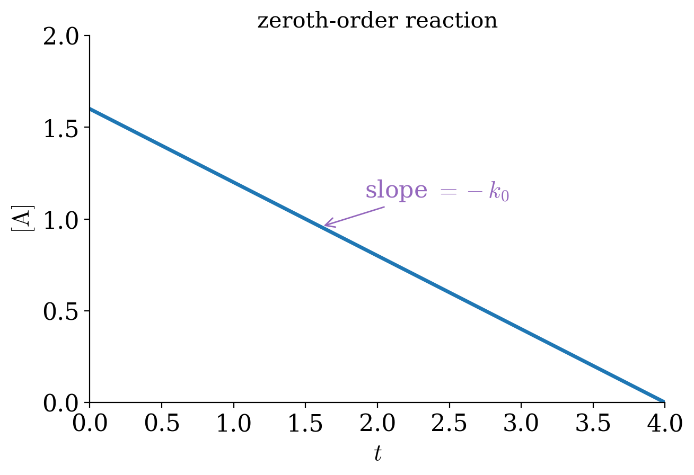
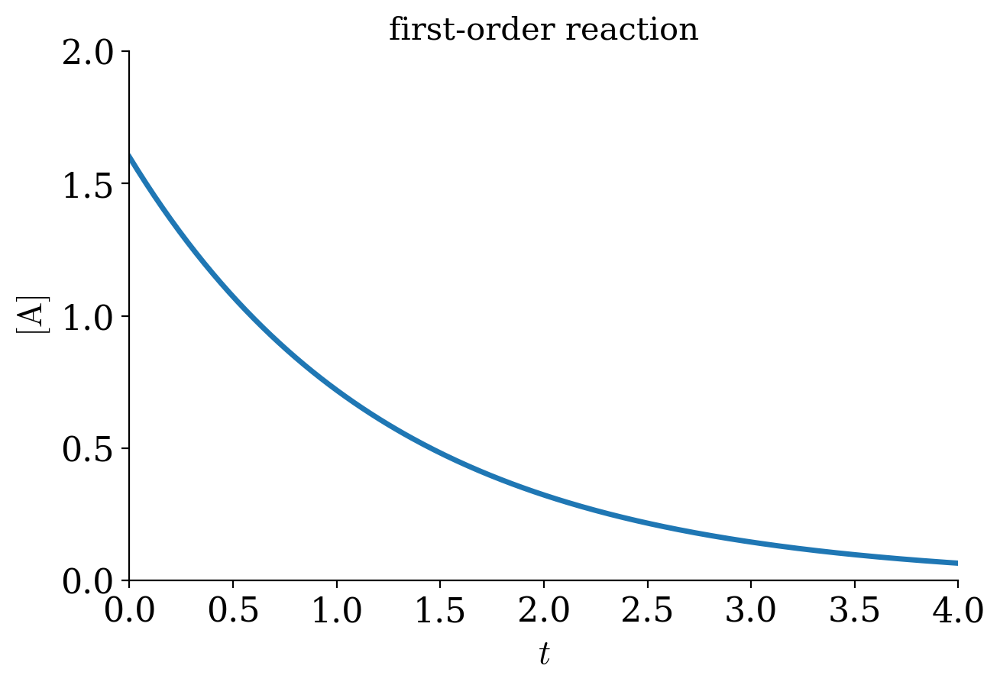
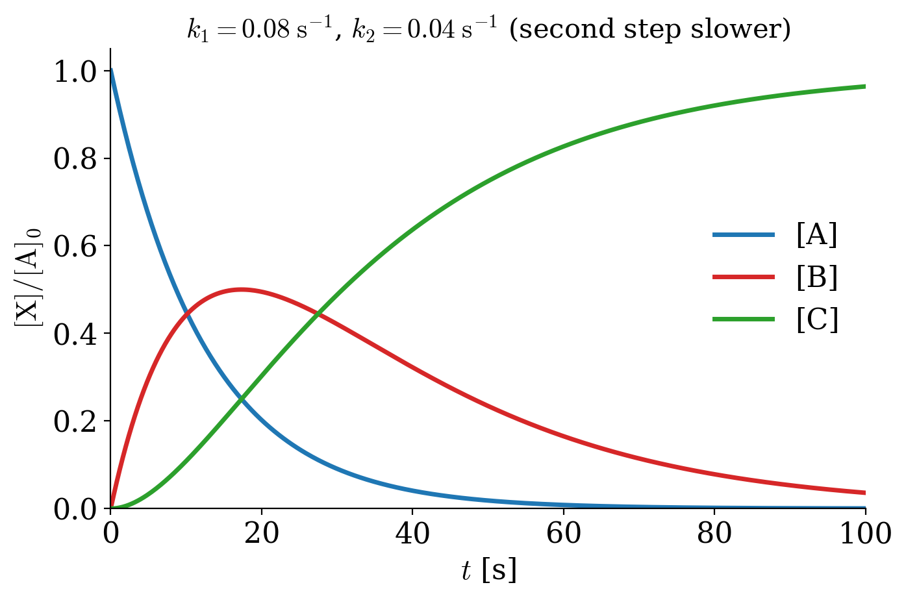
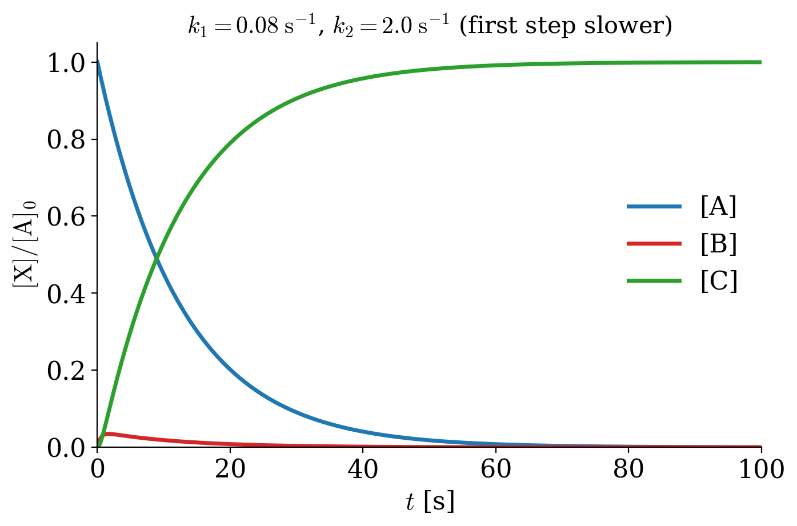
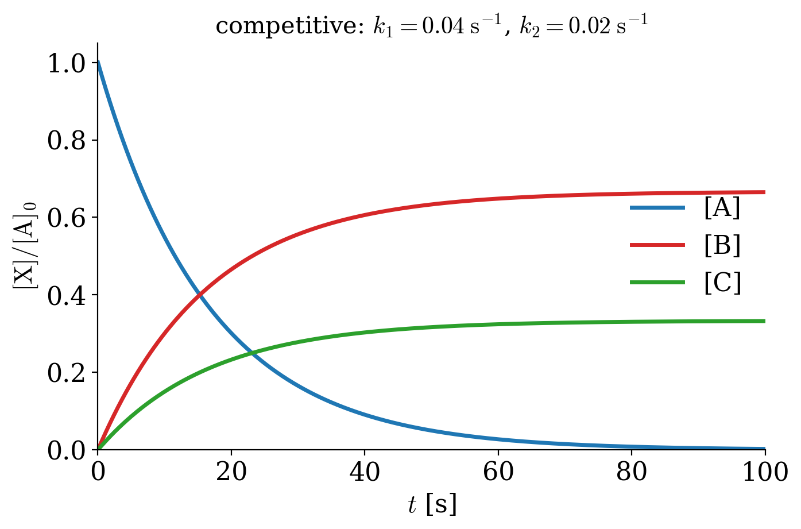
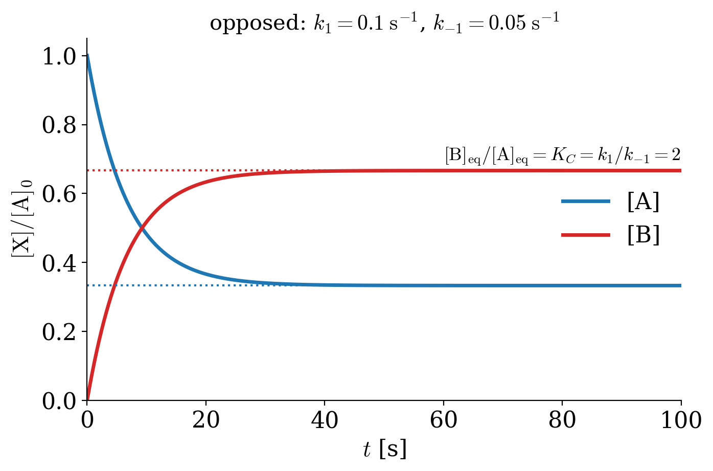
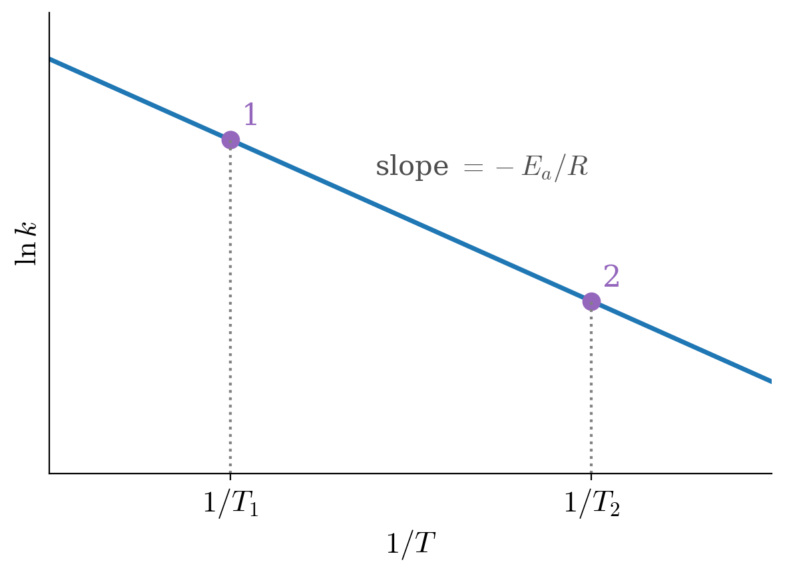
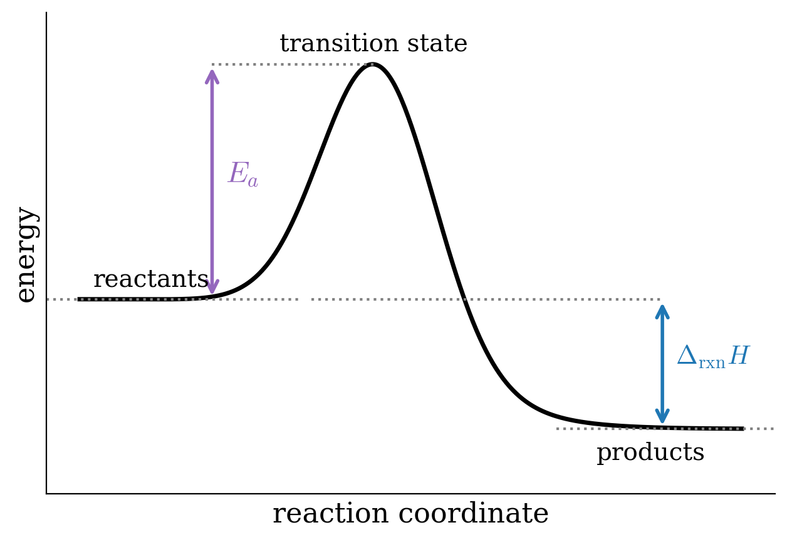

---
aliases:
  - Kinetics.html
---

# Chemical Kinetics {#sec-Kinetics}
From thermodynamics, we can determine the spontaneity of a reaction and its extent, using $\Delta G$ and $K_{\text{eq}}$, respectively. However, thermodynamics does not provide any information on how *fast* the reaction is going to happen. For example, while the reaction that converts solid carbon from its diamond allotropic form into hexagonal graphite is thermodynamically spontaneous, it is so slow as to be virtually non-existent. Diamond is effectively a meta-stable phase. The speed of a chemical reaction is the subject of a branch of physical chemistry called chemical kinetics. 

A chemical kinetics study aims to find the *rate* of a reaction and to find the microscopic steps that compose it, determining its *mechanism*. In this last chapter, we will therefore leave equilibrium behind and look at how concentrations change with time, how we can measure the rate of a reaction, and why reactions speed up when we heat them.

## Differential and integrated rate laws {#sec-diffintk}
The rate law of a chemical reaction is an equation that links the initial rate with the concentrations (or pressures) of the reactants. Rate laws usually include a constant parameter, $k$,  called the *rate coefficient*, and several parameters found at the exponent of the concentrations of the reactants, and are called *reaction orders*. The rate coefficient depends on several conditions, including the reaction type, the temperature, the surface area of an adsorbent, light irradiation, and others. The rate coefficient is usually represented with the lowercase letter $k$, and it should not be confused with the thermodynamic equilibrium constant that is generally designated with the uppercase letter $K$. Another useful concept in kinetics is the half-life, usually abbreviated with $t_{1/2}$. The half-life is defined as the time required to reach half of the initial reactant concentration. 

A reaction that happens in one single microscopic step is called elementary. Elementary reactions have reaction orders equal to the (integer) stoichiometric coefficients for each reactant. As such, only a limited number of elementary reactions are possible (four types are commonly observed), and they are classified according to their overall reaction order. The global reaction order of a reaction is calculated as the sum of each reactant's individual orders and is, at most, equal to three. The number of molecules that take part in an elementary step is called its *molecularity*: an elementary step involving one molecule is *unimolecular*, one involving two molecules is *bimolecular*, and one involving three molecules is *termolecular*. Keep in mind that the order is an experimental property of the rate law, while the molecularity describes a single microscopic step: the two coincide only for elementary reactions. We examine in detail the four most common reaction orders below.

### Zeroth-order reaction
For a zeroth-order reaction, the reaction rate is independent of the concentration of a reactant. In other words, if we have a reaction of the type:

$$
\text{A}\longrightarrow\text{products}
$$

the differential rate law can be written:

$$
- \frac{d[\mathrm{A}]}{dt}=k_0 [\mathrm{A}]^0 = k_0,
$$ {#eq-kin2}

which shows that any change in the concentration of $\mathrm{A}$ will have no effect on the speed of the reaction. The minus sign on the left-hand side is required because the rate is always defined as a positive quantity, while the derivative is negative because the concentration of the reactant is diminishing with time. 
Separating the variables $[\mathrm{A}]$ and $t$ of @eq-kin2 and integrating both sides, we obtain the integrated rate law for a zeroth-order reaction as:

$$
\begin{aligned}
\int_{[\mathrm{A}]_0}^{[A]} d[\mathrm{A}] &= -k_0 \int_{t=0}^{t} dt \\
[\mathrm{A}]-[\mathrm{A}]_0 &= -k_0 t \\ \\
[\mathrm{A}]&=[\mathrm{A}]_0 -k_0 t.
\end{aligned}
$$ {#eq-kin3}

Using the integrated rate law, we notice that the concentration of the reactant diminishes linearly with respect to time. A plot of $[\mathrm{A}]$ as a function of $t$, therefore, will result in a straight line with a slope equal to $-k_0$, as in the plot of @Fig-figk1. 

{#fig-figk1 fig-alt="Concentration of A versus time for a zeroth-order reaction: a straight line that decreases with slope minus k0 and reaches zero." width="70%"}

@Eq-kin3 also suggests that the units of the rate coefficient for a zeroth-order reaction are of concentration divided by time, typically $\frac{\mathrm{M}}{\mathrm{s}}$, with $\mathrm{M}$ being the molar concentration in $\frac{\mathrm{mol}}{\mathrm{L}}$ and $\mathrm{s}$ the time in seconds.
The half-life of a zero order reaction can be calculated from @eq-kin3, by replacing $[\mathrm{A}]$ with $\frac{1}{2}[\mathrm{A}]_0$:

$$
\begin{aligned}
\frac{1}{2}[\mathrm{A}]_0 &=[\mathrm{A}]_0 -k_0 t_{1/2} \\
t_{1/2} &= \frac{[\mathrm{A}]_0}{2k_0}.
\end{aligned}
$$ {#eq-kin4}

Zeroth-order reactions are common in several biochemical processes catalyzed by enzymes, such as the oxidation of ethanol to acetaldehyde in the liver by the alcohol dehydrogenase enzyme, which is zero-order in ethanol.

### First-order reaction
In a first-order reaction, the rate is proportional to the concentration of a single reactant. If a first-order reaction is elementary, it involves a single molecule, and it is unimolecular (for example, an isomerization or a radioactive decay). However, many first-order reactions are not elementary, so we should not use the two words as synonyms. As for the previous case, if we consider a reaction of the type:

$$
\mathrm{A}\rightarrow \text{products}
$$

the differential rate law for a first-order reaction is:

$$
- \frac{d[\mathrm{A}]}{dt}=k_1 [\mathrm{A}].
$$ {#eq-kin6}

Following the usual blueprint of separating the variables, and integrating both sides, we obtain the integrated rate law as:

$$
\begin{aligned}
\int_{[\mathrm{A}]_0}^{[A]} \frac{d[\mathrm{A}]}{[\mathrm{A}]} &= -k_1 \int_{t=0}^{t} dt \\
\ln \frac{[\mathrm{A}]}{[\mathrm{A}]_0}&=-k_1 t\\ \\
[\mathrm{A}] &= [\mathrm{A}]_0 \exp(-k_1 t).
\end{aligned}
$$ {#eq-kin7}

Using the integrated rate law to plot the concentration of the reactant, $[\mathrm{A}]$, as a function of time, $t$, we obtain an exponential decay, as in @Fig-figk2. 

{#fig-figk2 fig-alt="Concentration of A versus time for a first-order reaction: an exponential decay that approaches zero." width="70%"}

However, if we plot the logarithm of the concentration, $\ln[\mathrm{A}]$, as a function of time, we obtain a line with slope $-k_1$, as in the plot of @Fig-figk3. From @eq-kin7, we can also obtain the units for the rate coefficient for a first-order reaction, which typically is $\frac{1}{\mathrm{s}}$, independent of concentration. Since the rate coefficient for first-order reactions has units of inverse time, it is sometimes called the frequency rate.

![Linear Plot for a First-Order Reaction. Notice that the Quantity on the y Axis is ln[A].](img/ch14_first_lin.png){#fig-figk3 fig-alt="Natural logarithm of the concentration of A versus time for a first-order reaction: a straight line with slope minus k1." width="70%"}

The half-life of a first-order reaction is:

$$
\begin{aligned}
\ln \frac{\frac{1}{2}[\mathrm{A}]_0}{[\mathrm{A}]_0}&=-k_1 t_{1/2}\\
t_{1/2} &= \frac{\ln 2}{k_1}.
\end{aligned}
$$ {#eq-kin8}

The half-life of a first-order reaction is independent of the initial concentration of the reactant. Therefore, the half-life can be used in place of the rate coefficient to describe the reaction rate. Typical examples of first-order reactions are radioactive decays. For radioactive isotopes, it is common to report their rate of decay in terms of their half-life. For example, the most stable uranium isotope, $^{238}\mathrm{U}$, has a half-life of $4.468\times 10^9$ years, while the most common fissile isotope of uranium, $^{235}\mathrm{U}$, has a half-life of $7.038\times 10^8$ years.^[Notice how large these numbers are for uranium. To put these numbers in perspective, we can compare them with the half-life of a common isotope of plutonium, $^{241}\mathrm{Pu}$, which is $t_{1/2}=14.3$ years.] Other examples of first-order reactions in chemistry are the class of S~N~1 nucleophilic substitution reactions in organic chemistry. 

### Second-order reaction
A reaction is second-order when the sum of the reaction orders is two. Elementary second-order reactions are also called *bimolecular reactions*. There are two possibilities, a simple one, where the reaction order of one reagent is two, or a more complicated one, with two reagents having each a reaction order of one.

- For the simple case, we can write the reaction as:
$$
2\mathrm{A}\rightarrow \text{products}
$$
the differential rate law for a second-order reaction is:
$$
-\frac{d[\mathrm{A}]}{dt}=k_2 [\mathrm{A}]^2.
$$ {#eq-kin10}
Following the same procedure used for the two previous cases, we can obtain the integrated rate law as:
$$
\begin{aligned}
\int_{[\mathrm{A}]_0}^{[A]} \frac{d[\mathrm{A}]}{[\mathrm{A}]^2} &= -k_2 \int_{t=0}^{t} dt \\
\frac{1}{[\mathrm{A}]}-\frac{1}{[\mathrm{A}]_0} &= k_2 t\\ \\
\frac{1}{[\mathrm{A}]}&=\frac{1}{[\mathrm{A}]_0} + k_2 t.
\end{aligned}
$$ {#eq-kin11}
As for first-order reactions, the plot of the concentration as a function of time shows a non-linear decay. However, if we plot the inverse of the concentration, $\frac{1}{[\mathrm{A}]}$, as a function of time, $t$, we obtain a line with slope $+k_2$, as in the plot of @Fig-figk4. 

![Linear Plot for a Second-Order Reaction. Notice that the Quantity on the y Axis is 1/[A].](img/ch14_second_lin.png){#fig-figk4 fig-alt="Inverse of the concentration of A versus time for a second-order reaction: a straight line with positive slope k2." width="70%"}

Notice that the line has a *positive* slope, in contrast with the previous two cases, for which the slopes were negative. The units of $k$ for a simple second order reaction are calculated from @eq-kin11 and typically are $\frac{1}{\mathrm{M}\cdot \mathrm{s}}$.
The half-life of a simple second-order reaction is:
$$
\begin{aligned}
\frac{1}{\frac{1}{2}[\mathrm{A}]_0}-\frac{1}{[\mathrm{A}]_0} &= k_2 t_{1/2} \\
t_{1/2} &= \frac{1}{k_2 [\mathrm{A}]_0},
\end{aligned}
$$ {#eq-kin12}
which, perhaps not surprisingly, depends on the initial concentration of the reactant, $[\mathrm{A}]_0$. Therefore, if we start with a higher concentration of the reactant, the half-life will be shorter, and the reaction will be faster. An example of simple second-order behavior is the reaction $\mathrm{NO}_2 + \mathrm{CO} \rightarrow \mathrm{NO} + \mathrm{CO}_2$, which is second-order in $\mathrm{NO}_2$ and zeroth-order in $\mathrm{CO}$.

- For the complex second-order case, the reaction is:
$$
\mathrm{A}+\mathrm{B}\rightarrow \text{products}
$$
and the differential rate law is:
$$
-\frac{d[\mathrm{A}]}{dt}=k'_2 [\mathrm{A}][\mathrm{B}].
$$ {#eq-kin14}
The differential equation in @eq-kin14 has two variables, and cannot be solved exactly unless an additional relationship is specified. If we assume that the initial concentrations of the two reactants are equal, then $[\mathrm{A}]=[\mathrm{B}]$ at any time $t$, and @eq-kin14 reduces to @eq-kin10. If the concentrations of the reactants are different, then the integrated rate law will assume the following shape:
$$
\frac{\mathrm{[A]}}{\mathrm{[B]}} = \frac{\mathrm{[A]_0}}{\mathrm{[B]_0}} \exp \left\{ \left(\mathrm{[A]_0} - \mathrm{[B]_0}\right) k'_2t \right\}.
$$ {#eq-kin15}
The units of $k$ for a complex second order reaction can be calculated from @eq-kin15, and are the same as those for the simple case, $\frac{1}{\mathrm{M}\cdot \mathrm{s}}$.
The half-life of a complex second-order reaction cannot be easily written since two different half-lives could, in principle, be defined for each of the corresponding reactants.

### Third- and higher-order reactions
Although elementary reactions with order higher than two are possible, they are in practice infrequent, and only very few experimental third-order reactions are observed. Fourth-order or higher have never been observed because the probabilities for a simultaneous interaction between four molecules are essentially zero. Third-order elementary reactions are also called *termolecular reactions*. While termolecular reactions with three identical reactants are possible in principle, there is no known experimental example. Some complex third-order reactions are known, such as:

$$
2\text{NO}_{(g)}+\text{O}_{2(g)}\longrightarrow 2\text{NO}_{2(g)}
$$

for which the differential rate law can be written as:

$$
-\frac{dP_{\mathrm{O}_2}}{dt}=k_3 P_{\mathrm{NO}}^2 P_{\mathrm{O}_2}.
$$ {#eq-kin17}

## Complex Rate Laws
It is essential to specify that the order of a reaction and its molecularity are equal only for elementary reactions. Reactions that follow complex laws are composed of several elementary steps, and they usually have non-integer reaction orders, for at least one of the reactants. 

### Consecutive reactions
A reaction that happens following a sequence of two elementary steps can be written as follows:

$$
\text{A}\xrightarrow{\;k_1\;}\text{B}\xrightarrow{\;k_2\;}\text{C}
$$

Assuming that each of the steps follows a first order kinetic law, and that only the reagent $\mathrm{A}$ is present at the beginning of the reaction, we can write the differential change in concentration of each species with respect to infinitesimal time $dt$, using the following formulas:

$$
\begin{aligned}
-\frac{d[\mathrm{A}]}{dt}&=k_1 [\mathrm{A}] \Rightarrow [\mathrm{A}] = [\mathrm{A}]_0 \exp(-k_1 t) \\
\frac{d[\mathrm{B}]}{dt} &=k_1 [\mathrm{A}]-k_2 [\mathrm{B}] \\
\frac{d[\mathrm{C}]}{dt} &=k_2 [\mathrm{B}].
\end{aligned}
$$ {#eq-kincomp2}

These three equations represent a system of differential equations with three unknown variables. Unfortunately, these equations are linearly dependent on each other, and they are not sufficient to solve the system for each variable. To do so, we need to include a fourth equation, coming from the conservation of mass:

$$
[\mathrm{A}]_0=[\mathrm{A}]+[\mathrm{B}]+[\mathrm{C}].
$$ {#eq-kincomp3}

Using the first equation in @eq-kincomp2, we can now replace the concentration $[\mathrm{A}]$ in the second equation and solve for $[\mathrm{B}]$:

$$
\frac{d[\mathrm{B}]}{dt}+k_2 [\mathrm{B}]=k_1 [\mathrm{A}]_0 \exp(-k_1 t),
$$ {#eq-kincomp4}

which can be simplified by multiplying both sides by $\exp (k_2t)$:

$$
\begin{aligned}
\left( \frac{d[\mathrm{B}]}{dt}+k_2 [\mathrm{B}] \right) \exp (k_2t) &= k_1 [\mathrm{A}]_0 \exp[(k_2-k_1) t] \\
\Rightarrow \frac{d\left\{[\mathrm{B}]\exp (k_2t)\right\}}{dt} &= k_1 [\mathrm{A}]_0 \exp[(k_2-k_1) t],
\end{aligned}
$$ {#eq-kincomp5}

which can then be integrated remembering that $[B]_0=0$, and $\int \exp(kx)=\frac{1}{k}\exp(kx)$:

$$
[\mathrm{B}] = \frac{k_1}{k_2-k_1} [\mathrm{A}]_0 [\exp(-k_1t)-\exp(-k_2t)].
$$ {#eq-kincomp6}

We can then use both $[\mathrm{A}]$, from @eq-kincomp2, and $[\mathrm{B}]$, from @eq-kincomp6, in @eq-kincomp3 to solve for $[\mathrm{C}]$:

$$
\begin{aligned}
\left[\mathrm{C}\right] &= [\mathrm{A}]_0-[\mathrm{A}]-[\mathrm{B}] \\
&= [\mathrm{A}]_0-[\mathrm{A}]_0 \exp(-k_1 t)-\frac{k_1}{k_2-k_1} [\mathrm{A}]_0 [\exp(-k_1t)-\exp(-k_2t)] \\
&= [\mathrm{A}]_0\left\{1+\frac{-k_2 \exp(-k_1t)+ k_1 \exp(-k_2t)}{k_2-k_1} \right\}.
\end{aligned}
$$ {#eq-kincomp7}

From these results, we can distinguish two typical behaviors, depending on which of the two steps is the slowest. The slowest step in a sequence is called the *rate-determining step*, since, just like the narrowest point of a funnel, it limits how fast the whole process can go.

The first behavior is observed when the second step is slower than, or comparable to, the first one. For example, @Fig-figk5 reports the concentrations with respect to time for $k_1=2k_2$. In this case, the rate-determining step is the second reaction. $\mathrm{A}$ is converted into $\mathrm{B}$ faster than $\mathrm{B}$ can be converted into $\mathrm{C}$, so the intermediate accumulates: its concentration grows, reaches a maximum, and then decreases as $\mathrm{A}$ runs out. The product $\mathrm{C}$ forms slowly at the beginning (notice the S shape of its curve), since it has to wait for $\mathrm{B}$ to build up.

{#fig-figk5 fig-alt="Relative concentrations versus time for consecutive reactions A to B to C, with k1 equal to 0.08 and k2 equal to 0.04 per second. A decays exponentially, the intermediate B rises to a maximum of about 0.5 and then decreases, and C grows with an S shape toward 1." width="75%"}

The second behavior is observed when the first step is much slower than the second one, $k_1\ll k_2$, as in the plot of @Fig-figk6. In this case, the rate-determining step is the first reaction. Every molecule of $\mathrm{B}$ is converted into $\mathrm{C}$ almost as soon as it is formed, so the concentration of the intermediate stays very small at all times, and $\mathrm{C}$ appears as fast as $\mathrm{A}$ disappears. As such, the process has the same rate law as an elementary reaction going directly from $\mathrm{A}$ to $\mathrm{C}$.

{#fig-figk6 fig-alt="Relative concentrations versus time for consecutive reactions A to B to C, with k1 equal to 0.08 and k2 equal to 2.0 per second. A decays exponentially, the intermediate B stays close to zero at all times, and C rises almost as fast as A disappears." width="75%"}

Since, in this second case, the concentration of $\mathrm{B}$ is small and almost constant throughout the process, we can approximate its derivative to zero. This simplification is known as the *steady-state approximation*, and it allows us to eliminate the intermediate from the treatment. Using the second line of @eq-kincomp2:

$$
\frac{d[\mathrm{B}]}{dt} = k_1 [\mathrm{A}]-k_2 [\mathrm{B}] \approx 0 \quad \Rightarrow \quad [\mathrm{B}] \approx \frac{k_1}{k_2}[\mathrm{A}],
$$ {#eq-kinss}

which is indeed very small, since $k_1\ll k_2$. Replacing @eq-kinss into the third line of @eq-kincomp2, the rate of formation of the product becomes:

$$
\frac{d[\mathrm{C}]}{dt} = k_2 [\mathrm{B}] \approx k_1 [\mathrm{A}],
$$ {#eq-kinss2}

which is exactly the rate law of an elementary first-order reaction going directly from $\mathrm{A}$ to $\mathrm{C}$, with the rate coefficient of the slow step. The steady-state approximation is widely used to study processes that go through a series of very reactive intermediates, whose concentrations stay small and almost constant throughout the entire process:

$$
\begin{aligned}
\text{A} &\xrightarrow{\;k_1\;} \text{I}_1 \xrightarrow{\;k_2\;} \text{I}_2 \xrightarrow{\hphantom{k_n}} \cdots \xrightarrow{\;k_n\;}\text{products} \\
& \text{Steady State Approximation:} \\
\text{A}&\xrightarrow{\qquad\qquad\qquad\qquad\quad\quad\;\;}\text{products}
\end{aligned}
$$ {#eq-kincomp8}

### Competitive reactions

A process where two elementary reactions happen in parallel, competing with each other, can be written as follows:

$$
\begin{matrix}
 &_{k_1}  & B\\
 &\nearrow & \\
A &   & \\
 &\searrow& \\
  &_{k_2}  & C
\end{matrix}
$$

Assuming that each step follows first-order kinetics, we can write:

$$
\begin{aligned}
-\frac{d[\mathrm{A}]}{dt} &=k_1 [\mathrm{A}]+k_2 [\mathrm{A}] \Rightarrow [\mathrm{A}]=[\mathrm{A}]_0\exp \left[ -(k_1+k_2)t \right] \\
\frac{d[\mathrm{B}]}{dt} &=k_1 [\mathrm{A}] \Rightarrow [\mathrm{B}]=\frac{k_1}{k_1+k_2}[\mathrm{A}]_0 \left\{ 1-\exp \left[ -(k_1+k_2)t \right] \right\} \\
\frac{d[\mathrm{C}]}{dt} &=k_2 [\mathrm{A}]\Rightarrow [\mathrm{C}]=\frac{k_2}{k_1+k_2}[\mathrm{A}]_0 \left\{ 1-\exp \left[ -(k_1+k_2)t \right] \right\}.
\end{aligned}
$$ {#eq-kincomp4b}

The concentration of each of the species can then be plotted against time, obtaining the diagram reported in @Fig-figk7. The final concentrations of the products, $[\mathrm{B}]_f$ and $[\mathrm{C}]_f$, will depend on the values of the two rate coefficients. For example, if $k_1>k_2$, $[\mathrm{B}]_f>[\mathrm{C}]_f$, as in @Fig-figk7, but if $k_1<k_2$, $[\mathrm{B}]_f<[\mathrm{C}]_f$.

{#fig-figk7 fig-alt="Relative concentrations versus time for competitive reactions, A to B with k1 equal to 0.04 and A to C with k2 equal to 0.02 per second. A decays exponentially, while B and C grow and level off at two thirds and one third, so that their ratio is always equal to k1 over k2." width="75%"}

An important relationship that can be derived from @eq-kincomp4b is that:

$$
\frac{[\mathrm{B}]}{[\mathrm{C}]} =\frac{k_1}{k_2}.
$$ {#eq-kincomp5b}

### Opposed reactions

Another case of complex kinetic law happens when a pair of forward and reverse reactions occur simultaneously:

$$
\mathrm{A}\underset{k_{-1}}{\overset{k_1}{\rightleftharpoons}}\mathrm{B}
$$

where the rate coefficients for the forward and backwards reaction, $k_1$ and $k_{-1}$, respectively, are not necessarily equal to each other, but comparable in magnitude. We can write the rate laws for each of these elementary steps as:

$$
\begin{aligned}
-\frac{d[\mathrm{A}]}{dt} &=k_1 [\mathrm{A}]-k_{-1} [\mathrm{B}] = k_1 [\mathrm{A}]-k_{-1}\left([\mathrm{A}]_0-[\mathrm{A}]\right) \\
\frac{d[\mathrm{A}]}{dt} &=-(k_1+k_{-1})[\mathrm{A}] + k_{-1}[\mathrm{A}]_0,
\end{aligned}
$$ {#eq-kinopp1}

which can then be integrated to:

$$
\begin{aligned}
\left[\mathrm{A}\right] &=[\mathrm{A}]_0\frac{k_{-1}+k_1\exp[-(k_1+k_{-1})t]}{k_1+k_{-1}} \\
\left[\mathrm{B}\right] &=[\mathrm{A}]_0\left\{ 1-\frac{k_{-1}+k_1\exp[-(k_1+k_{-1})t]}{k_1+k_{-1}}\right\}.
\end{aligned}
$$ {#eq-kinopp2}

These formulas can then be used to obtain the plots in @Fig-figkK.

{#fig-figkK fig-alt="Relative concentrations versus time for opposed reactions, A to B with k1 equal to 0.1 and back with k minus 1 equal to 0.05 per second. A decreases and B increases until they level off at one third and two thirds, marked by dotted lines, so that the ratio of the equilibrium concentrations equals k1 over k minus 1, which is 2." width="75%"}

As can be seen from the plots in @Fig-figkK, after a sufficiently long time, the system reaches a dynamic equilibrium, where the concentrations of $\mathrm{A}$ and $\mathrm{B}$ don't change. These equilibrium concentrations can be calculated replacing $t=\infty$ in @eq-kinopp2:

$$
\begin{aligned}
\left[\mathrm{A} \right] _{\mathrm{eq}} &= [\mathrm{A}]_0 \frac{k_{-1}}{k_1+k_{-1}} \\
[\mathrm{B}]_{\mathrm{eq}} &= [\mathrm{A}]_0 \frac{k_{1}}{k_1+k_{-1}}.
\end{aligned}
$$ {#eq-kinopp3}

Considering that the concentrations of the species don't change at equilibrium:

$$
\begin{aligned}
-\frac{d[\mathrm{A}]_{\mathrm{eq}}}{dt} &= \frac{d[\mathrm{B}]_{\mathrm{eq}}}{dt} = 0\\
& \Rightarrow \; k_1[\mathrm{A}]_{\mathrm{eq}} = k_{-1}[\mathrm{B}]_{\mathrm{eq}} \\
& \Rightarrow \;  \frac{k_1}{k_{-1}} =  \frac{[\mathrm{B}]_{\mathrm{eq}}}{[\mathrm{A}]_{\mathrm{eq}}} = K_C, \\
\end{aligned}
$$ {#eq-kinopp4}

where $K_C$ is the equilibrium constant as defined in @sec-ChemicalEquilibrium. This is a rare link between kinetics and thermodynamics and appears only for opposed reactions after sufficient time has passed so that the system can reach the dynamic equilibrium.

## Experimental Methods for Determination of Reaction Orders
To experimentally measure the reaction rate, we need a method to measure concentration changes with respect to time. The simplest way to determine the reaction rate is to monitor the entire reaction as it proceeds and then plot the resulting data differently until a linear plot is found. A summary of the results obtained in @sec-diffintk and that is useful for this task is reported in the following table:

\tiny
|                           |                    *Zeroth-Order*                    |                 *First-Order*                |                   *Simple Second-Order*                   |                                                    *Complex Second-Order*                                                    |
|---------------------------|:----------------------------------------------------:|:--------------------------------------------:|:---------------------------------------------------------:|:----------------------------------------------------------------------------------------------------------------------------:|
| **Differential Rate Law** | $-\frac{d[\mathrm{A}]}{dt}=k_0 [\mathrm{A}]^0 = k_0$ | $-\frac{d[\mathrm{A}]}{dt}=k_1 [\mathrm{A}]$ |       $-\frac{d[\mathrm{A}]}{dt}=k_2 [\mathrm{A}]^2$      |                                   $-\frac{d[\mathrm{A}]}{dt}=k'_2 [\mathrm{A}][\mathrm{B}]$                                  |
| **Integrated Rate Law**   |         $[\mathrm{A}]=[\mathrm{A}]_0 -k_0 t$         |   $[\mathrm{A}]=[\mathrm{A}]_0 e^{-k_1 t}$   | $\frac{1}{[\mathrm{A}]}=\frac{1}{[\mathrm{A}]_0} + k_2 t$ | $\frac{\mathrm{[A]}}{\mathrm{[B]}}=\frac{\mathrm{[A]_0}}{\mathrm{[B]_0}}e^{\left(\mathrm{[A]_0}-\mathrm{[B]_0}\right)k'_2t}$ |
| **Units of $k$**          |            $\frac{\mathrm{M}}{\mathrm{s}}$           |            $\frac{1}{\mathrm{s}}$            |           $\frac{1}{\mathrm{M}\cdot \mathrm{s}}$          |                                            $\frac{1}{\mathrm{M}\cdot \mathrm{s}}$                                            |
| **Linear Plot vs. $t$**   |                    $[\mathrm{A}]$                    |              $\ln [\mathrm{A}]$              |                  $\frac{1}{[\mathrm{A}]}$                 |                              $\ln \frac{[\mathrm{A}]_0[\mathrm{B}]}{[\mathrm{B}]_0[\mathrm{A}]}$                             |
| **Half-life**             |         $t_{1/2}=\frac{[\mathrm{A}]_0}{2k_0}$        |          $t_{1/2}=\frac{\ln 2}{k_1}$         |           $t_{1/2}=\frac{1}{k_2 [\mathrm{A}]_0}$          |                                                      not easily defined                                                      |
\normalsize

However, this method works only if the reaction has few reactants, and it requires several measurements, each of which might be complicated to make. More useful methods to determine the reaction rate are the *initial rate* and the *isolation* methods that we describe below.

### Initial rates method

The *initial rates method* involves measuring the rate of a reaction as soon as it starts before any significant change in the concentrations of the reactants occurs. The initial rate method is practical only if the reaction is reasonably slow, but it can measure the rate unambiguously when more than one reactant is involved. For example, if we have a reaction with the following stoichiometry:

$$
\alpha \mathrm{A} + \beta \mathrm{B} \xrightarrow{k} \text{products}
$$

the initial rate method can be used to determine the coefficients of the rate law:

$$
\text{Rate}=k[\mathrm{A}]^{\alpha}[\mathrm{B}]^{\beta}
$$ {#eq-kinini1}

by designing three experiments, where the initial concentrations of $\mathrm{A}$ and $\mathrm{B}$ are appropriately changed. For example, let's consider the following experimental data from three different experiments:

|                        | $[\mathrm{A}]_0 \; (\text{M})$ | $[\mathrm{B}]_0 \; (\text{M})$ | $\text{initial rate}\;\left(\frac{M}{s}\right)$ |
| :--------------------- | :----------------------------: | :----------------------------: | :---------------------------------------------: |
| $\text{Experiment 1:}$ |              0.10              |              0.10              |                      4.32                       |
| $\text{Experiment 2:}$ |              0.15              |              0.10              |                      9.70                       |
| $\text{Experiment 3:}$ |              0.10              |              0.20              |                      4.29                       |

we can calculate $\alpha$ by taking the ratio of the rates measured in experiment 1 and 2:

$$
\begin{aligned}
\frac{\text{Rate}(1)}{\text{Rate}(2)}&=\frac{k(0.10\;\text{M})^\alpha(0.10\;\text{M})^\beta}{k(0.15\;\text{M})^\alpha(0.10\;\text{M})^\beta} \\
\frac{4.32}{9.70}&=\frac{(0.10\;\text{M})^\alpha}{(0.15\;\text{M})^\alpha} \\
0.445&=0.667^\alpha \;\rightarrow\; \ln0.445=\alpha \ln0.667 \\
\alpha &= \frac{-0.81}{-0.405}=2.
\end{aligned}
$$ {#eq-kiniso1}

$\beta$ can be calculated similarly by taking the ratio between experiments 1 and 3. Alternatively, we can also notice that the reaction rate does not change when the initial concentration $[\mathrm{B}]_0$ is doubled, therefore $\beta=0$.

### Isolation method

Another method that is widely used to determine reaction orders is the *isolation method*. This method is performed by using large excess concentrations of all reactants but one. For example, if we have the following reaction with three reagents and unknown rate law:

$$
\alpha \mathrm{A} + \beta \mathrm{B} + \gamma \mathrm{C} \xrightarrow{k} \text{products}
$$

we can perform three different experiments, in each of which we use an excess amount of all reagents but one, such as:

- Experiment 1: $[\mathrm{A}]_0=1\;\text{M},\quad [\mathrm{B}]_0=1000\;\text{M}, \quad [\mathrm{C}]_0=1000\;\text{M},$ in which the reaction order with respect to $\mathrm{A}$ is measured.

- Experiment 2: $[\mathrm{A}]_0=1000\;\text{M},\quad [\mathrm{B}]_0=1\;\text{M}, \quad [\mathrm{C}]_0=1000\;\text{M},$ in which the reaction order with respect to $\mathrm{B}$ is measured. 

- Experiment 3: $[\mathrm{A}]_0=1000\;\text{M},\quad [\mathrm{B}]_0=1000\;\text{M}, \quad [\mathrm{C}]_0=1\;\text{M},$ in which the reaction order with respect to $\mathrm{C}$ is measured. 

From each experiment we can determine the *pseudo-order* of the reaction with respect to the reagent that is in minority concentration. For example, for the reaction above, we can write the rate law as:

$$
\text{Rate}=k[\mathrm{A}]^{\alpha}[\mathrm{B}]^{\beta}[\mathrm{C}]^{\gamma}
$$ {#eq-kiniso2}

and we can write the initial concentrations, $[X]_0$, and the final concentrations, $[X]_f$, of each of the species in experiment 1, as:

$$
\begin{aligned}
\left[\mathrm{A}\right]_0 =1\;\text{M}\;\longrightarrow &[\mathrm{A}]_f=0\;\text{M} \qquad &\text{(100\% change)} \\
\left[\mathrm{B}\right]_0 =1000\;\text{M}\;\longrightarrow &[\mathrm{B}]_f=1000-1=999\;\text{M}\cong [\mathrm{B}]_0\qquad &\text{(0.1\% change)}\\
\left[\mathrm{C}\right]_0 =1000\;\text{M}\;\longrightarrow &[\mathrm{C}]_f=1000-1=999\;\text{M} \cong \left[\mathrm{C}\right]_0. \qquad &\text{(0.1\% change)}
\end{aligned}
$$

The coefficient $\alpha$ can then be determined by incorporating the concentration of the reactants in excess into the rate constant as:

$$
\begin{aligned}
\text{rate}&=k[\mathrm{A}]^{\alpha}\underbrace{[\mathrm{B}]^{\beta}[\mathrm{C}]^{\gamma}}_{\text{constant}} \\
&= k'[\mathrm{A}]^{\alpha}
\end{aligned}
$$

and then determine $\alpha$ by verifying which order the data collected for $[\mathrm{A}]$ at various times fits. This can be simply achieved by using the zero-, first-, and second-order kinetic plots, as reported in the table above. We can determine $\beta$ and $\gamma$ by repeating the same procedure for the data from the other two experiments. For example, if we find for a specific reaction that $\alpha=$ 1, $\beta=2$, and $\gamma=0$, we can then say that the reaction is pseudo-order one in $\mathrm{A}$, pseudo-order two in $\mathrm{B}$, and pseudo-order zero in $\mathrm{C}$, with an overall reaction order of three.

## Temperature Dependence of the Rate Coefficients
The dependence of the rate coefficient, $k$, on the temperature is given by the **Arrhenius equation**. This formula was derived by Svante August Arrhenius (1859–1927) in 1889 and is based on the simple experimental observation that almost every chemical process gets faster when the temperature is increased. Working on data from equilibrium reactions previously reported by van 't Hoff, Arrhenius proposed the following simple exponential formula to explain the increase of $k$ when $T$ is increased:

$$
k=A\exp\left( -\frac{E_a}{RT}\right),
$$ {#eq-Arr1}

where $A$ is the so-called Arrhenius pre-exponential factor, and $E_a$ is the activation energy. Both of these terms are independent of temperature,^[In theory, both $A$ and $E_a$ show a weak temperature dependence. However, they can be considered constants at most experimental conditions, since kinetic studies are usually performed in a small temperature range.] and they represent experimental quantities that are unique to each individual reaction. Since the vast majority of reactions speed up when the temperature increases, both $A$ and $E_a$ are positive.^[A few reactions, such as some recombinations of radicals, slow down when the temperature increases, and they show a negative *apparent* activation energy. These reactions are not elementary: their mechanism involves more than one step, and the measured $E_a$ is a combination of the activation energies of the individual steps.] The pre-exponential factor units are the same as the rate constant and will vary depending on the order of the reaction. As suggested by its name, the activation energy has units of energy per mole of substance, $\frac{\mathrm{J}}{\mathrm{mol}}$ in SI. 

A few important considerations can be made by analyzing @eq-Arr1:

1. **The rate coefficient grows exponentially with temperature.** For a typical activation energy of $50\;\text{kJ/mol}$, increasing the temperature from $298\;\text{K}$ to $308\;\text{K}$ almost doubles $k$. This is the origin of the rule of thumb that reactions near room temperature roughly double their rate for every 10 °C.
2. **Reactions with larger activation energies are more sensitive to temperature.** The larger $E_a$, the more a change in $T$ affects the exponential.
3. **The exponential is the fraction of molecules that can react.** As we will see below, $E_a$ is the height of an energy barrier, and $\exp\left(-\frac{E_a}{RT}\right)$ is related to the fraction of collisions that have enough energy to overcome it, while $A$ is related to how often the molecules attempt to react.

The Arrhenius equation is experimentally useful in its linearized form. Taking the logarithm of both sides of @eq-Arr1, we obtain $\ln k = \ln A - \frac{E_a}{R}\frac{1}{T}$, which is a straight line in a plot of $\ln k$ versus $1/T$. Applying @eq-Arr1 to two experiments taken at different temperatures, and taking the ratio between the results, we obtain:

$$
\ln \frac{k_{T_2}}{k_{T_1}}=-\frac{E_a}{R}\left(\frac{1}{T_2}-\frac{1}{T_1}\right),
$$ {#eq-Arr2}

which gives the plot of @Fig-figk8, from which $E_a$ can be determined.

{#fig-figk8 fig-alt="Arrhenius plot of ln k versus 1 over T: a straight line with negative slope, minus the activation energy over R, through two measured points at 1 over T1 and 1 over T2." width="70%"}

From empirical arguments, Arrhenius proposed the idea that reactants must acquire a minimum amount of energy before they can form any product. He called this amount of minimum energy the activation energy. We can motivate this assumption by plotting energy of a reaction along the reaction coordinate, as in @Fig-figk9. The reaction coordinate is defined as the minimum energy path that connects the reactants with the products. Along this path, the energy rises to a maximum, the *transition state*, before decreasing towards the products. The activation energy corresponds to the height of this barrier: only the molecules that collide with enough energy to reach the top of the barrier can turn into products. Notice that the barrier does not depend on whether the reaction is exothermic or endothermic: a reaction can be strongly spontaneous and still be extremely slow if its barrier is high, as in the diamond-to-graphite example at the beginning of this chapter.

{#fig-figk9 fig-alt="Schematic energy profile of a reaction along the reaction coordinate. The curve starts flat at the reactants, rises to a maximum labeled transition state, and falls to the lower-energy products. A purple double arrow from the reactants to the top of the barrier is labeled E a, and a blue double arrow between reactants and products is labeled delta rxn H." width="70%"}

## Chapter Review {#sec-rev15}
### Study Questions {#sec-quest15}
**1. How does the rate of a zeroth-order reaction depend on the concentration of the reactant?**

a. It is proportional to the concentration.
b. It is proportional to the square of the concentration.
c. It is independent of the concentration.
d. It decreases exponentially with the concentration.
e. It is inversely proportional to the concentration.

---

**2. Which plot gives a straight line for a first-order reaction?**

a. $\ln[\mathrm{A}]$ versus $t$, with slope $-k_1$.
b. $[\mathrm{A}]$ versus $t$, with slope $-k_1$.
c. $\frac{1}{[\mathrm{A}]}$ versus $t$, with slope $k_1$.
d. $[\mathrm{A}]^2$ versus $t$.
e. $\ln[\mathrm{A}]$ versus $\frac{1}{T}$.

---

**3. What is special about the half-life of a first-order reaction?**

a. It is proportional to the initial concentration.
b. It is inversely proportional to the initial concentration.
c. It increases as the reaction proceeds.
d. It is always 1 second.
e. It does not depend on the initial concentration, since $t_{1/2}=\frac{\ln 2}{k_1}$.

---

**4. Which plot gives a straight line for a simple second-order reaction?**

a. $[\mathrm{A}]$ versus $t$.
b. $\frac{1}{[\mathrm{A}]}$ versus $t$.
c. $\ln[\mathrm{A}]$ versus $t$.
d. $\sqrt{[\mathrm{A}]}$ versus $t$.
e. $[\mathrm{A}]^2$ versus $t$.

---

**5. When are the order of a reaction and its molecularity equal?**

a. Always.
b. Never.
c. Only for first-order reactions.
d. Only for elementary reactions.
e. Only for reactions in the gas phase.

---

**6. In the consecutive reactions $\mathrm{A}\rightarrow\mathrm{B}\rightarrow\mathrm{C}$ with $k_1 \ll k_2$, what happens to the intermediate $\mathrm{B}$?**

a. Its concentration stays small and almost constant, which justifies the steady-state approximation.
b. It accumulates and becomes the main product.
c. It is never formed.
d. Its concentration equals that of $\mathrm{A}$.
e. It reacts back to $\mathrm{A}$.

---

**7. For two competitive first-order reactions, $\mathrm{A}\rightarrow\mathrm{B}$ ($k_1$) and $\mathrm{A}\rightarrow\mathrm{C}$ ($k_2$), what is the ratio of the products?**

a. $\frac{[\mathrm{B}]}{[\mathrm{C}]} = 1$.
b. $\frac{[\mathrm{B}]}{[\mathrm{C}]} = \frac{k_2}{k_1}$.
c. $\frac{[\mathrm{B}]}{[\mathrm{C}]} = \frac{k_1}{k_2}$.
d. $\frac{[\mathrm{B}]}{[\mathrm{C}]} = k_1 k_2$.
e. It changes with time.

---

**8. For opposed reactions, $\mathrm{A}\rightleftharpoons\mathrm{B}$, how is the equilibrium constant related to the rate coefficients?**

a. $K_C = \frac{k_{-1}}{k_1}$.
b. $K_C = k_1 + k_{-1}$.
c. $K_C = k_1 k_{-1}$.
d. $K_C = k_1 - k_{-1}$.
e. $K_C = \frac{k_1}{k_{-1}}$.

---

**9. How is the isolation method performed?**

a. By measuring only the initial rate.
b. By using a large excess of all reactants but one.
c. By separating the products as they form.
d. By running the reaction at very low temperature.
e. By using equal concentrations of all reactants.

---

**10. How can the activation energy be obtained from the Arrhenius equation?**

a. From the intercept of a plot of $k$ versus $T$.
b. From the half-life of the reaction.
c. From the equilibrium constant.
d. From the slope of a plot of $\ln k$ versus $\frac{1}{T}$, which is $-\frac{E_a}{R}$.
e. From the reaction enthalpy.

---

::: {.callout-tip collapse="true" icon="false"}
## Answers

1.c, 2.a, 3.e, 4.b, 5.d, 6.a, 7.c, 8.e, 9.b, 10.d
:::
