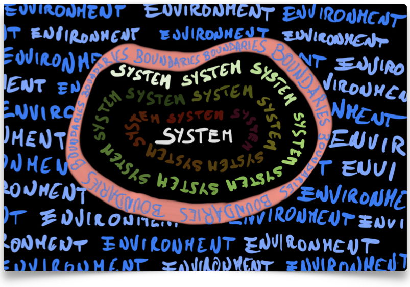

# Preface {.unnumbered}
{fig-alt="Hand-lettered illustration of a thermodynamic system: the word SYSTEM repeated in the center, surrounded by a pink ring labeled BOUNDARIES, with the word ENVIRONMENT repeated all around the outside." width="80%"}

Why does ice melt at room temperature, but water does not freeze? Why do some reactions release heat and still never happen, while others absorb heat and happen on their own? Why does a diamond, which should slowly turn into graphite, last forever? Every chemical process asks two questions: *which way* does it go, and *how fast*? Thermodynamics answers the first one, and chemical kinetics answers the second. Together, they are the foundation of everything that a chemist does with reactions, from the laboratory bench to an industrial plant.

This book is an introduction to thermodynamics and kinetics written for chemistry students. We will start from the simplest system possible, an ideal gas in a cylinder, build the laws of thermodynamics one step at a time, and then use them to understand chemical reactions, equilibria, phase transitions, and solutions. In the last chapter, we leave equilibrium behind and ask how fast reactions go. The book is the textbook for the first semester of physical chemistry (CHM 3001) at Florida Tech, but it is written for any undergraduate student who meets thermodynamics for the first time. The companion volume, *The Live Textbook of Physical Chemistry 2*, covers quantum mechanics and spectroscopy, but you do not need it to read this one.

This book was never really finished, and that was the plan from the start. I started writing it in the summer of 2020, when a pandemic moved all teaching online, as a repository website for the notes of the Physical Chemistry 1 course that I have taught since 2016. In 2021, a grant from the Florida Tech Open Educational Resources Grant Program, a collaboration between eEducation and Florida Tech's Evans Library and Teaching Council, turned those notes into a first edition. I chose the title "Live Textbook of Physical Chemistry" to emphasize the constantly evolving nature of the document: it was a live website more than a static textbook. Over the years, the notes were corrected, expanded, and reorganized, and the book slowly took shape. In 2024, I added a review section at the end of every chapter, with study questions written in the same style as my exams.

By 2026, I was getting ready to teach the Physical Chemistry 1 course for the 10th time, and the book had already been through several revisions. Generations of chemistry students had seen it, used it, cried over it, and ultimately contributed to its evolution. It was about time to give the book a significant upgrade, both for its electronic version and for a new printed one. To do that, I tied up the last loose threads, reorganized the structure into four parts, and rewrote or added a few parts with the help of Claude Code (Opus 5.5). What started as a simple website with lecture material and instructor's notes has now become a fully-fledged open textbook: the book that you have in front of you.

## How This Book Is Organized {.unnumbered}
The book is divided into four parts:

- **Part I, The Laws of Thermodynamics** (chapters 1–6), builds the laws of thermodynamics with the simplest systems possible, mostly an ideal gas in a cylinder, and without chemical reactions. Along the way, we introduce heat, work, internal energy, enthalpy, and entropy, and the zeroth, first, second, and third laws. Part I ends with the definition of the standard state and with a first look at a chemical reaction.
- **Part II, Chemical Thermodynamics** (chapters 7–10), applies the laws to chemical reactions: the heat of reactions (thermochemistry), the thermodynamic potentials, the Gibbs energy, and chemical equilibrium.
- **Part III, Phase Equilibria and Solutions** (chapters 11–13), uses the same tools for real gases, for the phase transitions of pure substances, and for mixtures.
- **Part IV, Chemical Kinetics** (chapter 14), leaves equilibrium behind and asks how fast reactions go.

Many textbooks place thermochemistry right after the first law, since the heat of a reaction requires only the enthalpy. In this book, thermochemistry opens Part II instead, after the entropy. This way, all the laws are in place when we meet our first reactions, and we can ask the real chemical question from the start: not only how much heat a reaction releases, but whether it happens at all. Answering this question leads us directly to the thermodynamic potentials, which then appear as the tool that solves a concrete problem rather than as abstract definitions. The title of the book reflects the same structure: the first three parts tell us which way a process goes, and the last one tells us how fast.

The appendices collect the thermodynamic data of inorganic and organic substances that we use in the examples (@sec-appendix) and suggest further reading for when you want a second explanation or more depth (@sec-FurtherReading).

## How to Use This Book {.unnumbered}
Thermodynamics is built on a small number of laws, but it expresses them with mathematics: you will need calculus, including derivatives, integrals, and partial derivatives of functions of more than one variable. Do not worry if partial derivatives are new to you: we introduce them when we first need them.

Besides the main text, the chapters contain two types of boxes:

- **Definitions**, numbered (Definition 1.1, Definition 1.2, …), state the fundamental concepts that we use over and over in the rest of the book. Study them carefully.
- **Worked examples**, numbered (Example 4.1, Example 4.2, …), solve a problem step by step. Try the problem on your own first, then read the solution, since it often contains explanations that complete the main text.

Every chapter ends with a review: a short list of **Key Ideas**, followed by **study questions** with their answers. Use them to check your understanding before moving on to the next chapter.

The book comes in three formats. The **website** is the main one: it has a search box and a sidebar with all chapters. The **PDF**, which you can download from the website for free, contains the same text. A low-cost **printed edition** is also available for those who prefer paper. If you spot a mistake, please use the "Report an issue" link at the top of the website.

## A Note on Units {.unnumbered}
We use SI units or their multiples throughout the book. Temperatures are measured in kelvin ($\text{K}$), energies in joules ($\text{J}$) or kilojoules ($\text{kJ}$), and volumes in cubic meters or, more often, in liters ($\text{L}$), where $1\,\text{L} = 10^{-3}\,\text{m}^3$. The one important exception is pressure, which we measure in bars ($\text{bar}$). The bar is still a multiple of the SI unit of pressure, the pascal ($\text{Pa}$), with $1\,\text{bar} = 10^5\,\text{Pa}$, and it is very close to the atmosphere ($\text{atm}$) used in many other chemistry textbooks and in general chemistry courses $(1\,\text{atm} = 1.013\,\text{bar})$.

We also try to avoid conversions between units, except for the simple one between degrees Celsius (°C) and kelvin, which only requires adding $273.15$. When an example needs a less common conversion, the conversion factor is given in the example itself. Finally, we set the atmospheric pressure to $P_{\text{atm}} = 1\,\text{bar}$, rather than $1.013\,\text{bar}$, an approximation that makes no practical difference for the problems that we treat here.

## A Note on the Use of AI {.unnumbered}
The November 2026 revision of this book was prepared with the help of Claude Code (Anthropic's Claude Opus 5.5), an AI assistant. The book, its structure, its scope, and its approach to teaching thermodynamics and kinetics are my own, developed over several years of teaching this course. In the revision, I used the AI as an assistant: to proofread the text, to rephrase passages, to draft new sections, figures, examples, and review questions following my outline and instructions, and to write the code for the computed figures. Every change was reviewed, corrected or rewritten, and approved by me, and I take full responsibility for the content of the book, including any remaining errors.

## License and Acknowledgments {.unnumbered}
This live open textbook is distributed under the [CC BY-NC-SA 4.0 License](https://creativecommons.org/licenses/by-nc-sa/4.0/). The Python scripts that generate the figures are available under the [MIT License](https://opensource.org/license/mit), and the source of the book is on [GitHub](https://github.com/peverati/pchem1).

I thank the students of CHM 3001, whose questions over the years shaped how every chapter is written. I am also grateful for the support of Florida Tech's Evans Library, and in particular of William Bowman. Finally, this book is dedicated to Marina and Stella. Marina, it is perhaps a cliché, but the book truly would not have been possible without your constant love and support. Stella, this book is almost as old as you are, and I hope that one day you will read it and perhaps even understand a little of what all those crazy symbols that you kept looking at over the years mean.

Roberto Peverati
Florida Institute of Technology, Melbourne, FL
