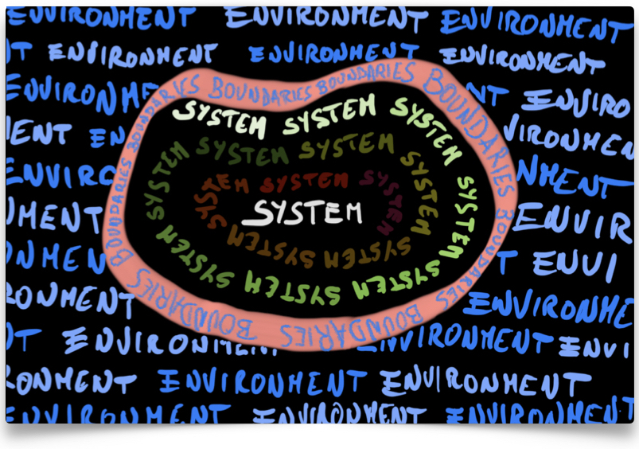

# Preface {.unnumbered}
{fig-alt="Hand-lettered illustration of a thermodynamic system: the word SYSTEM repeated in the center, surrounded by a pink ring labeled BOUNDARIES, with the word ENVIRONMENT repeated all around the outside." width="80%"}

This textbook is the official textbook for the Physical Chemistry 1 Course (CHM 3001) at Florida Institute of Technology.

The instructor for this course and author of this textbook is Dr. Roberto Peverati.

**Contacts**: [rpeverati@fit.edu](mailto:rpeverati@fit.edu), Office: OPS 333, (321) 674-7735

Chemistry Program, Department of Chemistry and Chemical Engineering,
Florida Institute of Technology, Melbourne, FL.

## Author's Note to the August 2024 Edition {.unnumbered}
2024 marks the fifth year of existence for "The Live Textbook of Physical Chemistry." Faithful to my initial intent, the textbook has evolved substantially from its humble beginnings, and it continues to evolve to this day. Five years is a long time in education, and much has happened during this period, including a pandemic that forced everyone to online teaching and learning, and the rise of generative AI in many fields, including education and Academia. I have big plans for the next phase of the book's evolution, but due to time constraints and the ever-increasing demands of academic duties, I had to postpone them for now. As such, the structure of the textbook has largely remained unchanged. If and when I will have time to restructure my entire courses, as well as the textbooks that go with them, I will present a true "Second Edition" of "The Live Textbook," but this is not it yet. 

What I did have time to do, however, was to bring "The Live Textbook" up to the standards of a true academic textbook. Since its inception, I was well aware that there was a glaring omission: exercises. This summer, I finally had the opportunity to add new review sections at the end of every chapter, each containing practice problems and study questions. These new sections are designed to help readers verify their understanding of each chapter's content. More importantly, they are intended for my students to test their knowledge before exams. For this reason, they follow the same style as the questions I have used in my exams over the past five years. In fact, several of these questions and exercises are taken directly from previous exams. I can't promise that the same questions will be in future exams, but familiarizing with them will give a student the edge over students that decide to ignore them.

Finally, I am not pretending to have been unaware of the emergence of AI, generative models, and their impact on education, so I've tried to put them to a good use. In the past five years, I specifically used ChatGPT and Claude to rewrite some sections of this textbook, and I have made it clear when that was the case. These tools were especially valuable this summer for the new exercises and questions sections, where I abundantly used them to help supplement my existing materials with newly generated ones. I made sure the AI didn't hallucinate and to fix it when it did, so hopefully, everything is consistent. I must confess that I would not have met the deadline for the beginning of the semester without this new technology. Hopefully, this serves as a good example of how AI can be incorporated into the classroom. 

Additionally, in the summer of 2026, I have reworked all of the pictures in the textbook to add alt-text descriptions. This is important for accessibility and it is (hopefully) compliant with the new Government directives on online accessibility for education. 

As usual, if you spot any mistakes, I encourage you to reach out to me at the contacts listed above.

## How to Use This Book {.unnumbered}
If you are a student in my course, please read this book carefully, since everything that will be in your exams is explained here! Since this book is specifically tailored for the CHM 3001 course at Florida Tech, there are no superfluous parts. In other words, everything in it might be subject to question in the quizzes and the final exam.

> Definitions and worked examples are numbered (e.g., Definition 1.1, Example 4.1) and are set apart from the rest of the text in boxes, blue for definitions and green for examples. Notes are highlighted in this format (indented, and following a grey vertical bar). Please study the definitions carefully since they are fundamental concepts that will be used several times in the remainder of the text, and they will be subject to quizzes and exams. Worked examples are essential for cementing the concepts, and you should attempt to solve them first without looking at the solution. Even if you were able to solve an example on your own, always read the solution after, since it might contain additional explanations expanding the main concepts in the text.

Navigating the book should be straightforward. On each page, there is a useful sidebar on the left that gives you an overview of all chapters, with a few important tools at its top. Arrows to move between chapters are at the bottom of each page. If you are old-school and prefer a pdf, you can download a printout by clicking on the corresponding icon at the top of the sidebar. If you are *really* old-school and prefer a printed book, the best solution is to download the pdf and print it yourself. It is a LaTeX book, and I can promise you it will look good on paper. However, I cannot provide physical copies to each student. In the sidebar, you will find a useful search box that is capable of searching the entire book. The most adventurous will find there a link to the raw GitHub source code. Feel free to head to [the GitHub repository of this book](https://github.com/peverati/pchem1) and fork it. 

For my students, each chapter of this book represents one week of work in the classroom and at home. The sidebar on the left will reflect your syllabus, as well as the main structure of the class on Canvas. The book is a live document, which means it will be updated throughout the semester with new material. While you are not required to check it every day, you might want to review each week's chapter before the lecture on Friday.

## A Note on Units {.unnumbered}
In general, we will use SI units or some of their multiples throughout the textbook, lectures, and exercises. For example, temperatures will be measured in kelvin ($\text{K}$), energetic terms will be measured in either joules ($\text{J}$) or kilojoules ($\text{kJ}$), while volumes will be measured in cubic meters, or more often in liters ($\text{L}$), where $1\,\text{L} = 10^{-3}\,\text{m}^3$. An important exception is made for pressures, which will be measured in bars ($\text{bar}$). This exception is not completely unjustified, since bar is still an (unconventional) multiple of the SI unit of pressure, pascal ($\text{Pa}$), where $1\,\text{bar} = 10^5\,\text{Pa}$. This choice is made to retain a reasonable similarity with the unit atmosphere ($\text{atm}$) which is extensively used in several other chemistry textbooks $(1\,\text{atm} = 1.013\,\text{bar})$ and in previous physical chemistry courses. 

We will generally also try to avoid conversion between units, except for some trivial conversion between degrees Celsius (°C) and Kelvin, with the conversion factor being an addition of $273.15\,\text{K}$. Other unconventional conversions might happen in some of the exercises, with the conversion factors always reported within the exercise itself.
Additionally, we will avoid unnecessary conversion between the average atmospheric pressure and bars by setting $P_{\text{atm}} = 1\,\text{bar},$ rather than $P_{\text{atm}} = 1\,\text{atm} = 1.013\, \text{bar},$ an approximation that is mostly inconsequential, at least at the scale of the problems that we treat here.

## A Note on the Use of AI {.unnumbered}
The November 2026 revision of this book was prepared with the help of Claude Code (Anthropic's Claude Opus 5.5), an AI assistant. The book, its structure, its scope, and its approach to teaching thermodynamics and kinetics are my own, developed over several years of teaching this course. In the revision, I used the AI as an assistant: to proofread the text, to rephrase passages, to draft new sections, figures, examples, and review questions following my outline and instructions, and to write the code for the computed figures. Every change was reviewed, corrected or rewritten, and approved by me, and I take full responsibility for the content of the book, including any remaining errors.

> This live open textbook is distributed under the [CC BY-NC-SA 4.0 License](https://creativecommons.org/licenses/by-nc-sa/4.0/) and it was funded by the Florida Tech Open Educational Resources Grant Program: A Collaboration of the Teaching Council, eEducation, and the Evans Library. Third-party images keep their own licenses, as credited in their captions or footnotes. The scripts used to build the book are available under the [MIT License](https://opensource.org/license/mit).

